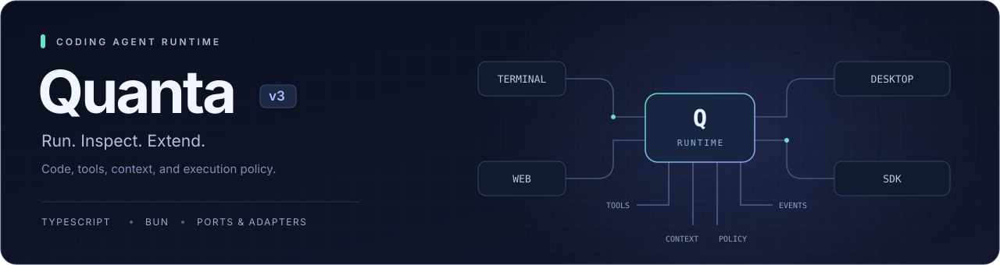

<div align="center">



**실행하고, 내부 동작을 확인하고, 확장할 수 있는 코딩 에이전트 런타임.**

[빠른 시작](#빠른-시작) · [문서 인덱스](docs/README.md) · [아키텍처](docs/ARCHITECTURE.md) · [English](README.md)

</div>

---

Quanta는 모델 호출과 도구 실행을 연결하는 에이전트 루프에 세션 저장, 권한 정책, 컨텍스트 관리, 프로바이더 어댑터를 결합합니다. 터미널에서 실행하거나 웹·데스크톱으로 연결하고, SDK로 다른 애플리케이션에 임베드할 수 있습니다.

## 주요 구성

| 영역 | 구현 범위 |
| :--- | :--- |
| **에이전트 루프** | 스트리밍, 도구 디스패치, 계획, 취소, 실패 복구 |
| **코드 도구** | 파일 작업, 셸 실행, Git 도구, 언어서버 연동 |
| **컨텍스트·메모리** | 컨텍스트 압축, 영속 메모리, 회상, 세션 재개 |
| **실행 정책** | 권한 판단, 사용자 승인, 파일시스템 제한, 샌드박스 어댑터 |
| **확장** | MCP, 커스텀 도구, 스킬, 서브에이전트, 워크플로 |
| **관측·평가** | 구조화 이벤트, trajectory, 재생, 텔레메트리, 벤치마크 도구 |

기능 활성화 여부는 실행 표면, 설정, 설치된 외부 도구에 따라 달라집니다. 기능별 성숙도와 증거는 [기능 카탈로그](docs/10.feature-catalog.md)에서 확인합니다.

## 빠른 시작

CI에 고정된 **Bun 1.3.14**와 Git을 사용합니다. 코드 검색·언어서버·샌드박스 등은 해당 실행 파일과 플랫폼 지원이 추가로 필요할 수 있습니다.

```bash
git clone https://github.com/josongmin/quanta-codeagent-v3.git
cd quanta-codeagent-v3
bun install --frozen-lockfile
cp .env.example .env.dev
```

`.env.dev`에 `ANTHROPIC_API_KEY` 또는 `OPENAI_API_KEY`를 입력합니다.

```bash
# 대화형 세션
bun run start

# 단일 요청
bun run start "src/sdk/index.ts를 읽고 공개 API를 설명해줘."

# 모델 호출 없이 CLI 옵션 확인
bun run start --help

# 프로바이더 선택; 모델은 QUANTA_MODEL로 지정
QUANTA_PROVIDER=openai bun run start
QUANTA_PROVIDER=anthropic bun run start

# 계획 모드
bun run start --plan "세션 저장 모듈의 리팩터링 계획을 작성해줘."

# 식별자가 있는 세션 저장·재개
bun run start --new-session
bun run start --resume <session-id>
```

환경파일은 `.env.dev` → `.env.local` → `.env` 순서로 읽고 먼저 읽은 값을 사용합니다. 실제 프로세스 환경변수가 최우선이며 로컬 환경파일은 Git에서 제외됩니다. 세션에서는 `/help`로 명령과 설정을 확인합니다.

## 실행 표면

| 표면 | 진입점 | 범위 |
| :--- | :--- | :--- |
| **CLI** | `bun run start` | 대화형 REPL·단일 요청. 개발 시 `bun run dev` |
| **웹** | [데몬](src/apps/web-daemon/README.md) + [프런트엔드](apps/web-frontend/README.md) | WebSocket·React UI. 프런트엔드 의존성 별도 설치 |
| **데스크톱** | [Tauri 셸](apps/tauri-shell/README.md) | macOS. 데몬·OCR sidecar를 소스에서 빌드 |
| **SDK** | [공개 API](src/sdk/index.ts) · [사용법](docs/plans/jul-4-sdk-embed-dx/USAGE.md) | 임베딩·도구 주입·이벤트 스트리밍 |
| **VS Code** | [에디터 연동](surfaces/vscode/README.md) | 선택적 빌드. proposed API 버전에 의존 |

## 개발·검증

```bash
bun run build            # CLI → dist/agent
bun run build:sdk        # SDK → dist/sdk/index.js
bun run build:sdk:types  # SDK 타입 선언
bun run typecheck        # 런타임 소스 타입 검사
bun run lint             # Biome·import 경계 검사
bun run verify:smoke     # smoke 검증 tier
bun run gates:list       # 구성된 검증 게이트 목록
bun fc list              # 기능 카탈로그
```

`bun run prepush`는 저장소의 pre-push 검증 캠페인을 실행합니다. 특정 테스트 통과, 전체 제품 검증, 실제 모델 평가, 외부 벤치마크 채점은 각각 다른 증거입니다. Contract·실모델·원격 평가에는 별도 도구체인, 자격증명 또는 인프라가 필요합니다.

## 읽는 순서

1. [문서 인덱스](docs/README.md)에서 목적별 진입점을 선택합니다.
2. [아키텍처](docs/ARCHITECTURE.md)와 [설계 RFC](rfc/0001-architecture.md)로 경계를 확인합니다.
3. [에이전트 루프 운영 참조](docs/runbooks/agent-loop-reference.md)로 실행·복구 흐름을 확인합니다.
4. [테스트 안내](tests/README.md)와 [저장소 규칙](AGENTS.md)을 읽고 변경할 영역의 검증을 선택합니다.
5. 기능 변경 시 [카탈로그 워크플로](tools/feature-catalog/README.md)에 따라 YAML과 생성 문서를 함께 갱신합니다.
