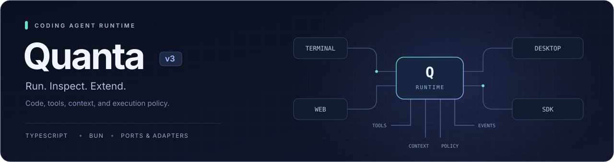
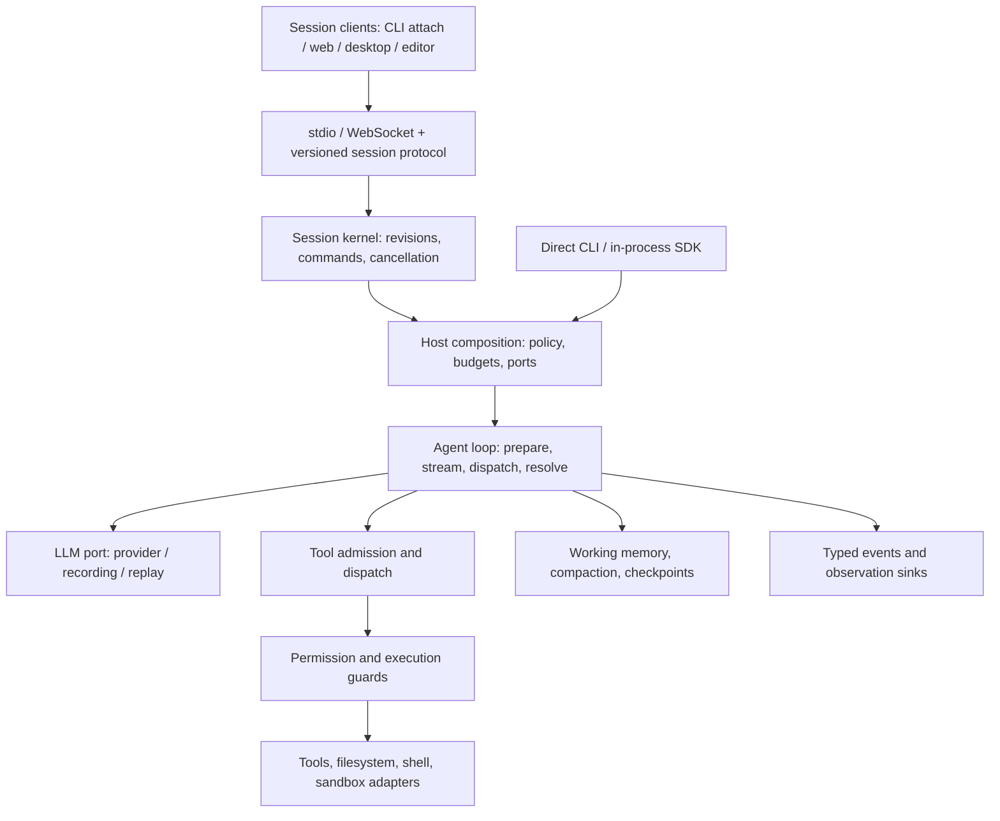

<div align="center">



**A coding agent runtime you can run, inspect, and extend.**

TypeScript · Bun · Ports & adapters · Streaming sessions

[Quick start](#quick-start) · [Engineering highlights](#engineering-highlights) · [Architecture](#architecture) · [Documentation](docs/README.md)

</div>

---

Quanta is a modular coding agent runtime built around streaming execution, explicit session authority, and inspectable state. Its core connects model providers, tools, context, permissions, and event streams through typed ports. Terminal, web, desktop, and SDK entry points compose that runtime for different execution environments.

## Engineering highlights

| Mechanism | What the runtime does |
| :--- | :--- |
| **Streaming execution with ordering barriers** | Starts eligible tools while the model is still streaming. The first ineligible call forms a barrier; deferred calls execute serially, and results retain the model's original call order. |
| **Versioned session control** | Validates command, event, and snapshot envelopes. Session commands carry identities and optional revision preconditions; the session kernel separates state reduction from execution. |
| **Context compaction that preserves live work** | Optional background compaction prepares a summary, then reconciles it against live history before installation. Stale boundaries and invalid tool-result seams are discarded. |
| **Explicit permission and authority boundaries** | Hard-deny checks precede permission-mode decisions. Host-issued goal-continuation capabilities are single-use and bound to an objective identity and revision. |
| **Selective checkpoint recovery** | Restores files, conversation state, or both through separate ports. File restoration binds to a checkpoint SHA; combined restoration reports partial failure explicitly. |
| **Embeddable and replayable execution** | Inject model ports and custom tools through the SDK. Scripted models and strict cassette replay exercise runtime behavior without a live provider. |
| **Verification tied to its inputs** | Verification receipts bind results to source, worktree state, comparison base, dependencies, toolchain, and environment. Architecture checks pair boundary rules with registered test entry points. |

[**Read the runtime architecture →**](docs/architecture/runtime-overview.md) — execution diagrams, concurrency rules, failure semantics, and links to the owning implementation and regression tests.

Feature availability depends on the surface, configuration, and installed tools. The [feature catalog](docs/10.feature-catalog.md) records per-feature evidence and maturity.

## Quick start

Use **Bun 1.3.14**, the version pinned in CI, and Git. Code search, language servers, and sandbox adapters may require additional executables or platform support.

```bash
git clone https://github.com/josongmin/quanta-codeagent-v3.git
cd quanta-codeagent-v3
bun install --frozen-lockfile
cp .env.example .env.dev
```

Set `ANTHROPIC_API_KEY` or `OPENAI_API_KEY` in `.env.dev`, then run:

```bash
# Interactive session
bun run start

# One prompt
bun run start "Read src/sdk/index.ts and explain the public API."

# Inspect options without calling a model
bun run start --help
```

The CLI loads `.env.dev` → `.env.local` → `.env`; the first value wins, and existing environment variables take precedence. Local environment files are ignored by Git.

<details>
<summary><strong>Provider selection, planning, and session resume</strong></summary>

Choose a provider explicitly when multiple credentials are available. Set `QUANTA_MODEL` to a model supported by that provider.

```bash
QUANTA_PROVIDER=openai bun run start
QUANTA_PROVIDER=anthropic bun run start

# Plan before implementation
bun run start --plan "Plan a refactor of the session storage module."

# Persist an identified session, then resume it
bun run start --new-session
bun run start --resume <session-id>
```

Use `/help` inside an interactive session to inspect commands and configuration. Start with [.env.example](.env.example) for environment setup.

</details>

## Choose a surface

| Surface | Entry point | Notes |
| :--- | :--- | :--- |
| **Terminal** | `bun run start` | Interactive REPL or one-shot prompts; `bun run dev` enables hot reload |
| **Web** | [Daemon](src/apps/web-daemon/README.md) + [frontend](apps/web-frontend/README.md) | WebSocket sessions and a React UI; frontend dependencies are installed separately |
| **Desktop** | [Tauri shell](apps/tauri-shell/README.md) | macOS shell with locally built daemon and OCR sidecars |
| **SDK** | [Public API](src/sdk/index.ts) · [usage](docs/plans/jul-4-sdk-embed-dx/USAGE.md) | In-process embedding, custom tools, and streaming events |
| **VS Code** | [Editor surface](surfaces/vscode/README.md) | Opt-in integration using a version-dependent proposed API |

Build from source:

```bash
bun run build            # Standalone CLI → dist/agent
bun run build:sdk        # SDK runtime → dist/sdk/index.js
bun run build:sdk:types  # SDK declarations
```

## Architecture

The architecture separates **session control**, **runtime composition**, and **agent execution**. Session-based clients enter through a versioned protocol and kernel. Direct CLI runs and in-process SDK consumers can compose the agent without taking the transport path.



- **State and effects have different owners.** The session reducer computes state transitions; the scheduler coordinates host actions and turn execution.
- **Concurrency is an explicit tool contract.** Eligibility comes from tool metadata and injected predicates. An ordinary mutating tool cannot become speculative merely because its call finished streaming.
- **Failure remains observable.** Protocol errors, revision conflicts, denied actions, discarded summaries, replay misses, and partial restores retain distinct outcomes.
- **Dependencies are checked.** Composition lives in host/runner layers; library slices have AST-scanned import restrictions and a configuration-to-test parity check.

See the [detailed runtime architecture](docs/architecture/runtime-overview.md) for the control path, scheduling example, tradeoffs, and evidence map.

| Path | Responsibility |
| :--- | :--- |
| [`src/agent/`](src/agent/) | Agent loop, orchestration, context, and recovery |
| [`src/host/`](src/host/) · [`src/runner/`](src/runner/) | Runtime assembly and execution entry points |
| [`src/llm/`](src/llm/) · [`src/tool/`](src/tool/) | Provider adapters and tool system |
| [`src/permission/`](src/permission/) · [`src/runtime/`](src/runtime/) | Policy and execution boundaries |
| [`src/session/`](src/session/) · [`src/memory/`](src/memory/) | Session storage and persistent memory |
| [`src/sdk/`](src/sdk/) · [`src/protocol/`](src/protocol/) | Embedding API and session protocol |
| [`apps/`](apps/) · [`surfaces/`](surfaces/) | Web, desktop, and editor interfaces |
| [`tests/`](tests/) · [`tools/`](tools/) | Verification, development tools, and evaluation |

Read the [architecture guide](docs/ARCHITECTURE.md), [design RFC](rfc/0001-architecture.md), and [agent-loop reference](docs/runbooks/agent-loop-reference.md) for the contracts behind this map.

## Exercise the core without a live model

The public SDK accepts a scripted `LLMPort`, so an application can drive the real agent loop without configuring provider credentials. Run this with Bun from the repository root:

```ts
import { createAnalysisAgent, fakeLlm } from "./src/sdk"

const agent = createAnalysisAgent({
  cwd: process.cwd(),
  model: "scripted",
  llm: fakeLlm([{ text: "Ready." }]),
  profile: "read-only",
  includeDefaultTools: false,
})

const outcome = await agent.run("Say Ready.")
console.log(outcome.reason, outcome.turns)
```

Replace `llm` with your provider implementation, inject tools with `defineTool`, or consume the run as an async event iterable. See the [SDK API](src/sdk/index.ts) and [embed guide](docs/plans/jul-4-sdk-embed-dx/USAGE.md).

## Development & evidence

```bash
bun run typecheck         # Type-check runtime source
bun run lint              # Biome and import-boundary checks
bun run verify:smoke      # Smoke verification tier
bun run gates:list       # Inspect configured verification gates
bun fc list              # Browse the feature catalog
```

For a focused regression, run the owning test directly:

```bash
bun test tests/unit/_arch/repo-index-hygiene.test.ts
```

`bun run prepush` runs the configured pre-push verification campaign. Contract tests, live model evaluations, and remote benchmarks have additional toolchain, credential, or infrastructure requirements. A focused test does not establish a full-suite or benchmark verdict.

Benchmark tooling includes SWE-bench and a [Terminal-Bench adapter](adapters/terminal-bench/README.md). Start with the [SWE-bench smoke guide](tests/smoke/swebench/README.md) and [evaluation runbook](docs/swebench-ec2-runbook.md). Historical measurements have their own datasets, model settings, and execution conditions; this README does not claim a current leaderboard score.

## Explore the repository

| I want to… | Start here |
| :--- | :--- |
| **Find the right document** | [Documentation index](docs/README.md) |
| **Understand a design decision** | [Architecture decision records](docs/decisions/README.md) |
| **Add or extend a tool** | [Tool authoring](docs/tool-authoring.md) |
| **Embed the agent** | [SDK usage](docs/plans/jul-4-sdk-embed-dx/USAGE.md) |
| **Debug a session** | [Agent-loop operational reference](docs/runbooks/agent-loop-reference.md) |
| **Contribute a change** | [Repository rules](AGENTS.md) · [Test guide](tests/README.md) · [Catalog workflow](tools/feature-catalog/README.md) |

<div align="center">

<sub>Quanta CodeAgent v3 · <a href="docs/README.md">Documentation</a></sub>

</div>
