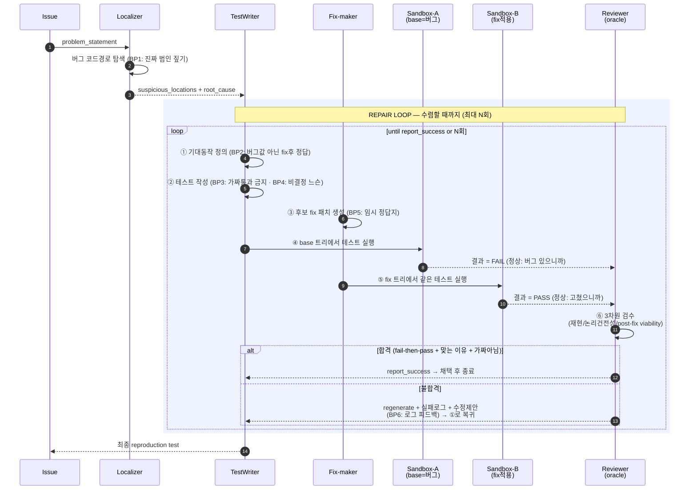
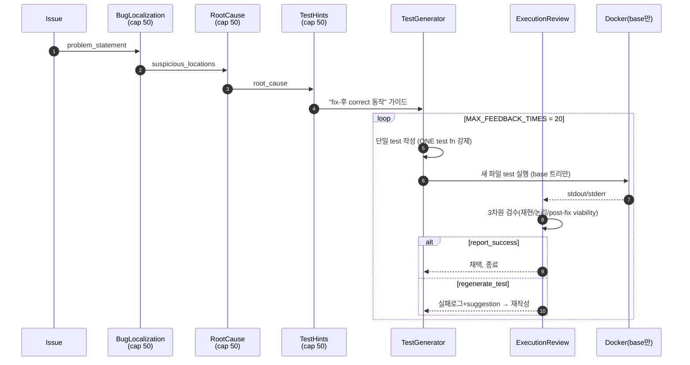
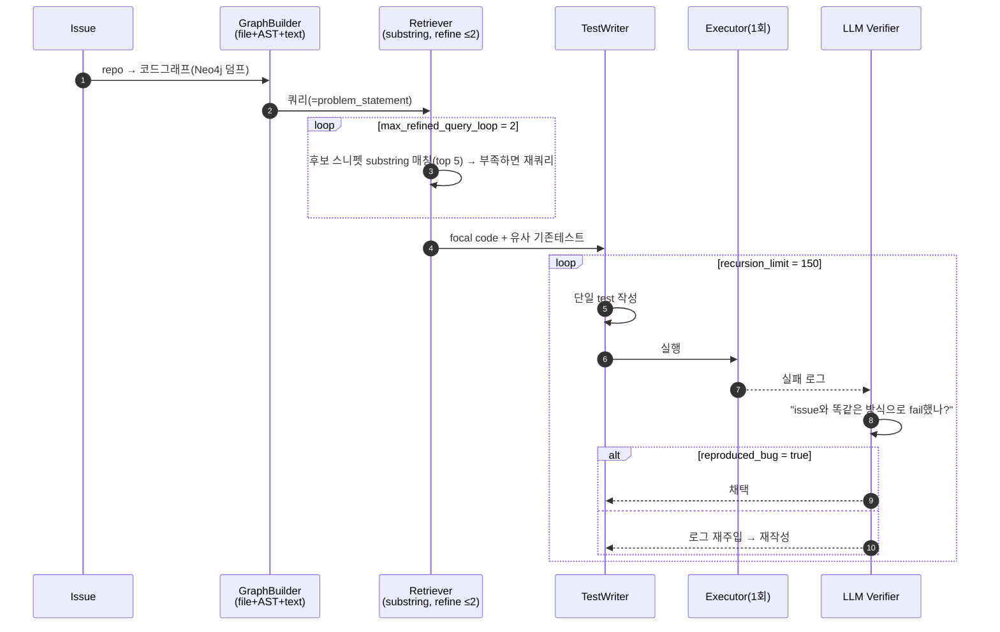
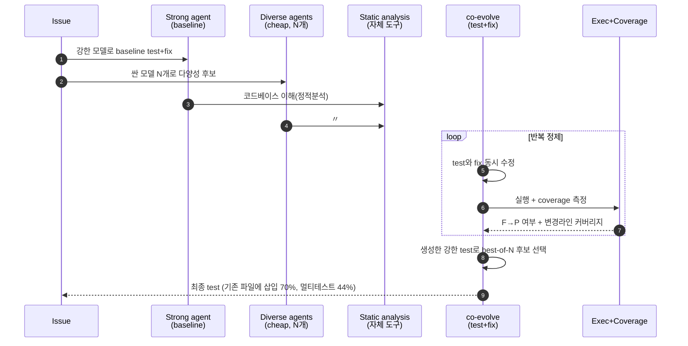
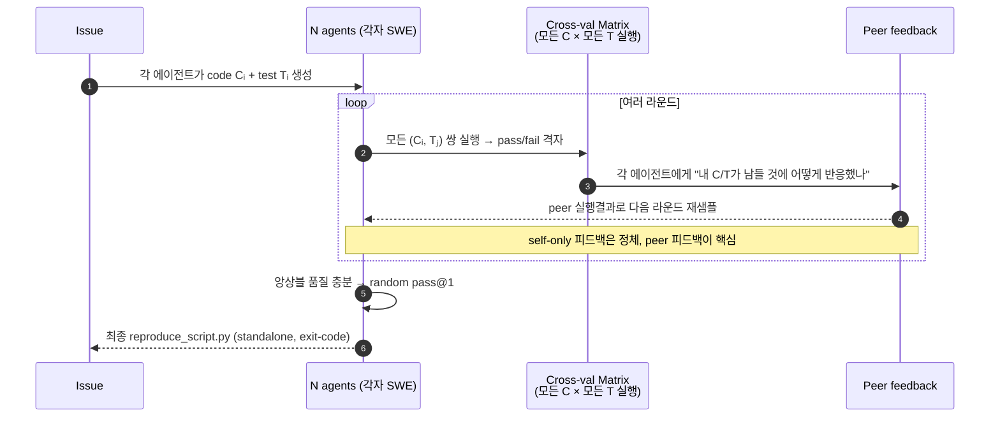

# Repro 생성 Loop — 베스트 프랙티스 + 시퀀스 다이어그램

> 분석일: 2026-07-01. 출처: SWT-bench 상위 스캐폴드 4종(ReProAgent/Echo/L\*Agent/TEX-T)의
> 실제 코드·프롬프트·실물 predictions + 3-라운드 적대 어딧.
> 이 문서는 "issue 하나가 들어와서 reproduction test 하나가 나오기까지" loop의 **어느 시점에
> 무엇이 일어나고, 각 시점의 베스트 프랙티스가 무엇인지**를 구체적으로 박아둔 실전 레퍼런스다.
>
> 증거 태그: `[code]`=실제 스캐폴드 코드에 존재(file:line), `[paper]`=논문 주장(공개코드엔 없음),
> `[audit]`=3R 적대 어딧의 per-instance resolved 데이터로 검증.

---

## 0. 풀어야 하는 핵심 문제

reproduction test를 만들 때 **정답 코드(gold fix)가 아직 없다.** 이슈가 존재한다는 건 코드가
틀렸다는 뜻이니까. 그래서 "내가 만든 테스트가 좋은 테스트인가"를 채점할 오라클이 없다.

**공통 원리는 하나 — fail-to-pass oracle을 generation-time에 *근사*한다.** 단 **구현은 두
갈래로 갈린다** (코드 기준 확정):

- **(A) base-fail + LLM verifier loop** — fix를 **안 만든다.** 테스트를 현재(버그) 트리에서만
  실행하고, LLM reviewer가 "이게 issue대로 *맞는 이유로* fail했나"를 판정한다. fixed 트리에서
  실제로 pass하는지는 **LLM의 상상으로** 판정. → **ReProAgent** `[code]`, **Prometheus 공개
  repro path** `[code]`.
- **(B) candidate/cross-candidate patch oracle** — fix를 **만들어** surrogate 정답지로 쓰고,
  "버그 트리 fail / fix 트리 pass"를 실제 실행으로 검증. → **Echo paper** `[paper]`, **L\*Agent**
  `[blog]`, **TEX-T**(여러 후보의 patch×test 격자) `[blog]`.

> ⚠️ 즉 "상위권은 전부 fix를 같이 만들어 2-tree 검증한다"는 **과한 일반화**다. 공개 코드 기준
> ReProAgent/Prometheus repro path는 (A) base-only verifier loop이고, fix-as-oracle은 Echo
> paper/TEX-T/L\*Agent 계열(B)이다. §2~4의 통합 loop은 (A)+(B)의 좋은 점을 합성한 *이상형*이지,
> 어느 한 공개 코드에 통째로 구현돼 있는 게 아니다.

---

## 1. 등장 요소 (actors)

| actor | 역할 |
|---|---|
| **Issue** | 자연어 버그 설명 (problem_statement) |
| **Localizer** | 버그가 사는 파일/함수/심볼을 찾음 |
| **TestWriter** | reproduction test 코드를 작성 |
| **Fix-maker** | 후보 fix 패치를 같이 생성 (임시 정답지) |
| **Sandbox-A (base)** | 현재=버그 코드 트리. 여기선 테스트가 **FAIL**해야 정상 |
| **Sandbox-B (fixed)** | 후보 fix 적용 트리. 여기선 테스트가 **PASS**해야 정상 |
| **Reviewer (oracle)** | "맞는 이유로 fail했나 / fix 후 진짜 pass하나 / 가짜 아닌가" 판정 |

---

## 2. 시퀀스 다이어그램 (mermaid) — 통합 *이상형* (A+B 합성)

> 주의: 아래는 §0의 (A)·(B)를 합성한 *이상형*이다. **③(fix 생성)·⑤(fix 트리 실행)은 (B)계열
> 스캐폴드만 실제로 한다.** ReProAgent/Prometheus 공개 repro path(A계열)는 ③⑤ 없이 ④(base
> 실행)+⑥(LLM verifier)만 돈다. 각 스캐폴드의 *실제* 흐름은 §7.



---

## 3. 시퀀스 다이어그램 (ASCII, 렌더 불가 환경용)

```
Issue
  │ problem_statement
  ▼
Localizer ── 버그 코드경로 탐색 [BP1] ──> suspicious_locations + root_cause
  │
  ▼
┌──────────────── REPAIR LOOP (최대 N회, 수렴까지) ─────────────────┐
│                                                                  │
│  ① 기대동작 정의   [BP2] "fix되면 -2여야 한다" (버그값 2 아님)     │
│  ② 테스트 작성     [BP3] 진짜함수 호출·정답 단언 (가짜통과 금지)   │
│                    [BP4] 비결정 축은 느슨하게                      │
│  ③ 후보 fix 작성   [BP5] 임시 정답지로 사용                        │
│        │                                                         │
│        ├─④ base(버그) 트리 실행 ───────> 결과: FAIL 이어야 정상   │
│        │      └ 여기서 PASS면 = 버그 못건드림 → 폐기              │
│        │                                                         │
│        └─⑤ fix 적용 트리 실행 ────────> 결과: PASS 이어야 정상    │
│               └ 여기서 FAIL이면 = 테스트가 과함/틀림 → 재작성     │
│        │                                                         │
│        ▼                                                         │
│  ⑥ Reviewer 검수:                                                │
│     - 맞는 이유로 fail했나? (엉뚱한 ImportError 아님)             │
│     - fix 후 진짜 pass했나?                                       │
│     - post-fix viability: 고쳐도 영영 못 통과하는 구조 아닌가?    │
│     - vacuous/mock 가짜 아닌가?                                   │
│        │                                                         │
│    ┌───┴────┐                                                    │
│  합격?     불합격 → 실패로그+수정제안 [BP6] ──┐                   │
│    │                        (① 로 복귀) ──────┘                   │
└────┼─────────────────────────────────────────────────────────────┘
     ▼
  최종 reproduction test 채택 ⛳
```

---

## 4. 단계별 상세 — 어느 시점에 무엇이, 왜

### 0단계: Localize (루프 진입 전, 1회)
이슈를 읽고 버그가 사는 함수/파일/심볼을 찾는다.
- **[BP1] 진짜 범인 코드경로를 짚어라.** 엉뚱한 모듈을 테스트하면 gold 변경점을 영영 안
  건드려서 무조건 실패한다. `[audit]` 생성 테스트가 gold 코드경로를 import/실행하면 resolved
  **+15pp(within-repo)**, +20pp(pooled). 디렉토리 위치는 cosmetic, **import/symbol targeting이
  load-bearing.**
- `[code]` ReProAgent: `src/bug_localization_agent.py` (cap `MAX_BUG_LOCALIZATION_COUNT=50`),
  `src/root_cause_analysis_agent.py`.

### 루프 ①: 기대 동작 정의
"버그가 고쳐지면 결과가 무엇이어야 하는가"를 먼저 못 박는다 — **지금 나오는 버그 값이 아니라.**
- **[BP2] 버그 동작이 아니라 fix-후 정답을 기준으로 잡아라.** 이 순서가 fail-to-pass의 전제다.
- `[code]` ReProAgent `TEST_GENERATION_HINTS_PROMPT` (`src/prompt_template.py:122`):
  *"describe what the correct behavior should be AFTER the fix, not what the buggy behavior
  currently is ... what assertion will FAIL on buggy code but PASS on fixed code."*

### 루프 ②: 테스트 작성
정답을 진짜 코드경로에서 단언하는 테스트를 쓴다.
```python
def test_subtract_negative():
    assert subtract(3, 5) == -2     # fix-후 정답을 진짜 함수로 단언
```
- **[BP3] 가짜 통과 금지.** `assert True`/`assert subtract(3,5) != 2`(약함)/`or`-chain(None이라
  항상 truthy)/`skipTest` 남발/mock·monkeypatch로 진짜 함수 우회 — 전부 금지. `[audit]` e-Otter++
  unresolved의 다수가 vacuous-or·skip-vacuous·weak-substring 단언. `[audit]` AssertFlip은 mock
  남용 45건 → 그 중 33%만 resolve(비-mock 62% 대비 급락).
- **[BP4] 비결정 축은 느슨하게.** DB backend·dict 순서·경고 문구 같은 흔들리는 축은
  `skipUnlessDBFeature`·subset 매칭·불변식으로. 과하게 exact 박으면 멀쩡한데도 brittle fail.
  `[code]` L\*Agent predictions가 `@skipUnlessDBFeature` 19건으로 backend noise 회피.
- `[code]` ReProAgent `TEST_GENERATOR_PROMPT` (`src/prompt_template.py:160`):
  *"must FAIL before the bug is fixed and PASS after ... assertion must verify what the code
  SHOULD produce (correct behavior), not what it currently produces."*

### 루프 ③: 후보 fix 패치 생성 (정답지가 없으니 직접 만든다)
- **[BP5] fix를 같이 만들어 임시 정답지로 쓴다.** 이게 골드 fix 없이 테스트를 검증하는 핵심.
- `[paper]` Echo: 자체 candidate patch 생성 후 dual-version check(원본 fail / 자기 patch pass).
  `[paper]` L\*Agent: test+fix co-evolve, 생성 test로 best-of-N. `[paper]` TEX-T: N개 후보의
  모든 fix×모든 test cross-validation 격자 실행.
  (주의: Echo 공개코드(Prometheus)엔 이 단계가 없음 — 논문 주장. ReProAgent 메인 파이프라인도
  fix를 안 만들고 골드 기준 사후채점 — 즉 ③은 **상위 설계의 베스트 프랙티스이지 모든 공개코드에
  구현된 건 아님**.)

### 루프 ④⑤: 2-tree 실행 (fail-then-pass를 직접 증명)
- **④ base(버그) 트리에서 실행 → FAIL이어야 정상.** 여기서 PASS면 테스트가 버그를 못 건드린
  것 → 폐기.
- **⑤ fix 적용 트리에서 실행 → PASS여야 정상.** 여기서 FAIL이면 테스트가 과하거나 틀린 것 →
  재작성.
- ④+⑤ 합쳐 **"버그 땐 실패 / 고치면 통과"(fail-to-pass)를 실행으로 증명**한다. 이게 reproduction
  test의 정의 그 자체(SWT-bench `get_resolution_success`도 base 대비 추가 F→P + 0 regression).
- `[code]` ReProAgent: Docker 격리 실행 `src/docker_container_manager.py`,
  `src/environment_service.py`(`execute_test_via_harness`).
- ⚠️ **이 단계는 docker는 불필요해도 execution은 필수** — base 트리 + fix 트리 둘 다 테스트를
  실제로 돌려야 한다(instance당 2회 이상). `[audit]` "stdout 한 줄로 채점"은 과소평가.

### 루프 ⑥: Reviewer 검수 (surrogate oracle)
실행 결과 + 테스트를 보고 판정한다. 3차원:
1. **Bug Reproduction** — 맞는 *이유*로 fail했나 (root cause와 일치, 엉뚱한 ImportError 아님)
2. **Test Logic Soundness** — 단언이 correct(post-fix) 동작을 검증하나, 가짜 패턴 아닌가
3. **POST-FIX VIABILITY** — "이 테스트가 고쳐도 영영 통과 못 하는 구조 아닌가?"(예: lambda
   직렬화 같은 언어 차원 제약)
- 합격(report_success)은 **버그 재현 AND post-fix viable 둘 다**일 때만. 하나라도 걸리면
  `regenerate_test`.
- `[code]` ReProAgent `EXECUTION_REVIEW_PROMPT` (`src/prompt_template.py:206-258`),
  `src/execution_review_agent.py` (verdict: `issue_reproduced_successfully`/`confidence_score`/
  `recommended_action`/`suggestion`).

### 분기 & 반복
- **합격** → 테스트 채택, 루프 종료.
- **불합격** → **[BP6] 버리지 말고 실패 로그를 피드백으로 넣어 ①로 복귀**, 재작성.
  `[code]` ReProAgent `MAX_FEEDBACK_TIMES=20` (`src/config.py`). `[audit]` Echo refinement
  on/off ablation = **+7.16pt**(실행 피드백 루프의 단독 기여).

---

## 5. 베스트 프랙티스 체크리스트 (요약)

| # | 베스트 프랙티스 | 어느 시점 | 근거 |
|---|---|---|---|
| BP1 | 진짜 버그 코드경로를 짚어라 (import/symbol이 gold 변경점 향하게) | 0. localize | `[audit]` +15pp |
| BP2 | 버그 값 아닌 **fix-후 정답**을 기준으로 단언 | ① 기대정의 | `[code]` hints prompt |
| BP3 | 가짜 통과 금지 (vacuous-or/skip/mock/약한 단언) | ② 작성 | `[audit]` mock 33%만 resolve |
| BP4 | 비결정 축은 느슨하게 (skip-guard/subset/불변식) | ② 작성 | `[code]` L\*Agent skip 19건 |
| BP5 | **fix를 같이 만들어 임시 정답지로** | ③ fix생성 | `[paper]` 상위 4종 공통 |
| BP6 | 안 되면 버리지 말고 실패 로그로 repair | ⑥→① 분기 | `[audit]` +7.16pt |
| — | base/fix **2-tree에서 fail-then-pass를 실행 증명** | ④⑤ | reproduction의 정의 |

---

## 6. 우리 파이프라인 매핑 (이미 있는 것 vs 미완)

- **이미 main 랜딩(default-OFF·효과 미측정):** surrogate-oracle 루프(⑥) = jun-28-oracle-first /
  reprovote-to-acceptance, repro-gen grounding(②의 입력) = jun-29-repro-gen-grounding.
- **genuinely 미완:** ④⑤ 2-tree 실행을 우리 grading에 태우는 **측정 레일**(base+gold 두 트리
  재실행, `execute.ts` 확장), 그리고 (C) localization-targeting의 **출력측**(change-coverage
  selection gate + reject seam).
- **하지 말 것(어딧 NULL):** existing-file insertion 강제, multi-test 강제, 단언 무조건 강화 —
  통계적으로 점수와 인과 없음(상세 [`audit/round3-synthesis.md`](audit/round3-synthesis.md)).

## 7. 경쟁사별 실제 흐름 (각각)

§2~4는 4종을 통합한 *이상적* loop이다. 실제로는 스캐폴드마다 흐름이 다르다 — 특히 **fix를
만드는가 / 언제 실행하는가 / 후보가 1개인가 N개인가**에서 갈린다. 아래는 각각의 실제 흐름.

### 7-1. ReProAgent (난징대) — 멀티에이전트 선형 + 단일후보 repair loop `[code]`

골드 fix를 **안 만들고**, 단일 테스트를 execution-review로 다듬는다. (메인 파이프라인은
사후에 골드로 채점 — §3-③의 self-fix는 ReProAgent엔 없음.)


- 핵심 차이: **fix 미생성·base 트리만 실행·single-test.** post-fix viability를 LLM이 *상상으로*
  판정(실제 fix 트리 실행 없이). 100% 새파일. `[code]` `planner.py:236-252`,
  `generator.py:522-568`, `prompt_template.py:105-258`, `config.py`.
- 천장(70%) 원인 `[audit]`: single-test 커버리지 + fixture 자가재구성 취약 + degenerate shim.

### 7-2. Echo (실체=Prometheus) — graph retrieval + LLM verifier loop `[code]` / `[paper]`


- 핵심 차이: graph는 **substring 인덱스**(semantic 아님), single-test pass@1. **repro 생성
  loop은 base-fail + verifier만** — `bug_reproduction_subgraph.py`가 context retrieval → write
  patch → file edit → git diff(`bug_reproducing_patch`=새 test 파일) → execute(base) →
  structured verifier("issue대로 fail했나") → 실패시 reset/retry. **candidate-fix/dual-tree
  없음** `[code, my clone]`.
- `[code]` `app/lang_graph/subgraphs/bug_reproduction_subgraph.py:31-108`,
  `app/tools/graph_traversal.py:272`, `app/lang_graph/nodes/bug_reproducing_structured_node.py:37`.

**별개 단계 — fix verification (repro 생성 loop *밖*):** 더 완전한 Prometheus 배포본에는
reproduction 생성과 **별도로** fix 검증 흐름이 있다 — `bug_fix_verification_subgraph`가
`edit_patch`(생성된 fix) + `reproduced_bug_patch`(생성된 test)를 **같이 적용**해 fix가 test를
통과하는지 확인. 단 이건 §0-(B)식 "repro 생성 loop 내부의 oracle"이 아니라 **issue-resolution
쪽의 사후 검증**이다. 둘은 분리해서 봐야 한다:
- Prometheus **repro generation**: base에서 test가 issue대로 fail하나 `[code, my clone]`
- Prometheus **fix verification**: `edit_patch` + `reproduced_bug_patch` 같이 적용해 pass 확인 `[code, fuller dist]`
- `[paper]` Echo 논문 자체는 candidate patch + dual-version validation을 repro 검증에 쓴다고
  주장 → **paper-level Echo는 (B)계열**이나, 공개 Prometheus repro path는 (A)계열.
- ⚠️ 출처 주의: 내가 clone한 EuniAI/Echo `app/`엔 `bug_reproduction`+`context_retrieval`
  subgraph만 있고 fix-verification subgraph는 **없음**(부분집합). fix-verification은 더 완전한
  배포본 기준.

### 7-3. L\*Agent (LogicStar, 84% #1) — test+fix co-evolve + best-of-N `[blog]` / `[reverse-engineered]`

비공개. blog + 실물 predictions 역추론. **fix와 test를 같이 진화시키고, 자기가 만든 강한
test로 여러 후보 patch 중 best를 고른다.**


- 핵심 차이: **coverage를 정제 신호로** 사용(단순 pass/fail 아님), **best-of-N을 자기 test로
  선택**, existing-file insertion. `[blog]` reproduce-before-fix gate 60.5→88.5%.
- ⚠️ insertion/multi-test는 `[audit]`에서 점수와 인과 NULL(within-system p=1.0) — L\*Agent가
  하는 *습관*이지 84%의 *원인*은 아님. 원인은 model+scaffold(우리가 못 봄, 비공개).

### 7-4. TEX-T (Salesforce, 87% script-mode) — cross-validation 격자 `[blog]` / `[reverse-engineered]`

비공개. **N개 에이전트가 각자 code+test를 만들고, 모든 fix × 모든 test를 실행한 격자로 서로
채점한다.** standalone `reproduce_script.py`(exit-code).


- 핵심 차이: **단일 후보가 아니라 N개 cross-validation**, selector는 random(앙상블이 좋으면
  selector 불필요), standalone script(suite 통합 회피).
- ⚠️ 87%는 script-mode(exit-code 채점)라 다른 모드와 직접 비교 불가. `[audit]` monkey-patch로
  실제 코드 우회한 strawman SOLVED 사례 존재 → script-mode는 게임성 있음(채점 추격 비권장).

### 한눈 비교

| | fix 생성? | 실행 | 후보 수 | 출력 | 정제 신호 |
|---|---|---|---|---|---|
| **ReProAgent** | ✗ | base만 | 1 | 새파일 single | LLM verdict |
| **Echo** | ✗(코드) / ✓(논문) | 1회 | 1 | 새파일 single | LLM issue-match |
| **L\*Agent** | ✓ co-evolve | exec+coverage | N(best-of) | 기존파일 insert | coverage |
| **TEX-T** | ✓ (각 agent) | 격자(C×T) | N(cross-val) | standalone script | peer 격자 |

> "fix 생성?" 열은 **repro 생성 loop 기준**. Echo ✓(논문)은 paper 주장이고 공개 Prometheus
> repro path는 ✗(base-only) — fix-as-oracle(`edit_patch`+`reproduced_bug_patch`)은 repro
> loop 밖의 별도 fix-verification 단계다. ReProAgent ✗ = `GeneratorState`에 candidate-fix
> 필드 자체가 없음(`generator.py:27-47`). L\*Agent/TEX-T는 `[blog]`+predictions 역추론(코드 미공개).

> §2~4 이상형은 **L\*Agent/TEX-T의 fix-as-oracle**(③⑤) + **ReProAgent의 명시적
> post-fix-viability 검수**(⑥) + **Echo의 fail-log 재주입**(⑥→①)을 합친 것이다. 공개코드 한
> 곳에 다 들어있진 않다.

---

> 한 줄(코드 기준 정정): **공통 원리는 fail-to-pass oracle을 generation-time에 *근사*하는 것
> 하나다. 구현은 둘로 갈린다 — (A) base에서 issue대로 fail하나만 LLM verifier로 보는 루프
> (ReProAgent·Prometheus 공개 repro), (B) fix를 같이 만들어 버그→FAIL/fix→PASS를 실행 검증
> (Echo paper·L\*Agent·TEX-T). 공통으로: 테스트는 fix-후 정답을 진짜 코드경로에서 단언하고,
> 안 되면 실패 로그로 고친다. "모두가 self-fix dual-tree를 한다"는 건 아니다.**
