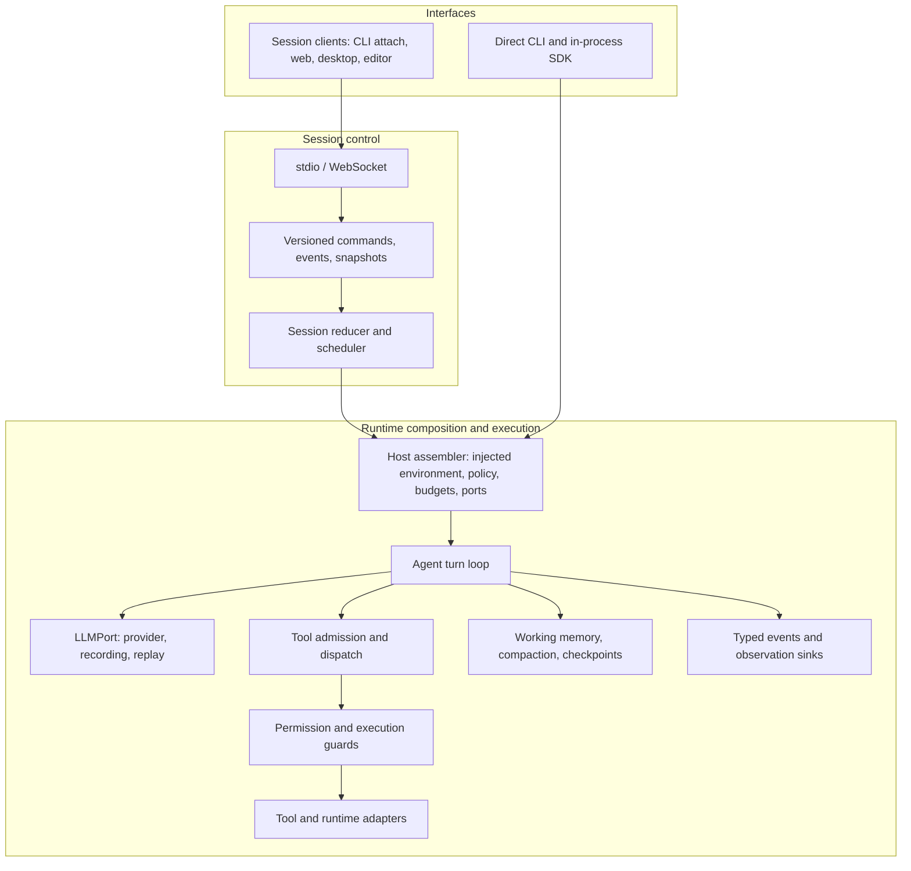
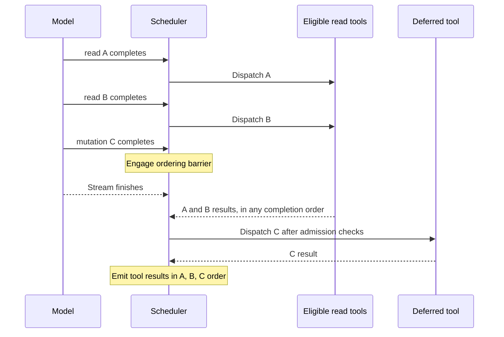

# Runtime architecture

[Project overview](../../README.md) · [Documentation index](../README.md) · [Full architecture reference](../ARCHITECTURE.md)

Quanta separates session control, runtime composition, and agent execution. This guide explains the mechanisms behind the public overview and maps each claim to implementation and regression coverage. Optional mechanisms remain dependent on host wiring and configuration.

## 1. Control plane and execution plane



The distinction matters: in-process embedding uses the real agent loop without requiring a WebSocket server. Session-based clients add command identity, revision checks, event projection, and control operations around that execution.

| Owner | Responsibility | Implementation |
| :--- | :--- | :--- |
| Protocol | Validate the version, envelope kind, and command/event/snapshot payload shape | [Session codec](../../src/protocol/session/codec.ts) |
| Session reducer | Compute state transitions and declare host actions | [Reducer](../../src/kernel/session/reducer.ts) |
| Session scheduler | Serialize command execution, coordinate host projections, and route turn control | [Scheduler](../../src/kernel/session/scheduler.ts) |
| Host | Assemble policy, budget controls, and adapters from injected inputs | [Host assembler](../../src/host/runtime/agent-config-assembler.ts) |
| Agent loop | Prepare turns, consume model streams, dispatch tools, and resolve continuation or termination | [Turn loop](../../src/agent/loop/turn-loop.ts) · [Outcome resolver](../../src/agent/loop/turn-outcome.ts) |

The scheduler gives `turn.cancel` a path outside the ordinary single-writer turn lease, allowing cancellation to reach a running turn while that turn owns the lease. This is an in-process execution contract, not a claim of distributed consensus or exactly-once remote effects.

## 2. Streaming tool execution with explicit barriers

A completed tool-call block can be scheduled before the rest of the model response arrives. Early execution requires the concurrency predicate and an early-dispatch safety predicate: normally a read-only tool, or an explicitly isolated operation such as a child-agent path.

The first ineligible call engages a head-of-line barrier. That call and every later call wait for stream completion and execute serially in model-call order. Completed results are assembled in the original call order, regardless of completion order.



This overlaps eligible work with model generation without treating all tools as parallel-safe. The barrier intentionally gives up later read parallelism to preserve effect ordering. Cancellation, refusal, and provider stream reset have their own handling; early-dispatch metadata is part of the tool's correctness contract.

Implementation: [streaming scheduler](../../src/agent/streaming-dispatch.ts). Regressions: [ordering and barriers](../../tests/unit/streaming-dispatch-hellgate.test.ts), [abort and abandonment](../../tests/unit/streaming-dispatch-abort-abandon-hellgate.test.ts), [refusal short-circuit](../../tests/unit/streaming-dispatch-refusal-shortcircuit.test.ts).

## 3. Session identity, revisions, and authority

Three distinct mechanisms address different failure modes:

| Mechanism | Contract | Failure addressed |
| :--- | :--- | :--- |
| Versioned envelopes | Decode only supported versions and structurally valid payloads | Invalid or incompatible wire input |
| Command identities and revision preconditions | Transport duplicate handling and kernel revision checks | Repeated delivery and stale state mutations |
| Host-issued continuation capability | Consume a random, single-use capability bound to objective ID/revision, then revalidate the owning authority | Replayed or stale goal-continuation requests |

The continuation registry consumes a capability before calling its validator. A mismatch, stale authority, or throwing validator therefore cannot leave the same capability replayable. This capability applies specifically to host-issued goal continuation; it is not a universal authentication scheme for every tool.

Implementation: [protocol codec](../../src/protocol/session/codec.ts), [kernel reducer](../../src/kernel/session/reducer.ts), [continuation authority](../../src/sdk/runtime/session/turn-submit-authority.ts). Regressions: [codec validation](../../tests/unit/protocol/session-codec.test.ts), [duplicate commands over stdio and WebSocket](../../tests/unit/ipc/transport-duplicate-command.test.ts), [single-use capability and authority drift](../../tests/unit/sdk/turn-submit-authority.test.ts).

## 4. Context compaction without replacing live work with a stale snapshot

Optional background compaction has two phases:

1. **Prepare:** snapshot a transcript prefix and summarize it while the turn continues.
2. **Reconcile and install:** require successful summarization and sufficient headroom, then rebuild the suffix against current working memory.

If the snapshot covered `prefix + suffix`, and live execution appended `new messages`, the installed result must be:

```text
summary(prefix) + live suffix + new messages
```

Installing the frozen summarized payload would drop those later appends. The reconciliation path instead discards stale boundaries, rewritten history, and seams that would orphan a tool result. Failed, aborted, and insufficient summaries retain typed discard outcomes.

This adds asynchronous coordination and summarization work; it is configurable rather than a universal latency guarantee. Memory recall and context compaction also serve different purposes: persistent recall brings prior knowledge into a session, while compaction reduces the active transcript footprint.

Implementation: [background controller](../../src/agent/compaction/background.ts), [live-history installation](../../src/agent/loop/compaction-wire.ts). Regressions: [live suffix preservation and stale-summary rejection](../../src/agent/loop/__tests__/bg-compaction-live-suffix-install.test.ts), [background controller](../../tests/unit/background-compaction-hellgate.test.ts).

## 5. Permission decisions and selective recovery

### Permission policy

Hard-deny checks precede mode-dependent permission decisions. Policy supports explicit allow, deny, and approval paths; automatic classification does not override the hard-deny boundary. Shell-equivalent tools contribute their shell command through the dispatch contract so policy is not limited to one tool name.

Permission policy, filesystem restrictions, and OS/container sandbox adapters are separate layers. Effective isolation depends on the selected adapter, host platform, configuration, and tool implementation. A policy decision alone does not establish containment for arbitrary injected code.

Implementation: [permission policy](../../src/permission/policy.ts), [execution runtime](../../src/runtime/). Regression: [permission hardening](../../tests/unit/permission-hardening.test.ts).

### Checkpoint recovery

Checkpoint restoration offers independent files and conversation-state operations, plus a combined operation. Files use a resolved checkpoint SHA with an expected-SHA guard; conversation restoration uses the checkpoint tag.

Combined restoration attempts files first. If that fails, it does not attempt conversation restoration. If files succeed and conversation restoration fails, the result reports failure with file-change information retained. This is explicit partial failure, not an atomic cross-store transaction.

Implementation: [selective restore](../../src/agent/per-tool-checkpoint/three-way-restore.ts). Regressions: [checkpoint behavior](../../tests/unit/per-tool-checkpoint-hellgate.test.ts), [combined restore partial failure](../../tests/unit/three-way-restore-both-partial-hellgate.test.ts).

## 6. Embedding, event delivery, and replay

The SDK exposes `createAnalysisAgent`, tool factories, event helpers, and scripted model ports. Model and tool injection allow consumers to exercise the real agent loop with controlled dependencies.

An `AgentRun` supports both outcome awaiting and async event iteration. Its event channel is single-consumer and bounded with drop-oldest behavior; `droppedEvents` exposes overflow. Consumers that require every streamed event must account for that delivery policy. Event hooks and the final outcome are separate interfaces from the buffered iterator.

Cassette replay preserves the provider event shape and honors cancellation. The default miss policy throws; live fallback must be selected explicitly and supplied with a fallback port. Fixed model responses support reproducible regression inputs, while filesystem state and external tools still need controlled fixtures.

Implementation: [SDK exports](../../src/sdk/index.ts), [run and event channel](../../src/sdk/run.ts), [scripted model](../../src/sdk/testing.ts), [replay adapter](../../src/llm/replay/replay-llm.ts). Regressions: [real-loop SDK embedding](../../tests/unit/sdk/embed.test.ts), [LLM replay](../../tests/unit/llm-replay-hellgate.test.ts).

## 7. Architecture rules and input-bound verification

Import boundaries are executable policy. Slice configurations declare denied imports and reviewed exceptions; a parity test checks that configurations have live test entry points. These rules constrain dependencies, not every possible runtime behavior.

Verification receipts include source revision, dirty-state digest, comparison base, manifest, dependencies, toolchain, environment, and resolved home capabilities. Drift invalidates receipt reuse; expiry and maximum lifetime are checked separately. Reuse is therefore tied to a specific verification context rather than a generic green status.

| Contract | Owning source | Regression coverage |
| :--- | :--- | :--- |
| Slice import policy | [Boundary configurations](../../tests/unit/_arch/slice-boundary-configs.ts) | [Configuration/test parity](../../tests/unit/slice-boundary-config-parity.test.ts) |
| Verification input identity | [Receipt schema and validation](../../tools/dev/verification-receipt.ts) | [Input drift and expiry](../../tests/unit/dev/verification-receipt.test.ts) |
| Gate selection and execution | [Gate manifest](../../tools/dev/gate-manifest.ts) | Inspect the configured tiers with `bun run gates:list` |

The tests linked here are an evidence map, not a declaration that every suite or deployment has passed. Read executed test results with their source revision and environment; benchmark capability and production acceptance require their own evidence.

## Continue reading

- [Turn lifecycle map](agent-turn-lifecycle-map.md): phase-by-phase code navigation.
- [Full architecture reference](../ARCHITECTURE.md): slice policy and port inventory.
- [Agent-loop operational reference](../runbooks/agent-loop-reference.md): debugging and recovery.
- [Feature catalog](../10.feature-catalog.md): feature maturity, configuration, and evidence.
