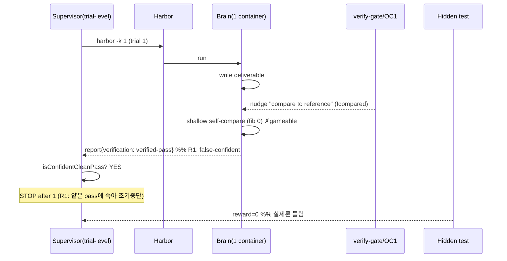

# adaptive best-of-N 설계 — 적대+객관 어딧 → SOTA++ 제안 (근거기반)

## 근거 (실측)
- **박스 A/B (jul-3, k=3, baseline vs verify-gate+OC1):** extract-elf 2→3(+1)·path-tracing 2→1(−1)·headless 3→3·polyglot 0→0·sam 0→0. **NET 0 (7/15 both).**
- **카세트 RCA (default-on):**
  - extract-elf 실패 = **never-ran fake-green** (extract.js 쓰고 "it parses…" 선언, 실행 스텝 0).
  - path-tracing 실패(gate) = **rework false-positive** (30스텝 정제한 image.c를 nudge가 다시 건드림).
  - polyglot 실패 = **shallow self-verify** (`diff cmain 0` = fib(0)만 비교 → verified-pass, 실 테스트는 전체 수열 → 틀림).
  - sam 실패 = **never-ran** (convert_masks.py 쓰고 "no-reference-available" 선언, 스크립트 실행 0).
- **아키텍처:** in-process best-of-N = DEAD (harbor invocation당 컨테이너 1개+duplex 1개 → attempt≥2 hang). 진짜 = **trial-level (harbor -k N, 고정)**.

---

## 적대 어딧 (설계 반증 시도)

**R1 [치명] 게이팅 신호가 gameable — 순환 결함.** adaptive의 트리거 = `isConfidentCleanPass`(verify-gate 스탬프). 근데 카세트가 정확히 이게 못 믿을 걸 증명함: polyglot이 fib(0)만 얕게 비교하고 **verified-pass**(confident) 받음. → adaptive는 polyglot을 "confident pass"로 보고 **1 trial서 STOP** = multi-run 기회 날림. **escalation을 escalation이 필요한 바로 그 신호로 게이팅하는 순환.**

**R2 [높음] trial-level adaptive는 deployment서 hook 없음.** harbor -k N은 atomic(고정). supervisor가 -k 1 순차 N회 돌리며 스탬프 읽는 건 **measurement만** 가능. 리더보드 제출(deployment)은 harbor가 -k N 스스로 돌려 mean 보고 → 우리 escalation 주입점 없음. → deployment 레버는 custom 제출 하네스 or in-process 부활(막힘) 필요.

**R3 [중] "fresh trial이 rework 회피" 부분참.** 각 fresh trial도 gate ON이라 **각 trial이 rework 가능**. path 2/3 baseline → gate-per-trial이 각 trial 1/3로 낮추면 best-of-3 ≈ 1−(2/3)³ ≈ 70%. 도움은 되나 gate가 각 trial 갉아먹음 → best-of-N은 gate rework의 **밴드에이드**. 진짜 fix = nudge를 !exercised에만(per-trial rework 제거).

**R4 [중] 비용모델이 use-case 혼동.** measurement엔 reward-gated(실 pass서 stop)가 최적. deployment엔 reward 못 봐서 gameable 스탬프로 gate → false-confident서 조기중단. "confidence-gated"는 deployment만 해당인데 깨진 신호 위에 섰음.

**R5 [치명·객관 핵심] best-of-N은 variance만 완화, synthesis CORRECTNESS 못 고침.** polyglot/sam = **0/3 both arms** = variance 아니라 **일관된 synthesis 오류**(fib 로직 자체가 틀림, 매번). best-of-N은 2/3→회복(variance)만 도움. **0/3짜리 일관실패는 몇 번 돌려도 0/3.** ← 이게 진짜 병목이고 best-of-N이 절대 못 푸는 것.

---

## 객관 어딧 (살아남는 것)
- adaptive best-of-N = **variance 태스크(path/extract 2/3류)만** 비용효율로 회복. 실재하나 **좁음**.
- 게이팅 신호 gameable → measurement는 reward-gate, deployment는 약한 휴리스틱.
- **진짜 갭 = 일관된 synthesis 오류(polyglot/sam 0/3)** — best-of-N 무효. 이건 오라클-루프나 diversity 필요.

---

## SOTA++ 제안 (경쟁사 검증 기반)

경쟁사 천장(LemonHar 84.5%·vix 89.9%)이 쓰는 것:
1. **self-generated test + reproduction-first (Agentless):** 에이전트가 **스펙에서 자기 수용테스트를 생성**, 제출물을 그것에 대해 실행, **green까지 반복**. shallow self-compare보다 강함(실행가능 + 범위 커버 + iterate).
2. **multi-sample + selection** (vix n=440).
3. **verify-before-submit.**

우리 갭에 맞춘 **구조적 SOTA++ (그리디 아님):**

**S1 — 오라클-루프 (nudge 아니라):** 한 방 "compare to reference" nudge(polyglot이 fib-0로 gaming) 대신, 에이전트가 **task 스펙서 실행가능 self-test 구성**(fib(0..12)=0,1,1,2,3,5…) → 제출물 전체에 대해 실행 → **틀리면 고치고 반복**. shallow-verify 차단(범위 커버) + 일관오류 수렴(iterate). ← polyglot/sam(R5) 공략.
**S2 — escalation에 diversity:** 재시도를 같은 접근 반복 말고 **다른 접근**(temp/lane diversity, jun-25 model-lane 有). 일관 버그가 반복 안 되게. ← R5.
**S3 — adaptive를 오라클-루프 결과로 게이팅** (얕은 스탬프 아니라, R1 해소): self-test 루프가 수렴 못 하면만 escalate.
**S4 — nudge는 !exercised에만** (R3 해소): path-tracing rework 제거, extract-elf만 잡음.

이게 4개 실패모드 다 구조적으로:
| 실패 | 현 설계 | SOTA++ |
|---|---|---|
| never-ran (extract/sam) | nudge(part) | S1 루프가 실행 강제 |
| shallow-verify (polyglot) | ❌ gaming됨 | S1 self-test가 범위 커버 |
| 일관 synthesis (polyglot/sam 0/3) | ❌ best-of-N 무효 | S1 iterate + S2 diversity |
| rework (path-tracing) | ❌ gate가 망침 | S4 !exercised + S1은 에이전트 자기테스트라 오탐無 |

---

## 시퀀스 다이어그램

### 현재 설계 (adaptive best-of-N + confidence-gate) — R1/R5 결함



### SOTA++ (오라클-루프 + diversity + loop-gated adaptive)

```mermaid
sequenceDiagram
    participant Sup as Supervisor(adaptive)
    participant Brain as Brain(fresh/trial)
    participant Loop as Self-test oracle-loop
    participant Grader as Hidden test

    loop trial k = 1..N (S3: 루프 미수렴 시만 escalate)
        Sup->>Brain: run (S2: trial마다 다른 접근/lane)
        Brain->>Brain: write deliverable
        Brain->>Loop: construct self-test FROM SPEC (fib 0..12=…)
        Loop->>Brain: run deliverable vs FULL self-test
        alt self-test fails
            Loop-->>Brain: mismatch @ fib(5) → fix, repeat  %% S1: 범위 커버·수렴
            Brain->>Brain: fix + re-run (iterate)
        else self-test green
            Brain-->>Sup: report{loopConverged: true, ran clean}
            Sup->>Sup: converged? YES → STOP (S3: 진짜 신호로 게이팅)
        end
    end
    Sup->>Grader: submit best (self-test-passing) trial
    Grader-->>Sup: reward=1  %% 범위 커버 self-test라 hidden과 정렬↑
```

핵심 차이: 현재는 **얕은 self-verify 스탬프**로 게이팅(gameable) → false-confident 조기중단. SOTA++는 **범위 커버 self-test 루프의 수렴**으로 게이팅 + iterate로 일관오류 수렴 + diversity로 다른 접근.

---

## 우선순위 (근거기반)
- **S4 (nudge !exercised)** = 즉시, 저위험, path-tracing 회귀 제거. 순수 verify-gate 조건변경 + 테스트.
- **S1 (오라클-루프)** = 최대 ROI(polyglot/sam 0/3 = 진짜 병목 공략), 근데 큰 작업(에이전트가 self-test 생성·iterate하게 오퍼레이터 가이드 + 루프). 경쟁사 검증.
- **S3 (loop-gated adaptive)** = S1 얹은 뒤 adaptive 신호를 루프수렴으로 교체.
- **S2 (diversity)** = jun-25 model-lane 재사용.
- adaptive best-of-N(현 커밋) = variance 태스크엔 유효하니 유지, 단 신호를 S3로 교체 전까진 measurement-only(reward-gate).

**정직한 결론:** 지금 best-of-N/verify-gate는 variance엔 도움이나 **진짜 병목(일관 synthesis 오류)엔 무효**. SOTA++ = **에이전트 자기 self-test 오라클-루프**(경쟁사 Agentless 검증)가 유일하게 그걸 공략. 그리디 nudge 강화 아님.
