# Codex Agent Loop Deep Dive

Overview router: [may-20-codex-agent-loop.md](/Users/songmin/Documents/code-new/semantica-codegraph-v2/docs/analysis/codex-agent/may-20-codex-agent-loop.md)

이 문서는 Codex 계열 에이전트의 실제 loop를 최대한 구체적으로 재구성한다.

중요:
- 이 문서는 제품 내부 비공개 원문 프롬프트를 그대로 공개하지 않는다.
- 대신 현재 세션에서 **직접 관측 가능한 사실**과, 그 사실로부터의 **강한 추론**, 그리고 더 조심해서 봐야 하는 **약한 추론**을 분리한다.

표기 규칙:
- `[FACT]`: 현재 세션에서 직접 관측 가능한 사실
- `[STRONG-INFERENCE]`: 직접 관측 사실들로부터 높은 신뢰도로 재구성한 동작 모델
- `[WEAK-INFERENCE]`: plausible 하지만 직접 증거가 충분하지 않은 해석

---

## 1. What is directly observable vs inferred

| 항목 | 분류 | 근거 |
|------|------|------|
| 현재 세션에는 `web.run`, `exec_command`, `apply_patch`, `spawn_agent`, `multi_tool_use.parallel` 등이 실제로 노출돼 있다 | `[FACT]` | tool definitions가 세션에 직접 제공됨 |
| 현재 세션은 `Default` mode다 | `[FACT]` | collaboration mode가 직접 제공됨 |
| `request_user_input`는 현재 mode에서 사용할 수 없다 | `[FACT]` | mode instructions에 직접 명시 |
| 응답은 한국어, 코드/주석/커밋은 영어 우선 | `[FACT]` | repo AGENTS.md에 직접 명시 |
| 도구 호출은 비싸므로 최소화해야 한다 | `[FACT]` | developer instructions에 직접 명시 |
| 검증은 사용자가 요청하지 않으면 하지 말아야 한다 | `[FACT]` | developer instructions에 직접 명시 |
| LLM이 도구 사용 여부와 순서를 판단한다 | `[STRONG-INFERENCE]` | tool definitions는 선택지만 주고, 실제 tool calls는 모델 응답 단계에서 발생 |
| runtime은 도구/권한/세션 상태를 제공하고 집행한다 | `[STRONG-INFERENCE]` | tool schema, sandbox, approval, mode, app-context가 별도 계층으로 제공됨 |
| Codex loop는 순정 ReAct보다 `policy-constrained tool-routing loop`에 가깝다 | `[STRONG-INFERENCE]` | 시스템/개발자/앱/repo 규칙이 매우 강하게 도구 선택과 응답을 제약 |
| 내부적으로 별도의 hard-typed enum intent router가 반드시 존재한다 | `[WEAK-INFERENCE]` | typed하게 생각하는 것이 합리적이지만, 실제 내부 구현은 직접 관측 불가 |

---

## 2. High-level loop

가장 보수적으로 재구성한 최상위 loop는 아래다.

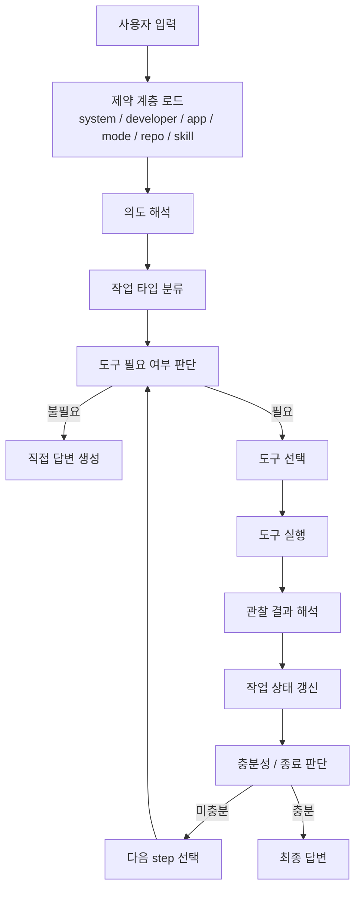

분류:
- `제약 계층 로드`는 `[FACT]`
  - system / developer / app / mode / repo / skill 지침이 실제로 존재한다.
- `의도 해석 -> 작업 타입 분류 -> 도구 선택 -> 결과 재해석`은 `[STRONG-INFERENCE]`
  - 이 단계를 통하지 않고는 실제 observed behavior를 설명하기 어렵다.

---

## 3. Intent understanding: how much is “left to the LLM”?

### 3.1 Minimal safe statement

- 사용자는 자연어 요청을 준다. `[FACT]`
- 세션은 그 위에 system/developer/app/repo 규칙을 얹는다. `[FACT]`
- 실제 어떤 도구가 호출되는지는 정적 선언이 아니라 모델의 응답 과정에서 결정된다. `[FACT]`
- 따라서 의도 해석과 tool routing의 실질적 주체는 LLM이다. `[STRONG-INFERENCE]`

### 3.2 What is likely not happening

- 사용자가 `"최신"`이라고 썼다고 해서 외부의 고정 parser가 무조건 web를 때리는 구조는 직접 관측되지 않았다. `[WEAK-INFERENCE]`
- 오히려 `규칙 + 자연어 문맥 + 현재 작업 상태`를 함께 보고 LLM이 판단하는 쪽이 observed behavior와 더 잘 맞는다. `[STRONG-INFERENCE]`

### 3.3 Practical conclusion

의도 파악은 아래 두 층의 합성으로 보는 게 가장 정확하다.

1. `hard constraints` `[FACT]`
- 사용 가능한 도구
- mode 제약
- browsing mandatory 규칙
- repo-local policy

2. `LLM interpretation` `[STRONG-INFERENCE]`
- 이 질문이 최신성 의존인지
- 로컬 코드 근거 의존인지
- 수정 요청인지
- review/audit 성격인지
- 병렬화 가치가 있는지

즉:
- `완전히 LLM 자율`도 아니고
- `완전히 외부 라우터`도 아니다
- `constraint-bounded LLM routing`이 가장 정확한 설명이다. `[STRONG-INFERENCE]`

---

## 4. Typed intent split

직접 내부 enum을 본 것은 아니므로, 아래는 관측 행동을 가장 잘 설명하는 typed split이다. `[STRONG-INFERENCE]`

### 4.1 Proposed top-level task kinds

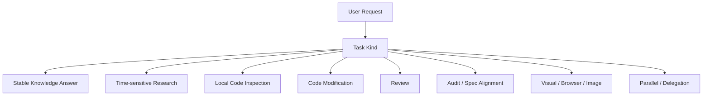

### 4.2 Why these kinds?

| Task kind | 분류 | 근거 |
|-----------|------|------|
| Stable Knowledge Answer | `[STRONG-INFERENCE]` | 도구 없이 바로 답하는 케이스가 존재 |
| Time-sensitive Research | `[STRONG-INFERENCE]` | 최신성 질문에서 web mandatory 규칙이 명시돼 있음 |
| Local Code Inspection | `[STRONG-INFERENCE]` | repo 기반 설명/리뷰/수정 전에 local file read가 필요 |
| Code Modification | `[STRONG-INFERENCE]` | `apply_patch`, `exec_command` scripted replace 선택이 갈림 |
| Review | `[STRONG-INFERENCE]` | findings-first 규칙이 명시돼 있음 |
| Audit / Spec Alignment | `[STRONG-INFERENCE]` | `aa/audit` skill이 별도로 존재 |
| Visual / Browser / Image | `[FACT]` + `[STRONG-INFERENCE]` | browser/image skills와 plugins가 실제 존재 |
| Parallel / Delegation | `[FACT]` + `[STRONG-INFERENCE]` | subagent tools 존재 + explicit permission rule 명시 |

### 4.3 Possible second-level tags

아래는 내부적으로 있을 법하지만 직접 보이지는 않는다. `[WEAK-INFERENCE]`

- `needs_web`
- `needs_local_evidence`
- `needs_edit`
- `needs_visual_confirmation`
- `needs_source_citation`
- `needs_parallelization`
- `high_risk`
- `verification_requested`

이런 tag 조합이 있으면 현재 observed tool behavior를 자연스럽게 설명할 수 있다.

---

## 5. Routing logic by type

### 5.1 Stable Knowledge Answer

목적:
- 정적인 개념 설명

loop:

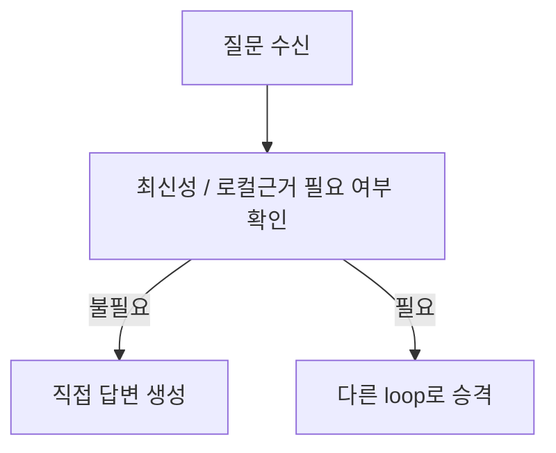

분류:
- direct-answer path 존재는 `[FACT]`
- 이 path가 별도 stable knowledge kind로 분리된다는 것은 `[STRONG-INFERENCE]`

### 5.2 Time-sensitive Research

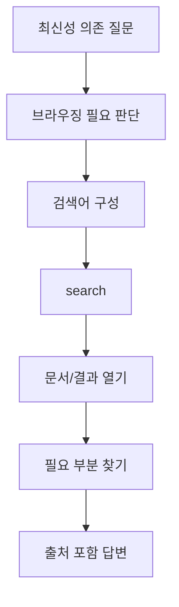

분류:
- 최신성 있는 정보는 browsing mandatory라는 정책은 `[FACT]`
- `검색어 구성 -> open -> find`는 `[STRONG-INFERENCE]`

### 5.3 Local Code Inspection

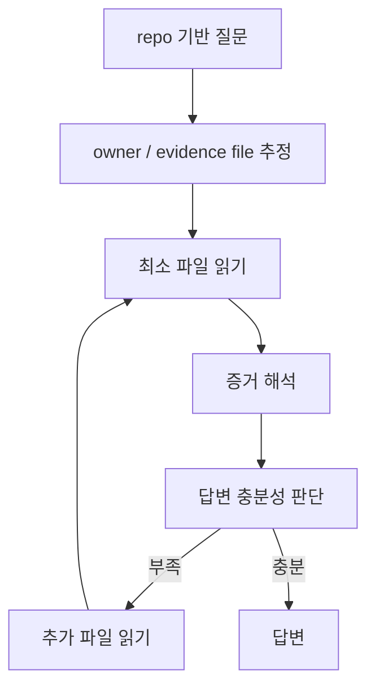

분류:
- `exec_command`, `parallel`, `rg`, `sed` 사용은 `[FACT]`
- owner/evidence-first 읽기는 `[STRONG-INFERENCE]`

### 5.4 Code Modification

이건 가장 복잡한 loop다.

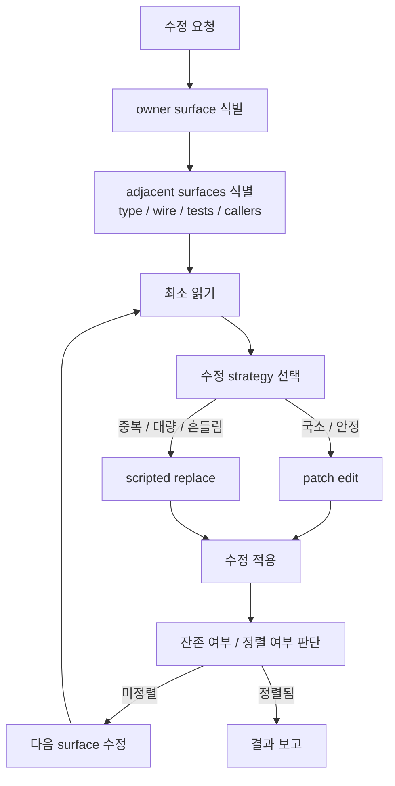

분류:
- `apply_patch`와 `exec_command + python`을 번갈아 쓴 것은 `[FACT]`
- `patch가 흔들리면 scripted replace로 전환`은 `[STRONG-INFERENCE]`
- `owner -> type/wire/test` 순서의 repair discipline은 repo policy + observed behavior를 합친 `[STRONG-INFERENCE]`

### 5.5 Review

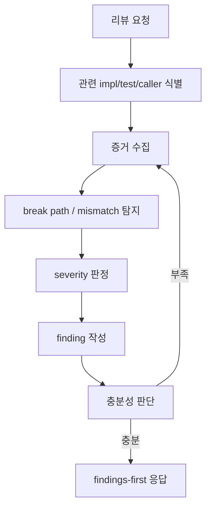

분류:
- findings-first 규칙은 `[FACT]`
- review를 별도 evidence loop로 보는 것은 `[STRONG-INFERENCE]`

### 5.6 Audit / Spec Alignment

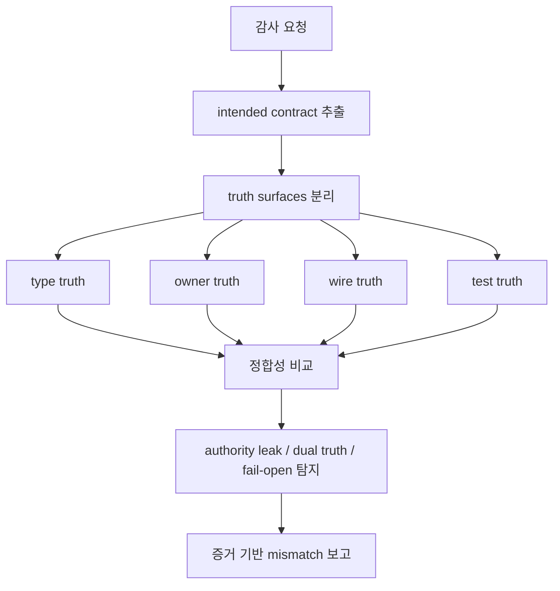

분류:
- audit/aa skill 존재는 `[FACT]`
- 위와 같은 loop specialization은 `[STRONG-INFERENCE]`

### 5.7 Visual / Browser / Image

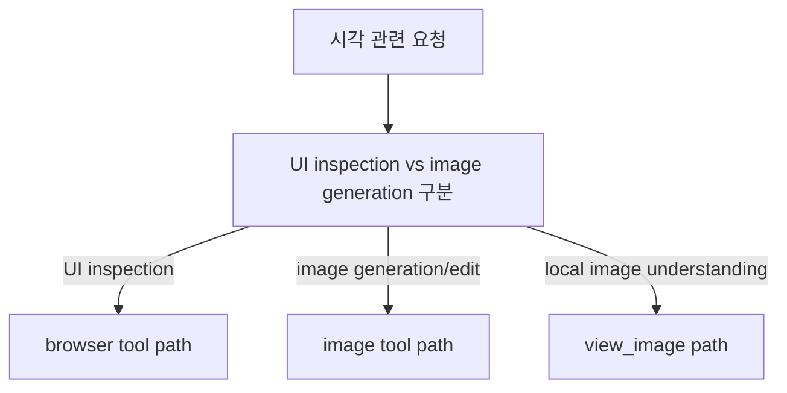

분류:
- image/browser related tools/plugins/skills 존재는 `[FACT]`
- 실제 시각 task router 분기는 `[STRONG-INFERENCE]`

### 5.8 Parallel / Delegation

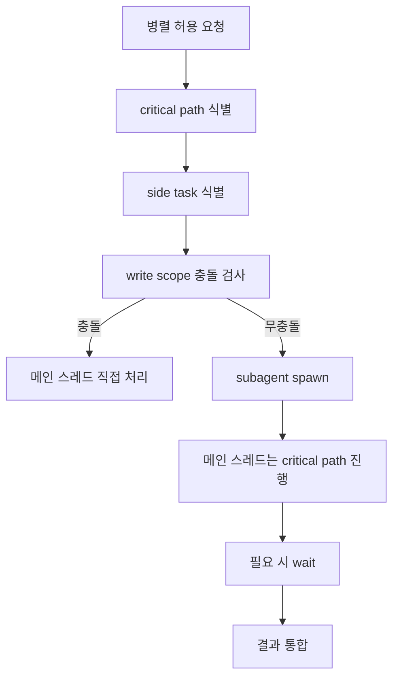

분류:
- explicit permission requirement는 `[FACT]`
- critical-path-local, side-task-delegated 구조는 `[STRONG-INFERENCE]`

---

## 6. Loop complexity by type

| Type | Loop complexity | 이유 |
|------|-----------------|------|
| Stable Knowledge Answer | 낮음 | 도구 없이 답변 가능 |
| Time-sensitive Research | 중간 | 검색/출처/비교 필요 |
| Local Code Inspection | 중간 | 최소 파일 read와 증거 해석 필요 |
| Code Modification | 높음 | multi-surface alignment + edit strategy + leftovers |
| Review | 중간~높음 | file/line evidence + severity + break path |
| Audit | 높음 | intended contract 추출 + truth-surface 분리 + structural mismatch |
| Visual / Browser / Image | 중간 | 시각 modality 분기 필요 |
| Parallel / Delegation | 높음 | critical path / side task / merge management |

이 complexity 표는 `[STRONG-INFERENCE]`다.

---

## 7. Specialized sub-loops inside Code Modification

코드 수정 loop 내부도 다시 쪼갤 수 있다. `[STRONG-INFERENCE]`

### 7.1 Owner-finding loop

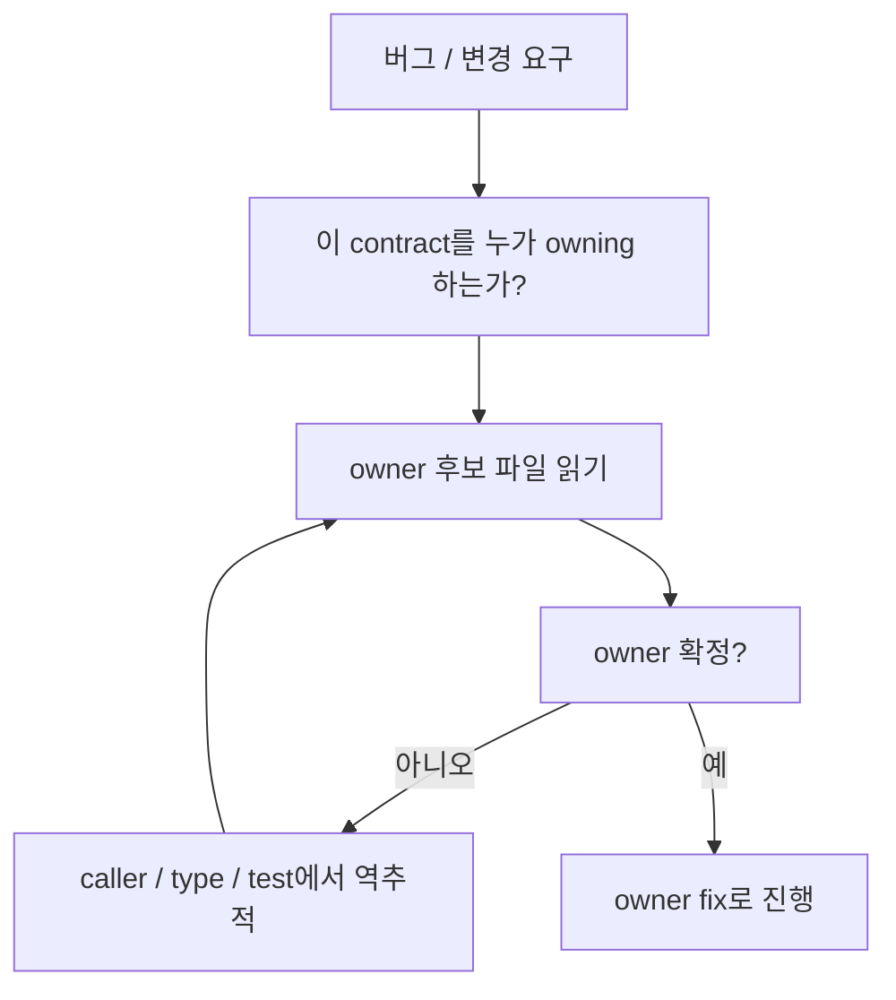

### 7.2 Edit-strategy loop

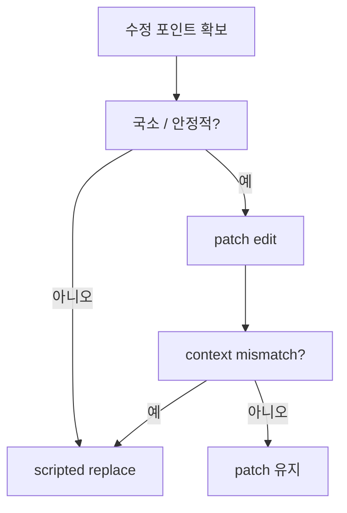

### 7.3 Surface-alignment loop

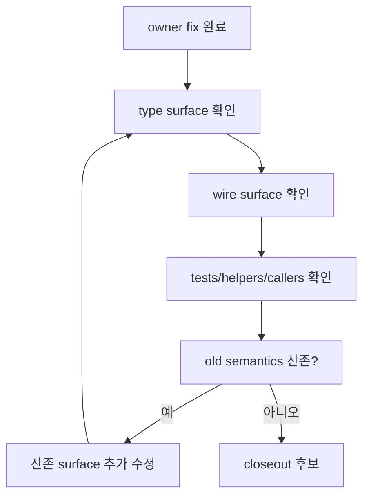

---

## 8. Termination conditions

### 8.1 Observed hard constraints

아래는 세션 지침에서 직접 보이는 종료/보고 규칙이다. `[FACT]`

- 검증을 안 했으면 안 했다고 말해야 한다
- partial이면 partial이라고 말해야 한다
- 큰 수정 후에는 changed files / enforced contract / verification status / remaining gaps를 분리하는 것이 권장된다
- 사용자가 요청하지 않은 무거운 검증은 하지 말아야 한다

### 8.2 Inferred stopping logic

아래는 실제 loop가 언제 멈추는지에 대한 재구성이다. `[STRONG-INFERENCE]`

종료 조건 후보:
1. 답변에 필요한 근거가 충분하다
2. 수정 세트가 논리적으로 닫혔다
3. 더 진행하려면 사용자 승인/추가 정보가 필요하다
4. 현재 제약하에서는 더 나아질 수 없다

비종료 조건 후보:
1. owner와 test가 다른 truth를 말한다
2. stale symbol / stale branch가 남아 있다
3. 결과를 단정하기에 증거가 부족하다
4. patch 실패 뒤 strategy 전환이 아직 안 됐다

---

## 9. Fact / strong / weak inference checklist

### 9.1 FACT

- 현재 어떤 도구가 세션에 있는지
- 현재 mode가 무엇인지
- browsing mandatory 조건
- request_user_input availability
- repo AGENTS rules
- 실제 tool usage history

### 9.2 STRONG-INFERENCE

- constraint-bounded LLM routing
- top-level typed task kinds
- code repair loop specialization
- review loop / audit loop specialization
- patch vs scripted replace switching logic
- subagent는 side task 위주라는 운영 원리

### 9.3 WEAK-INFERENCE

- 내부에서 literal enum/ADT가 정확히 어떤 이름으로 구현돼 있는지
- hidden planner가 별도 객체/서비스인지 여부
- confidence scoring이나 latent classifier가 별도 단계로 구현돼 있는지 여부
- exact prompt serialization order

---

## 10. Most precise safe summary

가장 안전하고도 해상도 높은 요약은 이거다.

1. Codex는 `도구를 사용할 수 있는 LLM 기반 에이전트`다. `[FACT]`
2. 실제 동작은 `정책 계층`과 `런타임 제약`에 강하게 묶여 있다. `[FACT]`
3. 도구 선택과 다음 step 결정의 실질적 주체는 LLM이다. `[STRONG-INFERENCE]`
4. 다만 그 선택은 자유 선택이 아니라 `constraint-bounded routing`이다. `[STRONG-INFERENCE]`
5. 코드 작업은 단순 1-pass가 아니라 `owner -> adjacent surfaces -> edit strategy -> leftovers -> closeout`의 repair loop를 가진다. `[STRONG-INFERENCE]`
6. review와 audit는 code modification과 다른 specialized loop를 가진다. `[STRONG-INFERENCE]`
7. 내부 구현이 정확히 어떤 hidden typed router/enum으로 되어 있는지는 직접 관측 불가다. `[FACT]`

## Round 2 update (2026-05-21 deep dive)

이 round에서는 Codex Rust binary 자체를 풀어서, `[WEAK-INFERENCE]`로만 가지고 있던 hidden runtime의 일부를 `[FACT]` 수준으로 끌어올린다.

### A. Codex Rust binary fingerprint

- `[FACT]` Binary path: `/Applications/Codex.app/Contents/Resources/codex`.
- `[FACT]` 182MB Mach-O arm64. CLI version 0.130.0 (models_cache의 `client_version`은 server-pushed 0.131.0).
- `[FACT]` Workspace crates (string table에서 복원): `codex-core, codex-api, codex-client, codex-exec, codex-exec-server, codex-mcp, codex-mcp-client, codex-cli, codex-tui, codex-app-server, codex-linux-sandbox, codex-plugin, codex-skill-install, codex-skill-list, codex-network`.
- `[FACT]` Built-in tools (binary string evidence): `shell, apply_patch (V4A diff with *** Begin Patch / *** End Patch), read, list_files, search (rg-backed), web_search, bash`.
- `[FACT]` 182MB 크기의 origin: static tokio + reqwest + rustls + sqlx + ratatui + WebRTC + V8 (for Node REPL support) + ~50% debug symbols. **No embedded ML models** (no `.onnx` / `.gguf` / `.safetensors`).
- `[FACT]` Bypass flag exists: `--dangerously-bypass-approvals-and-sandbox` (default disabled).

### B. Crate-to-loop ownership mapping

| Crate | What this round's evidence assigns to it | Class |
| --- | --- | --- |
| `codex-core` | inner agent loop, tool dispatch (`core/src/tools/router.rs` path string 존재) | `[FACT]` for path string, `[STRONG-INFERENCE]` for loop ownership |
| `codex-app-server` | Electron-fronted JSON-RPC turn router (Round 2의 `exec-server` 상위) | `[STRONG-INFERENCE]` |
| `codex-tui` | terminal UI agent loop entry | `[STRONG-INFERENCE]` |
| `codex-mcp` / `codex-mcp-client` | MCP transport (위임: `mcp-usage-audit.md`) | `[STRONG-INFERENCE]` |
| `codex-linux-sandbox` | sandbox enforcement layer | `[STRONG-INFERENCE]` |
| `codex-plugin` | plugin host (위임: `plugin-audit.md`) | `[STRONG-INFERENCE]` |
| `codex-skill-install` / `codex-skill-list` | skill admin path (위임: `skills-audit.md`) | `[STRONG-INFERENCE]` |
| `codex-network` | HTTP/SSE/WebSocket client layer (위임: `external-call-record-replay-audit.md`) | `[STRONG-INFERENCE]` |

### C. §9 checklist upgrades

이전 §9.3 WEAK-INFERENCE에서 강도가 바뀐 항목:

- ~~"내부에서 literal enum/ADT가 정확히 어떤 이름으로 구현돼 있는지"~~ **CORRECTED 2026-05-21**: crate 경계까지는 `[FACT]`이지만 enum 멤버 자체는 여전히 unknown. WEAK → FACT는 crate 단위에서만 적용된다.
- ~~"exact prompt serialization order"~~ **CORRECTED 2026-05-21**: 그대로 WEAK-INFERENCE. binary string 증거가 prompt order를 결정하지 않는다.

§9.2 STRONG-INFERENCE 신규 항목:

- inner agent loop는 단일 crate (`codex-core`) 안에 closed되어 있고, surface entry (`exec`, `exec-server`, `tui`, `chat`, `resume`)들은 같은 loop를 공유한다. (subcommand 분배는 `execution-loop.md` owner.)
- tool dispatch는 `core/src/tools/router.rs` path string으로 noun-form ownership을 가진다. (tool routing surface는 `tool-routing-and-triggering.md` owner.)
- sandbox/approval enforcement crate (`codex-linux-sandbox`)는 LLM이 아니라 runtime side에 있다 — `[MODEL]`이던 boundary가 `[STRONG-INFERENCE]`로 승격.

### D. What deliberately stays unchanged

- §3 intent understanding의 `constraint-bounded LLM routing` 결론은 binary 증거에 의해 더 강해졌지만 표현은 유지한다.
- §4 task-kind taxonomy는 binary string에서 enum literal로 발견된 것은 아니라서 `[STRONG-INFERENCE]` 그대로.
- §7 specialized sub-loops도 `[STRONG-INFERENCE]` 유지.

### E. NON-CLAIM 추가

- hidden planner가 `codex-core` 안의 어떤 module path에 있는지 단정하지 않는다. (`core/src/tools/router.rs` 외에는 path string이 안정적이지 않음.)
- LLM provider routing (OpenAI vs Anthropic)이 단일 trigger condition인지 multi-provider인지는 이 doc에서 결론짓지 않는다. (`external-call-record-replay-audit.md` owner.)
