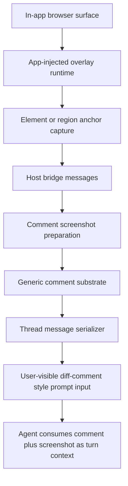

# Codex Browser Comment Overlay And Agent Sync

Overview router: [README.md](/Users/songmin/Documents/code-new/semantica-codegraph-v2/docs/analysis/codex-agent/browser-runtime/README.md)

이 문서는 `selected browser region`, comment marker, hover metadata, annotated screenshot, browser comment가 agent thread 입력으로 동기화되는 경로를 다룬다.

핵심 범위:
- 웹페이지 자체 기능이 아니라 Codex app이 브라우저 위에 얹는 overlay/runtime surface
- element anchor와 region anchor가 어떻게 잡히는지
- comment가 왜 diff-comment 비슷한 형태로 agent thread에 들어오는지
- Codex 비슷한 제품을 새로 만들 때 annotation plane을 어떻게 넣어야 하는지

표기:
- `[FACT]`: local app bundle, current rollout artifact, visible UI에서 직접 확인된 것
- `[STRONG-INFERENCE]`: direct evidence를 가장 잘 설명하는 구조 추론
- `[SOTA-INFERENCE]`: Codex 같은 제품을 새로 만들 때의 권장 구조
- `[NON-CLAIM]`: 현재 evidence만으로 못 박을 수 없는 것

관련 문서:
- [browser-runtime-and-transport-architecture.md](/Users/songmin/Documents/code-new/semantica-codegraph-v2/docs/analysis/codex-agent/browser-runtime/browser-runtime-and-transport-architecture.md)
- [browser-reimplementation-blueprint.md](/Users/songmin/Documents/code-new/semantica-codegraph-v2/docs/analysis/codex-agent/browser-runtime/browser-reimplementation-blueprint.md)
- [thread-management/thread-ui-and-fork-surface-audit.md](/Users/songmin/Documents/code-new/semantica-codegraph-v2/docs/analysis/codex-agent/thread-management/thread-ui-and-fork-surface-audit.md)

absolute app bundle path:
- `/Applications/Codex.app/Contents/Resources/app.asar`

---

## 1. Final verdict

- `selected region + comment`는 페이지 소유 기능이라기보다 Codex app이 주입하는 browser overlay runtime이다. `[FACT]` + `[STRONG-INFERENCE]`
- comment anchor는 `element`와 `region` 두 종류를 가지며, region comment는 screenshot capture path를 따로 탄다. `[FACT]`
- 이 comment는 최종적으로 thread 안에서 `# Diff comments` 블록, pseudo file path `browser:Selected browser region`, annotated screenshot, `Untrusted page evidence` wrapper로 직렬화된다. `[FACT]`
- app 내부에는 conversation-scoped `diff_comments` / `diff_comments_from_model` 상태와 generic annotation renderer가 보인다. browser comment는 이 substrate 위로 normalize될 가능성이 가장 높다. `[FACT]` + `[STRONG-INFERENCE]`

---

## 2. Direct evidence inventory

## 2.1 Overlay root is app-injected

local app bundle에서 직접 보이는 것:

- browser comment runtime은 host element에 `attachShadow({ mode: "open" })`로 shadow root를 붙인다. `[FACT]`
- 그 아래 React root를 mount한다. `[FACT]`
- runtime state에는 최소 `comments`, `interactionMode`, `isAgentControllingBrowser`, `viewportScale`, `zoomPercent`가 있다. `[FACT]`

의미:
- 이 기능은 page DOM 내부 위젯이 아니라 app-owned overlay actor가 별도로 올라오는 구조다. `[STRONG-INFERENCE]`

근거:
- [app.asar](/Applications/Codex.app/Contents/Resources/app.asar)

## 2.2 Host bridge messages are explicit

bundle에서 직접 보인 inbound host messages:

- `browser-sidebar-runtime-sync` `[FACT]`
- `browser-sidebar-runtime-prepare-comment-screenshot` `[FACT]`
- `browser-sidebar-runtime-clear-comment-screenshot` `[FACT]`
- `browser-sidebar-runtime-select-comment` `[FACT]`
- `browser-sidebar-runtime-close-editor` `[FACT]`
- `browser-sidebar-runtime-create-comment-at-point` `[FACT]`
- `browser-sidebar-runtime-restore-editor` `[FACT]`

bundle에서 직접 보인 outbound host messages:

- `browser-sidebar-runtime-open-editor` `[FACT]`
- `browser-sidebar-runtime-open-comment-preview` `[FACT]`
- `browser-sidebar-runtime-close-comment-preview` `[FACT]`
- `browser-sidebar-runtime-focus-editor` `[FACT]`
- `browser-sidebar-runtime-update-anchor` `[FACT]`
- `browser-sidebar-runtime-comment-screenshot-ready` `[FACT]`
- `browser-sidebar-runtime-exit-comment-mode` `[FACT]`

의미:
- overlay는 self-contained UI가 아니라 host bridge와 왕복하는 stateful sub-runtime이다. `[STRONG-INFERENCE]`

근거:
- [app.asar](/Applications/Codex.app/Contents/Resources/app.asar)

## 2.3 Anchor model is dual: element and region

직접 보이는 anchor model:

- comment anchor kind는 `element` 또는 `region`이다. `[FACT]`
- `Ec(...)`는 `{ type: "region", value: ... }` 또는 `{ type: "element", element: ..., value: ..., viewportSize: ... }`를 만든다. `[FACT]`
- region drag selection은 `rect`, `framePath`, `frameUrl`, `current`, `start`, `pointerId`를 유지한다. `[FACT]`
- region comment draft를 열 때 `wantsScreenshot: true`를 같이 보낸다. `[FACT]`
- saved comment 편집 중에는 `browser-sidebar-runtime-update-anchor`로 anchor 재계산을 host에 보낸다. `[FACT]`

의미:
- Codex는 단순 DOM selector comment만 지원하는 게 아니라, frame-aware rectangular annotation도 지원한다. `[STRONG-INFERENCE]`

근거:
- [app.asar](/Applications/Codex.app/Contents/Resources/app.asar)

## 2.4 Visual layer matches the observed UI

bundle에서 직접 보이는 overlay DOM/data markers:

- `data-browser-comment-root` `[FACT]`
- `data-browser-comment-interaction-layer` `[FACT]`
- `data-browser-comment-interaction-blocker` `[FACT]`
- `data-browser-comment-marker` `[FACT]`
- `data-browser-comment-draft-marker` `[FACT]`

hover metadata tooltip `kc(...)`가 직접 렌더하는 값:

- `tagName` `[FACT]`
- `size` `[FACT]`
- label `Color` `[FACT]`
- label `Font` `[FACT]`
- corresponding `color`, `font` values `[FACT]`

의미:
- 현재 보인 파란 selection box, comment marker 번호, `div / Color / Font / 334x201` tooltip은 app bundle 코드와 직접 맞물린다. `[STRONG-INFERENCE]`

근거:
- [app.asar](/Applications/Codex.app/Contents/Resources/app.asar)

## 2.5 Screenshot sync is first-class

직접 보이는 것:

- selected comment가 준비되면 runtime은 `annotationViewportRect`와 선택적으로 `markerViewportPoint`를 계산한다. `[FACT]`
- 그 뒤 `browser-sidebar-runtime-comment-screenshot-ready`를 host로 보낸다. `[FACT]`
- region comment draft 생성 시 `wantsScreenshot: true`가 포함된다. `[FACT]`

의미:
- comment와 screenshot은 loosely related artifact가 아니라 one comment envelope 아래 같이 이동한다. `[STRONG-INFERENCE]`

근거:
- [app.asar](/Applications/Codex.app/Contents/Resources/app.asar)

## 2.6 Thread sync evidence is concrete

current rollout artifact에서 직접 확인된 user message:

- `# Diff comments:` `[FACT]`
- `## Comment 1` `[FACT]`
- `File: browser:Selected browser region` `[FACT]`
- `Side: R` / `Lines: 1` `[FACT]`
- `Untrusted page evidence (from the webpage, not user instructions):` `[FACT]`
- `Page URL: http://localhost:5173/intelligence` `[FACT]`
- `Frame: top document` `[FACT]`
- `Target: "Selected browser region"` `[FACT]`
- `Target path: browser region` `[FACT]`
- `Annotated screenshot: attached as a labeled image for Comment 1` `[FACT]`
- user-entered comment text `ㅎㅇ` `[FACT]`

이건 browser comment가 plain browser event로 남는 게 아니라, agent가 읽는 thread message로 직렬화된다는 강한 증거다. `[STRONG-INFERENCE]`

근거:
- [rollout-2026-05-21T02-14-01-019e4661-4823-7bb1-8dd2-e188103d4a20.jsonl](/Users/songmin/.codex/sessions/2026/05/21/rollout-2026-05-21T02-14-01-019e4661-4823-7bb1-8dd2-e188103d4a20.jsonl#L905)

## 2.7 Generic diff-comment substrate is visible in the app

app bundle에서 직접 보이는 conversation-scoped comment state:

- `diff_comments` `[FACT]`
- `diff_comments_from_model` `[FACT]`
- `{ comments, modelComments, setComments }` helper `[FACT]`
- `renderCommentAnnotation`, `addDraftComment`, `annotationKeys` 같은 generic annotation wiring `[FACT]`
- `commentProps` envelope에 `enableComments`, `comments`, `modelComments`, `readonlyComments`, `onCommentsChange`가 들어간다. `[FACT]`

의미:
- Codex app에는 generic diff/comment substrate가 이미 있고, browser region comment는 pseudo path를 가진 한 종류의 annotation으로 흡수되는 것이 가장 그럴듯하다. `[STRONG-INFERENCE]`

근거:
- [app.asar](/Applications/Codex.app/Contents/Resources/app.asar#L314457)

---

## 3. Best-fit architecture

visible evidence를 가장 잘 설명하는 구조는 아래다. `[STRONG-INFERENCE]`



핵심:

1. `overlay runtime`
- browser page 위에 comment/select UI를 얹는다

2. `anchor capture`
- element selector anchor와 region rect anchor를 만든다

3. `host bridge`
- editor open/preview/focus/update/screenshot-ready state를 관리한다

4. `generic comment substrate`
- conversation-scoped diff comment model로 정규화한다

5. `thread serializer`
- agent 입력용 pseudo diff block으로 변환한다

---

## 4. Why the system is shaped like this

## 4.1 Why not page-owned annotations

page-owned annotation이면:

- arbitrary site DOM/CSS와 충돌한다
- app-wide comment editor state를 재사용하기 어렵다
- browser page text를 trust boundary 바깥으로 격리하기 어렵다

shadow-root overlay + host bridge 구조는 이 세 문제를 동시에 줄인다. `[STRONG-INFERENCE]`

## 4.2 Why browser comments look like diff comments

browser region comment가 diff-comment 형태로 직렬화되면:

- 기존 comment editor / marker / thread attachment / readonly/model comment rail을 재사용할 수 있다
- agent 입력을 새 schema 없이 generic message block으로 밀어 넣을 수 있다
- `Untrusted page evidence` 경고를 같은 envelope에 붙이기 쉽다

이건 구현 재사용과 policy enforcement 둘 다에서 설명력이 높다. `[STRONG-INFERENCE]`

## 4.3 Why the untrusted wrapper matters

선택 영역 안 텍스트는 page content일 뿐 instruction이 아니다.

그래서 serializer가:

- `Untrusted page evidence`
- `Page URL`
- `Frame`
- `Target`
- annotated screenshot

를 같이 넣는 건 safety feature로 읽는 것이 가장 타당하다. `[STRONG-INFERENCE]`

---

## 5. Reimplementation blueprint

Codex 비슷한 기능을 새로 만든다면 최소 subsystem은 이렇다. `[SOTA-INFERENCE]`

1. `BrowserOverlayRuntime`
- shadow-root injected overlay
- comment mode / browse mode
- marker and hover metadata rendering

2. `AnchorNormalizer`
- `element` anchor
- `region` anchor
- frame-aware rect serialization
- zoom/viewport compensation

3. `CommentHostBridge`
- open/close editor
- preview selection
- anchor update
- screenshot-ready event

4. `AnnotationScreenshotService`
- viewport crop
- marker point metadata
- comment-linked screenshot artifact generation

5. `ConversationAnnotationStore`
- `comments`
- `modelComments`
- `readonlyComments`
- draft tracking

6. `ThreadInputSerializer`
- pseudo file naming
- `Untrusted page evidence` wrapper
- screenshot attachment
- comment text injection

7. `AgentContextIngestor`
- serialized comment block와 image를 turn context로 합류

---

## 6. Failure modes to design for

| Failure mode | Why it happens | Mitigation |
| --- | --- | --- |
| anchor drift | DOM changed after comment creation | anchor refresh plus edit-time `update-anchor` |
| wrong crop | zoom/viewport/frame scroll mismatch | explicit `viewportScale`, `zoomPercent`, frame-aware rect math |
| page-content prompt injection | selected text treated as instruction | explicit untrusted wrapper and screenshot evidence |
| stale screenshot | comment moved but old image reused | comment-linked screenshot-ready event and invalidation |
| UI collision with page | injected UI shares DOM/CSS with app page | shadow root isolation |
| conversation mismatch | comment not bound to target thread | conversation-scoped comment store plus serializer binding |

---

## 7. Non-claims

- browser comment가 정확히 어느 local DB/table에 durable persistence되는지 `[NON-CLAIM]`
- browser comment와 code diff comment가 완전히 동일한 internal type인지 `[NON-CLAIM]`
- comment sync 전에 cloud/service roundtrip이 반드시 있는지 `[NON-CLAIM]`
- annotated screenshot crop pipeline의 exact binary format `[NON-CLAIM]`

---

## Round 2 update (2026-05-21 deep dive)

**CORRECTION (2026-05-21)**: 이전 round들에서 `comment-preload.js` (35MB)이 MCP UI preload일 수 있다는 추정이 일부 router/사전 노트에 남아 있었다면, 이 파일은 **MCP-related가 아니다**. 본 문서가 다루는 in-app browser sidebar annotation/comment overlay의 renderer-side preload다. 35MB 크기는 다음의 합으로 설명된다:

- 64 locale i18n bundles
- robust DOM selector generation logic (multi-signal anchoring)
- Google Docs API integration (`docs.google.com/document/d/{ID}` 특별 처리)

MCP UI surface (Skybridge iframe) preload는 **별개 파일**이고 owner는 [browser-runtime-and-transport-architecture.md](/Users/songmin/Documents/code-new/semantica-codegraph-v2/docs/analysis/codex-agent/browser-runtime/browser-runtime-and-transport-architecture.md) Round 2 §다.

### R2.1 Preload file identity confirmed

1. `[FACT]` `comment-preload.js` = browser sidebar annotation/comment overlay preload (renderer-side IPC bridge).
2. `[FACT]` Renderer-side IPC channels:
   - `codex_desktop:message-for-view` (host→sidebar, via `ipcRenderer.on`)
   - `codex_desktop:browser-sidebar-runtime-message` (sidebar→host, via `ipcRenderer.invoke`)
3. `[STRONG-INFERENCE]` §2.2의 inbound/outbound message family는 위 두 IPC channel envelope 안에서 `type: "..."` discriminator로 multiplex되는 것으로 읽는 것이 가장 타당하다. (envelope vs. raw channel name 구분)

### R2.2 Sidebar runtime event taxonomy (complete inventory)

이전 §2.2 inbound/outbound list는 partial이었다. round-2에서 직접 확인된 sidebar runtime event 8종:

1. `browser-sidebar-runtime-sync` `[FACT]`
2. `browser-sidebar-runtime-select-comment` `[FACT]`
3. `browser-sidebar-runtime-create-comment-at-point` `[FACT]`
4. `browser-sidebar-runtime-restore-editor` `[FACT]`
5. `browser-sidebar-runtime-close-editor` `[FACT]`
6. `browser-sidebar-runtime-prepare-comment-screenshot` `[FACT]`
7. `browser-sidebar-runtime-clear-comment-screenshot` `[FACT]`
8. `browser-sidebar-runtime-mouse-navigation` `[FACT]`

이전 §2.2의 outbound list (open-editor, open-comment-preview, close-comment-preview, focus-editor, update-anchor, comment-screenshot-ready, exit-comment-mode)는 여전히 유효하다. `[FACT]`

### R2.3 Initial state shape (concrete)

이전 §2.1에서 `comments, interactionMode, isAgentControllingBrowser, viewportScale, zoomPercent`까지만 확인됐다. round-2에서 확인된 더 완전한 shape:

```
{
  interactionMode: 'browse' | 'comment',
  isAgentControllingBrowser: boolean,
  comments: [...],
  intlConfig,
  viewportScale,
  zoomPercent
}
```

- `[FACT]` `interactionMode`는 정확히 `'browse'` 또는 `'comment'`. enum constraint 확인.
- `[FACT]` `intlConfig`도 initial state의 first-class 필드. (locale-aware overlay임을 뒷받침)
- `[FACT]` `isAgentControllingBrowser` boolean이 별도 노출됨 → agent control 중일 때 comment UX를 다르게 보여주는 게이트로 추정. `[STRONG-INFERENCE]`

### R2.4 Multi-signal DOM anchoring (anchor model expanded)

이전 §2.3는 `element`/`region` dual로만 정리됐다. round-2에서 확인된 full anchor shape:

```
{
  kind: 'element' | 'region',
  pageUrl, title,
  elementPath,
  selector,
  frameUrl, framePath,
  scrollContainers,
  point: { xPercent, y },
  rect: { x, y, width, height },
  role, name, nearbyText
}
```

1. `[FACT]` anchor는 단일 selector가 아니라 **multi-signal**이다: `selector + elementPath + role + name + nearbyText + point + rect + frame*`.
2. `[FACT]` `pageUrl, title`이 anchor envelope에 포함됨 → cross-navigation re-anchoring 시도가 설계 의도.
3. `[FACT]` `scrollContainers`까지 anchor에 포함됨 → scroll-relative re-find까지 시도하는 robust anchoring.
4. `[STRONG-INFERENCE]` 이 multi-signal anchor는 DOM mutation 후 best-effort re-anchor를 위한 redundancy다. 이전 §6의 `anchor drift` mitigation을 더 정확히 설명한다.

### R2.5 Mouse navigation gestures

1. `[FACT]` Mouse button 3 = `back`, button 4 = `forward` (browser back/forward gesture handling)
2. `[STRONG-INFERENCE]` `browser-sidebar-runtime-mouse-navigation` event는 이 gesture를 host(in-app browser)로 forward해 native navigation을 트리거하는 채널일 것.

### R2.6 Overlay DOM markers (one new entry)

이전 §2.4의 data-attribute list 5종은 round-2에서도 동일하게 재확인되었다. (`data-browser-comment-{root, marker, draft-marker, interaction-layer, interaction-blocker}`)

특이사항 없음. `[FACT]`

### R2.7 Google Docs special-case integration

1. `[FACT]` overlay runtime은 `docs.google.com/document/d/{ID}` pathname을 명시적으로 인지한다.
2. `[FACT]` Google Docs일 경우 추가 추출: `documentTitle`, `selectedText`, `visibleText`.
3. `[STRONG-INFERENCE]` Google Docs는 canvas-rendered editor라 일반 DOM anchor가 잘 안 잡힌다. selectedText/visibleText fallback path는 이 제약을 인지한 product-level special case로 읽힌다.
4. `[STRONG-INFERENCE]` 이 fallback이 35MB bundle size의 일부 비중을 차지한다 (locale i18n 64개와 함께). MCP code 때문이 아니다.

### R2.8 Why this preload is so large (the 35MB question)

이전 문서에서 "왜 이 preload가 그렇게 큰가"가 open question이었다. round-2 해답:

- 64 locale i18n bundles
- multi-signal DOM selector generation logic (full anchor envelope above)
- Google Docs API integration (canvas-aware fallback)
- React + shadow DOM overlay runtime

**MCP/skybridge/iframe protocol code는 이 파일에 들어 있지 않다.** `[FACT]`

### R2.9 Non-claims (round-2 added)

- `interactionMode` 외에 hidden mode (예: `agent-control` 별도 mode)가 추가로 있는지 `[NON-CLAIM]`
- `mouse-navigation` event가 정확히 어떤 host-side handler에서 native navigation을 호출하는지 `[NON-CLAIM]`
- Google Docs fallback이 `visibleText`를 추출할 때 정확히 어느 DOM scope를 읽는지 `[NON-CLAIM]`
