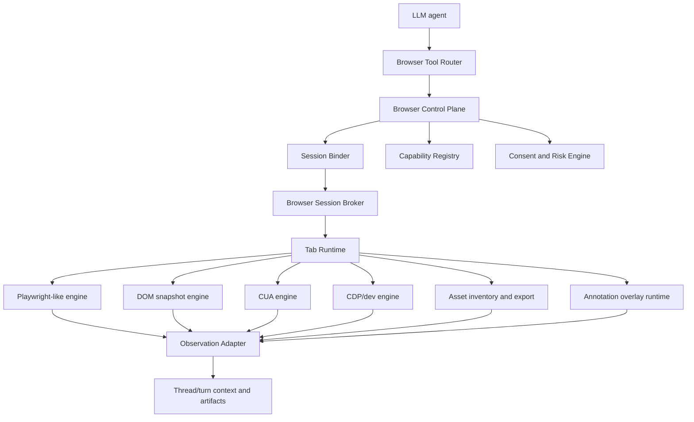

# Codex Browser Reimplementation Blueprint

Overview router: [README.md](/Users/songmin/Documents/code-new/semantica-codegraph-v2/docs/analysis/codex-agent/browser-runtime/README.md)

이 문서는 Codex 비슷한 browser subsystem을 새로 만든다는 전제로, visible Codex surface를 재구현 가능한 설계 단위로 내려서 적는다.

전제:
- 목표는 `browser answerer`가 아니라 `agent-owned browser execution subsystem`
- source는 current visible surface + local browser bundle + Codex app contract
- exact hidden internals 복제는 불가능하므로 best-fit design으로 정리

표기:
- `[STRONG-INFERENCE]`: visible surface를 가장 잘 설명하는 제품 요구사항 추론
- `[SOTA-INFERENCE]`: 구현 우선순위와 구조에 대한 권장 설계 추론

---

## 1. Product requirements inferred from Codex

Codex surface를 기준으로 최소 요구사항은 이렇다. `[STRONG-INFERENCE]`

1. `Local dev first`
- localhost, current in-app tab, file-like target을 잘 다뤄야 함

2. `Session-bound`
- browser action이 어떤 thread/session/turn에 속하는지 추적 가능해야 함

3. `Tab-native`
- browser 전체보다 tab이 기본 실행 단위여야 함

4. `Multi-engine`
- locator, coordinate, DOM-node, screenshot, dev inspection이 공존해야 함

5. `Artifact-aware`
- screenshot, DOM snapshot, asset bundle, dev logs를 artifact처럼 다뤄야 함

6. `Permission-aware`
- login, upload, delete, permission prompt, transmission을 독립 risk rail로 걸러야 함

7. `Annotation-aware`
- selected element/region comment를 browser artifact와 thread context 사이에서 bridge할 수 있어야 함

---

## 2. Target architecture



---

## 3. Minimal API proposal

## 3.1 Control-plane interfaces

```ts
interface BrowserControlPlane {
  getBrowser(sessionId: string, backend?: "iab" | "extension" | "cdp"): Promise<BrowserHandle>;
  classifyAction(action: BrowserAction): Promise<RiskClass>;
  requireConsent(action: BrowserAction, context: ConsentContext): Promise<ConsentDecision>;
}

interface BrowserHandle {
  id: string;
  capabilities: BrowserCapabilityCollection;
  tabs: TabsHandle;
  nameSession(name: string): Promise<void>;
}
```

## 3.2 Tab runtime interfaces

```ts
interface TabsHandle {
  list(): Promise<TabInfo[]>;
  get(id: string): Promise<TabHandle>;
  selected(): Promise<TabHandle | undefined>;
  new(): Promise<TabHandle>;
}

interface TabHandle {
  id: string;
  goto(url: string): Promise<void>;
  reload(): Promise<void>;
  back(): Promise<void>;
  forward(): Promise<void>;
  title(): Promise<string | undefined>;
  url(): Promise<string | undefined>;
  screenshot(options: ScreenshotOptions): Promise<Uint8Array>;
  playwright: PlaywrightLikeApi;
  cua: CoordinateUiApi;
  domCua: VisibleDomActionApi;
  dev: DevInspectionApi;
  capabilities: TabCapabilityCollection;
}
```

## 3.3 Observation envelope

```ts
interface BrowserObservation {
  actionId: string;
  browserId: string;
  tabId?: string;
  sessionId: string;
  turnId: string;
  status: "success" | "blocked" | "handoff" | "error";
  summary: string;
  artifacts?: ArtifactRef[];
  metadata?: Record<string, unknown>;
}
```

이 envelope가 있어야:
- answer assembly
- audit logging
- recovery
- replay/debug
가 단순 stdout parsing 없이 가능하다. `[SOTA-INFERENCE]`

## 3.4 Annotation envelope

```ts
interface BrowserAnnotation {
  annotationId: string;
  sessionId: string;
  turnId: string;
  tabId?: string;
  anchor:
    | { type: "element"; selector?: string; viewportRect?: Rect; framePath?: number[] }
    | { type: "region"; viewportRect: Rect; framePath?: number[]; frameUrl?: string };
  commentText: string;
  screenshotArtifact?: ArtifactRef;
  trustClass: "untrusted_page_evidence";
}
```

이 envelope가 있어야:
- browser comment UI와 thread-native artifact를 분리하지 않고 유지할 수 있고
- untrusted wrapper를 정책적으로 강제할 수 있고
- comment와 screenshot crop을 느슨한 후처리로 남기지 않을 수 있다. `[SOTA-INFERENCE]`

---

## 4. Build phases

## Phase 0: inspection-only

범위:
- `goto`, `reload`, `title`, `url`
- screenshot
- DOM snapshot
- no side-effect actions

목적:
- observation bridge와 artifact pipeline 먼저 검증

## Phase 1: structured interaction

범위:
- Playwright-like locator API
- `click`, `fill`, `press`, `waitFor...`
- stale snapshot guard

목적:
- deterministic UI automation 확보

## Phase 2: fallback engines

범위:
- coordinate CUA
- visible DOM node id actions
- dev/CDP hooks

목적:
- locator 실패 케이스 대응

## Phase 3: optional capabilities

범위:
- visibility
- viewport
- page asset inventory/bundle

목적:
- interactive inspection과 artifact harvesting 강화

## Phase 4: consent/risk engine

범위:
- action classification
- user confirmation
- handoff rails
- origin/account scoped permission

목적:
- browser side effect safety 완성

## Phase 5: annotation plane

범위:
- selected region or element anchors
- comment marker overlay
- screenshot-linked comment artifact
- thread serializer

목적:
- browser inspection 결과를 thread-native discussion artifact로 승격

---

## 5. Control plane requirements

새 제품에서 제일 먼저 넣어야 하는 control-plane rule:

1. `session binding`
- 모든 action에 `session_id`, `turn_id`를 붙일 것

2. `backend discovery`
- backend를 blind hardcode하지 말 것

3. `capability registry`
- optional features를 method existence로 추론하지 말고 explicit capability로 광고할 것

4. `risk typing`
- read, local mutate, remote transmit, irreversible mutate 분리

5. `artifact routing`
- screenshot/DOM/assets/dev logs를 thread artifact로 귀속시킬 것

6. `annotation routing`
- browser comment를 page-local widget으로 버리지 말고 thread-native comment envelope로 귀속시킬 것

---

## 6. Failure modes to design for

| Failure mode | Why it happens | Mitigation |
| --- | --- | --- |
| stale locator | UI state changed after snapshot | snapshot freshness guard |
| wrong tab | multi-tab session confusion | tab actor ownership + selected/get semantics |
| user state loss | same URL `goto` reload | reload-vs-goto policy |
| silent side effect | read/transmit confusion | typed risk engine |
| backend mismatch | capability absent in current backend | capability registry + graceful block |
| non-reproducible action | no session/turn binding | mandatory action envelope |
| over-broad scraping | bulk text extraction | narrow snapshot discipline |
| annotation drift | DOM changed after comment creation | anchor refresh plus screenshot recrop |
| page text prompt injection | selected text treated as instruction | untrusted evidence wrapper |

---

## 7. What not to build first

Codex 흉내를 낼 때 흔히 과하게 들어가는 것:

- full autonomous browsing planner
- large-scale web search mesh
- unrestricted page eval
- plugin marketplace 먼저
- browser persistence DB 먼저

우선순위가 아니다. `[SOTA-INFERENCE]`

먼저 필요한 건:
- session-bound tab runtime
- observation envelope
- deterministic locator path
- consent/risk gates

---

## 8. Final recommendation

Codex 스타일을 재현하려면 browser subsystem을 이렇게 잡는 편이 맞다. `[SOTA-INFERENCE]`

- `plugin`은 routing/policy bundle
- `browser-client`는 thin bootstrap and transport layer
- `browser broker`는 session-scoped backend resolver
- `tab runtime`은 실제 interaction execution unit
- `annotation overlay`는 selected region/element comment capture plane
- `capability registry`는 optional browser/tab features 광고
- `observation adapter`는 browser result를 agent context로 되돌리는 seam

이 6개가 빠지면 비슷해 보여도 Codex 같은 browser agent는 안 된다.

---

## Round 2 update (2026-05-21 deep dive)

build 2867 deep-dive에서 확정된 fact를 반영해 blueprint의 일부 권장 설계를 정정/확장한다. §1~§8의 기존 권장 사항은 대체로 유효하지만 아래 세 영역은 update가 필요하다.

### R2.1 Backend enum correction in API proposal (§3.1)

§3.1의 `getBrowser(sessionId, backend?: "iab" | "extension" | "cdp")` 시그니처는 visible surface에 비추어 부정확하다.

**CORRECTED 2026-05-21**: 실제 Codex active backend enum은 `chrome` + `iab` 두 개다 ([browser-runtime-and-transport-architecture.md](/Users/songmin/Documents/code-new/semantica-codegraph-v2/docs/analysis/codex-agent/browser-runtime/browser-runtime-and-transport-architecture.md) Round 2 §R2.1). `extension`은 chrome backend의 transport 메커니즘, `cdp`는 iab backend의 internal protocol이지 별도 backend identifier가 아니다.

권장 시그니처 (revised):

```ts
type BrowserBackend = "chrome" | "iab";
// "chrome": user의 real Chrome (Read-only posture, may-use-for-training class)
// "iab":    in-app browser (Interactive + Read + Write, localhost/file/in-app only)

interface BrowserControlPlane {
  availableBackends(): Promise<BrowserBackend[]>;
  getBrowser(sessionId: string, backend: BrowserBackend): Promise<BrowserHandle>;
  classifyAction(action: BrowserAction): Promise<RiskClass>;
  requireConsent(action: BrowserAction, context: ConsentContext): Promise<ConsentDecision>;
}
```

이 두 backend를 서로 다른 **trust class**로 분리해 design한다. 같은 ControlPlane 안에서 backend별 data-handling/privacy/origin 정책이 다르다는 것을 first-class로 만든다.

### R2.2 Phase 4 consent/risk engine — IPC-level mode bits (not just policy doc)

§4의 Phase 4 consent/risk engine은 policy class만 나열했다. round-2의 IPC enforcement evidence ([browser-safety-and-admissibility-model.md](/Users/songmin/Documents/code-new/semantica-codegraph-v2/docs/analysis/codex-agent/browser-runtime/browser-safety-and-admissibility-model.md) Round 2 §R2.1)를 반영해, 새 제품에서도 **policy를 mode-bit IPC channel로 expose**하는 것을 권장한다.

권장 control-plane mode bit channels (minimal):

| Channel | Purpose |
| --- | --- |
| `approval-mode/global` | top-level approval policy |
| `approval-mode/history` | browser history access policy |
| `approval-mode/file-transfer` | upload/download policy (별도 channel — generic origin과 분리) |
| `origin-allowlist/general` | per-origin allow/deny |
| `origin-allowlist/file-transfer` | upload/download origin은 generic보다 더 좁은 scope |
| `turn-route/capture`, `turn-route/release` | turn-scoped browser ownership lease |
| `plugin-auto-install/disabled` | plugin install gate |

`[SOTA-INFERENCE]` 이 channels는 doc-level rule이 아니라 control-plane primitive로 expose해야 audit log/replay/IPC-test로 검증 가능해진다.

`[SOTA-INFERENCE]` upload/download origin allowlist는 generic origin allowlist와 **별도 channel**로 두는 게 맞다. Codex가 이렇게 분리한 이유는 file egress가 가장 회복 불가한 side effect class이기 때문.

### R2.3 New phase: native bridge auth (Phase 4.5)

§4의 phase list에 누락된 layer가 있다. chrome backend / native-messaging-pipe / 외부 process bridge를 가질 경우 phase 4와 phase 5 사이에 native bridge auth가 필요하다.

**Phase 4.5: native bridge authentication**

범위:
- Mutual auth gate between Codex backend ↔ external browser process (native messaging host, Chrome extension 등)
- Anti-spoofing: arbitrary process가 native pipe로 spoofing해 Codex backend에 명령 inject하지 못하게 차단
- 별도 native binary (Codex의 `browser-use-peer-authorization.node`와 유사 위치)

목적:
- agent-controlled browser surface가 third-party process injection vector가 되지 않게 차단
- code-signing identity와 peer auth를 결합해 native bridge의 trust boundary 확정

`[SOTA-INFERENCE]` Codex는 `app-sandbox=false` (macOS) 상태에서 동작하므로, OS sandbox 대신 native peer auth가 사실상 1차 enforcement layer다. 새 제품도 OS sandbox를 못 끌 경우 동일 layer를 명시적으로 짚어야 한다.

### R2.4 Annotation envelope refinement (§3.4)

§3.4의 `BrowserAnnotation.anchor`는 element/region dual로만 정의됐다. [browser-comment-overlay-and-agent-sync.md](/Users/songmin/Documents/code-new/semantica-codegraph-v2/docs/analysis/codex-agent/browser-runtime/browser-comment-overlay-and-agent-sync.md) Round 2 §R2.4의 multi-signal anchor를 반영한 권장 shape:

```ts
interface AnnotationAnchor {
  kind: "element" | "region";
  // page-level identity
  pageUrl: string;
  title?: string;
  // frame identity
  frameUrl?: string;
  framePath?: number[];
  // primary selector signals (redundant by design for re-anchoring)
  selector?: string;
  elementPath?: string;
  // geometry
  rect?: { x: number; y: number; width: number; height: number };
  point?: { xPercent: number; y: number };
  scrollContainers?: string[];
  // semantic identity for accessibility-aware re-find
  role?: string;
  name?: string;
  nearbyText?: string;
}
```

`[SOTA-INFERENCE]` Redundant signals (selector + role + name + nearbyText + rect + scrollContainers)는 over-engineering이 아니라, DOM mutation 이후 best-effort re-anchor를 위한 의도된 redundancy. 새 제품도 single-selector anchor로 시작하면 page change 후 anchor drift mitigation이 거의 불가능하다.

### R2.5 Phase 5 annotation plane — special case integrations

§4의 Phase 5는 generic annotation plane만 다뤘다. round-2에서 확인된 Google Docs special case는 새 제품도 fallback path가 필요함을 시사한다.

`[SOTA-INFERENCE]` Canvas-rendered editor (Google Docs, Figma 류)는 normal DOM selector가 잘 안 잡힌다. Phase 5는 다음 fallback layer를 포함해야 한다:

- domain-specific anchor extractor (e.g. `documentTitle`, `selectedText`, `visibleText` for `docs.google.com/document/d/*`)
- annotation envelope에 `selectedText`/`visibleText`를 first-class field로 받을 수 있는 escape hatch
- canvas surface 인지 시 anchor kind를 `text-content`로 fallback

이건 35MB overlay bundle의 정당화 근거이기도 하다 ([browser-comment-overlay-and-agent-sync.md](/Users/songmin/Documents/code-new/semantica-codegraph-v2/docs/analysis/codex-agent/browser-runtime/browser-comment-overlay-and-agent-sync.md) Round 2 §R2.7~R2.8).

### R2.6 MCP UI iframe surface — out of browser-runtime blueprint scope

build 2867에서 in-app browser webview는 MCP widget iframe (Skybridge protocol)도 host한다. 이 protocol detail은 [browser-runtime-and-transport-architecture.md](/Users/songmin/Documents/code-new/semantica-codegraph-v2/docs/analysis/codex-agent/browser-runtime/browser-runtime-and-transport-architecture.md) Round 2 §R2.4에서 다룬다.

`[SOTA-INFERENCE]` Browser subsystem reimplementation 시, 같은 in-app browser webview 안에 MCP widget host를 함께 두는 게 단순화에는 도움이 되지만, **agent automation IPC layer**와 **MCP widget MessagePort protocol**은 서로 다른 trust boundary를 가져야 한다. Codex가 그렇게 분리되어 있다.

### R2.7 What still does not change

다음은 round-2 fact로도 변경되지 않는다:

- §1의 product requirements 7가지: 그대로 유효.
- §3.2의 `TabsHandle`/`TabHandle` shape: 그대로 유효 (단 `playwright`, `cua`, `domCua` 이름은 Codex IAB SKILL.md와 정확히 정합).
- §3.3의 BrowserObservation envelope: 그대로 유효.
- §5의 control plane rule 6가지: 그대로 유효.
- §6 failure mode table: 그대로 유효 — annotation drift mitigation은 R2.4의 multi-signal anchor로 강화됨.
