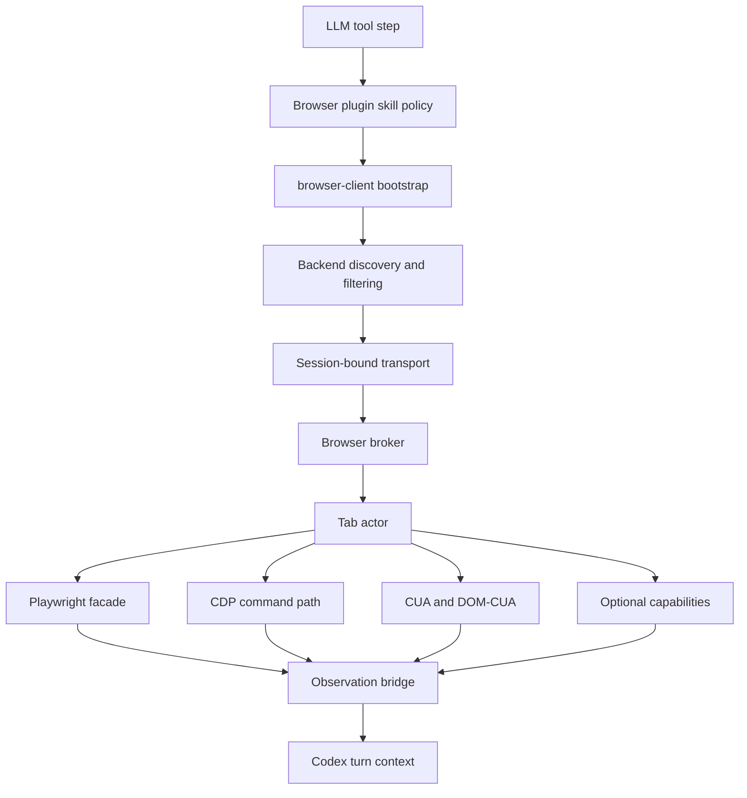
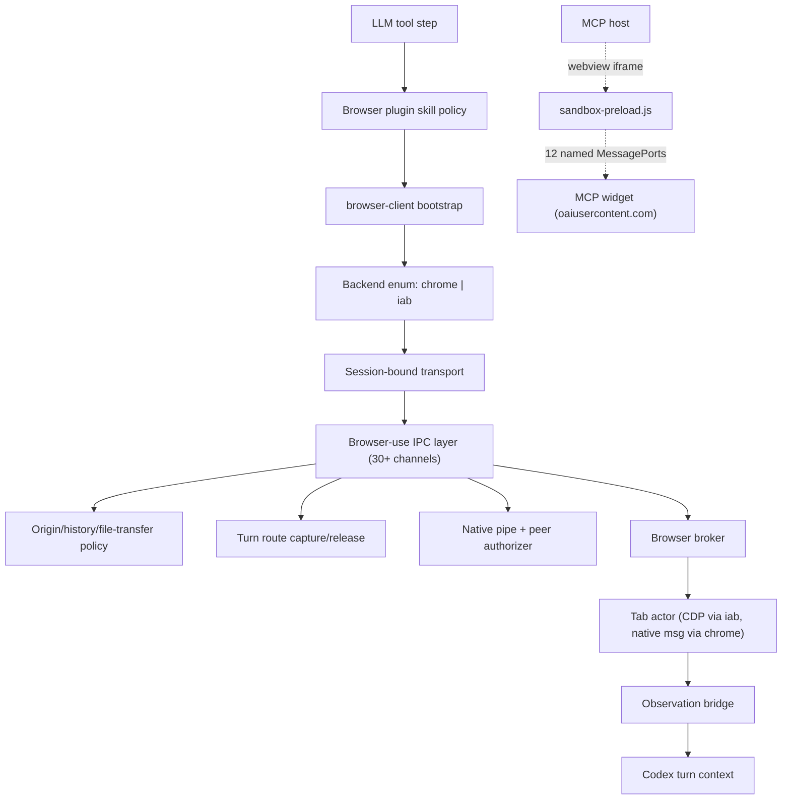

# Codex Browser Runtime And Transport Architecture

Overview router: [README.md](/Users/songmin/Documents/code-new/semantica-codegraph-v2/docs/analysis/codex-agent/browser-runtime/README.md)

이 문서는 `browser-client.mjs`에서 직접 보이는 runtime seam과, 그 seam으로부터 복원되는 best-fit browser architecture를 정리한다.

표기:
- `[FACT]`: bundle code나 skill contract에서 직접 보이는 것
- `[STRONG-INFERENCE]`: direct seam을 가장 잘 설명하는 구조 추론
- `[SOTA-INFERENCE]`: Codex 같은 제품을 새로 만들 때 가장 타당한 설계 추론
- `[NON-CLAIM]`: bundle만으로는 못 박을 수 없는 것

관련 문서:
- [browser-surface-and-capability-audit.md](/Users/songmin/Documents/code-new/semantica-codegraph-v2/docs/analysis/codex-agent/browser-runtime/browser-surface-and-capability-audit.md)
- [browser-comment-overlay-and-agent-sync.md](/Users/songmin/Documents/code-new/semantica-codegraph-v2/docs/analysis/codex-agent/browser-runtime/browser-comment-overlay-and-agent-sync.md)
- [turn-context-and-runtime-interface.md](/Users/songmin/Documents/code-new/semantica-codegraph-v2/docs/analysis/codex-agent/turn-context-and-runtime-interface.md)
- [plugin-audit.md](/Users/songmin/Documents/code-new/semantica-codegraph-v2/docs/analysis/codex-agent/plugin-audit.md)

scope note:

- 이 문서는 `browser-client`와 backend transport seam이 owner다.
- selected region overlay, comment marker, annotated screenshot, browser comment to thread sync는 [browser-comment-overlay-and-agent-sync.md](/Users/songmin/Documents/code-new/semantica-codegraph-v2/docs/analysis/codex-agent/browser-runtime/browser-comment-overlay-and-agent-sync.md)가 owner다.

---

## 1. Direct runtime seams

## 1.1 Bootstrap export

- `browser-client.mjs`는 `setupBrowserRuntime` export를 가진다. `[FACT]`
- skill 문서는 이 export를 bootstrap entrypoint로 사용한다. `[FACT]`

근거:
- [browser-client.mjs](/Users/songmin/.codex/plugins/cache/openai-bundled/browser/0.1.0-alpha2/scripts/browser-client.mjs)
- [SKILL.md](/Users/songmin/.codex/plugins/cache/openai-bundled/browser/0.1.0-alpha2/skills/browser/SKILL.md#L33)

## 1.2 Backend type split

bundle 코드에서 직접 보이는 backend identifiers:

- `extension` `[FACT]`
- `iab` `[FACT]`
- `cdp` `[FACT]`

의미:
- browser runtime은 single hardcoded driver가 아니라 multi-backend discovery model이다. `[STRONG-INFERENCE]`

근거:
- [browser-client.mjs](/Users/songmin/.codex/plugins/cache/openai-bundled/browser/0.1.0-alpha2/scripts/browser-client.mjs)

## 1.3 Session-bound transport

bundle 코드에서 직접 보이는 session transport 특징:

- runtime request는 `session_id`와 `turn_id`를 요구한다. `[FACT]`
- 값이 없으면 `"Missing required browser session_id"` / `"Missing required browser turn_id"` 에러를 낸다. `[FACT]`
- transport object는 `sendSessionRequest(...)`로 session params를 자동 주입한다. `[FACT]`

이건 browser 명령이 단순 local automation call이 아니라 `current Codex session/turn`에 귀속된다는 강한 증거다. `[STRONG-INFERENCE]`

근거:
- [browser-client.mjs](/Users/songmin/.codex/plugins/cache/openai-bundled/browser/0.1.0-alpha2/scripts/browser-client.mjs)

## 1.4 Session RPC shape

bundle 내부 transport에서 직접 보이는 RPC family:

- `executeCdp` `[FACT]`
- `attach`, `attachTarget`, `detach`, `detachTarget` `[FACT]`
- `getTabs`, `getUserTabs`, `getUserHistory`, `claimUserTab`, `createTab`, `finalizeTabs` `[FACT]`
- `nameSession` `[FACT]`
- `executeUnhandledCommand`, `moveMouse`, `getInfo` `[FACT]`

의미:

- browser runtime 뒤에는 tab/session broker가 있다. `[STRONG-INFERENCE]`
- top-level browser state와 user-owned tabs를 구분하는 rail이 있다. `[STRONG-INFERENCE]`

근거:
- [browser-client.mjs](/Users/songmin/.codex/plugins/cache/openai-bundled/browser/0.1.0-alpha2/scripts/browser-client.mjs)

## 1.5 Low-level execution primitives

bundle에서 직접 확인된 CDP-level seams:

| Primitive | Why it matters | Class |
| --- | --- | --- |
| `Page.captureScreenshot` | screenshot path가 CDP directly-backed | `[FACT]` |
| `Page.getLayoutMetrics` | viewport/fullpage crop 계산 | `[FACT]` |
| `Page.createIsolatedWorld` | read-only eval을 별도 world에서 수행 | `[FACT]` |
| `Runtime.evaluate` | page state read/eval path | `[FACT]` |
| `DOM.getDocument` | visible DOM extraction path 일부 | `[FACT]` |
| `Page.addScriptToEvaluateOnNewDocument` | tab bootstrap instrumentation 존재 | `[FACT]` |

근거:
- [browser-client.mjs](/Users/songmin/.codex/plugins/cache/openai-bundled/browser/0.1.0-alpha2/scripts/browser-client.mjs)

## 1.6 Display bridge

bundle 코드에서 보이는 display bridge:

- image는 `nodeRepl.emitImage(...)` 쪽으로 흘린다. `[FACT]`
- text/value는 console/log display bridge를 탄다. `[FACT]`

의미:
- browser runtime은 pure automation backend가 아니라 Codex 응답/관찰 stream과 연결된 presentation adapter를 가진다. `[STRONG-INFERENCE]`

근거:
- [browser-client.mjs](/Users/songmin/.codex/plugins/cache/openai-bundled/browser/0.1.0-alpha2/scripts/browser-client.mjs)

---

## 2. Best-fit hidden architecture

visible seam을 가장 잘 설명하는 모델은 아래다. `[STRONG-INFERENCE]`



핵심 해석:

1. `plugin`
- 라우팅/정책/skill layer

2. `browser-client`
- bootstrap + backend discovery + transport wrapper

3. `browser broker`
- current session에서 허용된 browser backend만 노출

4. `tab actor`
- navigation, screenshot, history, interaction, asset export를 실제로 수행하는 기본 실행 단위

5. `observation bridge`
- screenshot bytes, DOM snapshot text, dev output을 Codex turn context로 다시 주입

---

## 3. Why the architecture likely looks like this

## 3.1 Why not “just Playwright”

아닌 이유:

- `cua`, `dom_cua`, `playwright`, `dev`, `capabilities`가 같이 있다. `[FACT]`
- `visibility`, `viewport`, `pageAssets` 같은 capability registry가 따로 있다. `[FACT]`
- backend가 `iab`, `extension`, `cdp`로 갈라진다. `[FACT]`

즉 이건 Playwright wrapper가 아니라 `browser execution platform`에 가깝다. `[STRONG-INFERENCE]`

## 3.2 Why session binding matters

`session_id` / `turn_id` 강제는 다음을 시사한다. `[STRONG-INFERENCE]`

- agent/browser action auditability
- current thread 귀속성
- tab ownership and isolation
- approval/HITL gating과의 연결

새 제품에서도 이 binding이 없으면:
- 어떤 action이 어느 thread/user intent에 속했는지 추적이 약해지고
- concurrent browser work가 섞이고
- undo/recovery/logging이 어려워진다

## 3.3 Why isolated-world read-only eval matters

`Page.createIsolatedWorld` + read-only evaluate 조합은:

- DOM/JS state reading은 허용하되
- arbitrary mutation/evasion은 줄이고
- locator construction과 diagnosis는 가능하게 하려는 설계로 읽힌다. `[STRONG-INFERENCE]`

새 제품에서도 `read API`와 `state-mutating action API`는 분리하는 게 맞다. `[SOTA-INFERENCE]`

---

## 4. Rebuild architecture if starting from zero

Codex처럼 만들려면 아래 7개 레이어가 가장 타당하다. `[SOTA-INFERENCE]`

1. `BrowserControlPlane`
- session binding
- approval/HITL hooks
- capability visibility
- audit logging

2. `BackendDiscovery`
- available browser backends 탐색
- current session과 매칭되는 backend만 선택

3. `BrowserSessionBroker`
- browser instance lifecycle
- session naming
- tab ownership

4. `TabRuntime`
- `goto/reload/back/forward/screenshot/title/url`
- history and focus handling

5. `InteractionEngines`
- Playwright-like locators
- DOM snapshot
- coordinate/CUA fallback
- CDP dev hooks

6. `CapabilityRegistry`
- `visibility`
- `viewport`
- `pageAssets`
- future extensible capabilities

7. `ObservationAdapter`
- screenshot artifact
- DOM snapshot text
- structured result/error
- session/tab handle

---

## 5. Implementation implications

실제로 새로 구현하면:

- browser surface를 단일 monolith API로 만들지 말고 `browser -> tab -> capability` 3층으로 나누는 편이 낫다. `[SOTA-INFERENCE]`
- `tab`은 actor처럼 취급해 session-bound handle을 유지하는 편이 낫다. `[SOTA-INFERENCE]`
- CDP/raw browser primitive와 user-facing high-level Playwright facade를 같이 유지해야 한다. `[SOTA-INFERENCE]`
- backend discovery는 필수다. app 내 webview만 있다고 끝이 아니다. `[SOTA-INFERENCE]`
- observation payload는 plain text가 아니라 `artifact + structured metadata + handle` 세트여야 한다. `[SOTA-INFERENCE]`

---

## 6. Non-claims

- current Codex app이 정확히 어떤 embedded browser technology를 쓰는지 `[NON-CLAIM]`
- `extension` backend가 현재 이 세션에서 실제 active였는지 `[NON-CLAIM]`
- `browser-client.mjs` 내부 모든 bundled dependency의 역할 `[NON-CLAIM]`
- browser state persistence가 LevelDB/classic-level 기반이라는 주장 `[NON-CLAIM]`

---

## Round 2 update (2026-05-21 deep dive)

build 2867 main bundle inspection으로 확인된 추가/정정 사항.

### R2.1 Backend enum is `chrome` + `iab` (not `iab`/`extension`/`cdp`)

이전 §1.2는 `extension`, `iab`, `cdp`를 backend identifier로 적었다. round-2에서 main bundle 함수 `rn()`을 직접 확인한 결과, **active backend enum은 두 개**다.

1. `[FACT]` Main bundle function `rn()` returns active browser-use backend list:
   ```js
   if (e.externalBrowserUse) t.push('chrome');
   if (e.inAppBrowserUse)    t.push('iab');
   ```
2. `[FACT]` 가능한 출력: `['chrome']`, `['iab']`, `['chrome', 'iab']`.
3. `[FACT]` IPC channel: `x-codex-browser-use-available-backends`.
4. `[FACT]` Backend implementation은 workspace packages로 vendored됨: `browser-api`, `browser-backend-common`, `browser-common` (from `../../../lib/browser_use/`, OpenAI internal — not public).

기존 `extension`/`cdp` identifier에 대한 해석:
- `extension`: round-2의 `chrome` backend가 Chrome native messaging extension을 통해 동작하므로, 이전의 `extension` 추정은 사실상 `chrome` backend의 한 측면. ~~별도 backend identifier~~ → **CORRECTED 2026-05-21**: `extension`은 backend 이름이 아니라 `chrome` backend의 transport 구현 메커니즘.
- `cdp`: `iab` backend가 Electron webview의 CDP를 직접 사용하므로 §1.5의 `Page.captureScreenshot` 등 CDP primitive는 여전히 valid. 다만 user-facing backend identifier는 `iab` 하나. **CORRECTED 2026-05-21**: `cdp`는 standalone backend가 아니라 `iab` backend가 내부적으로 사용하는 protocol layer.

§1.5 (CDP primitives), §1.3 (session-bound transport), §1.4 (session RPC shape)는 그대로 유효하다.

### R2.2 browser-use IPC channel inventory (30+)

§1.4의 RPC family (`executeCdp, attach, getTabs, …`)는 `browser-client.mjs` bundle 내부 transport 수준이었다. round-2에서 확인된 것은 **main process ↔ renderer IPC layer**의 더 큰 surface다.

`[FACT]` Browser-use IPC channels (selected, total 30+):

| Group | Channels | Purpose |
| --- | --- | --- |
| Discovery | `x-codex-browser-use-available-backends` | backend enum publish |
| Origin policy | `browser-use-origin-add`, `browser-use-origin-remove`, `browser-use-origin-state-read` | per-origin allowlist mgmt |
| History approval | `browser-use-history-approval-mode-write` | history access approval policy |
| File transfer approval | `browser-use-file-transfer-approval-mode-write`, `browser-use-file-transfer-origin-add`, `browser-use-file-transfer-origin-remove` | upload/download origin allowlist |
| Native pipe | `browser-use-native-pipe-server`, `browser-use-native-pipe-startup`, `browser-use-native-pipe-peer-authorizer` | native messaging pipe lifecycle |
| State | `browser-use-viewport`, `browser-use-state`, `browser-use-cursor-state` | runtime state publish |
| Turn routing | `browser-use-turn-route-capture`, `browser-use-turn-route-release` | turn-scoped browser ownership |
| IAB specific | `browser-use-iab-api`, `browser-use-iab-tab` | in-app browser direct API |
| Capture | `browser-use-capture-surface` | screenshot/surface capture |
| Global approval | `browser-use-approval-mode-write` | top-level approval policy |
| Plugin policy | `browser-use-bundled-plugin-auto-install-disabled` | plugin install gate |

`[STRONG-INFERENCE]` `browser-use-turn-route-{capture, release}`는 §1.3의 `turn_id` 강제와 정확히 맞물린다. turn 단위 browser ownership lease가 명시적 IPC primitive라는 강한 증거.

`[STRONG-INFERENCE]` Origin/history/file-transfer 별도 channel은 §browser-safety의 confirmation tier 정책을 IPC layer에서 enforce하는 실제 hook다. policy가 doc-only가 아님을 뒷받침.

### R2.3 Native peer authorization binary

1. `[FACT]` Bundled native binary: `/Applications/Codex.app/Contents/Resources/native/browser-use-peer-authorization.node` (100KB).
2. `[FACT]` IPC channel `browser-use-native-pipe-peer-authorizer`가 이 binary를 호출하는 것으로 보인다 (이름 매칭). `[STRONG-INFERENCE]`
3. `[STRONG-INFERENCE]` Native pipe peer authorization은 Chrome native messaging host (`com.openai.codexextension`) ↔ Codex backend connection의 mutual auth gate일 가능성이 가장 높다. arbitrary process가 native pipe로 spoofing하지 못하게 막는 것.

### R2.4 Skybridge MCP UI iframe protocol (in-app browser hosts the iframe)

`[FACT]` In-app browser surface는 MCP UI iframe도 host한다. 이 iframe protocol은 browser-runtime/이 다루는 범위에 속한다 (in-app browser webview에서 host되므로). MCP pack과 cross-reference가 필요한 부분은 그쪽에서 별도로 다룬다.

1. `[FACT]` `sandbox-preload.js`가 iframe at `https://web-sandbox.oaiusercontent.com/?app=skybridge&locale=…&deviceType=desktop&unsafeSkipTargetOriginCheck=true#initId=<id>` 안에서 실행된다.
2. `[FACT]` `initId` regex: `/^[A-Za-z0-9_-]{1,128}$/`. Origin allowlist: 정확히 `web-sandbox.oaiusercontent.com` 또는 `*.web-sandbox.oaiusercontent.com`.
3. `[FACT]` **12 named MessagePorts** 기반 protocol.
   - Host → guest (7): `runWidgetCode`, `setAdditionalGlobals`, `setSafeArea`, `setTheme`, `setWidgetData`, `setWidgetView`, `notifyMcpAppsToolResult`
   - Guest → host (5): `navigate`, `notifyMcpAppsHostContext`, `notifyMcpAppsToolInput`, `notifyMcpAppsToolCancelled`, `requestMcpAppsResourceTeardown`
4. `[FACT]` `webview/index.html` CSP (verbatim):
   ```
   default-src 'none';
   img-src 'self' app: blob: data: https:;
   child-src 'self' blob: https://*.web-sandbox.oaiusercontent.com https://web-sandbox.oaiusercontent.com;
   frame-src 'self' blob: https://*.web-sandbox.oaiusercontent.com https://web-sandbox.oaiusercontent.com;
   worker-src 'self' blob:;
   script-src 'self' 'sha256-Z2/iFzh9VMlVkEOar1f/oSHWwQk3ve1qk/C2WdsC4Xk=' 'wasm-unsafe-eval';
   style-src 'self' 'unsafe-inline';
   font-src 'self' data:;
   media-src 'self' app: blob: data:;
   connect-src 'self' https://ab.chatgpt.com https://cdn.openai.com
   ```
5. `[MODEL]` `runWidgetCode`는 `{code, context}`를 받아 host가 guest 안으로 code를 push하는 channel. `setAdditionalGlobals`에는 allowlist가 없다. 따라서 이 protocol의 threat model은 host가 **OpenAI-blessed MCP server만 trust**한다는 가정에 전적으로 의존한다. arbitrary MCP server를 등록할 수 있다면 sandbox bypass primitive가 된다.
6. `[STRONG-INFERENCE]` `connect-src`가 `ab.chatgpt.com`, `cdn.openai.com`만 허용한다는 점은 widget code의 outbound network surface를 OpenAI infra로 제한한 의도된 보안 경계다.

이 protocol은 본 owner-pack의 `browser-client` transport와는 별개 layer다. `browser-client`는 agent→browser automation path를, skybridge protocol은 MCP widget UI hosting을 담당한다. 같은 in-app browser webview 안에 둘이 공존하지만 IPC layer가 다르다. `[STRONG-INFERENCE]`

### R2.5 Implication for §2 best-fit architecture diagram

§2의 mermaid diagram은 여전히 valid하지만, round-2 fact를 반영한 augmented view:



### R2.6 Round-2 non-claims

- `chrome` backend가 단일 Chrome process만 지원하는지, multiple profile을 지원하는지 `[NON-CLAIM]`
- Native peer authorizer binary가 어떤 cryptographic primitive를 사용하는지 (mTLS/HMAC/etc) `[NON-CLAIM]`
- Skybridge `runWidgetCode`가 받는 `code`의 정확한 실행 context (vm sandbox, JS realm 등) `[NON-CLAIM]`
- `browser-use-turn-route-capture` lease가 cooperative인지 preemptive인지 `[NON-CLAIM]`
