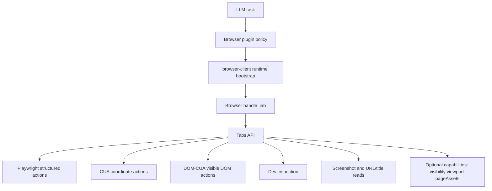

# Codex Browser Surface And Capability Audit

Overview router: [README.md](/Users/songmin/Documents/code-new/semantica-codegraph-v2/docs/analysis/codex-agent/browser-runtime/README.md)

이 문서는 Codex 브라우저 기능의 visible surface만 먼저 고정한다.

표기:
- `[FACT]`: plugin metadata, skill contract, capability docs, current-session plugin policy에서 직접 보이는 것
- `[STRONG-INFERENCE]`: visible surface를 가장 잘 설명하는 구조 추론
- `[SOTA-INFERENCE]`: Codex와 비슷한 제품을 새로 만들 때의 권장 구조 추론
- `[NON-CLAIM]`: 현재 surface만으로는 단정할 수 없는 것

---

## 1. Final verdict

- Codex 브라우저는 단순 `open URL` 기능이 아니다. `[STRONG-INFERENCE]`
- visible contract 기준으로는 `Browser plugin -> browser-client runtime -> browser handle -> tab handle -> capability families` 구조가 가장 타당하다. `[STRONG-INFERENCE]`
- 상호작용 엔진은 하나가 아니라 `Playwright`, `CUA`, `DOM-CUA`, `dev`, `clipboard`, `optional capability`가 병렬로 붙은 형태다. `[FACT]`

---

## 2. Direct evidence inventory

## 2.1 Plugin identity

직접 보이는 metadata:

| Evidence | Meaning | Class |
| --- | --- | --- |
| plugin name `browser` | browser surface가 별도 plugin bundle | `[FACT]` |
| aliases `@browser`, `@browser-use`, `Browser`, `in-app browser` | 호출 표면이 명시적 | `[FACT]` |
| keywords `browser`, `automation`, `chrome`, `iab`, `node-repl`, `browser-client` | backend/runtime split 힌트 | `[FACT]` |
| interface capabilities `Interactive`, `Read`, `Write` | read-only viewer가 아니라 live interactive surface | `[FACT]` |

근거:
- [plugin.json](/Users/songmin/.codex/plugins/cache/openai-bundled/browser/0.1.0-alpha2/.codex-plugin/plugin.json#L2)
- [plugin.json](/Users/songmin/.codex/plugins/cache/openai-bundled/browser/0.1.0-alpha2/.codex-plugin/plugin.json#L11)
- [plugin.json](/Users/songmin/.codex/plugins/cache/openai-bundled/browser/0.1.0-alpha2/.codex-plugin/plugin.json#L20)

## 2.2 Canonical entrypoint

skill 문서가 직접 말하는 것:

- browser work의 core entrypoint는 `scripts/browser-client.mjs`다. `[FACT]`
- setup은 `setupBrowserRuntime({ globals: globalThis })`로 시작한다. `[FACT]`
- setup 뒤 `agent.browsers.get("iab")`로 in-app browser handle을 받는다. `[FACT]`
- browser 제어는 generic Node REPL `js` tool 위에서 수행한다. `[FACT]`

근거:
- [SKILL.md](/Users/songmin/.codex/plugins/cache/openai-bundled/browser/0.1.0-alpha2/skills/browser/SKILL.md#L28)
- [SKILL.md](/Users/songmin/.codex/plugins/cache/openai-bundled/browser/0.1.0-alpha2/skills/browser/SKILL.md#L31)
- [SKILL.md](/Users/songmin/.codex/plugins/cache/openai-bundled/browser/0.1.0-alpha2/skills/browser/SKILL.md#L33)
- [SKILL.md](/Users/songmin/.codex/plugins/cache/openai-bundled/browser/0.1.0-alpha2/skills/browser/SKILL.md#L54)

## 2.3 Browser-scoped capabilities

직접 보이는 browser-level capability:

| Capability | What it does | Class |
| --- | --- | --- |
| `visibility` | 브라우저를 시각적으로 보여주거나 숨김 | `[FACT]` |
| `viewport` | viewport override / reset | `[FACT]` |

근거:
- [visibility.md](/Users/songmin/.codex/plugins/cache/openai-bundled/browser/0.1.0-alpha2/docs/capabilities/browser/visibility.md#L1)
- [viewport.md](/Users/songmin/.codex/plugins/cache/openai-bundled/browser/0.1.0-alpha2/docs/capabilities/browser/viewport.md#L1)

## 2.4 Tab lifecycle surface

skill 문서 끝단의 API contract에서 직접 보이는 것:

| Surface | Methods | Meaning | Class |
| --- | --- | --- | --- |
| `Tabs` | `get`, `list`, `new`, `selected` | multi-tab browser model | `[FACT]` |
| `Tab` navigation | `goto`, `reload`, `back`, `forward`, `close` | live navigation control | `[FACT]` |
| `Tab` observation | `title`, `url`, `screenshot` | current state readout | `[FACT]` |

근거:
- [SKILL.md](/Users/songmin/.codex/plugins/cache/openai-bundled/browser/0.1.0-alpha2/skills/browser/SKILL.md#L505)
- [SKILL.md](/Users/songmin/.codex/plugins/cache/openai-bundled/browser/0.1.0-alpha2/skills/browser/SKILL.md#L513)

## 2.5 Interaction families under a tab

`Tab` 아래에 직접 노출되는 상호작용 family:

| Family | Direct role | Why it matters |
| --- | --- | --- |
| `playwright` | locator-based structured interaction | deterministic UI automation |
| `cua` | coordinate-based action | fallback for raw UI control |
| `dom_cua` | filtered visible DOM node id 기반 action | semi-structured interaction |
| `dev` | developer-oriented inspection | debug/runtime investigation |
| `clipboard` | clipboard interaction | copy/paste/state bridging |
| `capabilities` | tab-specific optional features | asset export 등 확장 기능 |

모두 `[FACT]`.

근거:
- [SKILL.md](/Users/songmin/.codex/plugins/cache/openai-bundled/browser/0.1.0-alpha2/skills/browser/SKILL.md#L513)
- [SKILL.md](/Users/songmin/.codex/plugins/cache/openai-bundled/browser/0.1.0-alpha2/skills/browser/SKILL.md#L534)
- [SKILL.md](/Users/songmin/.codex/plugins/cache/openai-bundled/browser/0.1.0-alpha2/skills/browser/SKILL.md#L545)
- [SKILL.md](/Users/songmin/.codex/plugins/cache/openai-bundled/browser/0.1.0-alpha2/skills/browser/SKILL.md#L555)

## 2.6 Playwright contract shape

visible Playwright subset:

- `domSnapshot()` `[FACT]`
- read-only `evaluate(...)` `[FACT]`
- locator builders: `getByRole`, `getByText`, `getByLabel`, `locator`, `frameLocator` `[FACT]`
- wait helpers: `expectNavigation`, `waitForLoadState`, `waitForURL`, `waitForEvent("download")` `[FACT]`

근거:
- [SKILL.md](/Users/songmin/.codex/plugins/cache/openai-bundled/browser/0.1.0-alpha2/skills/browser/SKILL.md#L555)

중요한 성질:
- `evaluate`는 unrestricted page eval이 아니라 read-only page scope로 제한된다. `[FACT]`
- locator-based path가 있어도 DOM snapshot discipline을 강하게 요구한다. `[FACT]`

근거:
- [SKILL.md](/Users/songmin/.codex/plugins/cache/openai-bundled/browser/0.1.0-alpha2/skills/browser/SKILL.md#L239)
- [SKILL.md](/Users/songmin/.codex/plugins/cache/openai-bundled/browser/0.1.0-alpha2/skills/browser/SKILL.md#L241)

## 2.7 Optional tab capability example: page assets

`pageAssets` capability가 직접 보여주는 것:

- rendered page state 기준 asset inventory를 뽑을 수 있다. `[FACT]`
- asset bundle을 local artifact directory로 export할 수 있다. `[FACT]`
- browser surface가 단순 interaction만이 아니라 artifact acquisition도 맡는다. `[STRONG-INFERENCE]`

근거:
- [pageAssets.md](/Users/songmin/.codex/plugins/cache/openai-bundled/browser/0.1.0-alpha2/docs/capabilities/tab/pageAssets.md#L1)

## 2.8 Operational guidance encoded in skill policy

skill이 직접 강제하는 usage posture:

- browser work는 background가 기본이고 필요 시에만 visible로 올린다. `[FACT]`
- current tab이 이미 target URL이면 같은 URL로 `goto`하지 않는다. `[FACT]`
- code/build change 뒤 localhost 검증은 `reload()` 후 다시 확인한다. `[FACT]`
- broad extraction보다 one fresh `domSnapshot()` 또는 one screenshot로 먼저 orientation하라고 한다. `[FACT]`

근거:
- [SKILL.md](/Users/songmin/.codex/plugins/cache/openai-bundled/browser/0.1.0-alpha2/skills/browser/SKILL.md#L10)
- [SKILL.md](/Users/songmin/.codex/plugins/cache/openai-bundled/browser/0.1.0-alpha2/skills/browser/SKILL.md#L216)
- [SKILL.md](/Users/songmin/.codex/plugins/cache/openai-bundled/browser/0.1.0-alpha2/skills/browser/SKILL.md#L218)
- [SKILL.md](/Users/songmin/.codex/plugins/cache/openai-bundled/browser/0.1.0-alpha2/skills/browser/SKILL.md#L243)

---

## 3. Best-fit functional decomposition

가장 설명력이 높은 기능 분해는 아래다. `[STRONG-INFERENCE]`

핵심:

- `Browser`는 단일 API가 아니라 orchestration entrypoint다. `[STRONG-INFERENCE]`
- `Tab`이 진짜 작업 단위다. `[STRONG-INFERENCE]`
- `Playwright`만 있는 게 아니라 structured/unstructured/dev/asset rail을 같이 가진다. `[FACT]`

---

## 4. If rebuilding from scratch

Codex 비슷하게 만든다면 최소 surface는 여기까지는 필요하다. `[SOTA-INFERENCE]`

1. `BrowserManager`
- current session에 속한 browser instance resolve
- visibility/viewport 같은 browser-scoped capability 제공

2. `TabManager`
- `list/get/new/selected`
- session-bound tab id 유지

3. `Interaction adapters`
- `playwright-like`
- `coordinate CUA`
- `visible DOM node-id action`

4. `Observation adapters`
- screenshot bytes
- DOM snapshot text
- title/url/history
- dev logs/network/assets

5. `Capability registry`
- browser-scoped, tab-scoped optional capability discoverability

이 5개가 없으면 Codex 스타일 browser surface의 핵심 차별점이 안 나온다. `[STRONG-INFERENCE]`

---

## 5. What this document does not claim

- 실제 app 내부가 Electron webview인지, Chrome extension host인지, 별도 embedded browser인지 `[NON-CLAIM]`
- `iab` 약자가 정확히 어떤 internal implementation name인지 `[NON-CLAIM]`
- browser state persistence backend가 무엇인지 `[NON-CLAIM]`
- 모든 capability가 모든 backend에서 동일하게 지원되는지 `[NON-CLAIM]`

---

## Round 2 update (2026-05-21 deep dive)

Codex Desktop build 2867 plugin manifest 직접 검사로 확인된 두 browser-related plugin의 surface 정정/확장.

### R2.1 Browser plugin (IAB) — manifest absolute path & exact fields

§2.1의 plugin identity는 visible aliases/keywords/capabilities만 잡았다. round-2에서 manifest 절대경로와 declared field를 직접 확인:

1. `[FACT]` Plugin manifest absolute path: `/Applications/Codex.app/Contents/Resources/plugins/openai-bundled/plugins/browser/.codex-plugin/plugin.json`
2. `[FACT]` Version: `v0.1.0-alpha2`
3. `[FACT]` Aliases (manifest-declared): `@browser`, `@browser-use`
4. `[FACT]` Capabilities declared (manifest): `Interactive`, `Read`, `Write`
5. `[FACT]` IAB runtime entry: `scripts/browser-client.mjs` (199KB, minified) — Node REPL에서 bootstrap.
6. `[FACT]` SKILL.md에 명시된 model-facing API:
   - `browser.tabs.selected()`
   - `browser.tabs.new()`
   - `browser.tabs.list()`
   - `browser.nameSession(emoji taskname)`
   - screenshot bytes는 `nodeRepl.emitImage()`로 반환
7. `[FACT]` Default scope: **localhost, file://, in-app browser tabs only**.

§2.1의 alias list (`@browser`, `@browser-use`, `Browser`, `in-app browser`) 중 `Browser`와 `in-app browser`는 user-facing label일 수 있고, manifest-declared canonical aliases는 위 두 개로 좁힌다. `[STRONG-INFERENCE]`

### R2.2 Chrome plugin — distinct plugin, distinct trust posture

§2 전체가 IAB browser plugin만 다뤘다. round-2에서 **chrome plugin이 별도 manifest로 존재**함이 확인됐다. 이건 §2.3 (browser-scoped capabilities) 이나 §2.4 (tab lifecycle)의 hidden 가정과 다르다 — chrome plugin은 별도 plugin entity다.

1. `[FACT]` Plugin manifest absolute path: `/Applications/Codex.app/Contents/Resources/plugins/openai-bundled/plugins/chrome/.codex-plugin/plugin.json`
2. `[FACT]` Version: `v0.1.7` (browser plugin v0.1.0-alpha2와 다른 버전 lane)
3. `[FACT]` Capabilities declared: `Interactive`, `Read` (no `Write` — manifest POV에서는 순수 observational)
4. `[FACT]` Chrome extension ID: `hehggadaopoacecdllhhajmbjkdcmajg`
5. `[FACT]` Native messaging host name: `com.openai.codexextension`
6. `[FACT]` Native messaging host manifest install paths (per `installManifest.mjs`):
   - macOS: `~/Library/Application Support/Google/Chrome/NativeMessagingHosts/com.openai.codexextension.json`
   - Linux: `~/.config/google-chrome/NativeMessagingHosts/com.openai.codexextension.json`
   - Windows: `%APPDATA%/Local/OpenAI/extension/com.openai.codexextension.json`
7. `[FACT]` 별도 bundled `extension-host` native binary가 platform x arch matrix (macos/windows/linux × arm64/x64)로 존재. Chrome extension ↔ Codex backend bridge 역할.
8. `[FACT]` Plugin manifest의 privacy notice (verbatim): `"Browser data from using this plugin may be used for training"`.
9. `[FACT]` Helper scripts in chrome plugin: `chrome-is-running.js`, `open-chrome-window.js`, `check-extension-installed.js`, `check-native-host-manifest.js`, `installed-browsers.js`.

`[STRONG-INFERENCE]` IAB plugin과 chrome plugin은 capability surface가 다르다:
- IAB: `Interactive + Read + Write`, localhost/file/in-app tab 한정 → local dev work용.
- Chrome: `Interactive + Read` (Write 없음), real Chrome process → user real browsing context observation/interaction용.
- Privacy notice는 chrome plugin에만 명시됨 → trust posture가 명시적으로 다르다.

### R2.3 Backend enum correction (cross-link to runtime/transport)

§2.1 keywords에서 `iab` 외에 `chrome`이 함께 등장하는 이유는 [browser-runtime-and-transport-architecture.md](/Users/songmin/Documents/code-new/semantica-codegraph-v2/docs/analysis/codex-agent/browser-runtime/browser-runtime-and-transport-architecture.md) Round 2 §R2.1에서 확정되었다:

- Active browser-use backend enum은 `chrome` + `iab` 두 개.
- 이전 추정 `extension`, `cdp`는 별도 backend identifier가 아니라 각각 chrome backend / iab backend의 내부 transport 메커니즘.

§2의 functional decomposition diagram (`Browser handle: iab`)는 single-backend rendering이다. 실제로는 **두 backend handle**이 병렬로 가능하다 (`chrome`, `iab`). `[FACT]`

### R2.4 Round-2 non-claims

- `Write` capability를 chrome plugin이 정말 가지지 않는지 vs. manifest에서만 안 declare 한 것인지 `[NON-CLAIM]`
- `extension-host` native binary가 IPC framing에서 어떤 wire format을 쓰는지 (length-prefixed JSON 추정이나 미확정) `[NON-CLAIM]`
- IAB plugin과 chrome plugin이 같은 session lifecycle을 공유하는지 `[NON-CLAIM]`
