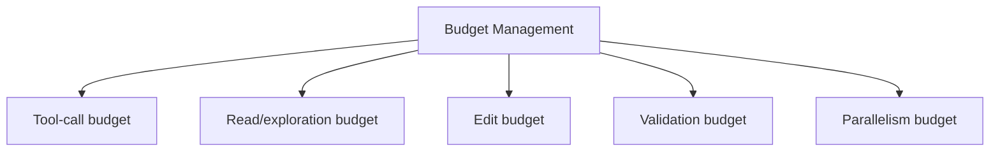
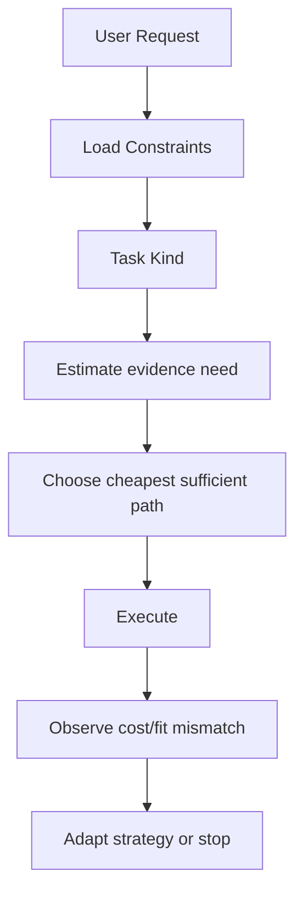
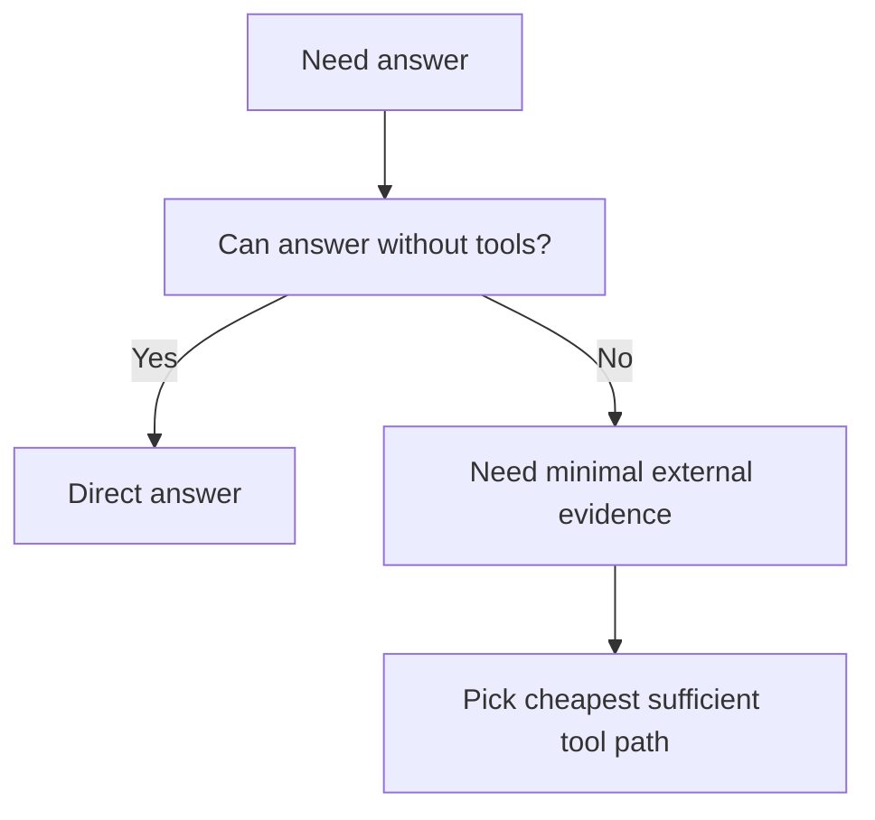
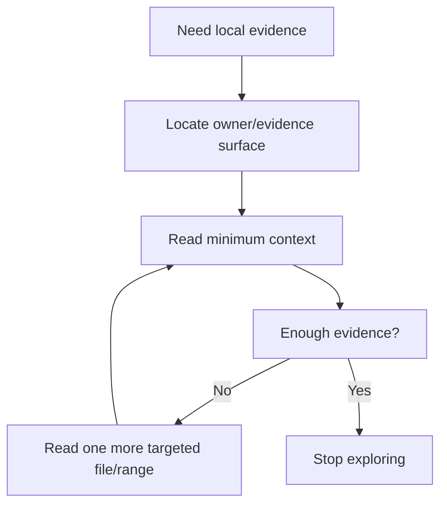
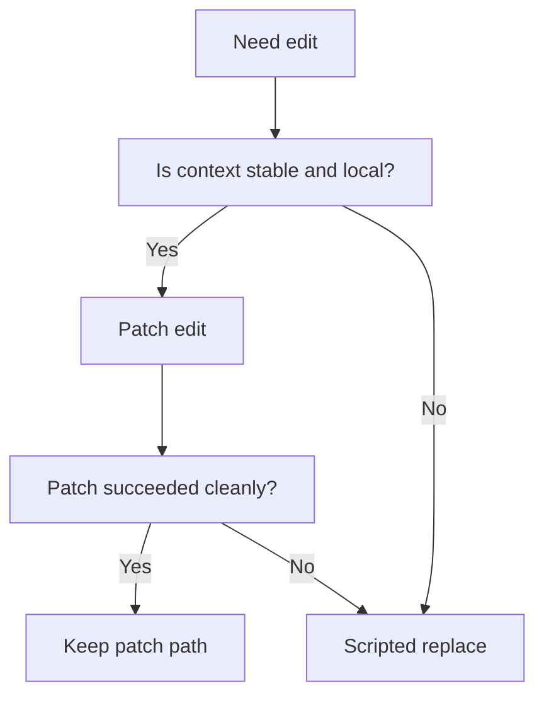
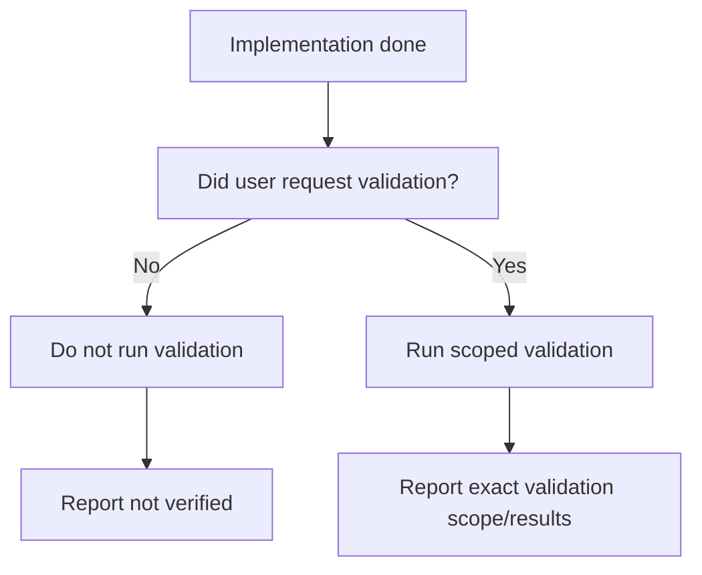
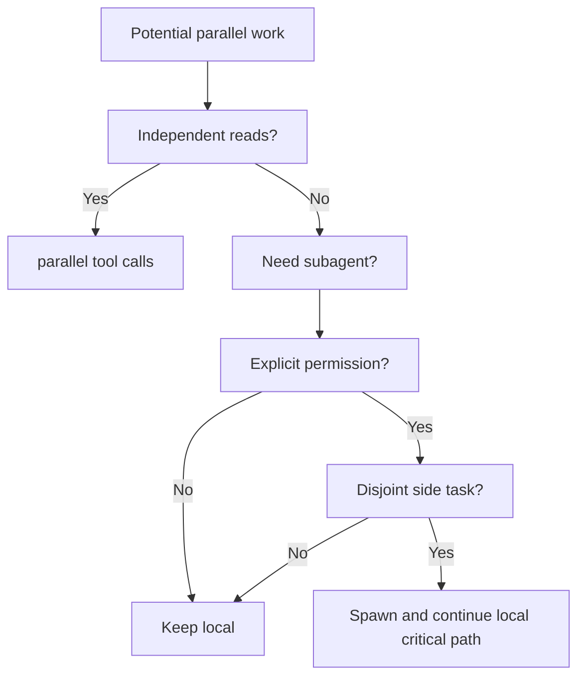
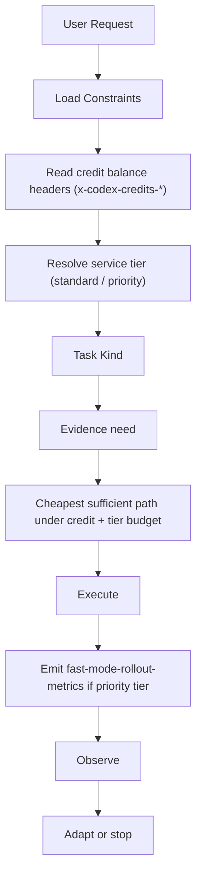

# Codex Agent Budget Management Audit

Overview router: [may-20-codex-agent-loop.md](/Users/songmin/Documents/code-new/semantica-codegraph-v2/docs/analysis/codex-agent/may-20-codex-agent-loop.md)

이 문서는 Codex 계열 에이전트가 `버젯`을 어떻게 관리하는지 감사 관점으로 재구성한다.

여기서 버젯은 단순 토큰만 뜻하지 않는다. 아래 다섯 축을 본다.

1. tool-call budget
2. read/exploration budget
3. edit budget
4. validation budget
5. parallelism/delegation budget

표기:
- `[FACT]`: 현재 세션 지침, tool schema, repo rules, 실제 tool history에서 직접 관측 가능한 사실
- `[STRONG-INFERENCE]`: 관측 사실을 가장 잘 설명하는 고신뢰 구조 추론
- `[WEAK-INFERENCE]`: plausible 하지만 직접 증거가 부족한 해석

주의:
- 이 문서는 내부 hidden scheduler나 cost model 원문을 본 것이 아니다.
- 대신 외부에서 보이는 정책과 실제 선택 패턴을 통해 `버젯 관리 메커니즘`을 역추적한다.

---

## 1. Executive summary

### 1.1 Final verdict

- `Alignment`: High `[STRONG-INFERENCE]`
- `Robustness`: Strong on visible budget rules, Medium on hidden internal metering details `[STRONG-INFERENCE]`
- `Confidence`: High on exploration/validation/tool budget, Medium on latent scoring details `[STRONG-INFERENCE]`
- `Ship readiness`: Ship as analysis doc `[STRONG-INFERENCE]`

### 1.2 Top conclusions

1. Codex는 `무제한 탐색형 agent`가 아니라 **명시적 비용 인식(cost-aware) 협업형 agent**로 보인다. `[STRONG-INFERENCE]`
2. 가장 강한 버젯은 `tool-call budget`과 `validation budget`이다. `[FACT]` + `[STRONG-INFERENCE]`
3. `한 번에 많이 읽지 말고, 필요한 최소 owner/evidence만 읽어라`는 read budget discipline이 직접 명시돼 있다. `[FACT]`
4. 병렬화는 허용되지만, `독립 read`나 `disjoint side task`에서만 쓰는 제한적 parallel budget 모델이다. `[FACT]` + `[STRONG-INFERENCE]`
5. 종료 시점의 honesty rail은 budget 절감의 부작용을 숨기지 못하게 하는 보정 장치다. `[STRONG-INFERENCE]`

---

## 2. Direct evidence inventory

## 2.1 Explicit budget-related rules

현재 세션에서 직접 관측 가능한 버젯 관련 규칙:

| Rule | Evidence | Classification |
| --- | --- | --- |
| 도구 호출은 비싸므로 신중히 해야 한다 | developer instructions | `[FACT]` |
| 시작 시 `ls -R`, `rg --files` 같은 광범위 탐색 금지 | developer instructions | `[FACT]` |
| 파일은 필요한 것만 읽어야 한다 | developer instructions | `[FACT]` |
| 같은 파일을 반복 재읽기하지 말아야 한다 | developer instructions | `[FACT]` |
| 읽기 작업은 가능하면 병렬화하라 | developer instructions | `[FACT]` |
| 검증/테스트는 요청받지 않으면 하지 말아야 한다 | developer instructions | `[FACT]` |
| follow-up에서도 이미 읽은 파일은 다시 읽지 말라는 강한 지침이 있다 | developer instructions | `[FACT]` |
| repo AGENTS는 `원인 파일 1~2개만 읽고 바로 패치`를 권한다 | repo AGENTS | `[FACT]` |
| repo AGENTS는 `probe-first`, `test-last`를 명시한다 | repo AGENTS | `[FACT]` |

## 2.2 Observed behavior from this thread

| Observed behavior | Notes | Classification |
| --- | --- | --- |
| broad scan 대신 `rg` + `sed -n`을 반복 사용했다 | narrow read discipline | `[FACT]` |
| 여러 파일 읽기는 `multi_tool_use.parallel`로 묶었다 | read parallelism | `[FACT]` |
| code edits에서 patch가 불안정해지자 scripted replace로 전환했다 | edit budget adaptation | `[FACT]` |
| 여러 차례 validation을 생략하고 그 사실을 명시했다 | validation budget + honesty rail | `[FACT]` |
| 현재 대화에서 subagent는 실제로 거의 사용하지 않았다 | delegation budget restraint | `[FACT]` |

---

## 3. What “budget” appears to mean here

가장 설명력이 높은 모델은 버젯을 아래 다섯 축으로 분리하는 것이다. `[STRONG-INFERENCE]`

### 3.1 Tool-call budget

의미:
- tool invocation 자체를 scarce resource로 본다

근거:
- “every tool call is expensive” 지침 `[FACT]`

### 3.2 Read/exploration budget

의미:
- 파일/검색/탐색 범위를 최소화

근거:
- broad scan 금지
- 필요한 파일만 읽기
- 같은 파일 재읽기 금지
- owner/evidence file 우선

분류:
- 근거는 `[FACT]`
- 이를 `read budget`로 묶어 보는 건 `[STRONG-INFERENCE]`

### 3.3 Edit budget

의미:
- 수정은 minimal coherent patch set으로 제한
- 국소 patch와 scripted replace를 비용/안정성 기준으로 전환

분류:
- actual fallback behavior는 `[FACT]`
- 이를 edit budget의 adaptive strategy로 해석하는 건 `[STRONG-INFERENCE]`

### 3.4 Validation budget

의미:
- build/test/verification은 high-cost lane
- user request 또는 explicit need가 없으면 보류

근거:
- 검증은 요청 시만
- repo는 `probe-first`, `test-last`

분류:
- `[FACT]`

### 3.5 Parallelism budget

의미:
- 병렬화 자체도 공짜가 아님
- read-heavy 독립 작업 또는 disjoint side task에만 사용

근거:
- 여러 읽기는 병렬화 권장 `[FACT]`
- subagent는 explicit permission + bounded disjoint tasks `[FACT]`

---

## 4. Budget management pipeline

버젯은 아래 순서로 실제 행동에 반영되는 것으로 보인다. `[STRONG-INFERENCE]`

설명:
- `Load Constraints`: 어떤 budget rule이 적용되는지 먼저 결정 `[FACT]`
- `Estimate evidence need`: 이 답변에 얼마나 많은 외부/로컬 증거가 필요한지 계산 `[STRONG-INFERENCE]`
- `Choose cheapest sufficient path`: 가능한 최소 비용 경로 선택 `[STRONG-INFERENCE]`
- `Observe cost/fit mismatch`: patch failure, broad result noise, validation cost 등을 반영 `[STRONG-INFERENCE]`

---

## 5. Tool-call budget audit

## 5.1 Constraint

- tool call은 비싸다 `[FACT]`

## 5.2 Practical effect

이 규칙은 아래처럼 보인다. `[STRONG-INFERENCE]`

1. 도구 없이 충분하면 direct answer
2. 도구가 필요하면 가장 좁은 도구 선택
3. 여러 독립 read가 필요하면 병렬화로 latency budget 절감
4. 한번 읽은 파일은 가능한 재사용

## 5.3 Best-fit model

### 5.4 Failure scenario if weakly managed

- setup: 모든 task에서 reflexively tool 호출
- trigger: stable knowledge question
- failure: unnecessary latency/cost, collaboration degradation
- severity: P2

Classification:
- scenario mechanism `[STRONG-INFERENCE]`

---

## 6. Read / exploration budget audit

## 6.1 Directly visible rules

- broad scan 금지 `[FACT]`
- 필요한 파일만 읽기 `[FACT]`
- 같은 파일 재읽기 금지 `[FACT]`
- owner/evidence-first read discipline `[FACT]` + repo AGENTS

## 6.2 Best-fit exploration model

이건 `explore-until-satisfied`가 아니라 `read-until-minimally-sufficient` 모델이다. `[STRONG-INFERENCE]`

## 6.3 Why this matters

이 모델이 없으면:
- 파일 재읽기 남발
- broad scan 남발
- context bloat
- 느린 협업

이런 문제가 생긴다. `[STRONG-INFERENCE]`

---

## 7. Edit budget audit

## 7.1 Direct evidence

- `apply_patch`를 실제로 사용했다 `[FACT]`
- patch context mismatch가 실제로 발생했다 `[FACT]`
- 이후 `exec_command + python` scripted replace로 전환했다 `[FACT]`

## 7.2 Interpretation

가장 그럴듯한 edit budget 모델:

1. 국소 안정 수정은 patch
2. 중복/불안정/대량 수정은 script
3. patch failure는 단순 실패가 아니라 **전략 전환 신호**

이 해석은 `[STRONG-INFERENCE]`다.

## 7.3 Edit strategy state machine

## 7.4 Budget rationale

왜 이게 budget management인가:
- patch는 diff clarity는 좋지만 repeated failure cost가 커질 수 있다
- scripted replace는 대량/중복 수정에서 total cost가 낮다

이 rationale은 `[STRONG-INFERENCE]`다.

---

## 8. Validation budget audit

## 8.1 Direct evidence

- 검증은 user-requested일 때만 `[FACT]`
- repo는 `probe-first`, `test-last` `[FACT]`
- final answer에서 validation 미실행을 명시해야 한다 `[FACT]`

## 8.2 Interpretation

validation은 optional garnish가 아니라, **명시 허가나 필요성이 있을 때만 열리는 expensive lane**으로 보인다. `[STRONG-INFERENCE]`

## 8.3 Validation control loop

## 8.4 Why honesty matters

validation budget을 아끼면 생기는 가장 큰 위험은 false confidence다.
이를 막는 보정 장치가:
- `not verified`
- `remaining gaps`
- `partial`

같은 reporting honesty rail이다. `[STRONG-INFERENCE]`

---

## 9. Parallelism / delegation budget audit

## 9.1 Direct evidence

- 여러 read는 병렬화 권장 `[FACT]`
- subagent는 explicit permission이 있을 때만 `[FACT]`
- disjoint ownership 요구 `[FACT]`
- wait는 sparingly `[FACT]`

## 9.2 Interpretation

병렬화는 무조건 좋은 게 아니라, coordination cost가 있는 budgeted action으로 보인다. `[STRONG-INFERENCE]`

### Best-fit model

1. independent read -> 병렬 OK
2. disjoint side task -> subagent OK
3. critical path blocking task -> 메인에서 직접
4. overlapping write -> 병렬 금지

## 9.3 Parallelism control diagram

---

## 10. Budget-aware stopping conditions

가장 설명력 높은 stopping model은 아래다. `[STRONG-INFERENCE]`

### Stop when

1. 충분한 증거를 확보했다
2. 다음 step의 비용이 현재 가치보다 크다
3. validation은 요청되지 않았다
4. 남은 불확실성은 honesty rail로 보고할 수 있다

### Continue when

1. owner/evidence가 아직 부족하다
2. patch path가 깨져서 strategy 전환이 필요하다
3. stale surface가 더 남아 있다
4. 현재 cost로 더 나은 certainty를 만들 수 있다

---

## 11. Attack surface analysis

## 11.1 No-budget model

- assumption: agent는 마음껏 탐색/검증/도구 호출한다
- fragility: observed “tools are expensive”, “read minimum”, “test-last”와 충돌
- verdict: 관측 사실과 불일치 `[STRONG-INFERENCE]`

## 11.2 Over-hard budget model

- assumption: agent는 rigid quota로만 행동한다
- fragility: patch -> script 전환, parallel read, current-state-aware adaptation 설명이 약함
- verdict: 부분 설명만 가능 `[STRONG-INFERENCE]`

## 11.3 Best-fit model

- explicit qualitative budget rules + LLM-side adaptive routing
- verdict: 가장 설명력 높음 `[STRONG-INFERENCE]`

---

## 12. Concrete failure scenarios if budget management were weak

### Scenario 1: read budget collapse

- setup: repo task
- trigger: 시작부터 broad file listing / full recursive scan
- expected under current policy: owner/evidence-first narrow read
- likely failure: latency 증가, context pollution, collaboration degradation
- severity: P2

### Scenario 2: validation budget collapse

- setup: user did not request tests
- trigger: assistant runs full heavy verification
- expected: no validation, honest report
- likely failure: instruction violation + wasted time
- severity: P2

### Scenario 3: edit budget collapse

- setup: repeated unstable block edits
- trigger: assistant insists on patch only
- expected: switch to script
- likely failure: repeated patch conflict, partial landing, stale blocks left over
- severity: P1

### Scenario 4: parallelism budget collapse

- setup: same-file modifications split across agents
- trigger: over-delegation
- expected: disjoint ownership only
- likely failure: merge conflict, state drift, coordination overhead
- severity: P1

---

## 13. False confidence traps

1. “버젯”은 토큰만 의미한다
- 아니다
- tool, read, edit, validation, parallelism 다 포함하는 operational budget에 가깝다

2. 병렬화는 항상 이득이다
- coordination cost와 write conflict가 있다

3. validation을 안 하면 그냥 덜 엄격할 뿐이다
- 그래서 honesty rail이 필요하다

4. patch가 더 정교하니 항상 patch가 낫다
- repeated mismatch cost까지 보면 아니다

---

## 14. Unknowns

직접 알 수 없는 것:

1. hidden internal quantitative cost score가 있는지 `[WEAK-INFERENCE]`
2. tool choice에 explicit numeric budget이 있는지 `[WEAK-INFERENCE]`
3. latent confidence/expected-value scoring 구현 세부 `[WEAK-INFERENCE]`

---

## 15. Most precise safe summary

- 현재 세션과 repo 지침은 `도구`, `읽기`, `수정`, `검증`, `병렬화`를 모두 scarce resource처럼 다루는 budget discipline을 직접 보여준다. `[FACT]` + `[STRONG-INFERENCE]`
- 가장 강한 visible budget rule은 `tool calls are expensive`, `read minimum`, `test-last`, `do not re-read`, `parallelize only when justified`다. `[FACT]`
- 실제 동작은 rigid quota라기보다, **qualitative budget rules + LLM-side adaptive routing** 모델이 가장 잘 설명한다. `[STRONG-INFERENCE]`
- validation을 줄이는 대신 honesty rail을 강화하는 구조가 존재한다고 보는 것이 observed behavior와 가장 잘 맞는다. `[STRONG-INFERENCE]`

---

## Round 2 update (2026-05-21 deep dive)

원본은 5축 (`tool / read / edit / validation / parallelism`) qualitative budget 만 다뤘다. 2026-05-21 deep dive 에서 Codex 가 **실제 credit/credit-balance HTTP 레일**과 **service tier 기반 speed budget**, 그리고 **fast-mode rollout metrics IPC** 를 운영한다는 사실이 직접 확인됐다. 즉 원본의 qualitative budget 5축에 **monetary credit budget** 과 **service-tier latency budget** 두 축이 더해진다.

### R2.1 Monetary credit budget — HTTP response headers

- `[FACT]` Codex Rust 바이너리는 다음 HTTP response header 를 직접 파싱한다:
  - `x-codex-credits-balance`
  - `x-codex-credits-has-credits`
  - `x-codex-credits-unlimited`
  - `x-codex-promo-message`
- `[STRONG-INFERENCE]`: 즉 원본의 qualitative "tool calls are expensive" 가 실제로는 **quantitative credit metering** 으로 뒷받침되고 있다. 원본 §14 unknown 1번 ("hidden internal quantitative cost score가 있는지") 은 **server-side 에 분명히 존재** 한다 — 다만 그 score 가 client-side 의사결정에 직접 들어가는지는 여전히 미확인.

### R2.2 Service tier `priority` = explicit latency budget knob

- `[FACT]` 모델별 service tier 에 `priority` 존재 (display name "Fast", 1.5x speed). (mode-and-plan-process Round 2 §R2.5 참조.)
- `[STRONG-INFERENCE]`: 즉 latency budget 이 binary user choice (standard / priority) 로 명시 exposed 되어 있다. 원본 §9 parallelism budget 은 latency 의 한 측면 (병렬화) 만 다뤘지만, service tier 는 **per-turn unit latency** 까지 가격이 매겨져 있다.

### R2.3 Fast-mode rollout metrics IPC

- `[FACT]` IPC channel 존재: `fast-mode-rollout-metrics`.
- `[STRONG-INFERENCE]`: rollout 동안 fast-mode usage 를 client→server 로 metering 하는 측정 레일. 원본 §10 stopping condition 에는 client-only metric 만 있었지만, 실제로는 **server-visible rollout telemetry** 가 budget 결정과 결합되어 있을 가능성 — 직접 evidence 는 channel 이름 뿐.

### R2.4 원본 budget pipeline 보정

원본 §4 pipeline (`Load Constraints → Task Kind → Estimate evidence → Cheapest sufficient path → Execute → Observe → Adapt`) 에 추가해야 할 단계:

- credit balance 가 0/depleted 일 때 stopping condition 이 자동 trigger 될 가능성 (`[WEAK-INFERENCE]` — 직접 evidence 없음).
- `x-codex-promo-message` 는 budget-adjacent UX hint 로 보임 — 직접 의사결정에 들어가지는 않을 가능성이 높지만 분류 미확정.

### R2.5 원본 §11 attack surface 보강

- 원본 §11.1 "No-budget model" 은 qualitative rules 만 근거로 했지만, Round 2 fact (credit headers + service tier) 로 **definitively 기각**. credit metering 은 server-side 에 hard-wired.
- 원본 §11.2 "Over-hard budget model" 도 부분 보정: client-side 는 여전히 qualitative + adaptive 지만, **server-side 는 quantitative credit metering**. 따라서 hybrid 모델이 정답.
- 새 P1: `x-codex-credits-unlimited: true` header 가 spoof 되면 client 측 budget discipline 이 풀려 무제한 호출 모드로 전환될 가능성 — 다만 client 가 그 header 를 어떻게 신뢰하는지 직접 evidence 없음.

### R2.6 원본 §14 unknown 해소 정도

- ~~"hidden internal quantitative cost score 가 있는지"~~ → **server-side 에 분명히 있다** (credit balance + has_credits + unlimited flags). client-side 에 quantitative score 가 노출되는지는 여전히 부분 미확인. `[FACT]`
- ~~"tool choice 에 explicit numeric budget 이 있는지"~~ → 여전히 직접 evidence 없음. service tier 는 turn-level 이지 tool-level 이 아니다. `[FACT: not enough evidence]`
- ~~"latent confidence/expected-value scoring"~~ → 직접 evidence 없음, 변동 없음.

### R2.7 Ownership map

- **Reasoning effort enum (`none/minimal/low/medium/high/xhigh`)** 자체는 [mode-and-plan-process-audit.md](./mode-and-plan-process-audit.md) Round 2 update 가 소유한다. reasoning effort 는 turn-level compute budget knob 지만 정의 위치는 mode doc.
- **`models_cache.json` 서버 핫스왑 attack surface** 는 prompt-and-policy-stack / mode-and-plan-process 가 분담 소유한다.
- 이 문서는 **monetary credit budget + service tier latency budget + fast-mode rollout metrics** 만 다룬다.
