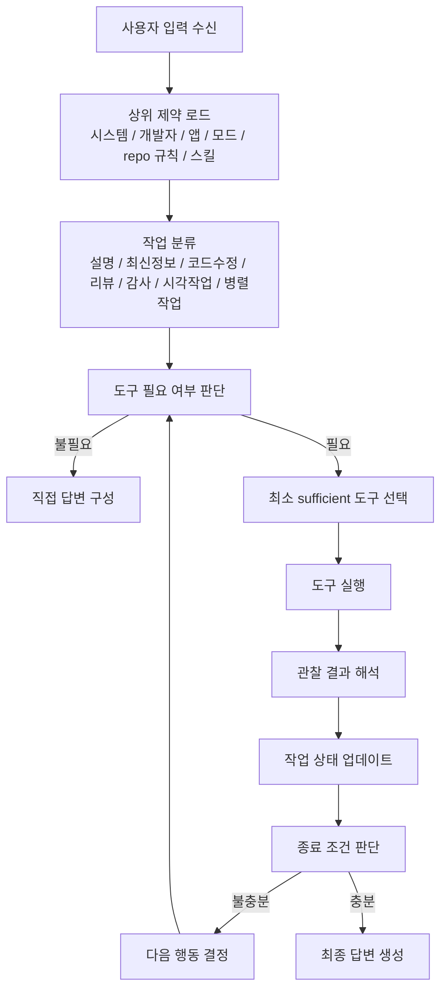
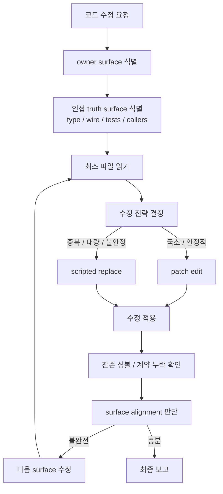
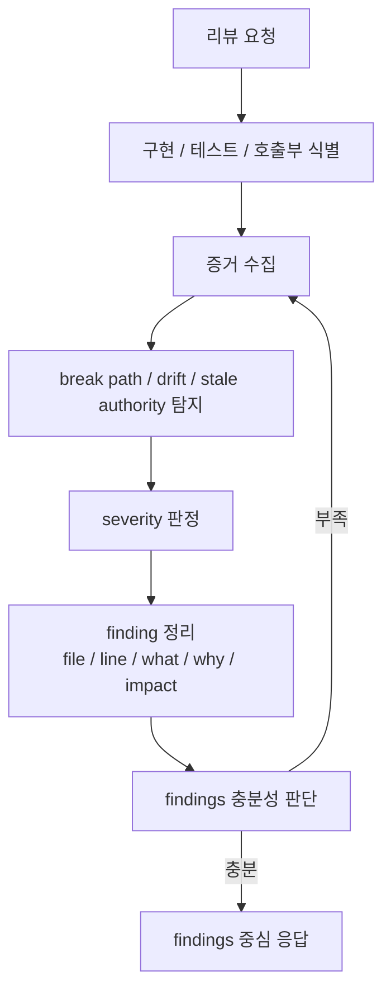
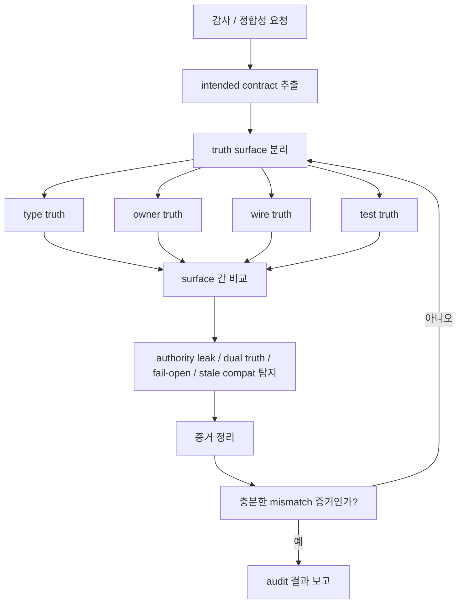
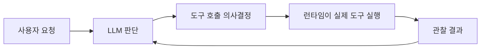

# Codex Agent Execution Loop

Overview router: [may-20-codex-agent-loop.md](/Users/songmin/Documents/code-new/semantica-codegraph-v2/docs/analysis/codex-agent/may-20-codex-agent-loop.md)

## 1. High-level model

Codex 계열 에이전트는 `질문 -> 답변`의 단순 1-pass 모델이 아니라, 아래처럼 동작하는 반복 루프에 가깝다.

요약:
- `ReAct family`와 닮았지만, 고전적인 `Thought -> Action -> Observation`를 외부에 그대로 노출하지는 않는다.
- 실제 구동축은 `정책 계층`, `도구 라우팅`, `상태 업데이트`, `종료 판단`이다.

## 2. Code-repair loop

코드 수정 작업은 별도의 repair loop를 가진다.

핵심 규칙:
- `owner first`
- `type / wire / tests`는 owner semantics에 맞춰 정렬
- patch가 불안정하면 scripted replace로 즉시 전환
- 문자열 grep은 closeout 보조일 뿐, semantic proof는 아니다

## 3. Review loop

리뷰 요청은 수정 루프가 아니라 증거 수집 루프에 가깝다.

핵심 규칙:
- findings first
- concrete file/line evidence
- generic praise보다 compile/runtime/semantic break 우선

## 4. Audit loop

감사 요청은 의도와 구현의 정합성 비교가 중심이다.

핵심 규칙:
- `type truth`, `owner truth`, `wire truth`, `test truth`를 분리해서 본다
- 문서나 테스트만으로 soundness를 선언하지 않는다

## 5. Runtime boundary

에이전트 실행은 LLM과 runtime의 역할 분리가 전제다.

경계:
- LLM:
  - 작업 분류
  - 도구 필요 여부 판단
  - 도구 선택
  - 결과 해석
  - 최종 응답 구성
- Runtime:
  - 어떤 도구가 있는지 제공
  - 권한/모드/세션 제약 집행
  - 실제 tool execution 수행

## 6. Practical interpretation

가장 실무적인 요약은 이렇다.

- Codex는 `순정 ReAct`라기보다 `policy-constrained tool-using iterative agent`다.
- Planner-heavy 시스템도 아니고, reflex bot도 아니다.
- 실제 체감은 `light planner + iterative executor + repair loop`에 가깝다.
