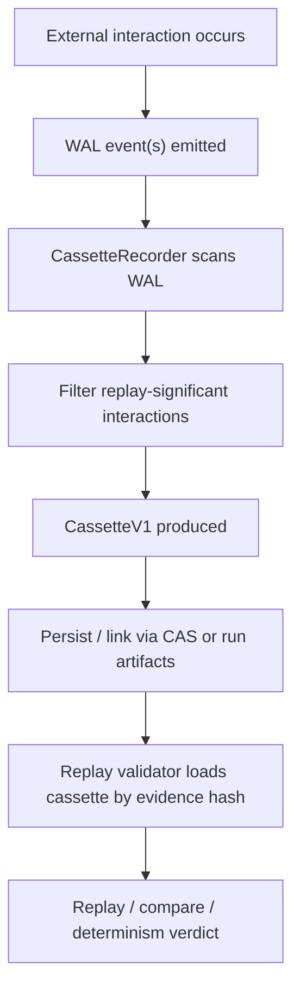
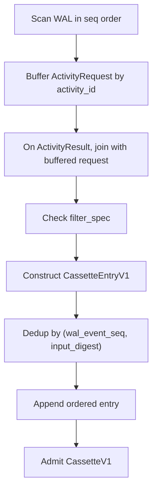
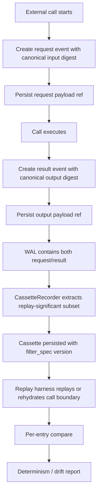

# External Call Record/Replay Audit

Overview router: [may-20-codex-agent-loop.md](/Users/songmin/Documents/code-new/semantica-codegraph-v2/docs/analysis/codex-agent/may-20-codex-agent-loop.md)

이 문서는 Codex/agent 계열에서 `외부 호출(LLM / API / DB / tool / sandbox exec 등)`의 입출력을 기록하고 재생하는 레이어를 감사 관점으로 정리한다.

핵심 질문:
- 현재 repo에 실제로 `cassette` 또는 record/replay layer evidence가 있는가
- 있다면 포맷은 무엇인가
- capture / persist / replay / verify 프로세스는 어떻게 보이는가
- LLM/API/DB 등 일반 external interaction으로 확장할 때 어떤 규칙이 필요한가

표기:
- `[FACT]`: 현재 repo 파일/주석/계약/구현에서 직접 관측 가능한 사실
- `[STRONG-INFERENCE]`: 관측 사실을 가장 잘 설명하는 고신뢰 구조 추론
- `[WEAK-INFERENCE]`: plausible 하지만 직접 근거가 부족한 해석

주의:
- 이 문서는 실제 repo evidence를 우선한다.
- evidence가 없는 부분은 `not enough evidence` 또는 weaker inference로 낮춘다.

---

## 1. Executive summary

### 1.1 Final verdict

- `Alignment`: Medium `[STRONG-INFERENCE]`
- `Robustness`: Fragile-to-Partial `[STRONG-INFERENCE]`
- `Confidence`: High on cassette format and recorder shape, Medium on full replay semantics, Low on DB/API generalization beyond explicit activity kinds `[STRONG-INFERENCE]`
- `Ship readiness`: Ship with blockers `[STRONG-INFERENCE]`

### 1.2 Top conclusions

1. repo 안에는 실제 `cassette` 계약과 recorder/validator 흔적이 존재한다. `[FACT]`
2. 현재 cassette SSOT는 `WAL의 replay-significant subset`으로 정의되어 있다. `[FACT]`
3. 포맷은 `run_id + ordered entries + optional filter_spec` 구조이며, 각 entry는 `kind`, `input/output digest`, `input/output ref`, `wal_event_seq`, `correlation_id`를 가진다. `[FACT]`
4. recorder는 WAL을 single-pass로 스캔해서 request/result를 join하고 cassette entry를 뽑는 구조다. `[FACT]`
5. replay validator는 아직 placeholder 성격이 강하다. strict digest compare를 말하지만 실제 구현은 non-empty check 수준이다. `[FACT]`
6. 따라서 `포맷 SSOT`와 `완전한 deterministic replay authority` 사이에는 아직 큰 구현 갭이 있다. `[STRONG-INFERENCE]`

---

## 2. Direct evidence inventory

## 2.1 Contract-level cassette evidence

직접 읽은 파일:
- [cassette_v1.rs](/Users/songmin/Documents/code-new/semantica-codegraph-v2/packages/analysis/quanta-v2/crates/quanta-contract-runtime/src/run_artifacts/cassette_v1.rs)

직접 관측된 사실:

| Evidence | Status | Notes |
| --- | --- | --- |
| `CassetteV1`는 replay-significance observation SSOT로 설명된다 | `[FACT]` | file header comment |
| Cassette는 WAL의 subset이다 | `[FACT]` | `WAL ⊇ Cassette` 명시 |
| replay significance 없는 WAL event는 cassette에 안 들어간다 | `[FACT]` | header comment |
| Cassette는 “external interactions (LLM calls, tool calls, test runs, sandbox execs)”를 기록한다고 명시된다 | `[FACT]` | header comment |
| `run_id`, `entries`, `filter_spec`를 가진다 | `[FACT]` | type definition |
| 각 entry는 `seq`, `kind`, `input_digest`, `output_digest`, `input_ref`, `output_ref`, `wal_event_seq`, `correlation_id`를 가진다 | `[FACT]` | type definition |
| `filter_spec`는 versioned filter rule이다 | `[FACT]` | type definition and comment |
| filter version mismatch는 fail-closed 해야 한다고 명시된다 | `[FACT]` | comment |

## 2.2 Recorder-level evidence

직접 읽은 파일:
- [cassette_recorder.rs](/Users/songmin/Documents/code-new/semantica-codegraph-v2/packages/analysis/quanta-v2/crates/quanta-agent-layer/src/adapters/determinism/cassette_recorder.rs)

직접 관측된 사실:

| Evidence | Status | Notes |
| --- | --- | --- |
| recorder는 `WAL -> Cassette extraction engine`이다 | `[FACT]` | file header comment |
| algorithm은 O(n) single-pass로 설명된다 | `[FACT]` | header comment |
| `ActivityRequest`를 buffer하고 `ActivityResult`와 join한다 | `[FACT]` | header + code |
| filter spec를 적용한다 | `[FACT]` | header + code |
| `(wal_event_seq, input_digest)` composite key로 dedup 한다 | `[FACT]` | header + code |
| deterministic claim을 위해 `BTreeMap` intermediate state를 사용한다 | `[FACT]` | header + code |
| `CasCommit`, `WorkspaceWrite`, `GateCheck`는 cassette external interaction에서 제외된다 | `[FACT]` | code |
| orphan result에 대해 tolerant/strict mode가 있다 | `[FACT]` | code |

## 2.3 Replay validator evidence

직접 읽은 파일:
- [cassette_replay_validator.rs](/Users/songmin/Documents/code-new/semantica-codegraph-v2/packages/analysis/quanta-v2/crates/quanta-agent-layer/src/adapters/determinism/cassette_replay_validator.rs)

직접 관측된 사실:

| Evidence | Status | Notes |
| --- | --- | --- |
| validator는 `DeterminismReplayPort`를 구현한다 | `[FACT]` | code |
| file comment는 “strict digest comparison for every entry”를 말한다 | `[FACT]` | header comment |
| 실제 구현은 in-memory `BTreeMap<evidence_hash, Vec<(input_digest, output_digest)>>`를 쓴다 | `[FACT]` | code |
| cassette not found면 `Err`다 | `[FACT]` | code |
| empty cassette면 `Err`다 | `[FACT]` | code |
| 실제 validator body는 “entries non-empty면 Ok(true)” placeholder 성격이다 | `[FACT]` | code comment + code |

## 2.4 Planning / RFC evidence

직접 읽은 파일:
- [TASK-A13-T8-golden-replay-and-eval-suite.md](/Users/songmin/Documents/code-new/semantica-codegraph-v2/docs/rfc/apr-13-typed-admission-frontend-for-agent-ingress/tasks/TASK-A13-T8-golden-replay-and-eval-suite.md)
- [18-agent-layer.md](/Users/songmin/Documents/code-new/semantica-codegraph-v2/docs/system-analysis/runtime-pipeline/18-agent-layer.md)

직접 관측된 사실:

| Evidence | Status | Notes |
| --- | --- | --- |
| full golden replay set과 KPI-oriented eval surface는 “아직 없다”고 적혀 있다 | `[FACT]` | T8 task current state |
| replay harness가 없으면 determinism claim이 문장으로만 남는다고 적혀 있다 | `[FACT]` | T8 hard blocker |
| determinism adapters로 `cassette_recorder`, `cassette_replay_validator`가 SSOT file references에 명시돼 있다 | `[FACT]` | agent-layer doc |

---

## 3. Reconstructed architecture

현재 evidence를 가장 잘 설명하는 상위 구조는 아래다. `[STRONG-INFERENCE]`



강한 근거:
- WAL subset semantics `[FACT]`
- recorder extraction engine `[FACT]`
- replay validator port `[FACT]`

약한 부분:
- 실제 production persistence path 전체 `[WEAK-INFERENCE]`
- DB/API-specific adapters의 완전한 구현 범위 `[WEAK-INFERENCE]`

---

## 4. Cassette format audit

## 4.1 Current format

직접 관측된 transport shape:

```text
CassetteV1 {
  run_id: [u8; 32],
  entries: Vec<CassetteEntryV1>,
  filter_spec: Option<CassetteFilterSpecV1>,
}
```

```text
CassetteEntryV1 {
  seq: u64,
  kind: CassetteEntryKind,
  input_digest: [u8; 32],
  output_digest: [u8; 32],
  input_ref: InlineOrBlobRefV1,
  output_ref: InlineOrBlobRefV1,
  wal_event_seq: Option<u64>,
  correlation_id: Option<[u8; 16]>,
}
```

```text
CassetteFilterSpecV1 {
  version: u16,
  included_kinds: BTreeMap<String, String>,
  excluded_patterns: Vec<String>,
}
```

모두 `[FACT]`.

## 4.2 Format invariants

직접 관측되거나 강하게 시사되는 포맷 불변식:

| Invariant | Evidence | Classification |
| --- | --- | --- |
| entry order is execution order | comments + `seq` meaning | `[FACT]` |
| cassette is deterministic for same WAL + same filter | recorder header | `[FACT]` |
| filter rules are versioned and mismatch must fail-closed | filter_spec comment | `[FACT]` |
| entry identity is tied to `(wal_event_seq, input_digest)` for join/dedup | recorder code | `[FACT]` |
| payload refs can be inline or blobref | type names and comments | `[FACT]` |

## 4.3 Format strengths

1. `payload body`와 `digest`를 분리한다 `[FACT]`
2. `run identity`와 `config determinism`을 분리한다 `[FACT]`
3. `filter_spec version`을 별도 rail로 둔다 `[FACT]`
4. `correlation_id`와 `wal_event_seq`가 join trace를 남긴다 `[FACT]`

## 4.4 Format gaps

1. `DB call`, `HTTP API call`, `queue publish`, `cache read/write` 같은 richer external kinds가 명시적으로 보이지 않는다 `[FACT]`
2. kind taxonomy는 현재 코드 조각에서 `LlmCall`, `ToolCall`, `TestRun` 위주로 보인다 `[FACT]`
3. external side effects의 semantic normalization rule은 직접 보이지 않는다 `not enough evidence` `[FACT]`

---

## 5. Recorder process audit

## 5.1 Current recorder process

직접 관측 가능한 process:



이 다이어그램은 recorder comment + code를 그대로 요약한 것이다. `[FACT]`

## 5.2 Strengths

1. single-pass O(n) `[FACT]`
2. request/result pair join `[FACT]`
3. replay-significance filtering `[FACT]`
4. dedup key 명시 `[FACT]`
5. deterministic map choice `[FACT]`

## 5.3 Weaknesses / drift risks

1. tolerant mode에서 orphan result가 silently skipped 된다 `[FACT]`
2. strict mode가 있더라도 default는 tolerant다 `[FACT]`
3. silent skip가 replay authority layer에서는 과도한 관용일 수 있다 `[STRONG-INFERENCE]`

### Risk

- orphan result가 실제 external side effect 누락을 가릴 수 있다
- severity: P1 `[STRONG-INFERENCE]`

---

## 6. Replay validator audit

## 6.1 Intended contract

header comment 기준 intended contract:
- cassette load
- every entry strict digest comparison
- fail-closed on loading error

이건 `[FACT]`.

## 6.2 Actual implementation

현재 구현:
- evidence hash -> vec of digest pairs in memory
- missing => Err
- empty => Err
- non-empty => Ok(true)

이것도 `[FACT]`.

## 6.3 Spec-to-implementation matrix

| Spec / Inferred Requirement | Implementation Evidence | Status | Risk | Notes |
| --- | --- | --- | --- | --- |
| Cassette-based replay validator exists | `CassetteReplayValidator` type exists | ✅ correct | P3 | visible implementation |
| Loading failure must fail-closed | `CassetteNotFound -> Err` | ✅ correct | P2 | matches comment |
| Empty cassette should not validate | `EmptyCassette -> Err` | ✅ correct | P2 | fail-closed |
| Every entry must be strict-compared | validator returns true for any non-empty entry list | ❌ contradicts | P0 | placeholder, no per-entry compare |
| Production validator should load from CAS/blob store | comment says production would use CAS; current code uses in-memory map | ⚠️ partial | P1 | test/prototype rail only |
| Determinism verdict should reflect replay semantics, not presence only | non-empty => true | ❌ missing | P0 | presence cache mistaken for replay proof |

---

## 7. External-call generalization audit

사용자 질문은 `LLM / API / DB 등`까지 포함한다. 현재 repo evidence로 직접 말할 수 있는 범위와 아닌 범위를 나눠야 한다.

## 7.1 Strongly supported external kinds

current cassette comments/code가 직접 지지하는 것:
- LLM calls `[FACT]`
- tool calls `[FACT]`
- test runs `[FACT]`
- sandbox execs `[FACT]`

## 7.2 Partially supported / not enough evidence

아래는 current evidence가 부족하다:
- HTTP REST / gRPC API request-response schema `[FACT: not enough evidence]`
- DB query/result capture schema `[FACT: not enough evidence]`
- transaction boundary capture `[FACT: not enough evidence]`
- nondeterministic clock/random/network normalization rule `[FACT: not enough evidence]`

### Best-fit inference

현재 구조를 일반화하면, API/DB도 같은 shape로 수용할 수 있다. `[STRONG-INFERENCE]`

필요한 확장:
1. `CassetteEntryKind`에 richer taxonomy 추가
2. input/output canonicalization rule
3. side-effect vs observation 구분
4. redaction / secret handling
5. transaction/session boundary markers

---

## 8. Recommended canonical cassette process

현재 repo evidence를 존중하면서, 외부 호출 일반화에 필요한 process를 구조적으로 적으면 아래가 맞다. `[STRONG-INFERENCE]`



## 8.1 Required stages

1. request capture
2. response/result capture
3. canonical digest computation
4. payload body persistence
5. ordered join
6. subset filtering
7. replay harness
8. per-entry verdict
9. diff reporting

---

## 9. Recommended format extensions for LLM / API / DB

현재 포맷을 크게 깨지 않고 필요한 확장:

## 9.1 Entry metadata

추가 후보:
- `provider`
- `endpoint_or_model`
- `status_class`
- `latency_ms`
- `normalized_headers_digest`
- `session_scope`
- `transaction_id`
- `error_class`

분류:
- current code에는 없음 `[FACT]`
- extension recommendation `[STRONG-INFERENCE]`

## 9.2 Payload classification

필요한 분리:
- raw input/output body
- normalized input/output body
- redacted input/output body

이유:
- 비밀정보/PII 보호
- deterministic compare와 forensic replay 분리

분류:
- recommendation `[STRONG-INFERENCE]`

## 9.3 DB-specific needs

DB external call cassette라면 필요:
- query kind
- normalized SQL digest
- bind params digest
- result-set digest
- row-order determinism rule
- transaction boundary id

현재 evidence엔 없음. `[FACT]`

---

## 10. Replay harness requirements

T8 task doc 기준으로도 replay harness 부재가 blocker다. `[FACT]`

### Required properties

1. same-input -> same-output assertion
2. ordering stability
3. multilingual / mixed intent / destructive canary coverage
4. transport parity
5. deterministic diff report

이 중 1, 3, 4, 5는 task doc에서 직접 보인다. `[FACT]`

### Missing pieces

1. full golden replay set 아직 없음 `[FACT]`
2. KPI-oriented eval surface 아직 없음 `[FACT]`
3. current validator is not enough to support real replay proof `[STRONG-INFERENCE]`

---

## 11. Attack surface analysis

## 11.1 Presence-only replay

- assumption: cassette exists and non-empty면 replay proof다
- fragility: actual per-entry semantic compare가 없다
- likely failure: stale or wrong output도 verified처럼 통과
- severity: P0

## 11.2 Tolerant orphan skipping

- assumption: orphan result는 harmless noise다
- fragility: missing request or lost join이 external interaction loss를 가릴 수 있다
- likely failure: incomplete replay transcript
- severity: P1

## 11.3 Filter drift without strict governance

- assumption: filter rule 바뀌어도 old cassette와 replay semantics는 비슷하다
- fragility: replay-significant subset 자체가 바뀐다
- current mitigation: versioned filter spec exists
- residual risk: validator must enforce mismatch fail-closed
- severity: P1

## 11.4 Secret / PII leakage

- assumption: raw payload refs can always be safely stored
- fragility: LLM/API/DB payloads often contain secrets or personal data
- current mitigation evidence: not enough evidence
- severity: P0 if unhandled

---

## 12. Concrete break attempts

### Scenario 1: stale cassette accepted as deterministic proof

- setup: evidence hash maps to non-empty cassette entries
- trigger: validator runs
- expected: every entry digest compared against replayed execution
- actual likely behavior: `Ok(true)` because entries are non-empty
- root cause: placeholder validator
- affected modules: replay validator, determinism gate
- severity: P0

### Scenario 2: orphan external result hidden by tolerant recorder

- setup: WAL contains ActivityResult without matching ActivityRequest
- trigger: recorder in default tolerant mode
- expected: fail-closed or at least degraded explicit record
- actual likely behavior: orphan skipped
- root cause: tolerant default
- affected modules: recorder, replay artifact completeness
- severity: P1

### Scenario 3: filter spec changed, replay not invalidated

- setup: cassette recorded with filter version N, validator expects N+1
- trigger: replay on historical cassette
- expected: fail-closed mismatch
- actual likely behavior: depends on validator path; current full enforcement not evidenced
- root cause: incomplete filter-version replay governance
- affected modules: cassette admission / replay validator
- severity: P1

### Scenario 4: API/DB side effects normalized incorrectly

- setup: DB query returns unordered rows or API response contains timestamps
- trigger: digest computed on unstable body
- expected: canonical normalization rule
- actual likely behavior: not enough evidence
- root cause: missing canonicalization contract for richer external kinds
- affected modules: future API/DB cassette layer
- severity: P1

---

## 13. Missing tests

1. `replay_validator_rejects_digest_mismatch_per_entry`
- scenario: one entry output digest differs
- expected: `Ok(false)` or explicit mismatch rail
- bug caught: presence-only validator

2. `recorder_orphan_result_default_is_explicitly_degraded_or_error`
- scenario: orphan result appears
- expected: explicit degraded rail or strict failure
- bug caught: silent skip

3. `filter_version_mismatch_fails_closed`
- scenario: cassette filter version older/newer than validator expectation
- expected: hard failure
- bug caught: semantic drift across replay rules

4. `llm_tool_testrun_kinds_roundtrip_in_cassette`
- scenario: each supported external kind recorded and replayed
- expected: deterministic order and digest-preserving roundtrip
- bug caught: kind-specific omission

5. `api_db_kind_requires_normalized_digest_contract`
- scenario: unstable API/DB payload
- expected: normalization step before digest
- bug caught: nondeterministic replay authority

---

## 14. Fixes

## 14.1 Minimal fix

1. Replace placeholder validator logic with real per-entry compare
2. Make orphan handling explicit: strict by default or degraded rail
3. Enforce filter version mismatch at validator boundary
4. Add golden replay harness before claiming determinism

## 14.2 Structural fix

1. Define richer `CassetteEntryKind` taxonomy for API/DB/network/queue rails
2. Add canonical normalization/redaction contract for payload classes
3. Separate:
   - replay authority digest
   - forensic/raw payload archive
4. Make replay verdict derive from raw comparison evidence, not cassette presence

## 14.3 Invariant enforcement points

- recorder admission boundary
- filter version check
- replay validator per-entry loop
- transport/API/DB canonicalization boundary
- secret/redaction boundary before persistence

---

## 15. Residual risk

even after strengthening current cassette path, these remain:

1. API/DB richer external kinds are still under-specified in current visible evidence
2. secret handling / PII redaction policy for cassette payloads is not evidenced
3. full offline golden replay set is still a roadmap item, not proven implementation

---

## 16. Most precise safe summary

- 현재 repo에는 실제 `CassetteV1` 계약과 `CassetteRecorder`, `CassetteReplayValidator`가 존재한다. `[FACT]`
- Cassette는 `WAL의 replay-significant subset`으로 정의되며, 외부 상호작용의 최소 deterministic replay authority를 지향한다. `[FACT]`
- 포맷은 꽤 잘 정의돼 있지만, replay validator는 아직 실질적으로 placeholder라서 presence-only proof에 가깝다. `[FACT]` + `[STRONG-INFERENCE]`
- 따라서 `포맷 SSOT는 있음`, `완전한 replay authority는 아직 미완성`이 현재 가장 정확한 판정이다. `[STRONG-INFERENCE]`
- LLM/API/DB까지 일반화하려면 kind taxonomy, canonical normalization, redaction, per-entry replay compare, golden replay harness가 추가로 필요하다. `[STRONG-INFERENCE]`

## Round 2 update (2026-05-21 deep dive)

이 doc은 본래 Quanta repo 측 cassette evidence를 다루지만, Codex가 실제로 어떤 external endpoint surface를 가지고 있는지를 fact로 확인하면 record/replay 일반화 작업의 target surface가 명확해진다.

### A. Codex external endpoint surface (Rust binary hardcoded)

- `[FACT]` Rust binary string evidence에서 발견된 endpoint:
  - `https://api.openai.com/v1/responses` — Responses API, SSE streaming
  - `https://api.openai.com/v1/realtime` — WebSocket (voice/audio)
  - `https://api.openai.com/auth`
  - `https://api.openai.com/profile`
  - `https://auth.openai.com/oauth/token`
  - `https://chatgpt.com/backend-api`
  - `https://chatgpt.com/codex-backend/agent-identity` — multi-agent JWT validation (신규 surface)
- `[FACT]` Custom CA bundle을 두 가지 env로 받는다: `SSL_CERT_FILE`, `CODEX_CA_CERTIFICATE`.
- `[FACT]` Telemetry / credits 응답 header: `x-codex-credits-balance`, `x-codex-credits-has-credits`, `x-codex-credits-unlimited`, `x-codex-promo-message`.
- `[FACT]` `models_cache.json`은 ETag-keyed (server-pushed system prompts + personality templates를 cache).

### B. Anthropic SDK presence

- `[FACT]` Codex bundle 안 `app-session.js`와 `worker.js`에 Anthropic SDK가 vendored되어 있다. binary string evidence: `cache_creation_input_tokens`, `cache_read_input_tokens`, `anthropic.response.timestamp`, `anthropic_error`, `anthropic.stream_error`.
- `[MODEL]` Trigger path는 **결정되지 않았다**. 현재 증거는 다음 둘 사이를 결정해주지 않는다:
  - (a) `external-agent-migration` 패키지가 Claude Code 데이터를 import할 때만 SDK가 동작 (one-shot migration only)
  - (b) live multi-provider routing — 사용자 세션 중에도 Anthropic이 호출 가능

`[NON-CLAIM]` Codex가 OpenAI 외 다른 provider로 live agent loop를 돌리는지 여부.

### C. Record/replay 일반화에 미치는 영향

§13/§15에서 `LLM/API/DB 일반화`를 roadmap으로 두었던 것이 이제 구체화된다:

| External kind | Required canonicalization | Class |
| --- | --- | --- |
| OpenAI Responses API (SSE) | request body + SSE event sequence를 deterministic으로 normalize. `x-codex-*` 헤더는 cassette payload에서 redact 또는 분리. | `[STRONG-INFERENCE]` |
| OpenAI Realtime (WebSocket) | frame-level message log + binary audio chunk hash. cassette V1 entry shape로는 부족, V2 candidate. | `[STRONG-INFERENCE]` |
| `chatgpt.com/codex-backend/agent-identity` (JWT) | JWT는 cassette에 그대로 적으면 안 됨 — claim digest로 redact. | `[STRONG-INFERENCE]` |
| Anthropic SDK calls (if live) | cache token counts (`cache_creation_input_tokens` 등)를 normalization rule에 포함. | `[STRONG-INFERENCE]` |
| `models_cache.json` (ETag) | model registry hydration은 cassette external interaction이 아니라 build-time artifact로 분리. | `[STRONG-INFERENCE]` |

### D. §13 missing pieces 갱신

§13에 추가되어야 하는 항목:

- multi-endpoint provider classifier (OpenAI vs Anthropic vs internal `chatgpt.com/codex-backend`).
- WebSocket frame log shape (Realtime API).
- JWT/credentials redaction rule (현재 §15 residual risk의 secret/PII에 구체적 surface가 붙음).
- ETag-keyed registry는 cassette 밖이라는 boundary 명시.

### E. CA bundle / network policy

- `[FACT]` `SSL_CERT_FILE`, `CODEX_CA_CERTIFICATE`가 정상 path. 즉 corporate CA를 통해 endpoint 호출이 가능하다는 의미.
- Record 측: cassette는 endpoint URL은 기록하지만 CA bundle/cert chain까지 capture할 의무는 없다 (replay determinism scope 밖).

### F. Ownership 정정

- `[FACT]` 이 doc은 Codex external surface 자체의 owner다. Skybridge / MCP UI surface는 `mcp-usage-audit.md` owner. `logs_2.sqlite` 등 local storage 측 retention은 `thread-management/storage-and-db-audit.md` owner.
- `[FACT]` Anthropic SDK presence와 trigger path 논의는 본 doc에서만 다룬다 — `agent-loop-deep-dive.md`에서는 본 doc으로만 위임.

### G. What stays unchanged

- §1 Final verdict는 그대로 (Quanta repo 측 cassette는 그대로 fragile-to-partial).
- §16 summary 5줄은 유지. Codex 측 endpoint surface 발견은 Quanta cassette의 정확성에 즉시 영향을 주지 않는다.
