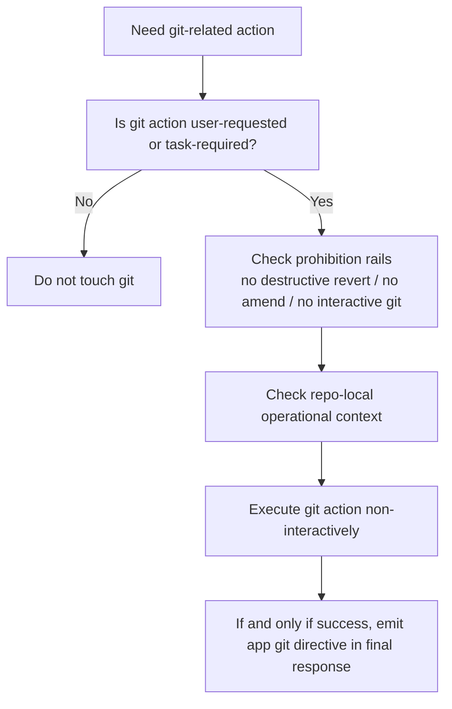
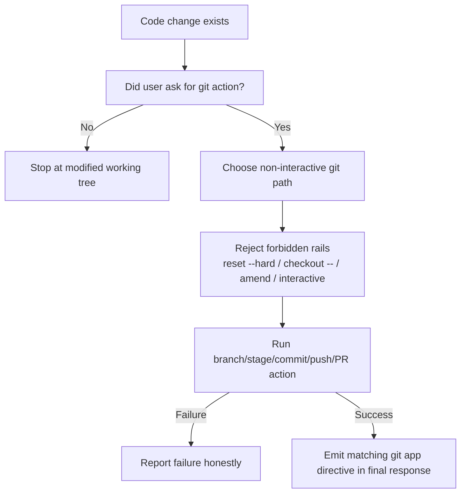

# Git and Branch Management Audit

Overview router: [may-20-codex-agent-loop.md](/Users/songmin/Documents/code-new/semantica-codegraph-v2/docs/analysis/codex-agent/may-20-codex-agent-loop.md)

이 문서는 Codex 계열 에이전트의 `git / branch management` 동작을 현재 세션에서 보이는 evidence 기준으로 감사 관점에서 정리한다.

표기:
- `[FACT]`: 현재 세션 지침, app context, tool/skill/plugin description, repo-local rule에서 직접 관측 가능한 사실
- `[STRONG-INFERENCE]`: 관측 사실을 가장 잘 설명하는 고신뢰 구조 추론
- `[WEAK-INFERENCE]`: plausible 하지만 직접 근거가 부족한 해석

주의:
- 이 문서는 hidden backend git orchestration이나 서비스측 PR lifecycle internals를 주장하지 않는다.
- 현재 세션의 visible contract와 repo-local operational rule만을 대상으로 한다.

---

## 1. Executive summary

### 1.1 Final verdict

- `Alignment`: High `[STRONG-INFERENCE]`
- `Robustness`: Strong on visible workflow rails, Medium on hidden platform internals `[STRONG-INFERENCE]`
- `Confidence`: High for current-session git policy and app directive behavior `[STRONG-INFERENCE]`
- `Ship readiness`: Ship as analysis doc `[STRONG-INFERENCE]`

### 1.2 Top conclusions

1. git/branch management는 단순 shell command 묶음이 아니라 `capability + policy prohibition + app directive` 3층 구조로 보인다. `[STRONG-INFERENCE]`
2. 현재 세션에는 git-related app directives가 직접 존재한다. `[FACT]`
3. 그러나 visible git capability가 곧 unrestricted git autonomy를 의미하지는 않는다. `[STRONG-INFERENCE]`
4. destructive git action, implicit revert, amend, interactive git 사용은 강하게 제한된다. `[FACT]`
5. branch / stage / commit / push / PR은 “실행 성공 후에만 app UI에 반영하는” 후행 reporting rail을 가진다. `[FACT]` + `[STRONG-INFERENCE]`

---

## 2. Direct evidence inventory

## 2.1 App-context git facts

직접 관측 가능한 app-context 사실:

1. branch prefix default는 `codex/`다. `[FACT]`
2. branch 생성/전환 성공 후에는 `::git-create-branch{...}` directive를 emit 하라고 적혀 있다. `[FACT]`
3. stage 성공 후에는 `::git-stage{...}` directive를 emit 하라고 적혀 있다. `[FACT]`
4. commit 성공 후에는 `::git-commit{...}` directive를 emit 하라고 적혀 있다. `[FACT]`
5. push 성공 후에는 `::git-push{...}` directive를 emit 하라고 적혀 있다. `[FACT]`
6. PR 생성 성공 후에는 `::git-create-pr{...}` directive를 emit 하라고 적혀 있다. `[FACT]`
7. 이 git directives는 commentary가 아니라 final response에서만 emit 하라고 적혀 있다. `[FACT]`
8. 실제 성공 전에는 emit 하면 안 된다고 적혀 있다. `[FACT]`

## 2.2 Developer-policy git facts

직접 관측 가능한 developer 지침:

1. dirty git worktree일 수 있다고 명시돼 있다. `[FACT]`
2. user가 만든 기존 변경은 revert하면 안 된다고 적혀 있다. `[FACT]`
3. `git reset --hard` 같은 destructive command는 금지라고 적혀 있다. `[FACT]`
4. `git checkout --` 같은 destructive restore도 금지라고 적혀 있다. `[FACT]`
5. interactive git console은 피하고 non-interactive git를 선호하라고 적혀 있다. `[FACT]`
6. amend는 사용자가 명시적으로 요청하지 않으면 하지 말라고 적혀 있다. `[FACT]`
7. validation behavior section에는 explicit request 없이는 `NEVER use git`라는 강한 지침이 있다. `[FACT]`

## 2.3 Repo-local operational facts

이 repo의 AGENTS에서 직접 관측 가능한 사실:

1. Rust verification workflow는 `scripts/cg-dispatch` front door를 따라야 한다. `[FACT]`
2. direct cargo 금지 같은 운영 규칙이 강하다. `[FACT]`
3. 즉 git workflow보다 먼저 repo-local operational workflow를 따라야 한다. `[STRONG-INFERENCE]`

## 2.4 Visible plugin/skill facts related to git

1. `GitHub` plugin이 enabled다. `[FACT]`
2. plugin-contributed skills로 `github:github`, `github:gh-address-comments`, `github:gh-fix-ci`, `github:yeet`가 보인다. `[FACT]`
3. plugin instructions는 relevant plugin capability를 standalone capability보다 선호하라고 적고 있다. `[FACT]`

---

## 3. Best-fit model

가장 설명력 높은 모델은 아래다. `[STRONG-INFERENCE]`

핵심은:
- git action은 가능하지만 기본 자동화 대상이 아니고, `[STRONG-INFERENCE]`
- permission/policy에 의해 강하게 gate되며, `[FACT]`
- app directive는 실제 git mutation의 대체물이 아니라 success reporting rail이라는 점이다. `[STRONG-INFERENCE]`

---

## 4. Capability layers

## 4.1 Execution layer

실제 git command는 shell/tooling layer에서 수행된다. `[STRONG-INFERENCE]`

근거:
- visible direct git mutation tool은 따로 없고, shell execution capability가 있다. `[FACT]`
- git-related app directives는 execution tool이 아니라 response directive다. `[FACT]`

## 4.2 UI/reporting layer

`::git-stage`, `::git-commit`, `::git-create-branch`, `::git-push`, `::git-create-pr`는 app UI synchronization/reporting rail이다. `[STRONG-INFERENCE]`

근거:
- “after successfully … emit directive”로 정의돼 있다. `[FACT]`

## 4.3 Workflow/policy layer

이 층이 가장 중요하다.

1. no destructive revert `[FACT]`
2. no implicit amend `[FACT]`
3. preserve user changes `[FACT]`
4. prefer non-interactive git `[FACT]`
5. do not use git unless relevant/requested `[FACT]`

즉 visible capability보다 위에서 policy가 workflow를 shaping한다. `[STRONG-INFERENCE]`

---

## 5. Branch management

## 5.1 Branch naming policy

1. 기본 prefix는 `codex/`다. `[FACT]`
2. 사용자가 다른 prefix를 원하면 그 요청을 따른다. `[FACT]`

## 5.2 Branch creation semantics

직접 관측 가능한 것은 다음뿐이다:

1. branch 생성/전환 성공 후 app directive를 emit 해야 한다. `[FACT]`
2. success 전에는 emit하면 안 된다. `[FACT]`

가장 정확한 추론:

- branch creation은 executable operation과 reporting operation이 분리돼 있다. `[STRONG-INFERENCE]`
- app directive는 branch creation 그 자체가 아니라 “이미 성공한 branch state를 app에 반영”하는 rail이다. `[STRONG-INFERENCE]`

---

## 6. Commit/stage/push/PR process

## 6.1 Stage

- stage 성공 후에만 `::git-stage{...}` `[FACT]`
- stage 자체는 directive로 일어나는 것이 아니라 underlying git operation success 후 반영된다 `[STRONG-INFERENCE]`

## 6.2 Commit

- commit 성공 후에만 `::git-commit{...}` `[FACT]`
- amend는 명시 요청 없으면 금지 `[FACT]`

## 6.3 Push

- push 성공 후에만 `::git-push{...}` `[FACT]`

## 6.4 PR

- PR 생성 성공 후에만 `::git-create-pr{...}` `[FACT]`
- `isDraft=true/false` field가 있다 `[FACT]`
- draft PR rail이 explicitly supported된다 `[FACT]`

---

## 7. Interaction with GitHub plugin

가장 설명력 높은 구조:

1. raw git mutation and local branch state live in shell/local repo rail `[STRONG-INFERENCE]`
2. GitHub plugin lives in repository/PR/CI workflow rail `[FACT]` + `[STRONG-INFERENCE]`
3. local branch push 이후 PR/CI/connector workflow는 plugin skill이 더 natural rail이다 `[STRONG-INFERENCE]`

즉:
- branch/commit/push는 local repo state mutation,
- PR triage / CI / review-thread work는 GitHub plugin-assisted workflow,
로 분리해서 보는 것이 맞다. `[STRONG-INFERENCE]`

---

## 8. Default operating stance

현재 세션에서 가장 보수적으로 안전한 operating stance:

1. git는 항상 쓰는 기본 루프가 아니다. `[STRONG-INFERENCE]`
2. user request 또는 명시적 delivery workflow가 있어야 stage/commit/push/PR 쪽으로 간다. `[STRONG-INFERENCE]`
3. code modification과 git mutation은 분리된다. `[STRONG-INFERENCE]`
4. 수정이 끝났다고 해서 자동 stage/commit이 따라오지 않는다. `[STRONG-INFERENCE]`
5. success reporting directive는 실제 action 이후에만 나온다. `[FACT]`

---

## 9. Typed process model

---

## 10. Prohibitions and guard rails

## 10.1 Explicit prohibitions

1. no destructive reset/checkout restore `[FACT]`
2. no revert of unrelated user changes `[FACT]`
3. no amend unless asked `[FACT]`
4. avoid interactive git `[FACT]`

## 10.2 Effective guard rails

1. separate code-edit success from git workflow success `[STRONG-INFERENCE]`
2. require real success before UI reflection `[FACT]`
3. preserve dirty worktree semantics `[STRONG-INFERENCE]`
4. treat git as opt-in operational lane rather than automatic closeout step `[STRONG-INFERENCE]`

---

## 11. Failure scenarios

### Scenario 1: implicit cleanup reverts user changes

- setup: dirty worktree with unrelated user edits
- trigger: assistant treats revert/reset as cleanup tool
- expected under visible contract: preserve unrelated edits
- likely failure: user work loss
- severity: P0

Classification:
- prohibition evidence `[FACT]`

### Scenario 2: app directive emitted before real success

- setup: branch/commit/push fails
- trigger: assistant still emits git directive
- expected: no directive until real success
- likely failure: app/UI state dishonesty
- severity: P1

Classification:
- directive contract `[FACT]`

### Scenario 3: code fix treated as auto-commit request

- setup: user asked only for code modification
- trigger: assistant performs stage/commit unasked
- expected: stop at changed files unless user requests git workflow
- likely failure: overreach / undesired mutation
- severity: P1

Classification:
- visible policy pressure `[FACT]` + `[STRONG-INFERENCE]`

---

## 12. False confidence traps

1. “git directives가 있으니 git 자체를 그걸로 실행한다”
- 아니다
- visible contract상 그건 post-success UI/reporting rail이다

2. “branch prefix가 있으니 항상 branch를 새로 딴다”
- 아니다
- prefix default가 있을 뿐, branch creation 자체가 항상 mandatory라는 evidence는 없다

3. “code를 고쳤으니 자동 commit/push까지 가도 된다”
- 아니다
- visible rules는 오히려 git overreach를 강하게 억제한다

4. “GitHub plugin이 있으니 local git workflow가 필요 없다”
- 아니다
- local repo mutation rail과 PR/CI/review workflow rail은 분리해서 보는 편이 더 정확하다

---

## 13. Unknowns

직접 알 수 없는 것:

1. hidden backend branch orchestration internals `[WEAK-INFERENCE]`
2. app directive가 UI state에 반영되는 exact backend path `[WEAK-INFERENCE]`
3. local git command wrapper가 있는지 여부 `[WEAK-INFERENCE]`
4. platform-wide default branch policy beyond current visible context `[WEAK-INFERENCE]`

---

## 14. Most precise safe summary

- 현재 세션에는 git/branch/commit/push/PR 관련 app directive와 naming policy가 직접 존재한다. `[FACT]`
- 그러나 그 surface는 unrestricted automatic git autonomy가 아니라 **policy-gated operational workflow**로 보는 것이 가장 정확하다. `[STRONG-INFERENCE]`
- git action은 underlying execution success와 app reporting이 분리돼 있고, directive는 success 후 반영 rail이다. `[STRONG-INFERENCE]`
- destructive git action, amend, interactive git, unrelated-change revert는 강하게 제한된다. `[FACT]`
- 따라서 이 에이전트의 git process는 “항상 자동으로 version-control까지 마감하는 루프”라기보다, “사용자 요청과 policy gate가 있을 때만 들어가는 controlled workflow lane”으로 설명하는 것이 가장 정확하다. `[STRONG-INFERENCE]`
