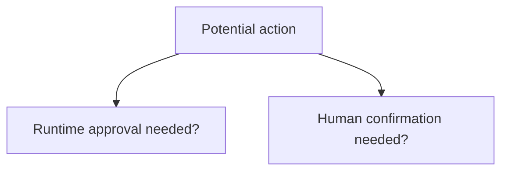
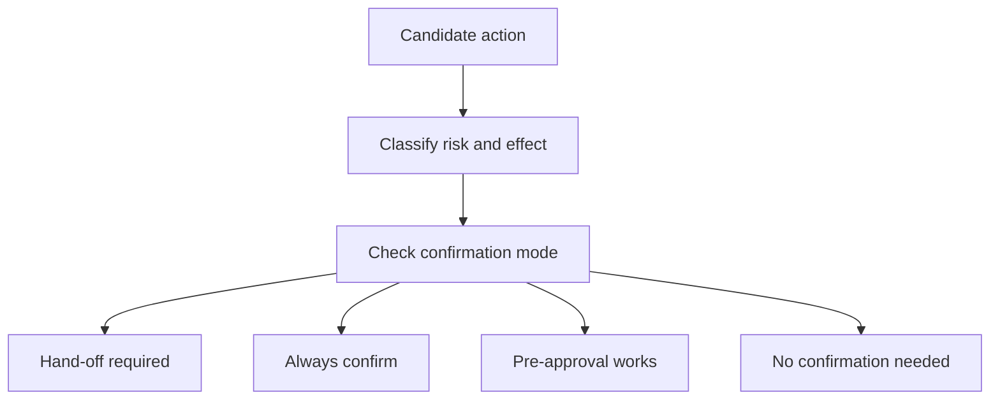
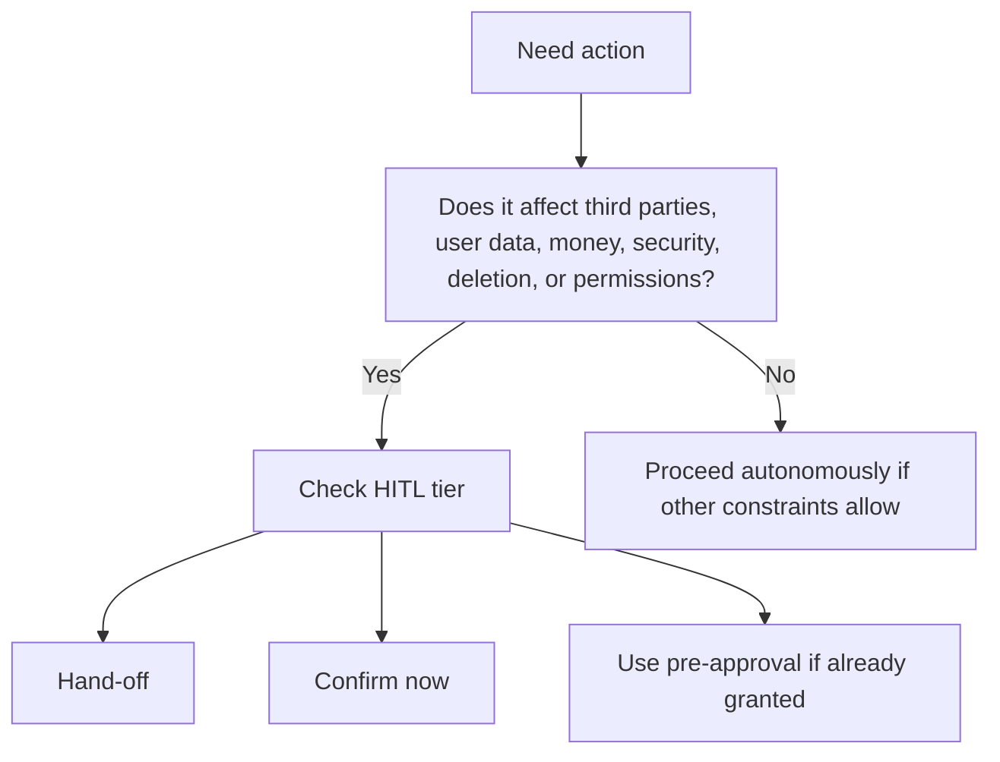
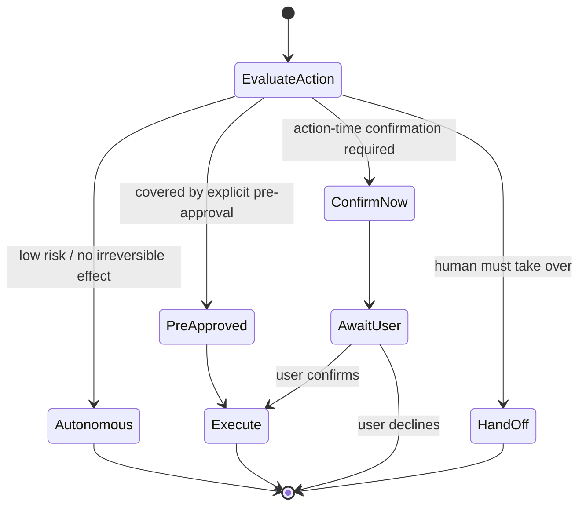

# HITL Audit

Overview router: [may-20-codex-agent-loop.md](/Users/songmin/Documents/code-new/semantica-codegraph-v2/docs/analysis/codex-agent/may-20-codex-agent-loop.md)

이 문서는 Codex 계열 에이전트에서 `HITL(human-in-the-loop)`이 어디서, 어떤 강도로, 어떤 이유로 개입하는지 감사 관점으로 정리한다.

범위:
- 사람이 반드시 개입해야 하는 순간
- 확인이 필요한 행동과 즉시 실행 가능한 행동의 경계
- approval policy와 confirmation policy의 차이
- 현재 세션에서 직접 보이는 HITL contract
- 무엇이 직접 관측 가능한 사실이고, 무엇이 강한/약한 추론인지

표기:
- `[FACT]`: 현재 세션 지침, tool schema, app/runtime context에서 직접 관측 가능한 사실
- `[STRONG-INFERENCE]`: 관측 사실을 가장 잘 설명하는 고신뢰 구조 추론
- `[WEAK-INFERENCE]`: plausible 하지만 직접 근거가 부족한 해석

주의:
- 이 문서는 현재 세션에서 보이는 `인간 개입 계약`을 중심으로 쓴다.
- hidden internal UI flow나 다른 deployment의 세부 UX는 overclaim하지 않는다.

---

## 1. Executive summary

### 1.1 Final verdict

- `Alignment`: High `[STRONG-INFERENCE]`
- `Robustness`: Strong on visible confirmation policy, Medium on alternate deployment UX details `[STRONG-INFERENCE]`
- `Confidence`: High on current HITL rules, Medium on generalized internal implementation `[STRONG-INFERENCE]`
- `Ship readiness`: Ship as analysis doc `[STRONG-INFERENCE]`

### 1.2 Top conclusions

1. HITL는 optional UX garnish가 아니라 **정책적으로 강제되는 control surface**다. `[STRONG-INFERENCE]`
2. 현재 세션에는 `handoff required`, `always confirm`, `pre-approval works`, `no confirmation needed`의 계층이 직접 명시돼 있다. `[FACT]`
3. approval policy와 confirmation policy는 같은 것이 아니다. `[FACT]` + `[STRONG-INFERENCE]`
4. 현재 세션은 approval policy가 `never`이지만, confirmation-required actions는 여전히 존재한다. `[FACT]`
5. 민감한 데이터 전송, destructive action, representational communication, certain installations/runs는 HITL 경계가 매우 강하다. `[FACT]`

---

## 2. Direct evidence inventory

## 2.1 Current-session HITL sources

직접 관측 가능한 HITL 관련 규칙 소스:

| Source | What it governs | Classification |
| --- | --- | --- |
| developer confirmation policy block | action-time confirmation / handoff / sensitive-data transmission rules | `[FACT]` |
| app/runtime mode policy | `request_user_input` availability and mode behavior | `[FACT]` |
| permissions policy | approval policy, sandbox behavior | `[FACT]` |
| general tool schema | some tools imply user interaction boundaries | `[FACT]` |

## 2.2 Directly visible HITL levels

현재 세션 지침에는 아래 4단계가 직접 정의돼 있다. `[FACT]`

1. `Hand-Off Required`
2. `Always Confirm at Action-Time`
3. `Pre-Approval Works`
4. `No Confirmation Needed`

이건 추론이 아니라 explicit policy structure다. `[FACT]`

## 2.3 Directly visible examples

### Hand-Off Required

직접 명시된 예:
- 최종 비밀번호 변경 제출
- browser/web safety barrier bypass
- HTTPS insecure interstitial bypass
- paywall bypass

모두 `[FACT]`.

### Always Confirm

직접 명시된 예:
- 데이터 삭제
- 계정/권한/access 수정
- CAPTCHA 해결
- 새 소프트웨어/스크립트 설치 또는 실행
- 제3자 대상 representational communication
- notification subscription/unsubscribe
- financial transaction confirmation
- system settings change
- medical care actions

모두 `[FACT]`.

### Pre-Approval Works

직접 명시된 예:
- login / browser permission prompts
- age verification
- third-party “are you sure?” warning
- file upload
- file management
- model-generated code를 OS/tool 환경에 입력
- sensitive data transmission

모두 `[FACT]`.

### No Confirmation Needed

직접 명시:
- irreversible effect나 risk가 없는 무해한 action

`[FACT]`

---

## 3. HITL is not the same as approval

이 구분이 중요하다.

## 3.1 Approval policy

현재 세션:
- `approval policy = never` `[FACT]`

이건 runtime/tool execution escalation에 관한 규칙이다. `[FACT]`

## 3.2 Confirmation policy

현재 세션:
- sensitive actions는 user confirmation/handoff가 필요할 수 있다 `[FACT]`

이건 tool escalation이 아니라, **행동 정당화와 사용자 의사 확인**에 관한 규칙이다. `[STRONG-INFERENCE]`

## 3.3 Most precise distinction

- approval:
  - runtime/permission layer
- confirmation:
  - policy/consent layer

둘은 orthogonal한 축으로 보는 것이 가장 정확하다. `[STRONG-INFERENCE]`

---

## 4. HITL control model

가장 설명력이 높은 HITL 모델은 아래다. `[STRONG-INFERENCE]`

의미:
- 단순히 “사용자 요청했으니 실행”이 아니다
- action class에 따라 사람이 개입해야 하는 강도가 다르다

---

## 5. What counts as human-required intervention?

현재 policy를 typed하게 정리하면 아래다. `[STRONG-INFERENCE]`

### 5.1 Consent-critical intervention

특징:
- user가 명시적으로 yes/no를 내려야 한다

예:
- 삭제
- 전송
- 권한 변경
- 대표성 있는 제3자 커뮤니케이션
- 민감 데이터 입력

근거는 `[FACT]`.

### 5.2 Takeover-required intervention

특징:
- agent가 끝까지 못 하고, 사람이 직접 해야 한다

예:
- final password change submit
- safety barrier bypass

근거는 `[FACT]`.

### 5.3 Soft-interaction allowance

특징:
- 사전 허용이 있으면 매번 안 물어도 된다

예:
- login
- age verification
- file upload
- model-generated code 입력

근거는 `[FACT]`.

### 5.4 Autonomous safe action

특징:
- irreversible effect/risk 없음
- 별도 human loop 불필요

근거는 `[FACT]`.

---

## 6. Current-session HITL process

현재 세션에서 observed/explicit policy를 가장 잘 설명하는 process는 아래다. `[STRONG-INFERENCE]`

핵심:
- “무슨 tool을 쓸까”보다 먼저
- “이 action class가 사람 개입을 요구하나”를 본다

---

## 7. Sensitive-data HITL

이 축은 특히 강하다.

## 7.1 Directly visible rules

현재 세션 규칙은 아래를 직접 말한다. `[FACT]`

- sensitive data transmission은 confirmation boundary다
- typing sensitive data into a form counts as transmission
- reading local telemetry/history data to enter it into a form is also sensitive
- visiting a URL with sensitive query params counts as transmission
- generic “fill out this form”은 blanket approval이 아니다

## 7.2 Practical implication

이건 단순 개인정보 보호가 아니라:
- 데이터 읽기
- 데이터 선택
- 데이터 입력
- 데이터 제출

전부를 HITL rail에 걸 수 있다는 뜻이다. `[STRONG-INFERENCE]`

즉 human loop는 submit 버튼 직전에만 있는 게 아니다. `[STRONG-INFERENCE]`

---

## 8. Representational-action HITL

현재 정책은 representational communication을 명시적으로 별도 레일로 둔다. `[FACT]`

직접 예:
- email
- DM
- Slack
- LinkedIn message/post
- public post/comment
- appointment/reservation creation/modification

의미:
- 초안 작성은 가능할 수 있어도
- 실제 발송/제출은 action-time confirm 대상

이 해석은 `[STRONG-INFERENCE]`다.

---

## 9. Runtime-mode interaction with HITL

## 9.1 request_user_input is unavailable

현재 `Default` mode에서는 `request_user_input` tool이 unavailable다. `[FACT]`

의미:
- HITL가 필요해도 structured UI tool 대신
- plain-text confirmation/handoff 질문으로 처리해야 한다

이건 `[STRONG-INFERENCE]`.

## 9.2 Approval never does not remove HITL

현재 `approval policy = never`지만,
- confirmation-required actions는 여전히 남아 있다 `[FACT]`

의미:
- runtime escalation을 안 쓰는 것과
- user consent를 안 받는 것은 다르다

`[STRONG-INFERENCE]`

---

## 10. HITL state machine

이 state machine은 direct policy structure를 가장 잘 요약한다. `[STRONG-INFERENCE]`

---

## 11. Attack surface analysis

## 11.1 False assumption: “user asked, so execute”

- contradicted by explicit confirmation policy
- user intent is bounded by HITL gates
- severity: P0

Classification:
- `[FACT]`

## 11.2 False assumption: “approval never means no human step exists”

- wrong
- approval and confirmation are separate rails
- severity: P1

Classification:
- `[FACT]` + `[STRONG-INFERENCE]`

## 11.3 False assumption: “confirmation only matters at final submit”

- wrong
- sensitive data reading/typing itself may require consent
- severity: P1

Classification:
- `[FACT]`

## 11.4 False assumption: “tool availability implies permission to act”

- wrong
- even if browser or shell can technically do it, HITL tier may block action
- severity: P1

Classification:
- `[STRONG-INFERENCE]`

---

## 12. Concrete failure scenarios if HITL were weak

### Scenario 1: sensitive data auto-submit

- setup: form asks for contact/financial/medical/history data
- trigger: agent fills and submits without explicit consent
- expected under current policy: confirm before reading/typing/transmitting
- likely failure: privacy breach
- severity: P0

Classification:
- rule basis `[FACT]`

### Scenario 2: representational communication sent without confirmation

- setup: user asks for help drafting a message
- trigger: agent sends it directly
- expected: drafting allowed, sending requires confirmation
- likely failure: reputational/relationship risk
- severity: P1

Classification:
- rule basis `[FACT]`

### Scenario 3: destructive local/cloud delete without action-time confirm

- setup: delete file/email/post
- trigger: agent executes directly
- expected: always confirm
- likely failure: irreversible data loss
- severity: P0

Classification:
- rule basis `[FACT]`

### Scenario 4: unsafe browser barrier bypass

- setup: browser shows security interstitial
- trigger: agent bypasses
- expected: hand-off required
- likely failure: phishing/malware/security exposure
- severity: P0

Classification:
- rule basis `[FACT]`

---

## 13. False confidence traps

1. “HITL는 그냥 좋은 UX”
- 아니다
- 명시적 policy enforcement layer다

2. “현재 mode에서 interactive tool이 없으니 HITL도 없다”
- 아니다
- plain-text confirm/handoff path가 남는다

3. “approval never면 다 agent autonomy다”
- 아니다
- confirmation-required action은 여전히 human gate를 탄다

4. “final submit만 사람 확인 받으면 충분”
- 아니다
- 민감 데이터 reading/typing 단계도 transmission boundary로 본다

---

## 14. Unknowns

직접 알 수 없는 것:

1. 다른 deployment에서 HITL UI가 어떻게 렌더되는지 `[WEAK-INFERENCE]`
2. hidden internal risk scoring details `[WEAK-INFERENCE]`
3. action classes가 내부에서 literal enum인지 prompt-mediated 분류인지 `[WEAK-INFERENCE]`

---

## 15. Most precise safe summary

- 현재 세션에는 명시적인 HITL policy hierarchy가 존재한다: `Hand-Off Required`, `Always Confirm`, `Pre-Approval Works`, `No Confirmation Needed`. `[FACT]`
- approval policy와 confirmation policy는 다른 축이며, 현재 세션은 `approval never`이지만 confirmation-required actions는 여전히 많다. `[FACT]` + `[STRONG-INFERENCE]`
- HITL는 특히 deletion, sensitive data transmission, representational communication, permissions, installs/runs, financial/medical/security-sensitive actions에서 강하게 작동한다. `[FACT]`
- 가장 설명력 높은 모델은 `action classification -> HITL tier assignment -> execute / confirm / handoff` state machine이다. `[STRONG-INFERENCE]`
