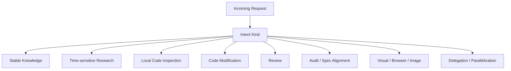
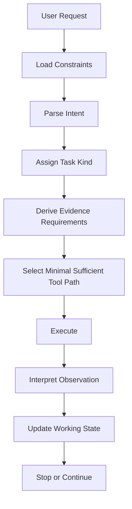
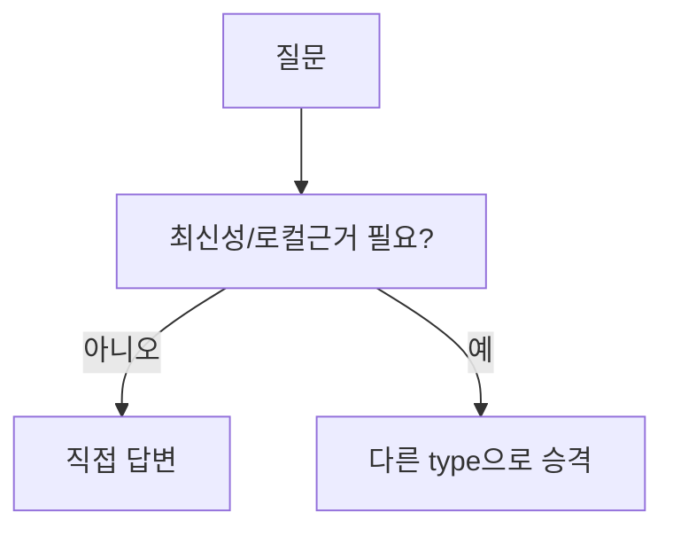
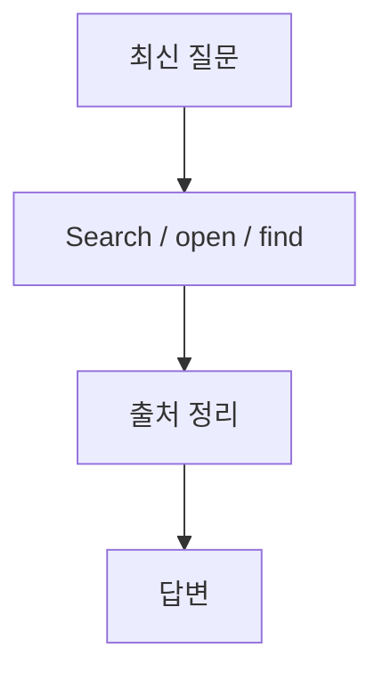
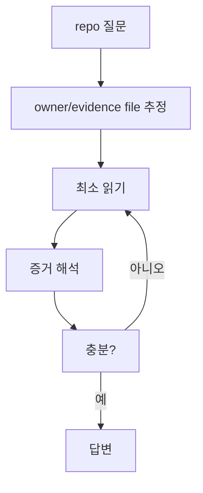
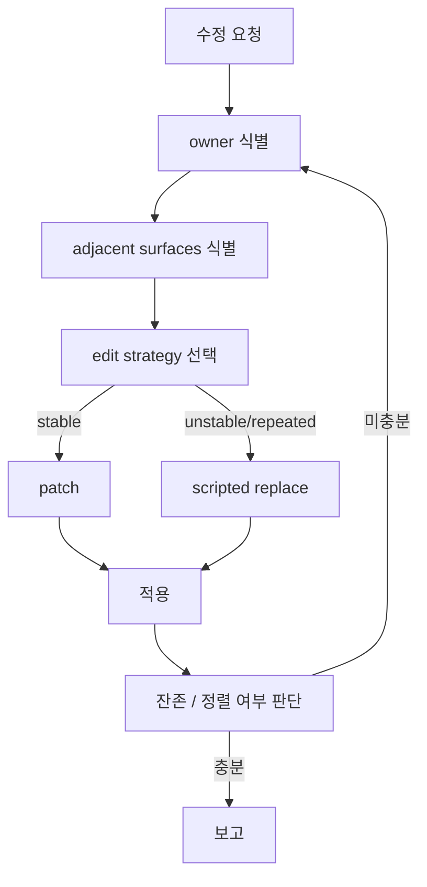
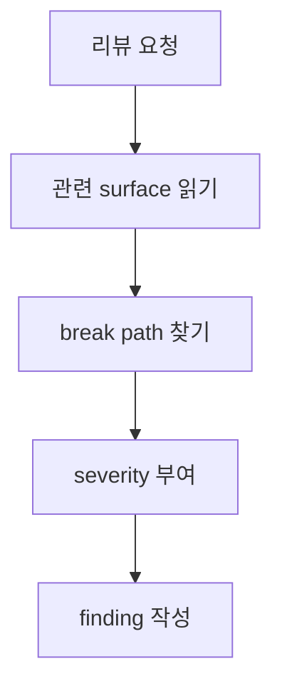
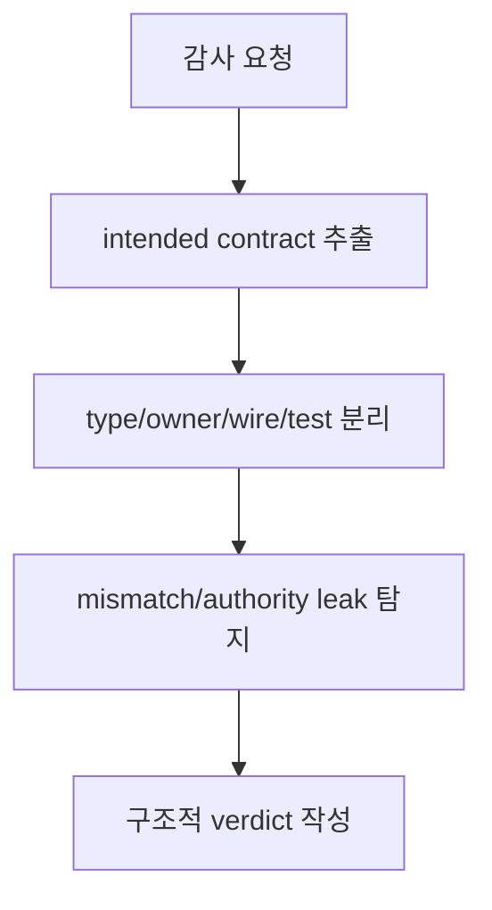
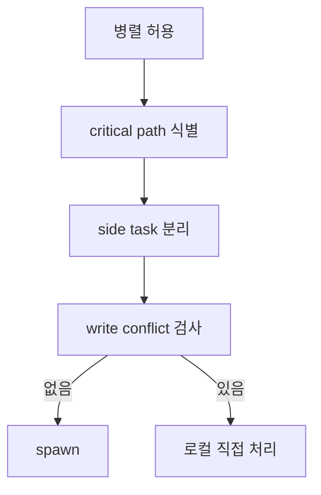
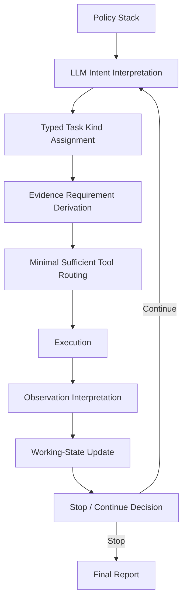

# Codex Agent Judgment and Tool Usage Audit

Overview router: [may-20-codex-agent-loop.md](/Users/songmin/Documents/code-new/semantica-codegraph-v2/docs/analysis/codex-agent/may-20-codex-agent-loop.md)

이 문서는 Codex 계열 에이전트가 **어떻게 판단을 내리고 도구를 선택/사용하는지**를 감사 관점으로 재구성한다.

범위:
- 의도 파악이 어디까지 LLM 판단인지
- 어떤 종류의 intent/type으로 분리하는 것이 합리적인지
- 각 type별 loop가 어떻게 달라지는지
- tool routing과 fallback이 어떤 구조를 가지는지
- 무엇이 직접 관측 가능한 사실이고, 무엇이 강한/약한 추론인지

표기:
- `[FACT]`: 현재 세션/지침/tool schema/tool history에서 직접 관측 가능한 사실
- `[STRONG-INFERENCE]`: 관측 사실을 가장 잘 설명하는 고신뢰 구조적 추론
- `[WEAK-INFERENCE]`: plausible 하지만 직접 근거가 부족한 해석

---

## 1. Executive summary

### 1.1 Final verdict

- `Alignment`: High `[STRONG-INFERENCE]`
- `Robustness`: Strong for explanation, limited for hidden internals `[STRONG-INFERENCE]`
- `Confidence`: High on routing/loop shape, Medium on hidden internal representation `[STRONG-INFERENCE]`
- `Ship readiness`: Ship as analysis doc `[STRONG-INFERENCE]`

### 1.2 Top conclusions

1. Codex의 판단 주체는 runtime이 아니라 **constraint-bounded LLM**이다. `[STRONG-INFERENCE]`
2. runtime은 **도구/권한/세션/모드/앱 기능**을 제공하고 집행한다. `[FACT]`
3. 의도 파악은 자유 생성이 아니라 **정책 계층 + 작업 분류 + 도구 라우팅**의 조합이다. `[STRONG-INFERENCE]`
4. tool 선택은 질문 문자열이 아니라 **답변의 증거 조건**을 기준으로 이루어진다. `[STRONG-INFERENCE]`
5. code modification, review, audit, research는 서로 다른 specialized loop를 가진다. `[STRONG-INFERENCE]`

---

## 2. Direct evidence inventory

### 2.1 Observable runtime constraints

아래는 현재 세션에서 직접 관측된다.

| Evidence | Status | Notes |
| --- | --- | --- |
| 현재 mode는 `Default`다 | `[FACT]` | collaboration mode에 직접 명시 |
| `request_user_input`는 현재 mode에서 사용 불가다 | `[FACT]` | mode instructions에 직접 명시 |
| 현재 세션에는 `web.run`, `exec_command`, `apply_patch`, `spawn_agent`, `multi_tool_use.parallel` 등이 존재한다 | `[FACT]` | tool definitions가 직접 제공됨 |
| 승인 정책은 `never`, sandbox는 `danger-full-access`다 | `[FACT]` | environment/app context에 직접 명시 |
| 응답은 한국어, 코드/주석/커밋 본문은 영어 우선이다 | `[FACT]` | repo AGENTS.md에 직접 명시 |
| 검증은 사용자가 요청하지 않으면 하지 말라는 강한 지침이 있다 | `[FACT]` | developer instructions에 직접 명시 |
| 최신성 있는 정보는 web를 사용해 확인해야 한다 | `[FACT]` | system browsing policy에 직접 명시 |

### 2.2 Observable behavioral evidence from this thread

| Evidence | Status | Notes |
| --- | --- | --- |
| 메타 질문들에 대해 `web`를 쓰지 않고 직접 설명했다 | `[FACT]` | time-sensitive가 아니라고 판단된 것 |
| repo 작업에서는 `exec_command`, `parallel`, `apply_patch`를 주로 사용했다 | `[FACT]` | actual tool history |
| patch 문맥이 흔들릴 때 `exec_command + python` 치환으로 전환했다 | `[FACT]` | actual tool history |
| subagent tool은 존재했지만, 명시 허용이 없는 동안 실제로 쓰지 않았다 | `[FACT]` | actual tool history |
| 반복적으로 validation을 하지 않았고, 그 사실을 답변에서 명시했다 | `[FACT]` | actual responses + instructions |

---

## 3. Who actually makes the judgment?

### 3.1 Minimal claim

- 세션은 도구 목록과 제약을 제공한다. `[FACT]`
- 하지만 어떤 도구를 실제로 호출할지는 정적 매핑으로 주어지지 않는다. `[FACT]`
- 실제 tool call은 모델 응답 과정에서 선택되어 발생한다. `[FACT]`

따라서:
- **판단 주체는 LLM**이고, `[STRONG-INFERENCE]`
- **실행/권한 집행 주체는 runtime**이다. `[STRONG-INFERENCE]`

### 3.2 Why this is the strongest explanation

대안 A:
- “외부 hard router가 대부분의 의도를 결정한다”

문제:
- 그러면 동일한 코드 작업에서 patch와 scripted replace가 상황에 따라 바뀌는 observed behavior를 설명하기 어렵다. `[STRONG-INFERENCE]`
- patch failure 뒤 전략 전환, 남은 갭 보고, type/owner/wire/test 정렬 같은 동작은 정적 rule만으로는 부족하다. `[STRONG-INFERENCE]`

대안 B:
- “LLM이 완전히 자유롭게 다 한다”

문제:
- browsing mandatory, mode restriction, repo policy, no-validation rules 같은 강한 제약을 설명하기 어렵다. `[STRONG-INFERENCE]`

따라서 가장 적합한 설명:
- `constraint-bounded LLM routing` `[STRONG-INFERENCE]`

---

## 4. Typed intent model

직접 내부 타입을 본 적은 없으므로 아래는 **외부 행동을 가장 잘 설명하는 typed split**이다. `[STRONG-INFERENCE]`

### 4.1 Top-level kinds

### 4.2 Admission criteria per kind

| Kind | Admission signal | Classification |
| --- | --- | --- |
| Stable Knowledge | 최신성/로컬근거/실수행 결과물이 필요 없음 | `[STRONG-INFERENCE]` |
| Time-sensitive Research | 최신/오늘/최근/현재/공식 문서/출처 요구 | `[FACT]` + `[STRONG-INFERENCE]` |
| Local Code Inspection | repo/file/symbol/function/test 기준 질문 | `[STRONG-INFERENCE]` |
| Code Modification | 고쳐라/구현해라/패치해라/리팩터해라 | `[STRONG-INFERENCE]` |
| Review | findings 중심 검토 요청 | `[FACT]` + `[STRONG-INFERENCE]` |
| Audit / Spec Alignment | 설계/의도/authority/invariant 정합성 요청 | `[FACT]` + `[STRONG-INFERENCE]` |
| Visual / Browser / Image | 이미지/브라우저/localhost/스크린샷 요청 | `[FACT]` + `[STRONG-INFERENCE]` |
| Delegation / Parallelization | 병렬/서브에이전트/웨이브별 처리 요청 | `[FACT]` + `[STRONG-INFERENCE]` |

### 4.3 Likely second-order routing tags

아래 tag는 내부적으로 있을 법하지만 직접 확인되지는 않았다. `[WEAK-INFERENCE]`

- `needs_web`
- `needs_local_evidence`
- `needs_edit`
- `needs_visual_confirmation`
- `needs_source_attribution`
- `verification_requested`
- `explicit_parallel_permission`
- `high_stakes`
- `owner_surface_required`

---

## 5. Decision formation pipeline

판단 형성은 아래 순서로 보는 것이 가장 정확하다. `[STRONG-INFERENCE]`

### 5.1 Load constraints

Inputs:
- system policy `[FACT]`
- developer/runtime policy `[FACT]`
- app/environment policy `[FACT]`
- mode policy `[FACT]`
- repo-local AGENTS rules `[FACT]`
- skill rules if invoked `[FACT]`

Effect:
- 의도 파악 전에 **허용 가능한 선택 공간**이 이미 줄어든다. `[STRONG-INFERENCE]`

### 5.2 Parse intent

무엇을 읽나:
- 사용자 문장
- 강조된 동사: 리뷰, 감사, 구현, 최신 확인, 병렬 등
- 산출물 기대: 설명/수정/문서/이미지/브라우저 inspection

직접 관측:
- skill trigger 규칙이 실제로 존재한다. `[FACT]`
- 특정 종류의 요청에서 특정 tools/response styles이 일관되게 선택된다. `[FACT]`

재구성:
- 자연어를 task kind로 매핑하는 parsing 단계가 있다. `[STRONG-INFERENCE]`

### 5.3 Derive evidence requirements

핵심 질문:
1. 이 답변은 최신성을 필요로 하나?
2. 이 답변은 로컬 코드 증거를 필요로 하나?
3. 실제 수정 결과물이 필요한가?
4. 시각 결과 확인이 필요한가?
5. 출처 링크가 필요한가?
6. 병렬화가 실제 가치가 있는가?

이 단계는 tool routing의 진짜 기준이다. `[STRONG-INFERENCE]`

### 5.4 Select minimal sufficient tool path

도구 선택은 `가능한 모든 도구` 중 하나가 아니라, `가장 싼 sufficient path`를 고르는 문제로 보인다. `[STRONG-INFERENCE]`

예:
- stable knowledge -> no tool
- latest docs -> web
- repo inspection -> exec_command
- local small edit -> apply_patch
- repeated unstable edit -> scripted replace
- explicit parallel -> subagents

---

## 6. Tool routing audit

## 6.1 Routing matrix

| Requirement | Preferred path | Evidence | Classification |
| --- | --- | --- | --- |
| 최신성 필요 | web | browsing mandatory policy | `[FACT]` |
| 로컬 코드 근거 필요 | exec_command / parallel | actual code-task tool usage | `[FACT]` |
| 국소 수정 | apply_patch | actual tool usage + tool suitability | `[FACT]` + `[STRONG-INFERENCE]` |
| 중복/불안정 수정 | exec_command scripted replace | actual fallback usage | `[FACT]` + `[STRONG-INFERENCE]` |
| 이미지 생성/편집 | image tool | tool definitions + plugin docs | `[FACT]` |
| localhost/UI inspection | browser plugin path | plugin policy | `[FACT]` |
| 병렬화 | spawn_agent path | tool defs + explicit permission rule | `[FACT]` |

## 6.2 Why routing is not naive keyword matching

단순 keyword router라면 설명이 어려운 observed behavior:
- 같은 code modification에서도 `apply_patch`와 `scripted replace`가 상황에 따라 바뀜
- 메타 질문에는 아무 도구도 안 씀
- 최신성 있는 질문이면 web를 강제해야 함
- subagent는 도구가 있어도 permission 없으면 안 씀

따라서 routing은 최소한 아래를 함께 고려한다. `[STRONG-INFERENCE]`
- task kind
- current state
- policy constraints
- tool affordance

---

## 7. Specialized loops by task kind

## 7.1 Stable Knowledge

Complexity:
- 낮음 `[STRONG-INFERENCE]`

## 7.2 Time-sensitive Research

Complexity:
- 중간 `[STRONG-INFERENCE]`

## 7.3 Local Code Inspection

Complexity:
- 중간 `[STRONG-INFERENCE]`

## 7.4 Code Modification

Complexity:
- 높음 `[STRONG-INFERENCE]`

## 7.5 Review

Complexity:
- 중간~높음 `[STRONG-INFERENCE]`

## 7.6 Audit

Complexity:
- 높음 `[STRONG-INFERENCE]`

## 7.7 Delegation

Complexity:
- 높음 `[STRONG-INFERENCE]`

---

## 8. Fallback and recovery logic

### 8.1 Patch failure recovery

관측 사실:
- patch context mismatch 후 scripted replace로 전환한 사례가 있었다. `[FACT]`

감사 결론:
- patch failure를 단순 재시도가 아니라 **strategy failure signal**로 취급하는 것으로 보인다. `[STRONG-INFERENCE]`

### 8.2 Over-broad read recovery

관측 사실:
- `rg`와 `sed -n` 선호 규칙이 직접 존재한다. `[FACT]`

감사 결론:
- broad read가 아니라 `검색 -> 좁은 구간 읽기`가 canonical path다. `[STRONG-INFERENCE]`

### 8.3 Validation recovery

관측 사실:
- validation은 요청 전까지 하지 말라는 규칙이 직접 존재한다. `[FACT]`

감사 결론:
- 종료 시 “not verified”를 명시하는 것이 fallback honesty rail이다. `[STRONG-INFERENCE]`

### 8.4 Delegation recovery

관측 사실:
- subagent는 explicit permission이 있을 때만 권장된다. `[FACT]`

감사 결론:
- 잘못 쪼개면 wait cost가 커지므로, critical path는 로컬에 남긴다. `[STRONG-INFERENCE]`

---

## 9. Attack surface audit

### 9.1 Over-automation assumption

- 가정: 외부 router가 모든 의도를 안전하게 분류한다
- 취약점: patch-vs-script, owner-vs-test 우선순위, leftovers handling 같은 정교한 전환을 설명 못 함
- 판정: 잘못된 모델일 가능성 높음 `[STRONG-INFERENCE]`

### 9.2 Pure-freeform assumption

- 가정: LLM이 제약 없이 자율적으로 모든 걸 정한다
- 취약점: browsing mandatory, mode limits, no-validation policy, repo-specific build rules를 설명 못 함
- 판정: 잘못된 모델일 가능성 높음 `[STRONG-INFERENCE]`

### 9.3 Hidden typed-router overclaim

- 가정: 내부에 정확히 `enum IntentKind` 같은 hard structure가 있다
- 취약점: 직접 관측 불가
- 판정: 문서에서는 overclaim 금지 `[FACT]`

---

## 10. Concrete break attempts against naive models

### Scenario 1: “keyword router only”

- setup: 사용자가 `최신`이라는 단어 없이도 최신 문서를 요구
- trigger: "OpenAI docs 기준으로 지금 가능한 모델 알려줘"
- expected under naive model: keyword miss 가능
- likely actual behavior: time-sensitive research path로 분류
- root cause of naive failure: semantic intent를 못 읽음
- severity: P1

Classification:
- scenario mechanism `[STRONG-INFERENCE]`

### Scenario 2: “always patch edits”

- setup: 중복 test block과 흔들리는 문맥
- trigger: repeated legacy branch cleanup
- expected under naive model: patch 반복
- likely actual behavior: scripted replace 전환
- root cause of naive failure: edit-strategy adaptation 부재
- severity: P1

Classification:
- patch failure history `[FACT]`
- strategic transition model `[STRONG-INFERENCE]`

### Scenario 3: “tool choice determined only by request string”

- setup: 동일한 "고쳐" 요청이지만 파일 상태가 다름
- trigger: stable vs unstable edit contexts
- expected under naive model: 같은 tool만 선택
- likely actual behavior: patch 또는 script 분기
- root cause of naive failure: current-state-aware routing 부재
- severity: P1

Classification:
- actual mixed editing behavior `[FACT]`
- state-aware routing `[STRONG-INFERENCE]`

---

## 11. False confidence traps

1. “tool exists == always used”
- `spawn_agent`가 있어도 explicit permission이 없으면 보수적으로 안 쓰는 것이 맞다
- 존재와 선택은 다르다

2. “web를 안 썼으니 browser/research loop가 없다”
- 최신성 없는 질문이면 direct answer가 맞다
- path not taken은 path absent의 증거가 아니다

3. “grep/patch history만 보면 단순 shell bot 같다”
- 실제론 review mode, audit mode, mode policy, repo rules가 결과를 강하게 형성한다

4. “내부 typed router가 반드시 보장된다”
- typed하게 설명하는 건 useful model이지만, internal implementation existence는 direct evidence가 없다

---

## 12. Best-fit architecture model

가장 설명력이 높은 모델은 아래다.

분류:
- policy stack 존재: `[FACT]`
- 나머지 pipeline: `[STRONG-INFERENCE]`

---

## 13. Residual unknowns

아래는 여전히 직접 알 수 없다.

1. hidden system prompt 원문 전체 `[FACT]`
2. 내부 planner가 별도 서비스/객체인지 여부 `[WEAK-INFERENCE]`
3. intent classifier가 literal enum인지 latent internal representation인지 `[WEAK-INFERENCE]`
4. confidence scores가 실제 internal state로 존재하는지 여부 `[WEAK-INFERENCE]`

---

## 14. Most precise safe statement

가장 안전하고도 해상도 높은 최종 진술:

- Codex는 단순한 질문-답변 모델이 아니라, **정책 제약 하에서 도구를 선택하고 반복적으로 실행하는 LLM 에이전트**다. `[STRONG-INFERENCE]`
- 판단의 실질적 주체는 LLM이지만, 그것은 **runtime이 제공한 도구/권한/모드/repo 정책 경계 안에서**만 이루어진다. `[STRONG-INFERENCE]`
- 의도는 고정 keyword router보다 넓게 해석되며, 최소한 `stable knowledge / research / inspection / modification / review / audit / visual / delegation` 정도의 typed split으로 보는 것이 observed behavior와 가장 잘 맞는다. `[STRONG-INFERENCE]`
- code modification에서는 특히 `owner identification -> surface alignment -> edit strategy -> leftovers -> closeout`의 specialized repair loop가 핵심이다. `[STRONG-INFERENCE]`
- 내부 구현이 정확히 어떤 hidden typed router/enum/planner로 되어 있는지는 직접 관측 불가이므로, 그 부분은 overclaim하지 않는 것이 맞다. `[FACT]`
