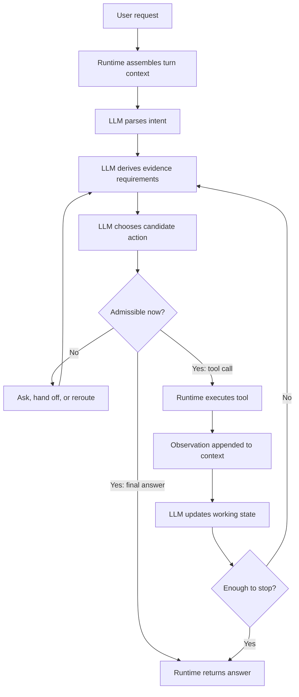
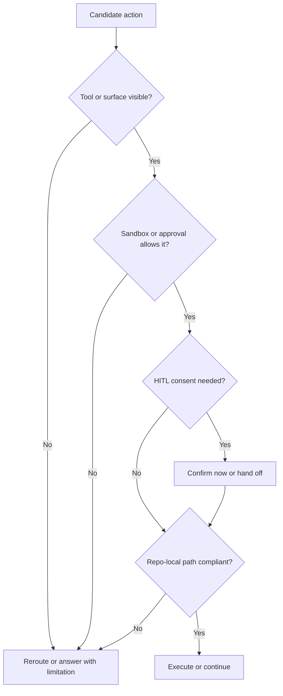

# Codex App Agent Loop Model

이 문서는 Codex app agent loop 문서군의 `thin router`다.

이 문서의 역할:
- 큰 loop shape를 한 번에 본다
- runtime과 LLM의 경계를 짧게 고정한다
- 어떤 질문을 어느 depth 문서로 내려야 하는지 정한다
- `FACT`와 `MODEL`의 claim 강도를 분리한다

이 문서가 하지 않는 것:
- hidden internal implementation dump
- 분산된 depth 내용을 다시 한 파일에 재복제
- exact hidden planner, enum, score formula 단정

관련 문서:
- [README.md](/Users/songmin/Documents/code-new/semantica-codegraph-v2/docs/analysis/codex-agent/README.md)
- [execution-loop.md](/Users/songmin/Documents/code-new/semantica-codegraph-v2/docs/analysis/codex-agent/execution-loop.md)
- [agent-loop-deep-dive.md](/Users/songmin/Documents/code-new/semantica-codegraph-v2/docs/analysis/codex-agent/agent-loop-deep-dive.md)
- [turn-context-and-runtime-interface.md](/Users/songmin/Documents/code-new/semantica-codegraph-v2/docs/analysis/codex-agent/turn-context-and-runtime-interface.md)
- [response-assembly-and-closeout.md](/Users/songmin/Documents/code-new/semantica-codegraph-v2/docs/analysis/codex-agent/response-assembly-and-closeout.md)
- [prompt-and-policy-stack.md](/Users/songmin/Documents/code-new/semantica-codegraph-v2/docs/analysis/codex-agent/prompt-and-policy-stack.md)
- [mode-and-plan-process-audit.md](/Users/songmin/Documents/code-new/semantica-codegraph-v2/docs/analysis/codex-agent/mode-and-plan-process-audit.md)
- [repo-local-rule-ingestion-audit.md](/Users/songmin/Documents/code-new/semantica-codegraph-v2/docs/analysis/codex-agent/repo-local-rule-ingestion-audit.md)
- [tool-routing-and-triggering.md](/Users/songmin/Documents/code-new/semantica-codegraph-v2/docs/analysis/codex-agent/tool-routing-and-triggering.md)
- [tool-inventory-and-usage-audit.md](/Users/songmin/Documents/code-new/semantica-codegraph-v2/docs/analysis/codex-agent/tool-inventory-and-usage-audit.md)
- [mcp-usage-audit.md](/Users/songmin/Documents/code-new/semantica-codegraph-v2/docs/analysis/codex-agent/mcp-usage-audit.md)
- [plugin-audit.md](/Users/songmin/Documents/code-new/semantica-codegraph-v2/docs/analysis/codex-agent/plugin-audit.md)
- [browser-runtime/README.md](/Users/songmin/Documents/code-new/semantica-codegraph-v2/docs/analysis/codex-agent/browser-runtime/README.md)
- [memory-model-audit.md](/Users/songmin/Documents/code-new/semantica-codegraph-v2/docs/analysis/codex-agent/memory-model-audit.md)
- [thread-management/README.md](/Users/songmin/Documents/code-new/semantica-codegraph-v2/docs/analysis/codex-agent/thread-management/README.md)
- [session-management-audit.md](/Users/songmin/Documents/code-new/semantica-codegraph-v2/docs/analysis/codex-agent/thread-management/session-management-audit.md)
- [thread-management/storage-and-db-audit.md](/Users/songmin/Documents/code-new/semantica-codegraph-v2/docs/analysis/codex-agent/thread-management/storage-and-db-audit.md)
- [thread-management/inferred-internal-architecture.md](/Users/songmin/Documents/code-new/semantica-codegraph-v2/docs/analysis/codex-agent/thread-management/inferred-internal-architecture.md)
- [thread-management/thread-ui-and-fork-surface-audit.md](/Users/songmin/Documents/code-new/semantica-codegraph-v2/docs/analysis/codex-agent/thread-management/thread-ui-and-fork-surface-audit.md)
- [thread-management/ui-action-to-persistence-mapping.md](/Users/songmin/Documents/code-new/semantica-codegraph-v2/docs/analysis/codex-agent/thread-management/ui-action-to-persistence-mapping.md)
- [subagent/README.md](/Users/songmin/Documents/code-new/semantica-codegraph-v2/docs/analysis/codex-agent/thread-management/subagent/README.md)
- [logging-and-recovery-audit.md](/Users/songmin/Documents/code-new/semantica-codegraph-v2/docs/analysis/codex-agent/thread-management/logging-and-recovery-audit.md)
- [task-management-and-todo-audit.md](/Users/songmin/Documents/code-new/semantica-codegraph-v2/docs/analysis/codex-agent/task-management-and-todo-audit.md)
- [long-horizon-task-management-audit.md](/Users/songmin/Documents/code-new/semantica-codegraph-v2/docs/analysis/codex-agent/thread-management/long-horizon-task-management-audit.md)
- [automation-audit.md](/Users/songmin/Documents/code-new/semantica-codegraph-v2/docs/analysis/codex-agent/thread-management/automation-audit.md)
- [permission-management-audit.md](/Users/songmin/Documents/code-new/semantica-codegraph-v2/docs/analysis/codex-agent/permission-management-audit.md)
- [sandbox-and-approval-audit.md](/Users/songmin/Documents/code-new/semantica-codegraph-v2/docs/analysis/codex-agent/sandbox-and-approval-audit.md)
- [hitl-audit.md](/Users/songmin/Documents/code-new/semantica-codegraph-v2/docs/analysis/codex-agent/hitl-audit.md)
- [may-20-codex-lsp.md](/Users/songmin/Documents/code-new/semantica-codegraph-v2/docs/analysis/codex-agent/may-20-codex-lsp.md)
- [may-20-codex-signal.md](/Users/songmin/Documents/code-new/semantica-codegraph-v2/docs/analysis/codex-agent/may-20-codex-signal.md)
- [unknowns-and-non-claims.md](/Users/songmin/Documents/code-new/semantica-codegraph-v2/docs/analysis/codex-agent/unknowns-and-non-claims.md)

## ToC

1. Final model
2. Claim ladder
3. Canonical invariants and change control
4. Boundary summary
5. Control-state authority
6. Continuity boundary
7. Reading map
8. Recommended reading order
9. Rule of thumb

## 1. Final model

가장 보수적인 최종 모델은 이거다.

- `runtime/app`는 정책, capability surface, session state, permission, mode를 제공하고 집행한다.
- `LLM`은 intent 해석, evidence requirement derivation, tool routing, observation interpretation, stop/continue 판단을 맡는다.
- 실제 동작은 `one-shot answer`보다 `constraint-bounded iterative loop`에 가깝다.
- 실행 직전에는 `capability visibility -> sandbox/approval -> HITL consent -> repo-local compliance` 순서의 admissibility gate가 다시 걸린다.
- 코드 작업에서는 일반 loop 위에 `owner -> adjacent truth surfaces -> patch -> verification/closeout` repair loop가 얹힌다.

한 줄 요약:

- runtime은 `선택 공간`과 `실행`을 제공한다
- LLM은 그 공간 안에서 `무엇을 할지`와 `언제 멈출지`를 결정한다

## 2. Claim ladder

이 문서군은 문장 강도를 셋으로 나눈다.

| Label | Meaning | Safe examples |
| --- | --- | --- |
| `[FACT]` | 현재 세션에서 직접 관측 가능한 것 | visible tools, mode, sandbox, repo rules, actual tool lifecycle surface |
| `[MODEL]` | observed behavior를 가장 잘 설명하는 best-fit operational model | typed task split, working-state schema, minimal-sufficient-path routing |
| `[NON-CLAIM]` | 이 문서군이 단정하지 않는 hidden internals | exact hidden planner, enum names, confidence formula, persistence backend |

핵심 규칙:

- `FACT`와 `MODEL`을 섞어 쓰지 않는다.
- `MODEL`은 설명력을 위해 쓰지만 hidden implementation claim으로 승격하지 않는다.
- `NON-CLAIM`은 별도 문서와 각 depth 문서의 경계 문장으로 유지한다.

depth taxonomy 대응:

- 이 router의 `[MODEL]`은 depth 문서들에서 쓰는 `[STRONG-INFERENCE]`와 `[WEAK-INFERENCE]`를 얇게 접은 표기다.
- inference 강도 자체를 세밀하게 다뤄야 하는 질문이면 이 파일보다 [agent-loop-deep-dive.md](/Users/songmin/Documents/code-new/semantica-codegraph-v2/docs/analysis/codex-agent/agent-loop-deep-dive.md)를 owner로 본다.

## 3. Canonical invariants and change control

이 router가 실제로 소유해야 하는 건 cross-doc invariant다.

| Invariant | Owned here vs delegated | Claim level | Evidence required to change | Must-update companion docs |
| --- | --- | --- | --- | --- |
| runtime injects constraints and capabilities | owned here | `[FACT]` plus `[MODEL]` | visible tool or instruction surface changed | turn-context-and-runtime-interface, agent-loop-deep-dive |
| LLM owns classification, routing, and stop or continue | owned here | `[MODEL]` | observed behavior no longer fits | execution-loop, agent-loop-deep-dive, tool-routing-and-triggering |
| tool choice follows truth condition, not naive keywords | owned here | `[MODEL]` | defended routing counterexample | tool-routing-and-triggering, may-20-codex-signal |
| source and runtime outputs outrank docs and memory | owned here | `[MODEL]` | trust ladder changes in observed behavior | may-20-codex-signal, memory-model-audit |
| LSP is an accelerator, not final proof | owned here | `[MODEL]` | LSP surface becomes authoritative closeout proof | may-20-codex-lsp, may-20-codex-signal |
| detailed transport, routing, closeout, and session semantics are delegated | delegated | `[FACT]` about document ownership | owner split changes | owner depth docs named in section 7 |

변경 규칙:

- invariant가 바뀌면 이 router만 고치면 안 된다.
- `owned here` row가 바뀌면 `Must-update companion docs` 열에 적힌 문서를 같이 갱신해야 한다.
- current-session capability map이나 one-off usecase만 바뀐 경우에는 owner depth 문서만 바꾸고 invariant는 그대로 둘 수 있다.

## 4. Boundary summary

| Surface | Mostly runtime/app-owned | Mostly LLM-owned | Depth owner |
| --- | --- | --- | --- |
| turn bootstrap | instruction stack attach, tool schema exposure, mode/sandbox metadata attach | none | [turn-context-and-runtime-interface.md](/Users/songmin/Documents/code-new/semantica-codegraph-v2/docs/analysis/codex-agent/turn-context-and-runtime-interface.md) |
| repo-local bootstrap | repo entrypoint rule file, secondary rule availability | adopt repo-specific execution posture | [repo-local-rule-ingestion-audit.md](/Users/songmin/Documents/code-new/semantica-codegraph-v2/docs/analysis/codex-agent/repo-local-rule-ingestion-audit.md) |
| capability gating | tool availability, approval/sandbox limits, mode gate | choose among allowed tools only | [turn-context-and-runtime-interface.md](/Users/songmin/Documents/code-new/semantica-codegraph-v2/docs/analysis/codex-agent/turn-context-and-runtime-interface.md) |
| mode-specific interaction branching | current mode, allowed interaction primitives | decide local assumption vs ask vs explicit plan state | [mode-and-plan-process-audit.md](/Users/songmin/Documents/code-new/semantica-codegraph-v2/docs/analysis/codex-agent/mode-and-plan-process-audit.md) |
| intent handling | none | task classification, evidence requirement derivation | [agent-loop-deep-dive.md](/Users/songmin/Documents/code-new/semantica-codegraph-v2/docs/analysis/codex-agent/agent-loop-deep-dive.md) |
| signal weighting | none | trust/downgrade rules, conflict arbitration | [may-20-codex-signal.md](/Users/songmin/Documents/code-new/semantica-codegraph-v2/docs/analysis/codex-agent/may-20-codex-signal.md), [may-20-codex-lsp.md](/Users/songmin/Documents/code-new/semantica-codegraph-v2/docs/analysis/codex-agent/may-20-codex-lsp.md) |
| permission and consent gating | capability exposure, sandbox, approval, HITL rails | choose compliant path among allowed ones | [permission-management-audit.md](/Users/songmin/Documents/code-new/semantica-codegraph-v2/docs/analysis/codex-agent/permission-management-audit.md), [sandbox-and-approval-audit.md](/Users/songmin/Documents/code-new/semantica-codegraph-v2/docs/analysis/codex-agent/sandbox-and-approval-audit.md), [hitl-audit.md](/Users/songmin/Documents/code-new/semantica-codegraph-v2/docs/analysis/codex-agent/hitl-audit.md) |
| tool execution | actual process/browser/web/tool run, result capture, session ids | decide whether and when to call | [turn-context-and-runtime-interface.md](/Users/songmin/Documents/code-new/semantica-codegraph-v2/docs/analysis/codex-agent/turn-context-and-runtime-interface.md) |
| tool, MCP, and plugin family choice | visible tools, plugins, MCP resource rails | map signal family to best execution surface | [tool-inventory-and-usage-audit.md](/Users/songmin/Documents/code-new/semantica-codegraph-v2/docs/analysis/codex-agent/tool-inventory-and-usage-audit.md), [mcp-usage-audit.md](/Users/songmin/Documents/code-new/semantica-codegraph-v2/docs/analysis/codex-agent/mcp-usage-audit.md), [plugin-audit.md](/Users/songmin/Documents/code-new/semantica-codegraph-v2/docs/analysis/codex-agent/plugin-audit.md) |
| browser subsystem specifics | browser plugin contract, browser-client bootstrap, tab/capability runtime, browser comment overlay, browser safety | choose browser path, understand live browser constraints, explain selected-region comment sync, rebuild similar subsystem | [browser-runtime/README.md](/Users/songmin/Documents/code-new/semantica-codegraph-v2/docs/analysis/codex-agent/browser-runtime/README.md) |
| working state | thread history persistence, session handles, artifact persistence | owner shortlist, hypothesis, blockers, next-step queue | [memory-model-audit.md](/Users/songmin/Documents/code-new/semantica-codegraph-v2/docs/analysis/codex-agent/memory-model-audit.md) |
| task decomposition and queueing | none | current active item, pending items, deferred validation, closeout queue | [task-management-and-todo-audit.md](/Users/songmin/Documents/code-new/semantica-codegraph-v2/docs/analysis/codex-agent/task-management-and-todo-audit.md) |
| bounded subagent delegation | child lifecycle surface, child handles, optional fork surface | sidecar task split, ownership boundary, integration timing | [subagent/README.md](/Users/songmin/Documents/code-new/semantica-codegraph-v2/docs/analysis/codex-agent/thread-management/subagent/README.md) |
| top-level loop | none | continue, stop, widen, reroute | [execution-loop.md](/Users/songmin/Documents/code-new/semantica-codegraph-v2/docs/analysis/codex-agent/execution-loop.md), [agent-loop-deep-dive.md](/Users/songmin/Documents/code-new/semantica-codegraph-v2/docs/analysis/codex-agent/agent-loop-deep-dive.md) |
| long-horizon continuity | automation handles, summary rails, artifact durability | decide whether to externalize, wake later, or keep local | [long-horizon-task-management-audit.md](/Users/songmin/Documents/code-new/semantica-codegraph-v2/docs/analysis/codex-agent/thread-management/long-horizon-task-management-audit.md), [automation-audit.md](/Users/songmin/Documents/code-new/semantica-codegraph-v2/docs/analysis/codex-agent/thread-management/automation-audit.md), [logging-and-recovery-audit.md](/Users/songmin/Documents/code-new/semantica-codegraph-v2/docs/analysis/codex-agent/thread-management/logging-and-recovery-audit.md) |
| response assembly | app formatting rails, artifact rendering, link rendering | defended-claim filtering, uncertainty carry, closeout wording | [response-assembly-and-closeout.md](/Users/songmin/Documents/code-new/semantica-codegraph-v2/docs/analysis/codex-agent/response-assembly-and-closeout.md) |

## 5. Control-state authority

main router에서 별도 축으로 고정해야 하는 최소 authority truth는 이거다.

| Layer | Main owner | What it constrains | What user text alone does not safely mutate |
| --- | --- | --- | --- |
| system policy | runtime | safety, freshness, browse mandates | top safety posture |
| developer/runtime policy | runtime | tool budget, workflow posture, default verification posture | tool preference and hidden workflow rules |
| app/environment policy | runtime/app | visible capability set, browser/docs/git surfaces | enabling unavailable surfaces |
| permission and HITL policy | runtime plus consent rail | whether an action is admissible or requires human confirmation | bypassing confirmation or approval boundaries |
| mode policy | runtime | available interaction primitives | mode transition by plain user text |
| repo-local bootstrap and policy | repo loader | SSOT entrypoint, canonical tooling, language, fail-closed posture | bypassing AGENTS-first front door or inventing secondary authority |
| skill/plugin policy | runtime | task-specific playbook | inactive skill semantics |
| user request | user | objective, scope, output shape | higher-order policy state |
| working state | LLM plus thread | owner shortlist, hypothesis, blockers | capability set or policy stack |

짧게 줄이면:

- user는 `무엇을 하라`를 바꾼다
- runtime은 `무엇이 가능하냐`를 바꾼다
- LLM은 그 사이에서 `지금 어떤 경로가 합법적이고 충분하냐`를 결정한다

정책 적층 상세는 [prompt-and-policy-stack.md](/Users/songmin/Documents/code-new/semantica-codegraph-v2/docs/analysis/codex-agent/prompt-and-policy-stack.md) 가 owner다.

main router에 남겨둘 최소 gating 순서는 이거다.

의미:

- `tool visible`과 `지금 실행 가능`은 다르다.
- approval-free여도 HITL branch는 남아 있다.
- user intent가 있어도 repo-local front door를 우회할 수는 없다.

## 6. Continuity boundary

memory/session 문서를 다시 재복제하지 않고, continuity strength만 main router에 남기면 이렇다.

읽는 법:

- `Continuity rail`과 `What persists`는 visible surface 기준 요약이다.
- `Strength`, `Safe claim`, `Unsafe overclaim`은 관측 사실을 정리한 model layer다.

| Continuity rail | What persists | Strength | Safe claim | Unsafe overclaim |
| --- | --- | --- | --- | --- |
| thread history | prior user/assistant/tool messages | strong | same-thread continuity exists | exact hidden compression algorithm |
| compression summary | compact state or handoff summary | strong | compressed continuity rail exists | exact summarizer internals or losslessness |
| working state | owner shortlist, hypothesis, blockers | medium | reasoning is stateful within the loop | durable explicit object store is visible |
| workspace artifacts | docs, logs, generated files, code | very strong | externalized durable state exists | platform-global long-term recall |
| live exec session | shell process/session id | medium | in-flight continuation exists | strong recovery by itself |
| subagent handles | child ids and child results | medium | child continuity exists until close | arbitrary cross-thread child recall |
| automation wakeup | heartbeat or cron handle | medium | future follow-up or detached run can be scheduled | full work-log persistence |
| cross-session new-thread re-entry | reread artifacts, maybe inspect memory notes if explicitly used | weak to medium | continuity can be reconstructed from durable rails | automatic rich cross-thread recall |
| hidden global memory | not directly visible | none as proof | keep as non-claim | treating it as reliable evidence substrate |

핵심:

- 강한 continuity는 thread와 artifact 쪽이다.
- live shell, subagent, automation은 continuation surface이지 durable proof substrate는 아니다.
- hidden global memory는 이 문서군의 non-claim로 남겨야 한다.

추가 구분:

- `same-thread continuity`는 비교적 강하다
- `same-thread after compression`도 summary rail이 있으면 비교적 강하다
- `cross-session new-thread continuity`는 artifact reread와 explicit wakeup rail에 더 의존한다
- `automation`은 wakeup or detached execution rail이지 state ledger 자체는 아니다
- `live exec session`은 app restart나 interruption 이후에는 artifact나 summary보다 약하다
- `global arbitrary recall`은 visible contract로는 주장하지 않는다

세부 persistence 분석은 [memory-model-audit.md](/Users/songmin/Documents/code-new/semantica-codegraph-v2/docs/analysis/codex-agent/memory-model-audit.md), [session-management-audit.md](/Users/songmin/Documents/code-new/semantica-codegraph-v2/docs/analysis/codex-agent/thread-management/session-management-audit.md), 그리고 subagent-specific continuity는 [subagent/README.md](/Users/songmin/Documents/code-new/semantica-codegraph-v2/docs/analysis/codex-agent/thread-management/subagent/README.md)가 owner다.

## 7. Reading map

| If you want... | Read this file first? | Then go to... |
| --- | --- | --- |
| 전체 loop의 큰 shape | yes | this file only may be enough |
| runtime과 LLM의 handshake | skim here | [turn-context-and-runtime-interface.md](/Users/songmin/Documents/code-new/semantica-codegraph-v2/docs/analysis/codex-agent/turn-context-and-runtime-interface.md) |
| repo 진입 시 어떤 규칙 파일이 먼저 효력을 가지는지 | skim here | [repo-local-rule-ingestion-audit.md](/Users/songmin/Documents/code-new/semantica-codegraph-v2/docs/analysis/codex-agent/repo-local-rule-ingestion-audit.md) |
| 상위 loop와 specialized loop | skim here | [execution-loop.md](/Users/songmin/Documents/code-new/semantica-codegraph-v2/docs/analysis/codex-agent/execution-loop.md), [agent-loop-deep-dive.md](/Users/songmin/Documents/code-new/semantica-codegraph-v2/docs/analysis/codex-agent/agent-loop-deep-dive.md) |
| policy stack와 prompt assembly | skim here | [prompt-and-policy-stack.md](/Users/songmin/Documents/code-new/semantica-codegraph-v2/docs/analysis/codex-agent/prompt-and-policy-stack.md), [turn-context-and-runtime-interface.md](/Users/songmin/Documents/code-new/semantica-codegraph-v2/docs/analysis/codex-agent/turn-context-and-runtime-interface.md) |
| Default vs Plan에서 branch가 어떻게 달라지는지 | skim here | [mode-and-plan-process-audit.md](/Users/songmin/Documents/code-new/semantica-codegraph-v2/docs/analysis/codex-agent/mode-and-plan-process-audit.md) |
| tool routing과 fallback | skim here | [tool-routing-and-triggering.md](/Users/songmin/Documents/code-new/semantica-codegraph-v2/docs/analysis/codex-agent/tool-routing-and-triggering.md) |
| exact visible tool families and when they are chosen | skim here | [tool-inventory-and-usage-audit.md](/Users/songmin/Documents/code-new/semantica-codegraph-v2/docs/analysis/codex-agent/tool-inventory-and-usage-audit.md) |
| MCP discovery vs retrieval vs execution | skim here | [mcp-usage-audit.md](/Users/songmin/Documents/code-new/semantica-codegraph-v2/docs/analysis/codex-agent/mcp-usage-audit.md) |
| plugin-preferred capability routing | skim here | [plugin-audit.md](/Users/songmin/Documents/code-new/semantica-codegraph-v2/docs/analysis/codex-agent/plugin-audit.md) |
| browser plugin/runtime, selected-region overlay, and tab/capability surface | skim here | [browser-runtime/README.md](/Users/songmin/Documents/code-new/semantica-codegraph-v2/docs/analysis/codex-agent/browser-runtime/README.md) |
| non-LSP local signals | skim here | [may-20-codex-signal.md](/Users/songmin/Documents/code-new/semantica-codegraph-v2/docs/analysis/codex-agent/may-20-codex-signal.md) |
| LSP-like semantic surface | skim here | [may-20-codex-lsp.md](/Users/songmin/Documents/code-new/semantica-codegraph-v2/docs/analysis/codex-agent/may-20-codex-lsp.md) |
| working state와 memory recovery | skim here | [memory-model-audit.md](/Users/songmin/Documents/code-new/semantica-codegraph-v2/docs/analysis/codex-agent/memory-model-audit.md), [thread-management/README.md](/Users/songmin/Documents/code-new/semantica-codegraph-v2/docs/analysis/codex-agent/thread-management/README.md), [session-management-audit.md](/Users/songmin/Documents/code-new/semantica-codegraph-v2/docs/analysis/codex-agent/thread-management/session-management-audit.md) |
| local storage, DB, session index, archived rollout | skim here | [thread-management/storage-and-db-audit.md](/Users/songmin/Documents/code-new/semantica-codegraph-v2/docs/analysis/codex-agent/thread-management/storage-and-db-audit.md) |
| best-fit hidden runtime/persistence architecture | skim here | [thread-management/inferred-internal-architecture.md](/Users/songmin/Documents/code-new/semantica-codegraph-v2/docs/analysis/codex-agent/thread-management/inferred-internal-architecture.md) |
| thread UI actions, session ID, deeplink, local/worktree fork | skim here | [thread-management/thread-ui-and-fork-surface-audit.md](/Users/songmin/Documents/code-new/semantica-codegraph-v2/docs/analysis/codex-agent/thread-management/thread-ui-and-fork-surface-audit.md) |
| UI action별 likely local write/read mapping | skim here | [thread-management/ui-action-to-persistence-mapping.md](/Users/songmin/Documents/code-new/semantica-codegraph-v2/docs/analysis/codex-agent/thread-management/ui-action-to-persistence-mapping.md) |
| subagent lifecycle, ownership split, child continuity | skim here | [subagent/README.md](/Users/songmin/Documents/code-new/semantica-codegraph-v2/docs/analysis/codex-agent/thread-management/subagent/README.md) |
| logging, interruption recovery, volatile vs durable rails | skim here | [logging-and-recovery-audit.md](/Users/songmin/Documents/code-new/semantica-codegraph-v2/docs/analysis/codex-agent/thread-management/logging-and-recovery-audit.md) |
| permission, sandbox, approval, HITL boundary | skim here | [permission-management-audit.md](/Users/songmin/Documents/code-new/semantica-codegraph-v2/docs/analysis/codex-agent/permission-management-audit.md), [sandbox-and-approval-audit.md](/Users/songmin/Documents/code-new/semantica-codegraph-v2/docs/analysis/codex-agent/sandbox-and-approval-audit.md), [hitl-audit.md](/Users/songmin/Documents/code-new/semantica-codegraph-v2/docs/analysis/codex-agent/hitl-audit.md) |
| task queue, todo-like decomposition, deferred validation | skim here | [task-management-and-todo-audit.md](/Users/songmin/Documents/code-new/semantica-codegraph-v2/docs/analysis/codex-agent/task-management-and-todo-audit.md) |
| mode, session, app effects | skim here | [mode-and-plan-process-audit.md](/Users/songmin/Documents/code-new/semantica-codegraph-v2/docs/analysis/codex-agent/mode-and-plan-process-audit.md), [session-management-audit.md](/Users/songmin/Documents/code-new/semantica-codegraph-v2/docs/analysis/codex-agent/thread-management/session-management-audit.md), [automation-audit.md](/Users/songmin/Documents/code-new/semantica-codegraph-v2/docs/analysis/codex-agent/thread-management/automation-audit.md), [plugin-audit.md](/Users/songmin/Documents/code-new/semantica-codegraph-v2/docs/analysis/codex-agent/plugin-audit.md) |
| long-horizon continuity and wakeup rails | skim here | [long-horizon-task-management-audit.md](/Users/songmin/Documents/code-new/semantica-codegraph-v2/docs/analysis/codex-agent/thread-management/long-horizon-task-management-audit.md), [automation-audit.md](/Users/songmin/Documents/code-new/semantica-codegraph-v2/docs/analysis/codex-agent/thread-management/automation-audit.md), [logging-and-recovery-audit.md](/Users/songmin/Documents/code-new/semantica-codegraph-v2/docs/analysis/codex-agent/thread-management/logging-and-recovery-audit.md) |
| final answer, partial wording, skipped verification disclosure | skim here | [response-assembly-and-closeout.md](/Users/songmin/Documents/code-new/semantica-codegraph-v2/docs/analysis/codex-agent/response-assembly-and-closeout.md) |
| non-claims boundary only | no | [unknowns-and-non-claims.md](/Users/songmin/Documents/code-new/semantica-codegraph-v2/docs/analysis/codex-agent/unknowns-and-non-claims.md) |

## 8. Recommended reading order

1. [may-20-codex-agent-loop.md](/Users/songmin/Documents/code-new/semantica-codegraph-v2/docs/analysis/codex-agent/may-20-codex-agent-loop.md)
2. [turn-context-and-runtime-interface.md](/Users/songmin/Documents/code-new/semantica-codegraph-v2/docs/analysis/codex-agent/turn-context-and-runtime-interface.md)
3. [repo-local-rule-ingestion-audit.md](/Users/songmin/Documents/code-new/semantica-codegraph-v2/docs/analysis/codex-agent/repo-local-rule-ingestion-audit.md) and [prompt-and-policy-stack.md](/Users/songmin/Documents/code-new/semantica-codegraph-v2/docs/analysis/codex-agent/prompt-and-policy-stack.md)
4. [execution-loop.md](/Users/songmin/Documents/code-new/semantica-codegraph-v2/docs/analysis/codex-agent/execution-loop.md) and [agent-loop-deep-dive.md](/Users/songmin/Documents/code-new/semantica-codegraph-v2/docs/analysis/codex-agent/agent-loop-deep-dive.md)
5. [mode-and-plan-process-audit.md](/Users/songmin/Documents/code-new/semantica-codegraph-v2/docs/analysis/codex-agent/mode-and-plan-process-audit.md), [permission-management-audit.md](/Users/songmin/Documents/code-new/semantica-codegraph-v2/docs/analysis/codex-agent/permission-management-audit.md), [sandbox-and-approval-audit.md](/Users/songmin/Documents/code-new/semantica-codegraph-v2/docs/analysis/codex-agent/sandbox-and-approval-audit.md), and [hitl-audit.md](/Users/songmin/Documents/code-new/semantica-codegraph-v2/docs/analysis/codex-agent/hitl-audit.md)
6. [tool-routing-and-triggering.md](/Users/songmin/Documents/code-new/semantica-codegraph-v2/docs/analysis/codex-agent/tool-routing-and-triggering.md)
7. [tool-inventory-and-usage-audit.md](/Users/songmin/Documents/code-new/semantica-codegraph-v2/docs/analysis/codex-agent/tool-inventory-and-usage-audit.md), [mcp-usage-audit.md](/Users/songmin/Documents/code-new/semantica-codegraph-v2/docs/analysis/codex-agent/mcp-usage-audit.md), and [plugin-audit.md](/Users/songmin/Documents/code-new/semantica-codegraph-v2/docs/analysis/codex-agent/plugin-audit.md)
8. [memory-model-audit.md](/Users/songmin/Documents/code-new/semantica-codegraph-v2/docs/analysis/codex-agent/memory-model-audit.md) and [thread-management/README.md](/Users/songmin/Documents/code-new/semantica-codegraph-v2/docs/analysis/codex-agent/thread-management/README.md)
9. [thread-management/storage-and-db-audit.md](/Users/songmin/Documents/code-new/semantica-codegraph-v2/docs/analysis/codex-agent/thread-management/storage-and-db-audit.md), [thread-management/inferred-internal-architecture.md](/Users/songmin/Documents/code-new/semantica-codegraph-v2/docs/analysis/codex-agent/thread-management/inferred-internal-architecture.md), [thread-management/thread-ui-and-fork-surface-audit.md](/Users/songmin/Documents/code-new/semantica-codegraph-v2/docs/analysis/codex-agent/thread-management/thread-ui-and-fork-surface-audit.md), [thread-management/ui-action-to-persistence-mapping.md](/Users/songmin/Documents/code-new/semantica-codegraph-v2/docs/analysis/codex-agent/thread-management/ui-action-to-persistence-mapping.md), and [subagent/README.md](/Users/songmin/Documents/code-new/semantica-codegraph-v2/docs/analysis/codex-agent/thread-management/subagent/README.md)
10. [task-management-and-todo-audit.md](/Users/songmin/Documents/code-new/semantica-codegraph-v2/docs/analysis/codex-agent/task-management-and-todo-audit.md), [long-horizon-task-management-audit.md](/Users/songmin/Documents/code-new/semantica-codegraph-v2/docs/analysis/codex-agent/thread-management/long-horizon-task-management-audit.md), and [automation-audit.md](/Users/songmin/Documents/code-new/semantica-codegraph-v2/docs/analysis/codex-agent/thread-management/automation-audit.md)
11. [response-assembly-and-closeout.md](/Users/songmin/Documents/code-new/semantica-codegraph-v2/docs/analysis/codex-agent/response-assembly-and-closeout.md)
12. [may-20-codex-signal.md](/Users/songmin/Documents/code-new/semantica-codegraph-v2/docs/analysis/codex-agent/may-20-codex-signal.md) and [may-20-codex-lsp.md](/Users/songmin/Documents/code-new/semantica-codegraph-v2/docs/analysis/codex-agent/may-20-codex-lsp.md) when signal provenance matters

구조 의도:

- 이 파일은 `router + composition layer`까지만 맡는다.
- transport boundary와 closeout boundary는 독립 depth 문서로 분리한다.
- 반복되는 pseudocode, exhaustive audit table, surface-specific usecase는 owner 문서만 유지한다.
- session-sampled surface inventory나 signal ladder는 이 파일에서 다시 owner 행세를 하지 않고 depth 문서로만 연결한다.

## 9. Rule of thumb

한 줄로 줄이면:

- runtime은 `제약과 도구`를 준다
- LLM은 `의도와 증거 조건`을 해석한다
- 둘은 `tool call -> observation -> state update` 인터페이스로 반복한다
- 이 router는 전체 지도를 제공하고, 실제 논증은 owner depth 문서에서 닫는다

## Round 2 update (2026-05-21 deep dive)

이 router 본문에는 새로운 fact를 추가하지 않는다. depth doc 사이의 ownership 정정만 고정한다.

새로운 ownership 갱신:

| Topic introduced in deep dive | Owner doc (definitive fact 위치) | Router의 역할 |
| --- | --- | --- |
| Anthropic SDK literal (`cache_creation_input_tokens`, `anthropic.stream_error`) presence in `app-session.js` + `worker.js` | [external-call-record-replay-audit.md](/Users/songmin/Documents/code-new/semantica-codegraph-v2/docs/analysis/codex-agent/external-call-record-replay-audit.md) | trigger path는 `[MODEL]`로만 가지고 router는 multi-provider 단정을 하지 않는다 |
| Skybridge / MCP UI surface 및 `settings.mcp.detail.command`, `tool_search` 류 IPC | [mcp-usage-audit.md](/Users/songmin/Documents/code-new/semantica-codegraph-v2/docs/analysis/codex-agent/mcp-usage-audit.md) | router는 MCP를 boundary로만 언급, 채널 카탈로그는 깊이 문서가 소유 |
| `logs_2.sqlite` (logs retention, sliding window, PASSIVE wal_checkpoint) | [thread-management/storage-and-db-audit.md](/Users/songmin/Documents/code-new/semantica-codegraph-v2/docs/analysis/codex-agent/thread-management/storage-and-db-audit.md) | router는 continuity rail 표에만 weak reference 유지 |
| Rust workspace crate 구조 (`codex-core`, `codex-app-server`, `codex-tui`, …) 및 subcommand 목록 | [agent-loop-deep-dive.md](/Users/songmin/Documents/code-new/semantica-codegraph-v2/docs/analysis/codex-agent/agent-loop-deep-dive.md) / [execution-loop.md](/Users/songmin/Documents/code-new/semantica-codegraph-v2/docs/analysis/codex-agent/execution-loop.md) | router는 cite하지 않고 owner 문서로만 위임 |
| `turn_context` record schema (`approval_policy, sandbox_policy, personality, collaboration_mode, ...`) | [turn-context-and-runtime-interface.md](/Users/songmin/Documents/code-new/semantica-codegraph-v2/docs/analysis/codex-agent/turn-context-and-runtime-interface.md) | router는 6.section continuity 외에는 schema 미보유 |
| Thread-follower event taxonomy (13개 distinct events) | [response-assembly-and-closeout.md](/Users/songmin/Documents/code-new/semantica-codegraph-v2/docs/analysis/codex-agent/response-assembly-and-closeout.md) 의 closeout-side 사용, [tool-routing-and-triggering.md](/Users/songmin/Documents/code-new/semantica-codegraph-v2/docs/analysis/codex-agent/tool-routing-and-triggering.md) 의 IPC envelope 사용 | router는 단일 owner를 강제하지 않고 두 곳에서 다른 lens로 cite한다 |
| OpenAI/ChatGPT endpoint 목록, telemetry 헤더, `models_cache.json` ETag | [external-call-record-replay-audit.md](/Users/songmin/Documents/code-new/semantica-codegraph-v2/docs/analysis/codex-agent/external-call-record-replay-audit.md) | router는 transport boundary 단정 안 함 |
| 4 V4A `apply_patch` markers, `~/.codex/rules/default.rules` allowlist | [tool-inventory-and-usage-audit.md](/Users/songmin/Documents/code-new/semantica-codegraph-v2/docs/analysis/codex-agent/tool-inventory-and-usage-audit.md) | router는 capability map row에 노출하지 않는다 |

router 자체 invariants 변경:

- §3 Canonical invariants table에는 row 추가 없음. deep-dive에서 발견된 binary-level facts는 invariant level이 아니라 capability map / surface inventory level이다.
- §4 Boundary summary는 그대로 유지. 신규 facts는 depth doc 내부 capability/observation level이다.
- §6 Continuity boundary의 `live exec session`, `workspace artifacts` row는 그대로 유지하되, `logs_2.sqlite` 같은 implementation-level evidence는 owner doc에 두고 router는 weak reference만 유지한다.

규칙:

- Router는 binary-strings, schema 필드, IPC envelope 같은 implementation-level fact를 다시 인용하지 않는다.
- depth doc 사이 권한 충돌이 의심되면 위 표를 새 owner 진위로 본다.
