# Codex LSP Usage

Overview router: [may-20-codex-agent-loop.md](/Users/songmin/Documents/code-new/semantica-codegraph-v2/docs/analysis/codex-agent/may-20-codex-agent-loop.md)

이 문서는 Codex가 IDE/LSP-like surface를 사용할 수 있을 때의 동작만 정리한다. surface가 없으면 같은 판단을 `rg`, file read, test, log로 대체한다.

## ToC

1. Scoring model
2. Surface model
3. Query flow
4. Coverage boundary
5. Interface map
6. Usecase matrix
7. Detailed usecases
8. Response assembly
9. Language heuristics
10. Failure modes
11. Review checklist
12. Rule of thumb

## 1. Scoring Model

- `Use frequency 0-10`
  - `10`: 거의 항상 먼저 고려
  - `7-9`: 자주 씀
  - `4-6`: 조건부로 자주 씀
  - `1-3`: 희귀하지만 유효
  - `0`: 사실상 안 씀
- `Signal trust 0-10`
  - `10`: 단독으로도 매우 강한 신호
  - `7-9`: 강한 신호지만 source로 확인 권장
  - `4-6`: 보조 신호
  - `1-3`: 힌트 수준
  - `0`: 의사결정 근거로 부적합

점수 의미:

- 이 점수는 현재 세션에서 직접 측정한 telemetry가 아니라, Codex의 best-fit operational model이다.
- `Use frequency`는 "노출되어 있을 때 얼마나 자주 손이 가는가"다.
- `Signal trust`는 "답변/패치 판단에서 이 신호를 얼마나 강하게 믿는가"다.

## 2. Surface Model

- 입력은 보통 `file + line + column` 또는 `file`이다.
- 출력은 원문이 아니라 의미 메타데이터다.
- 역할은 truth source가 아니라 disambiguation accelerator다.

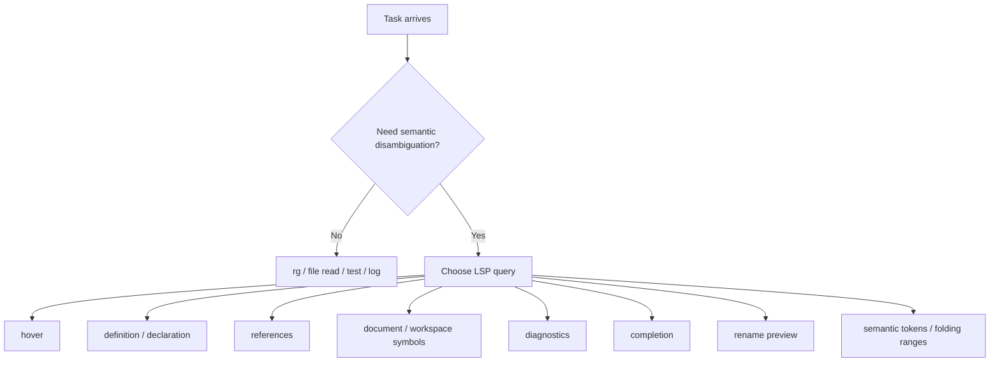

## 3. Query Flow

1. `hover`로 타입, 시그니처, 짧은 설명을 확인한다.
2. `definition`으로 owner file과 구현 위치를 찾는다.
3. `references`로 영향 범위를 본다.
4. `symbols`로 파일 구조를 잡는다.
5. `diagnostics`로 지금 깨진 지점을 확인한다.
6. `completion`과 `rename preview`로 API shape와 edit scope를 확인한다.
7. 마지막 판단은 소스 읽기와 테스트/로그다. LSP만으로 결론내리지 않는다.

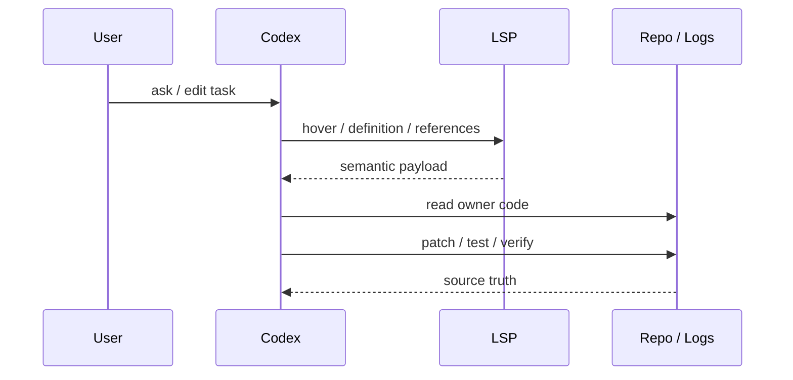

## 4. Coverage Boundary

이 문서는 다음을 목표로 한다.

- practically exhaustive:
  - Codex가 LSP-like surface를 실제 작업에 쓰는 대표/조건부/희귀 케이스를 최대한 넓게 적는다.
- not safely claimable:
  - 특정 hidden implementation, 제품 내부 telemetry, 세션 비노출 capability의 실제 호출 빈도를 단정하지 않는다.

즉:

- 아래 목록은 `실전 envelope` 기준으로는 넓다.
- 하지만 `formal complete inventory of all internal behaviors`라고 쓰면 오버클레임이다.

## 5. Interface Map

| High-level name | LSP RPC | Role | Use frequency | Signal trust | Input | Payload fields used | Codex가 뽑는 것 |
|---|---|---|---:|---:|---|---|---|
| `hover` | `textDocument/hover` | core | 9 | 6 | `file + line + column` | `contents`, `range` | 타입, 시그니처, 짧은 설명 |
| `definition` | `textDocument/definition` | core | 10 | 8 | `file + line + column` | `uri`, `range`, `targetRange`, `targetSelectionRange` | 실제 구현 위치 |
| `declaration` | `textDocument/declaration` | secondary | 5 | 6 | `file + line + column` | `uri`, `range`, `targetRange` | 선언 위치 |
| `typeDefinition` | `textDocument/typeDefinition` | secondary | 6 | 7 | `file + line + column` | `uri`, `range`, `targetRange` | 타입 owner |
| `implementation` | `textDocument/implementation` | secondary | 7 | 7 | `file + line + column` | `uri`, `range`, `targetRange` | concrete impl / override |
| `references` | `textDocument/references` | core | 9 | 6 | `file + line + column` | location list, `includeDefinition` | 사용처, blast radius |
| `document symbols` | `textDocument/documentSymbol` | core | 8 | 8 | `file` | `name`, `kind`, `range`, `selectionRange`, `children` | outline, top-level structure |
| `workspace symbols` | `workspace/symbol` | secondary | 6 | 5 | query string | `name`, `kind`, `containerName`, `location` | repo-wide owner 후보 |
| `diagnostics` | `textDocument/publishDiagnostics` | core | 8 | 7 | `file` or open buffer | `severity`, `message`, `range`, `source`, `code`, `relatedInformation` | blocking error, source of failure |
| `completion` | `textDocument/completion` | core | 7 | 4 | `file + line + column` | `label`, `kind`, `detail`, `documentation`, `insertText`, `textEdit` | API surface |
| `completion resolve` | `completionItem/resolve` | rare | 2 | 4 | completion item | `detail`, `documentation`, extra fields | expanded candidate details |
| `signatureHelp` | `textDocument/signatureHelp` | secondary | 5 | 6 | `file + line + column` | `signatures`, `activeSignature`, `activeParameter` | arg order, overload |
| `prepareRename` | `textDocument/prepareRename` | secondary | 6 | 7 | symbol position | `range`, `placeholder`, error if unsupported | rename 가능성 |
| `rename` | `textDocument/rename` | secondary | 6 | 7 | symbol position + new name | `changes` / `documentChanges` | edit blast radius |
| `codeAction` | `textDocument/codeAction` | secondary | 5 | 3 | `file` or range | `title`, `kind`, `edit`, `diagnostics` | quick fix 후보 |
| `callHierarchy incoming` | `callHierarchy/incomingCalls` | rare | 3 | 5 | call hierarchy item | caller items, from ranges | who calls this |
| `callHierarchy outgoing` | `callHierarchy/outgoingCalls` | rare | 3 | 5 | call hierarchy item | callee items, from ranges | what this calls |
| `documentHighlight` | `textDocument/documentHighlight` | rare | 3 | 5 | `file + line + column` | highlight ranges, kinds | same-symbol local hotspots |
| `semantic tokens` | `textDocument/semanticTokens/full`, `.../range` | secondary | 4 | 4 | `file` or range | token stream `data`, `legend` | value/type/keyword structure |
| `folding ranges` | `textDocument/foldingRange` | secondary | 4 | 6 | `file` | `startLine`, `endLine`, `kind` | block boundaries |
| `inlay hints` | `textDocument/inlayHint` | rare | 2 | 4 | `file` or range | hint label, position, kind | implicit type/arg readability |
| `selection ranges` | `textDocument/selectionRange` | rare | 2 | 5 | `file + line + column` | parent selection hierarchy | structurally safe local expansion |
| `document links` | `textDocument/documentLink` | rare | 1 | 2 | `file` | target links, ranges | linked config/spec targets |
| `linked editing` | `textDocument/linkedEditingRange` | rare | 1 | 4 | `file + line + column` | linked ranges | paired token rename hints |
| `codeLens` | `textDocument/codeLens` | rare | 1 | 3 | `file` | lens titles, commands | test/ref count shortcuts |
| `moniker` | `textDocument/moniker` | rare | 1 | 5 | symbol position | identity strings, scheme | cross-boundary identity hint |

## 6. Usecase Matrix

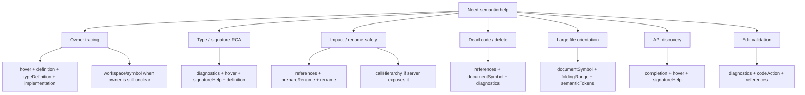

| Use case | Primary interfaces | Use frequency | Signal trust | What Codex uses from payload | Follow-up |
|---|---|---:|---:|---|---|
| Owner tracing | `hover`, `definition`, `typeDefinition`, `implementation` | 10 | 8 | type hint, owner URI, selection range, implementation target | read owner source, then narrow by references |
| Type / signature RCA | `diagnostics`, `hover`, `signatureHelp`, `definition` | 9 | 7 | severity, error message, active signature, active parameter, related info | fix arity/type mismatch, recheck diagnostics |
| Impact / rename safety | `references`, `prepareRename`, `rename` | 8 | 7 | callsites, rename range, workspace edit size, public surface hit count | approve rename or scope down change |
| Dead code / delete | `references`, `documentSymbol`, `diagnostics` | 6 | 4 | zero/low references, local structure, unresolved breakage after removal | delete candidate or quarantine then verify |
| Large file orientation | `documentSymbol`, `foldingRange`, `semanticTokens` | 5 | 6 | file outline, block boundaries, declaration/usage density | targeted read only |
| API discovery | `completion`, `hover`, `signatureHelp` | 7 | 4 | candidate labels, docs, insertText, arg order, overloads | callsite fix or import fix |
| Repo-wide owner search | `workspace/symbol`, `references` | 6 | 5 | close matches, container name, top-level location | narrow to actual owner file |
| Edit validation | `diagnostics`, `codeAction`, `references` | 8 | 6 | remaining errors, quick fix titles, residual callsites | apply fix or run build/test |
| Import / export path debug | `definition`, `declaration`, `workspace/symbol`, `diagnostics` | 6 | 6 | resolved module target, unresolved import message, container name | inspect module/export chain |
| Declaration / implementation split | `declaration`, `definition`, `implementation` | 5 | 7 | declaration target, concrete impl targets | choose real owner before patch |
| Override / dispatch tracing | `implementation`, `references`, `typeDefinition` | 4 | 5 | concrete overrides, receiver type owner, callsite spread | inspect dynamic/static dispatch surface |
| Quick-fix triage | `diagnostics`, `codeAction`, `hover` | 4 | 3 | fix titles, suggested edits, current type summary | accept/reject quick fix |
| LSP insufficiency fallback | `diagnostics`, `references`, `workspace/symbol` | 7 | 9 | weak or contradictory semantic signals | downgrade to source/test/log path |
| Call hierarchy impact tracing | `callHierarchy incoming`, `callHierarchy outgoing` | 3 | 5 | caller/callee items, from ranges | inspect call graph-like spread |
| Local scope micro-edit | `documentHighlight`, `selectionRange` | 3 | 5 | same-symbol local spans, structural parent ranges | keep edit local |
| Readability assist | `inlay hints`, `hover` | 2 | 4 | inferred type/name hints, inline argument names | faster reading only |
| Cross-boundary identity check | `moniker`, `definition`, `workspace/symbol` | 1 | 5 | symbol identity strings, owner candidates | verify same symbol across boundaries |

Notes:

- `callHierarchy` is useful when exposed, but it is secondary and not guaranteed.
- `prepareRename` is a gate, not a replacement for `rename`.
- `semanticTokens` and `foldingRange` are orientation tools, not final proof.
- `codeAction`, `completion`, `inlay hints`는 생산성에는 유용하지만 truth signal로는 약하다.

## 7. Detailed Usecases

### 7.1 Owner Tracing

목적:
- symbol의 실제 owner file과 concrete implementation을 찾는다.
- wrapper, alias, re-export, trait, interface, base class를 구분한다.

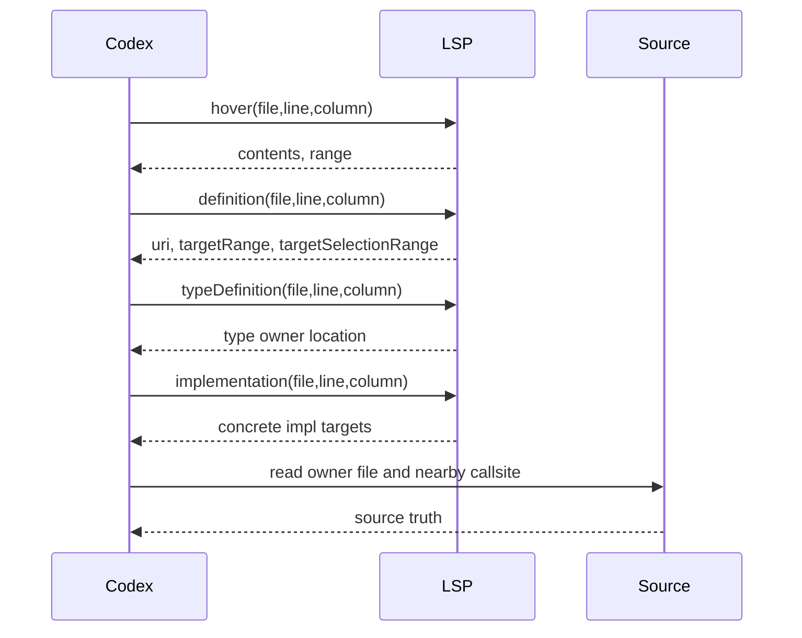

| Item | Details |
|---|---|
| Primary interfaces | `hover`, `definition`, `typeDefinition`, `implementation` |
| Input | callsite `file + line + column` |
| Payload fields used | `contents`, `uri`, `targetRange`, `targetSelectionRange` |
| Data extracted | type hint, symbol owner, type owner, concrete impl candidate |
| Decision rule | declaration만 보이면 `implementation` 또는 source read로 내려간다 |
| Follow-up | owner file read, then `references` if scope matters |

### 7.2 Type / Signature RCA

목적:
- 타입 mismatch, 잘못된 argument order, overload mismatch를 좁힌다.

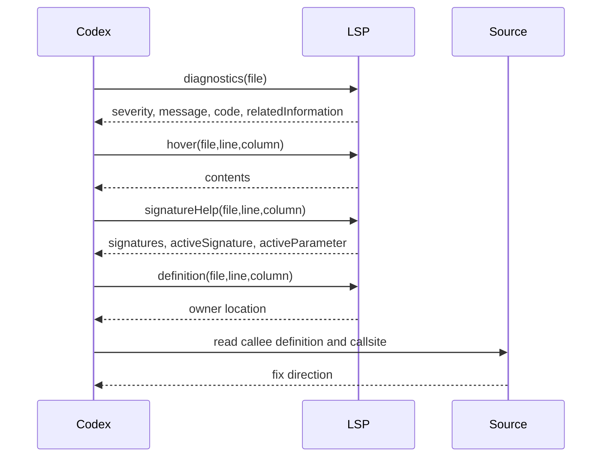

| Item | Details |
|---|---|
| Primary interfaces | `diagnostics`, `hover`, `signatureHelp`, `definition` |
| Input | failing callsite or error range |
| Payload fields used | `message`, `code`, `relatedInformation`, `contents`, `signatures`, `activeParameter` |
| Data extracted | expected type, actual error family, active overload, wrong arg position |
| Decision rule | diagnostics가 vague하면 `signatureHelp`와 callee source로 보정한다 |
| Follow-up | patch callsite or callee signature, then recheck diagnostics |

### 7.3 Impact / Rename Safety

목적:
- symbol rename이나 signature change의 blast radius를 본다.
- edit가 local인지 public surface까지 번지는지 구분한다.

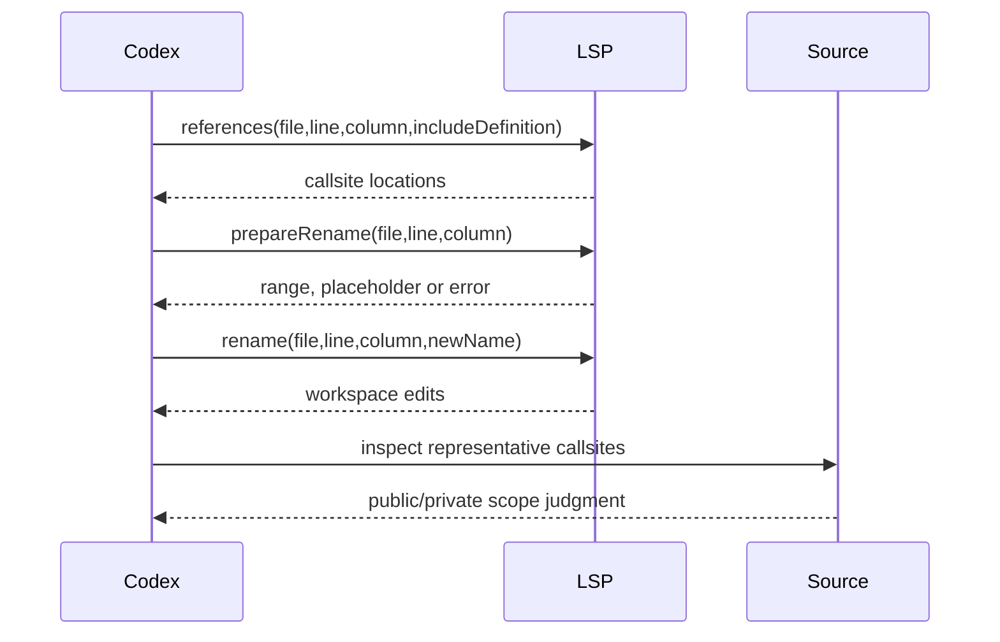

| Item | Details |
|---|---|
| Primary interfaces | `references`, `prepareRename`, `rename` |
| Input | target symbol position and optional new name |
| Payload fields used | location list, `range`, `placeholder`, `changes`, `documentChanges` |
| Data extracted | callsite count, touched files, touched modules, rename eligibility |
| Decision rule | edit set이 크거나 public caller가 많으면 narrow patch 또는 staged rollout로 내린다 |
| Follow-up | approve rename, scope down, or refuse broad unsafe edit |

### 7.4 Dead Code / Delete Review

목적:
- delete candidate가 실제 dead인지, string registration이나 hidden dynamic use가 있는지 본다.

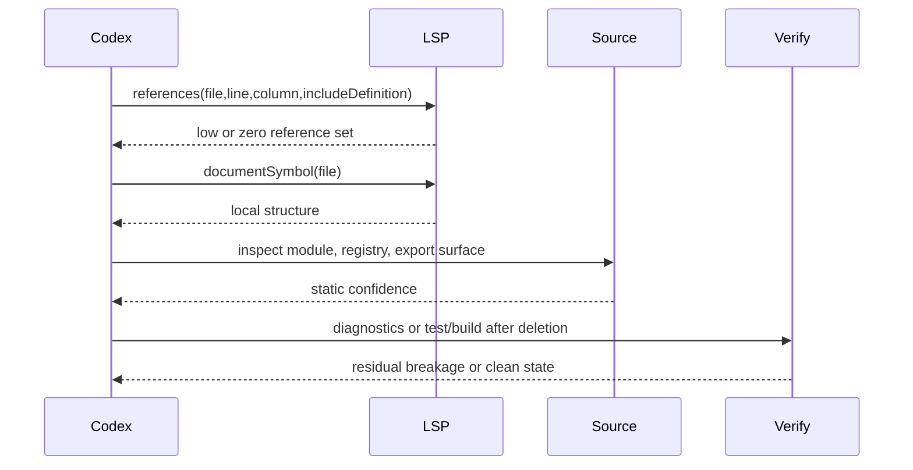

| Item | Details |
|---|---|
| Primary interfaces | `references`, `documentSymbol`, `diagnostics` |
| Input | candidate symbol or block |
| Payload fields used | reference locations, symbol tree, residual diagnostics |
| Data extracted | visible static use, local ownership, post-delete breakage |
| Decision rule | `references == 0`만으로 dead 판정하지 않는다 |
| Follow-up | source/log/test confirmation before final removal |

### 7.5 Large File Orientation

목적:
- 큰 파일에서 필요한 구간만 읽고 나머지는 건드리지 않는다.

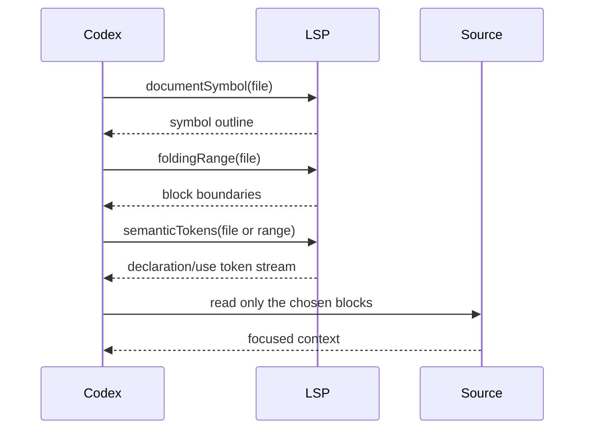

| Item | Details |
|---|---|
| Primary interfaces | `documentSymbol`, `foldingRange`, `semanticTokens` |
| Input | file path |
| Payload fields used | `name`, `kind`, `range`, `children`, `startLine`, `endLine`, token `data` |
| Data extracted | top-level blocks, candidate edit area, declaration vs usage zones |
| Decision rule | 구조를 먼저 잡고, 실제 내용 읽기는 필요한 블록으로 제한한다 |
| Follow-up | targeted source read and patch |

### 7.6 API Discovery

목적:
- unfamiliar object, namespace, module의 API surface를 빠르게 추정한다.

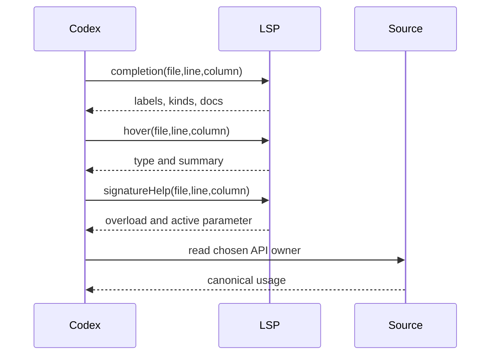

| Item | Details |
|---|---|
| Primary interfaces | `completion`, `hover`, `signatureHelp` |
| Input | partial callsite or member access |
| Payload fields used | `label`, `detail`, `documentation`, `insertText`, `signatures`, `activeParameter` |
| Data extracted | candidate methods, expected arg order, likely canonical API |
| Decision rule | completion 후보는 힌트일 뿐이고 owner source로 확인한다 |
| Follow-up | fix import, pick API, or reject wrong candidate |

### 7.7 Repo-Wide Owner Search

목적:
- 이름은 아는데 file owner를 모를 때 repo-wide 후보를 빠르게 줄인다.

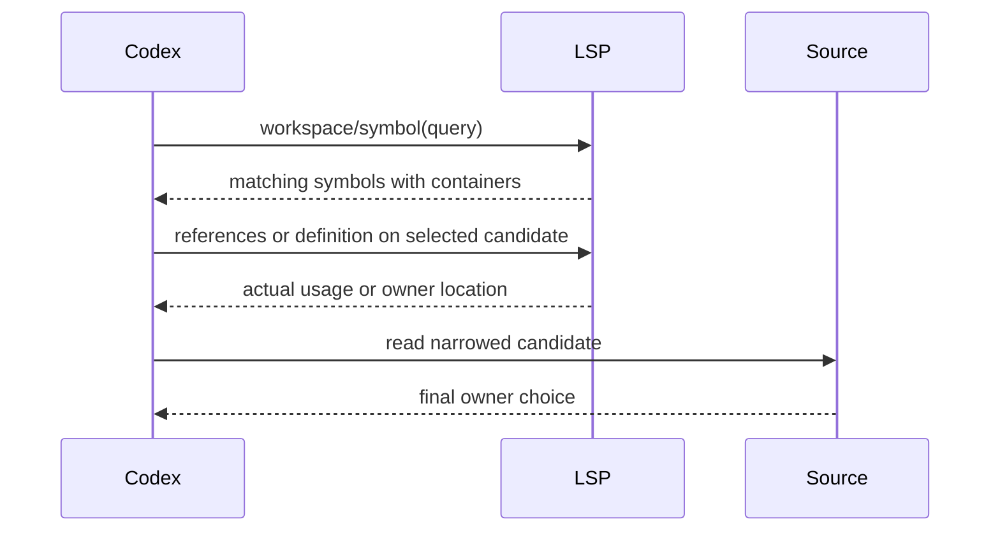

| Item | Details |
|---|---|
| Primary interfaces | `workspace/symbol`, `references`, `definition` |
| Input | symbol name or partial name |
| Payload fields used | `name`, `kind`, `containerName`, `location` |
| Data extracted | owner candidates, module context, likely package |
| Decision rule | 동명이인이 많으면 representative candidate만 source read로 확인한다 |
| Follow-up | move into owner tracing flow |

### 7.8 Edit Validation

목적:
- edit 이후 남은 breakage와 자동 fix 후보를 확인한다.

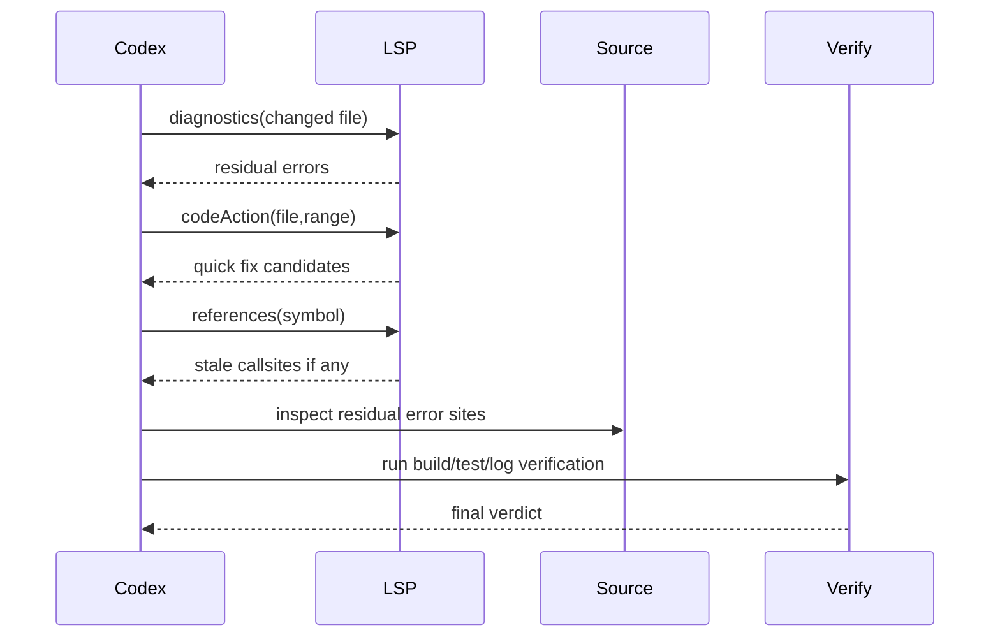

| Item | Details |
|---|---|
| Primary interfaces | `diagnostics`, `codeAction`, `references` |
| Input | changed files and changed symbol positions |
| Payload fields used | `message`, `severity`, `code`, `title`, `kind`, `edit`, residual location list |
| Data extracted | remaining breakage, auto-fix shape, stale caller set |
| Decision rule | `codeAction` suggestion은 proposal일 뿐이고 무조건 적용하지 않는다 |
| Follow-up | patch again or escalate to build/test |

### 7.9 Import / Export Path Debug

목적:
- import/export chain이 꼬였을 때 resolved module target을 좁힌다.
- unresolved import가 config 문제인지 실제 export 누락인지 구분한다.

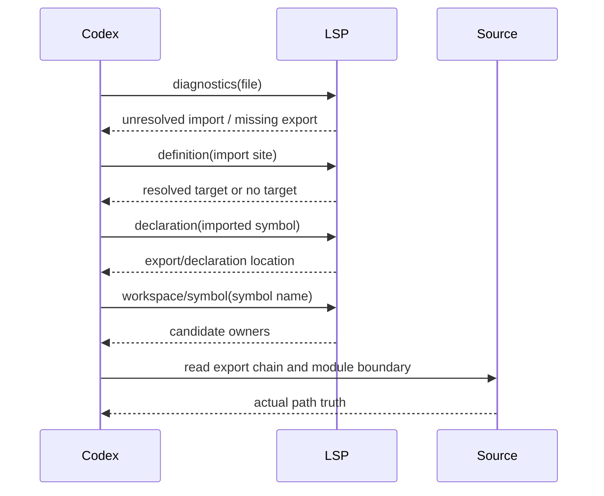

| Item | Details |
|---|---|
| Primary interfaces | `diagnostics`, `definition`, `declaration`, `workspace/symbol` |
| Input | import site or unresolved symbol |
| Payload fields used | `message`, `code`, owner `uri`, `containerName`, candidate `location` |
| Data extracted | import target, export candidate, missing link in module chain |
| Decision rule | LSP가 target을 못 찾으면 config or export chain mismatch로 의심하고 source로 내려간다 |
| Follow-up | fix import path, add export, or adjust config |

### 7.10 Declaration / Implementation Split

목적:
- declaration과 implementation이 분리된 언어/구조에서 실제 patch owner를 잘못 고르는 것을 막는다.

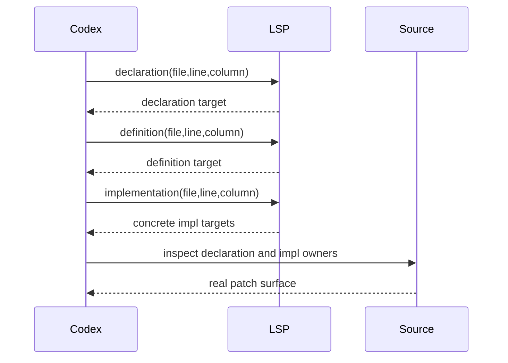

| Item | Details |
|---|---|
| Primary interfaces | `declaration`, `definition`, `implementation` |
| Input | symbol position |
| Payload fields used | declaration `uri`, definition `targetRange`, impl target list |
| Data extracted | interface/trait surface vs concrete owner surface |
| Decision rule | declaration owner에 바로 패치하지 않고 implementation owner를 먼저 본다 |
| Follow-up | patch impl or patch interface plus all impls |

### 7.11 Override / Dispatch Tracing

목적:
- virtual dispatch, trait method, interface override, subclass override처럼 runtime target이 여러 개인 경우를 좁힌다.

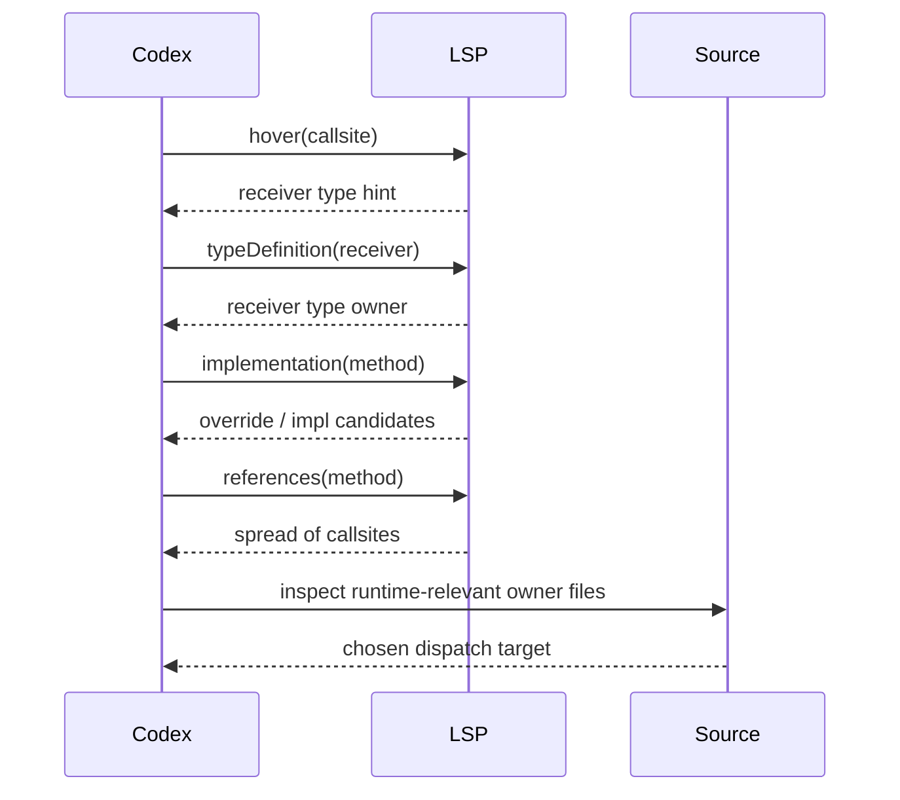

| Item | Details |
|---|---|
| Primary interfaces | `hover`, `typeDefinition`, `implementation`, `references` |
| Input | dynamic dispatch callsite |
| Payload fields used | receiver type summary, impl target list, callsite locations |
| Data extracted | likely runtime receiver, candidate overrides, shared API surface |
| Decision rule | impl candidate가 여러 개면 receiver type과 nearby source를 같이 본다 |
| Follow-up | patch shared interface or one concrete impl |

### 7.12 Quick-Fix Triage

목적:
- LSP가 제안하는 quick fix를 그대로 적용하지 않고 분류한다.

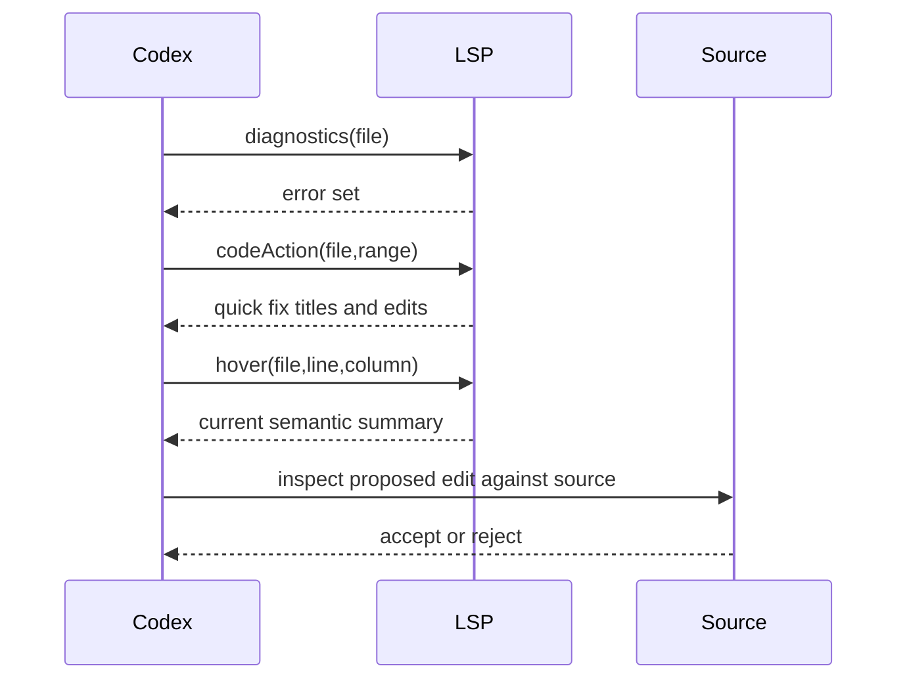

| Item | Details |
|---|---|
| Primary interfaces | `diagnostics`, `codeAction`, `hover` |
| Input | error range |
| Payload fields used | `title`, `kind`, `edit`, current `contents` |
| Data extracted | proposed transformation, likely intent, mismatch risk |
| Decision rule | import auto-fix, rename, suppression류는 source semantics와 비교 후 채택한다 |
| Follow-up | apply manually, reject, or narrow edit |

### 7.13 LSP Insufficiency Fallback

목적:
- semantic surface가 약하거나 모순될 때 text/search/log path로 강등한다.

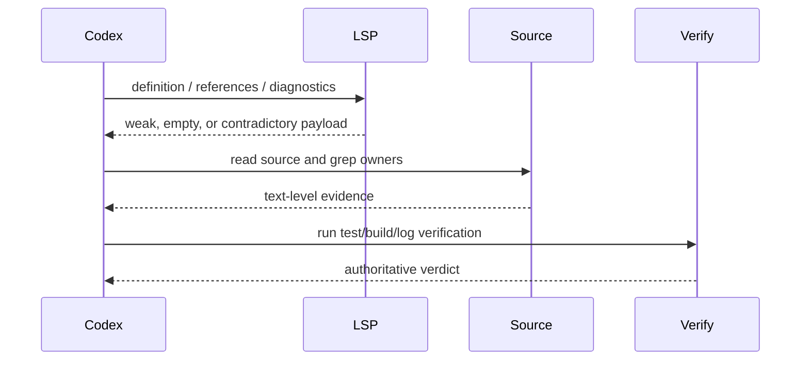

| Item | Details |
|---|---|
| Primary interfaces | `definition`, `references`, `diagnostics` |
| Input | any ambiguous semantic target |
| Payload fields used | empty result, contradictory target, missing callsites, weak diagnostics |
| Data extracted | lack of confidence itself |
| Decision rule | LSP가 비거나 모순되면 semantic path를 truth source로 취급하지 않는다 |
| Follow-up | switch to `rg`, source read, diff, test, log |

### 7.14 Call Hierarchy Impact Tracing

목적:
- caller/callee spread를 quick graph처럼 본다.
- `references`만으로는 애매한 호출 방향을 보정한다.

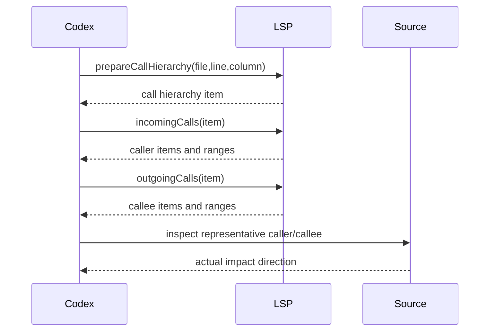

| Item | Details |
|---|---|
| Primary interfaces | `callHierarchy incoming`, `callHierarchy outgoing` |
| Input | function/method position |
| Payload fields used | caller/callee item, from ranges |
| Data extracted | incoming callers, outgoing dependencies |
| Decision rule | call hierarchy는 quick graph이지 full call graph authority가 아니다 |
| Follow-up | inspect representative paths in source |

### 7.15 Local Scope Micro-Edit

목적:
- 작은 rename, local variable change, same-symbol edit를 너무 넓게 퍼뜨리지 않는다.

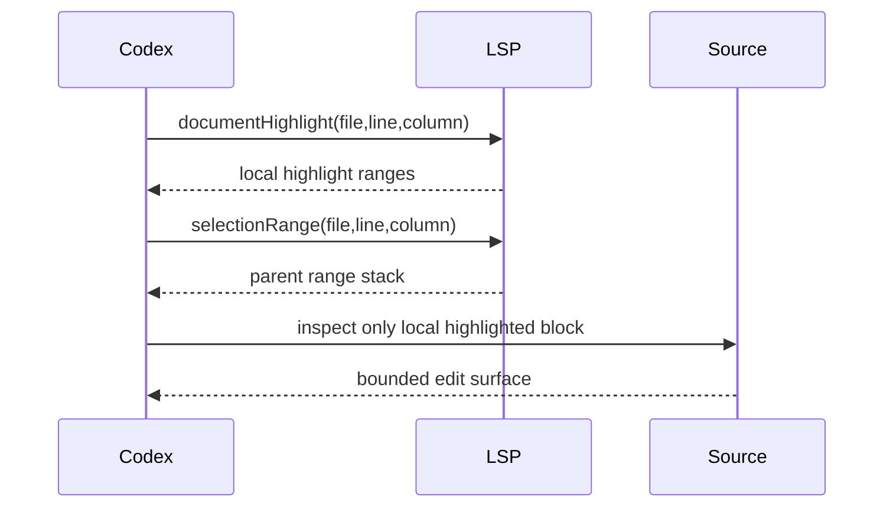

| Item | Details |
|---|---|
| Primary interfaces | `documentHighlight`, `selectionRange` |
| Input | local symbol position |
| Payload fields used | highlight ranges, parent selection hierarchy |
| Data extracted | same-file hotspot cluster, structurally safe local block |
| Decision rule | local highlight가 충분히 좁으면 broad repo search를 뒤로 미룬다 |
| Follow-up | localized edit, then diagnostics |

### 7.16 Readability Assist

목적:
- implicit type or argument meaning이 읽기 비용을 높일 때 빠르게 보조한다.

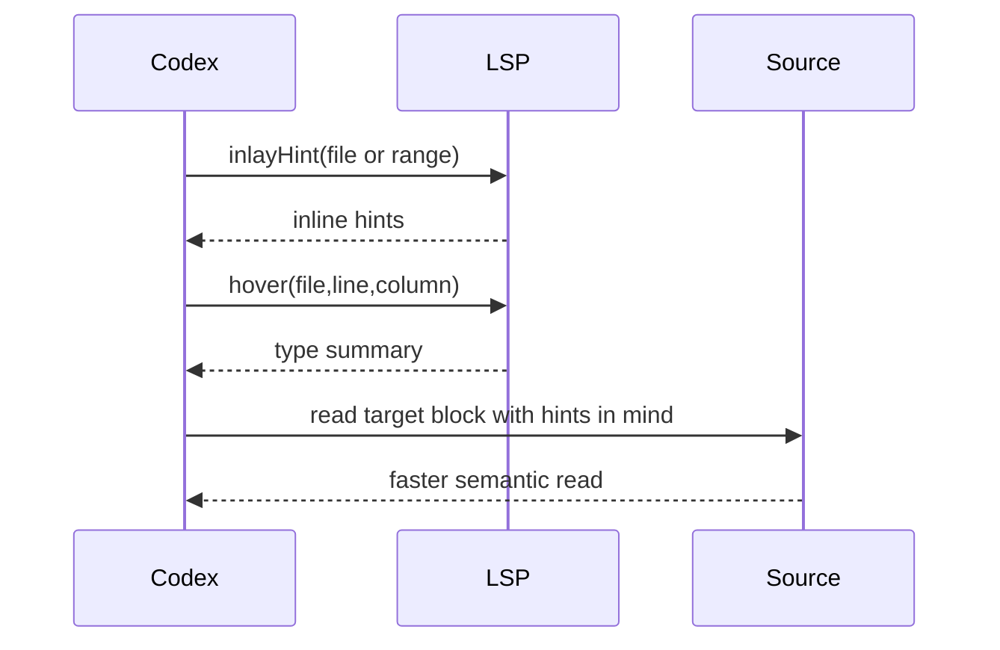

| Item | Details |
|---|---|
| Primary interfaces | `inlay hints`, `hover` |
| Input | dense expression or arg list |
| Payload fields used | hint label, position, hint kind, hover contents |
| Data extracted | inferred names/types for readability |
| Decision rule | readability 보조일 뿐이고 patch truth로 승격하지 않는다 |
| Follow-up | continue normal source read |

### 7.17 Cross-Boundary Identity Check

목적:
- symbol 이름이 같아도 identity가 같은지 다른지 경계에서 확인한다.

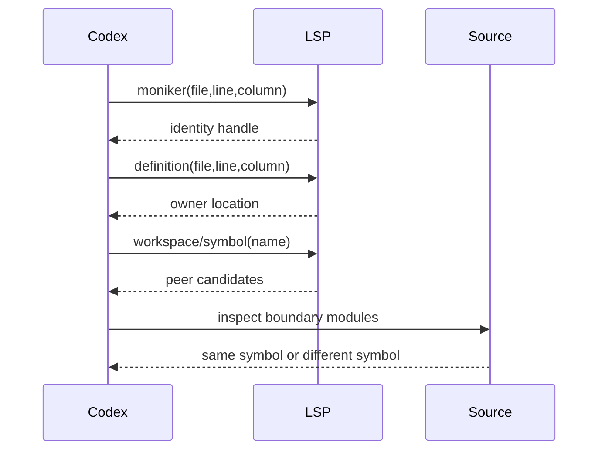

| Item | Details |
|---|---|
| Primary interfaces | `moniker`, `definition`, `workspace/symbol` |
| Input | ambiguous cross-boundary symbol |
| Payload fields used | identity string/scheme, owner URI, candidate locations |
| Data extracted | same-identity hint vs name collision |
| Decision rule | moniker가 없거나 빈약하면 source boundary proof로 내려간다 |
| Follow-up | confirm collision or continuity |

### 7.18 Low-Frequency Utility Surfaces

목적:
- 독립된 주 흐름이라기보다 다른 flow를 보조하는 희귀 LSP 표면을 묶는다.

```mermaid
sequenceDiagram
    participant C as Codex
    participant L as LSP
    participant S as Source

    C->>L: completionItem/resolve(item)
    L-->>C: expanded docs/detail
    C->>L: documentLink(file)
    L-->>C: target links
    C->>L: linkedEditingRange(file,line,column)
    L-->>C: paired ranges
    C->>L: codeLens(file)
    L-->>C: sparse lens metadata
    C->>S: treat all of them as navigation hints
    S-->>C: source truth
```

| Surface | Use frequency | Signal trust | What it helps with | Why trust is low |
|---|---:|---:|---|---|
| `completion resolve` | 2 | 4 | richer docs for one candidate | still candidate-level hint |
| `document links` | 1 | 2 | linked config/spec target open | links are navigation only |
| `linked editing` | 1 | 4 | paired token edit awareness | local co-edit hint, not blast radius proof |
| `codeLens` | 1 | 3 | sparse test/ref shortcut metadata | lens counts are UI-oriented, not authority |

## 8. Response Assembly

Codex는 LSP 응답을 그대로 답하지 않는다. 보통 다음 순서로 압축한다.

1. owner file
2. type / signature
3. usage count / affected callsites
4. blocking diagnostics
5. actual source or test evidence

요약 규칙:

- `hover`는 “이게 뭐냐”
- `definition`은 “어디가 실체냐”
- `typeDefinition`은 “이 타입의 본체가 뭐냐”
- `implementation`은 “실제 구현체가 뭐냐”
- `references`는 “어디까지 터지냐”
- `diagnostics`는 “지금 뭐가 깨졌냐”
- `rename preview`는 “얼마나 넓게 바뀌냐”

응답에서 실제로 자주 쓰는 필드:

- owner path: `uri`, `targetRange`, `location`
- type/signature: `contents`, `signatures`, `activeParameter`
- blast radius: reference location count, changed file count
- breakage: `severity`, `message`, `code`, `relatedInformation`
- structure: symbol tree, folding boundaries

## 9. Language Heuristics

| Language | Trust more | Trust less | Extra check |
|---|---|---|---|
| Rust | type, trait, impl, diagnostics | macro, proc-macro, `#[cfg]`, generated code | `cargo check`, feature flags |
| Python | import nav, hover, basic diagnostics | dynamic attrs, monkey patch, metaclass, framework injection | runtime path, tests |
| TS / JS | hover, completion, references, rename preview | path alias mismatch, `any`, string-key access, project config drift | `tsconfig`, runtime import path |

## 10. Failure Modes

- unsaved buffer and disk file mismatch
- generated or macro-expanded code
- dynamic runtime binding
- stale index or wrong workspace root
- config mismatch between editor and build
- string-based usage that references cannot see

## 11. Review Checklist

Codex의 LSP 사용을 리뷰할 때 보는 항목:

1. owner tracing에서 `definition`만 보고 implementation 확인을 건너뛰지 않았는가
2. type RCA에서 `diagnostics` message만 믿고 callee signature를 안 본 것은 아닌가
3. rename 판단에서 `prepareRename`과 `rename` edit size를 실제로 비교했는가
4. dead code 판단에서 `references == 0`만으로 삭제 결론을 내리지 않았는가
5. large file reading에서 `documentSymbol` 없이 파일 전체를 무식하게 읽지 않았는가
6. completion 후보를 source truth처럼 과신하지 않았는가
7. final answer가 LSP payload만 반복하고 source/test/log evidence를 빠뜨리지는 않았는가

## 12. Rule of Thumb

- owner 찾기: `hover` -> `definition` -> `typeDefinition` / `implementation`
- 영향 범위: `references` -> `prepareRename` / `rename`
- 구조 파악: `documentSymbol` -> `foldingRange` -> `semanticTokens`
- 에러 수정: `diagnostics` -> `codeAction` -> source read
- API 탐색: `completion` -> `hover` -> `signatureHelp`
- 최종 truth: source, diff, test, log
