# Codex Non-LSP Signal Model

Overview router: [may-20-codex-agent-loop.md](/Users/songmin/Documents/code-new/semantica-codegraph-v2/docs/analysis/codex-agent/may-20-codex-agent-loop.md)

이 문서는 Codex가 `LSP` 바깥에서 실제 판단에 쓰는 신호를 정리한다. `LSP` 자체는 [may-20-codex-lsp.md](/Users/songmin/Documents/code-new/semantica-codegraph-v2/docs/analysis/codex-agent/may-20-codex-lsp.md)에 분리한다.

## ToC

1. Scoring model
2. Scope
3. Signal stack
4. Problem-solving loop
5. Signal family map
6. Combination rules
7. Usecase matrix
8. Detailed usecases
9. Conflict resolution
10. Anti-signals
11. Review checklist
12. Rule of thumb

## 1. Scoring Model

- `Use frequency 0-10`
  - `10`: 거의 항상 먼저 본다
  - `7-9`: 자주 본다
  - `4-6`: 조건부로 자주 본다
  - `1-3`: 희귀하지만 유효하다
  - `0`: 사실상 안 쓴다
- `Signal trust 0-10`
  - `10`: 단독으로도 매우 강하다
  - `7-9`: 강하지만 다른 신호로 닫는 것이 안전하다
  - `4-6`: 보조 신호다
  - `1-3`: 힌트 수준이다
  - `0`: 판단 근거로 부적합하다

주의:

- 이 점수는 내부 telemetry가 아니라 best-fit operational model이다.
- `Use frequency`와 `Signal trust`는 다르다. 예를 들어 `rg hits`는 자주 보지만 단독 신뢰도는 낮다.

## 2. Scope

이 문서가 다루는 것:

- source text
- file/module adjacency
- git diff and status
- search distribution
- build/test/runtime logs
- artifact and snapshot output
- repo-local rules
- browser/UI observation
- environment/tool availability
- user intent and constraint signals

이 문서가 직접 다루지 않는 것:

- `LSP` semantic surface
- hidden product telemetry
- non-exposed internal ranking systems

## 3. Signal Stack

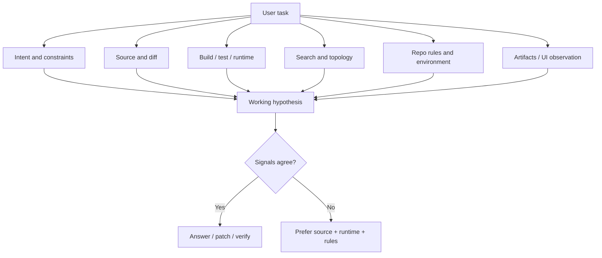

핵심:

- source와 runtime이 가장 강하다
- search와 topology는 owner 후보 축소용이다
- docs, memory, naming 느낌은 주 신호가 아니다

## 4. Problem-Solving Loop

### 4.1 End-to-end timeline

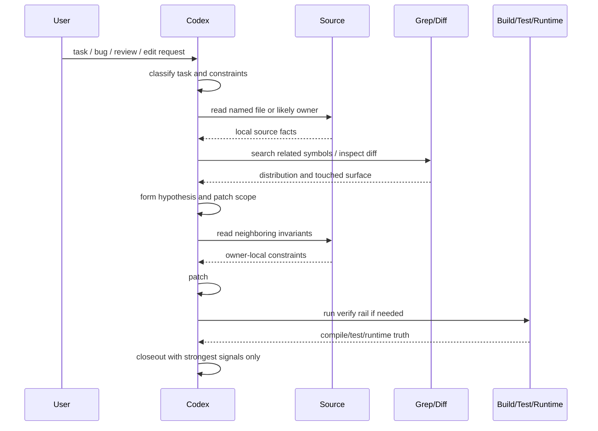

### 4.2 Stage-by-stage signal use

| Stage | Goal | Primary signals | Use frequency | Signal trust | Exit criterion |
|---|---|---|---:|---:|---|
| Intake | 요청과 제약을 해석 | `user intent`, `repo-local rules`, `environment` | 10 | 8 | what is being asked, what is allowed |
| First owner guess | 첫 owner 후보를 잡음 | `source text`, `rg hits`, `file topology` | 10 | 7 | one or two likely owner files |
| Owner confirmation | 실제 owner를 확정 | `source text`, `nearby source adjacency`, `git diff` | 10 | 9 | concrete owner and nearby invariant identified |
| Hypothesis formation | 왜 깨졌는지 설명 | `source text`, `build/test/runtime logs`, `artifact diff` | 8 | 9 | failure class and causal seam named |
| Patch scoping | 수정 범위를 제한 | `git diff`, `source adjacency`, `rg hits` | 9 | 8 | bounded write set selected |
| Patch execution | 실제 수정 | `source text`, `repo-local rules` | 8 | 9 | patch aligns to owner and rules |
| Verification | 수정이 실제로 맞는지 검증 | `build logs`, `test logs`, `runtime output`, `exit status` | 8 | 9 | green rail or explicit remaining blocker |
| Closeout | 무엇이 증명됐는지 보고 | `source text`, `diff`, `runtime/test/build result` | 10 | 9 | final answer contains only defended claims |

### 4.3 What changes by task type

| Task type | First strong signal | Second strong signal | What gets delayed |
|---|---|---|---|
| code edit | `source text` | `git diff` | docs/memory |
| compile failure | `build logs` | `source text` | browser/UI |
| behavior bug | `test logs` or `runtime output` | `source text` | naming/topology |
| review/audit | `source text` | `search distribution` | heavy verification unless needed |
| UI regression | `browser observation` | `source text` + `runtime output` | snapshots as proof |
| status/claim verification | `source text` | `tests/gates/logs` | plan prose |

### 4.4 Stage downgrade rules

- intake 단계에서 user intent가 애매하면 broad implementation을 늦춘다
- owner guess 단계에서 `rg`만 있고 source read가 없으면 확정하지 않는다
- hypothesis 단계에서 log와 source가 충돌하면 log를 재검증하고 source를 우선 본다
- verification 단계에서 wrong rail이 green이어도 intended rail이 red면 closeout하지 않는다

## 5. Signal Family Map

| Signal family | Role | Use frequency | Signal trust | What Codex extracts | Common failure mode |
|---|---|---:|---:|---|---|
| `source text` | core | 10 | 10 | owner, call path, actual behavior, invariants | partial read can miss nearby invariant |
| `nearby source adjacency` | core | 9 | 8 | same-file and same-module context | adjacent code can still be unrelated |
| `git diff` | core | 9 | 9 | actual changed surface, blast radius, intent drift | dirty tree can mix unrelated work |
| `git status` | secondary | 7 | 7 | touched files, staged/unstaged split | does not explain semantic impact |
| `build logs` | core | 8 | 9 | compile error family, broken owner file, failing symbol | stale build output can mislead |
| `test logs` | core | 8 | 9 | failing behavior, assertion shape, stack trace | flaky tests distort confidence |
| `runtime output` | core | 7 | 9 | JSON payload, API response, program result | sampled runtime may miss alternate path |
| `command exit status` | core | 8 | 8 | success/failure boundary, reproducibility | success can still hide logical bug |
| `artifact diff` | secondary | 6 | 8 | snapshot delta, generated output delta, metrics delta | artifact can be stale or cached |
| `rg hits` | core | 9 | 5 | owner candidates, callsite candidates, term distribution | grep absence is weak evidence |
| `file topology` | secondary | 7 | 6 | package boundary, test/impl pairing, module ownership | naming can lie |
| `repo-local rules` | core | 8 | 8 | allowed workflow, forbidden rails, verification policy | rule text can route but not prove code truth |
| `user intent` | core | 9 | 8 | goal, risk tolerance, stop condition, scope | vague asks can over-authorize |
| `environment/tool availability` | secondary | 7 | 7 | what can be verified now, missing tools, session constraints | availability says nothing about correctness |
| `browser / UI observation` | secondary | 4 | 7 | visible regression, interaction failure, layout break | visual pass can hide logic bug |
| `image / screenshot` | rare | 2 | 6 | obvious visual state | cannot prove interaction correctness |
| `snapshot / fixture shape` | secondary | 5 | 6 | format and structure drift | shape pass can miss semantic failure |
| `docs / plans / handoff` | rare | 4 | 3 | intended architecture, claimed status | stale very often |
| `memory / prior turn context` | rare | 3 | 3 | prior failed path, earlier hypothesis | can be stale or partial |
| `naming vibe` | rare | 2 | 1 | weak owner guess | extremely easy to hallucinate from name |
| `absence from grep` | rare | 3 | 2 | possible non-use | dynamic or indirect use is invisible |

## 6. Combination Rules

### 6.1 Trust order

1. `source text`
2. `runtime / build / test output`
3. `git diff`
4. `repo-local rules`
5. `search distribution`
6. `artifact/UI observation`
7. `docs / memory / naming`

### 6.2 Typical query order

1. read the changed or named file
2. inspect nearby owner code
3. search for callsites or owner candidates
4. check diff or status if patching
5. run build/test/runtime only when needed
6. use docs or memory only to route, not to prove

### 6.3 Downgrade rules

- `rg` hit without source read: downgrade
- stale log without rerun or timestamp coherence: downgrade
- docs claim without source or test proof: downgrade
- passing snapshot shape without behavior proof: downgrade
- browser visual pass without action/result proof: downgrade

## 7. Usecase Matrix

| Use case | Primary signals | Use frequency | Signal trust | What Codex uses | Follow-up |
|---|---|---:|---:|---|---|
| Owner tracing without LSP | `source text`, `rg hits`, `file topology` | 10 | 8 | definition-like owner path from source and distribution | inspect owner and callers |
| Patch scoping | `git diff`, `source adjacency`, `rg hits` | 9 | 8 | exact touched surface, neighboring invariants, related callers | narrow or widen patch |
| Compile failure RCA | `build logs`, `source text`, `repo rules` | 8 | 9 | failing file, failing symbol, rail constraints | patch owner then rerun |
| Behavior failure RCA | `test logs`, `runtime output`, `source text` | 8 | 9 | assertion, stack trace, actual value vs expected value | reproduce or patch |
| Dead code review | `rg hits`, `source adjacency`, `runtime/test evidence` | 6 | 4 | likely non-use, registry/export check, post-delete breakage | quarantine or remove |
| Import/export path debug | `source text`, `rg hits`, `build logs` | 7 | 8 | broken export chain, missing re-export, wrong module path | repair path |
| Large file orientation | `file topology`, `source adjacency`, `rg hits` | 6 | 6 | top-level blocks, probable owner zones | targeted read |
| Generated artifact drift | `artifact diff`, `source text`, `build/test logs` | 5 | 8 | real semantic delta vs churn | decide regenerate or patch source |
| UI regression check | `browser observation`, `source text`, `runtime output` | 4 | 7 | visible break, event flow, response payload | patch UI or handler |
| Constraint/rule check | `repo-local rules`, `user intent`, `environment` | 8 | 8 | allowed tool path, prohibited action, verification rail | choose compliant flow |
| Conflicting signal arbitration | `source text`, `runtime`, `diff`, `logs` | 7 | 9 | which signal wins when others disagree | downgrade weak signals |

## 8. Detailed Usecases

### 7.1 Owner Tracing Without LSP

목적:
- named symbol 또는 changed file의 실제 owner를 source와 search만으로 찾는다.

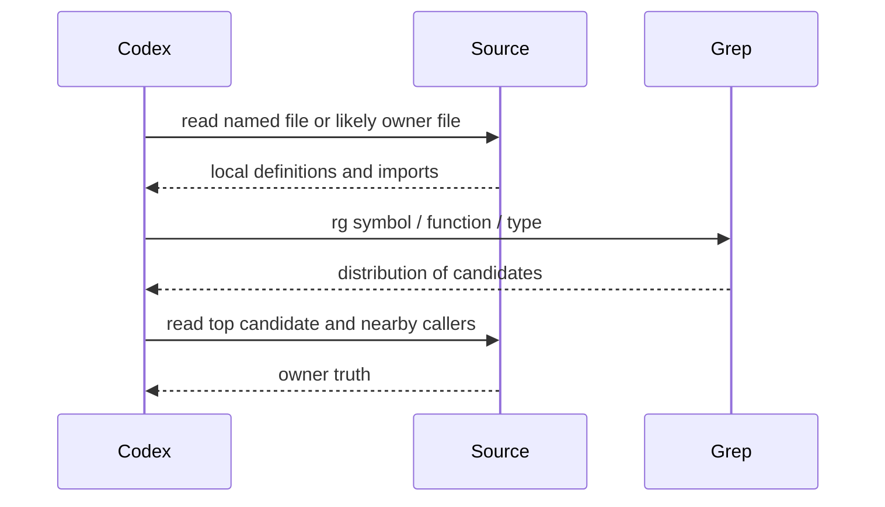

| Item | Details |
|---|---|
| Primary signals | `source text`, `rg hits`, `file topology` |
| Data extracted | likely owner file, exported surface, caller clusters |
| Decision rule | `rg` 결과는 후보일 뿐이고 source owner를 반드시 읽는다 |
| Follow-up | inspect neighbors or patch owner |

### 7.2 Patch Scoping

목적:
- patch가 너무 좁거나 너무 넓지 않게 바운더리를 잡는다.

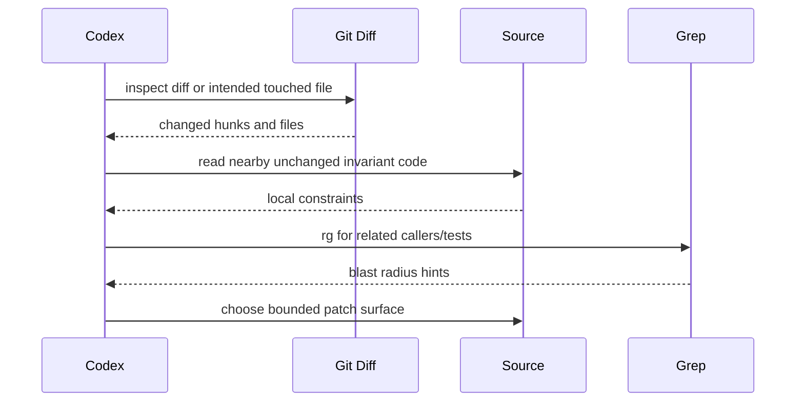

| Item | Details |
|---|---|
| Primary signals | `git diff`, `source adjacency`, `rg hits` |
| Data extracted | changed lines, neighboring invariant, likely dependents |
| Decision rule | diff만 보고 patch하지 않고 인접 불변식도 읽는다 |
| Follow-up | patch and validate |

### 7.3 Compile Failure RCA

목적:
- compile error의 owner file과 실제 failure class를 좁힌다.

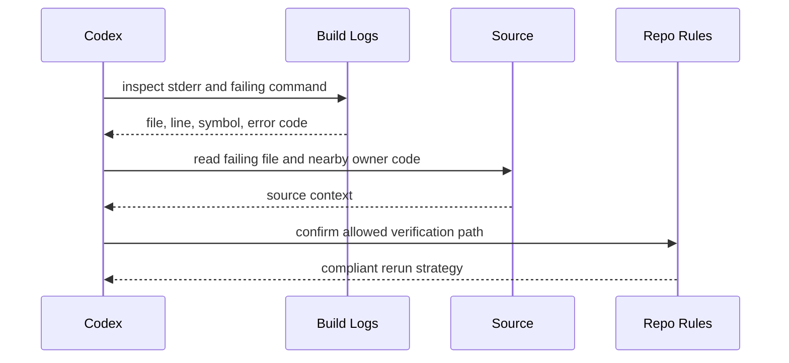

| Item | Details |
|---|---|
| Primary signals | `build logs`, `source text`, `repo-local rules` |
| Data extracted | exact error family, broken owner symbol, valid rerun rail |
| Decision rule | error text보다 source owner와 rail policy를 같이 본다 |
| Follow-up | patch owner and rerun |

### 7.4 Behavior Failure RCA

목적:
- test/runtime failure를 semantic claim이 아니라 actual wrong value 기준으로 좁힌다.

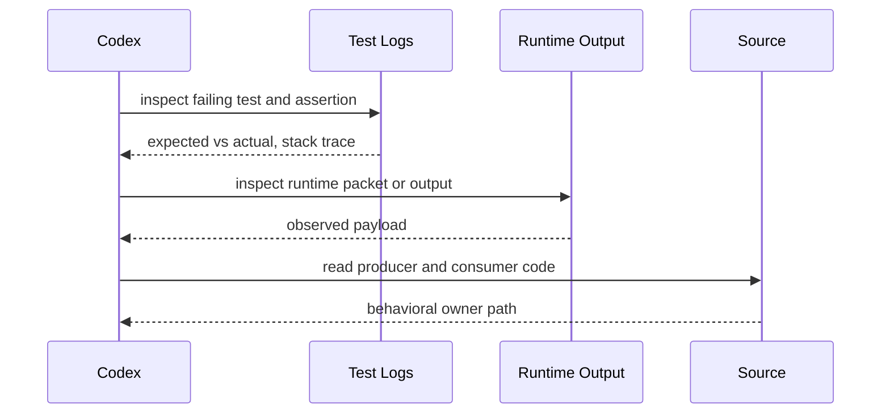

| Item | Details |
|---|---|
| Primary signals | `test logs`, `runtime output`, `source text` |
| Data extracted | wrong value, failure point, producer/consumer seam |
| Decision rule | stack trace와 actual payload를 둘 다 보지 않으면 behavior RCA를 닫지 않는다 |
| Follow-up | patch producer or expectation |

### 7.5 Dead Code Review

목적:
- true dead code와 hidden dynamic use를 구분한다.

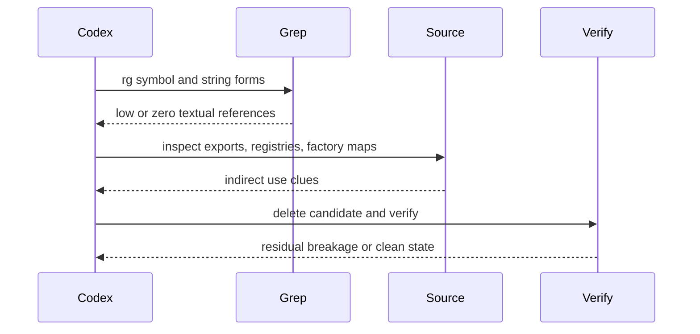

| Item | Details |
|---|---|
| Primary signals | `rg hits`, `source adjacency`, `runtime/test evidence` |
| Data extracted | explicit uses, export surface, hidden registry use |
| Decision rule | `grep miss != dead code` |
| Follow-up | quarantine or remove |

### 7.6 Import / Export Path Debug

목적:
- import/export chain mismatch를 source와 logs로 닫는다.

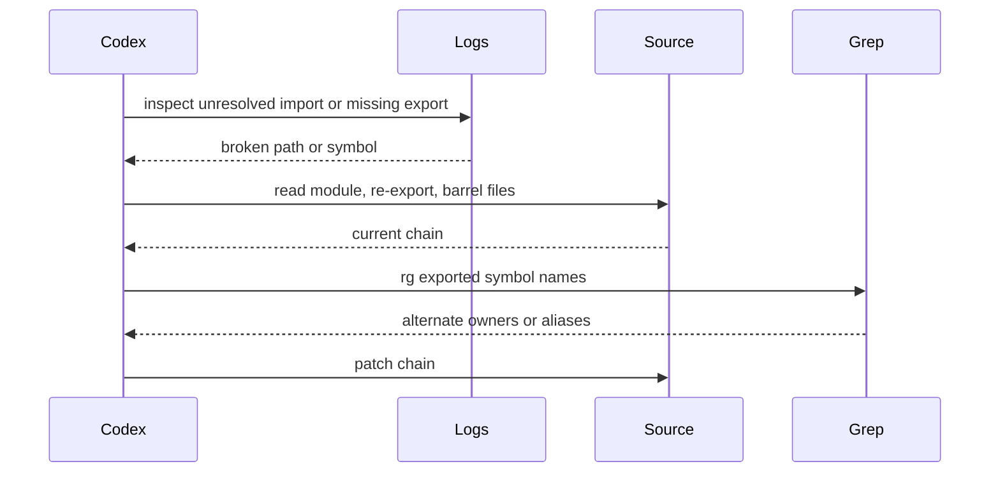

| Item | Details |
|---|---|
| Primary signals | `source text`, `rg hits`, `build logs` |
| Data extracted | broken chain segment, alternate owner, missing export |
| Decision rule | logs는 위치를 주고 source가 chain truth를 준다 |
| Follow-up | repair import/export path |

### 7.7 Generated Artifact Drift

목적:
- generated file, snapshot, metrics output이 source bug인지 regeneration 문제인지 구분한다.

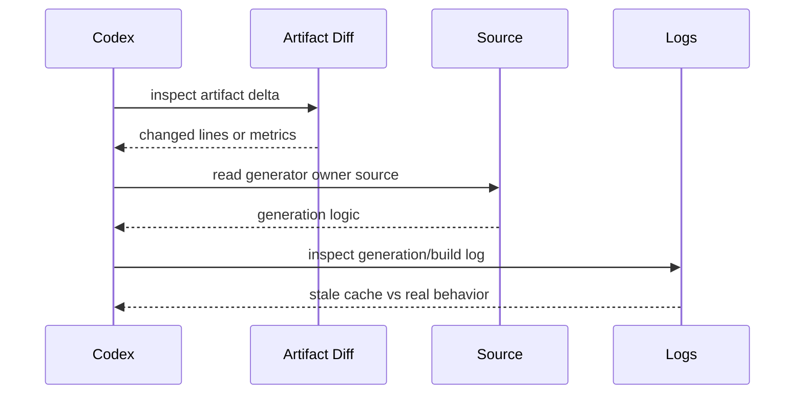

| Item | Details |
|---|---|
| Primary signals | `artifact diff`, `source text`, `build/test logs` |
| Data extracted | semantic drift vs format churn, generator owner |
| Decision rule | artifact delta만으로 source bug라고 단정하지 않는다 |
| Follow-up | patch source or regenerate |

### 7.8 UI Regression Check

목적:
- visible regression과 handler/runtime failure를 같이 본다.

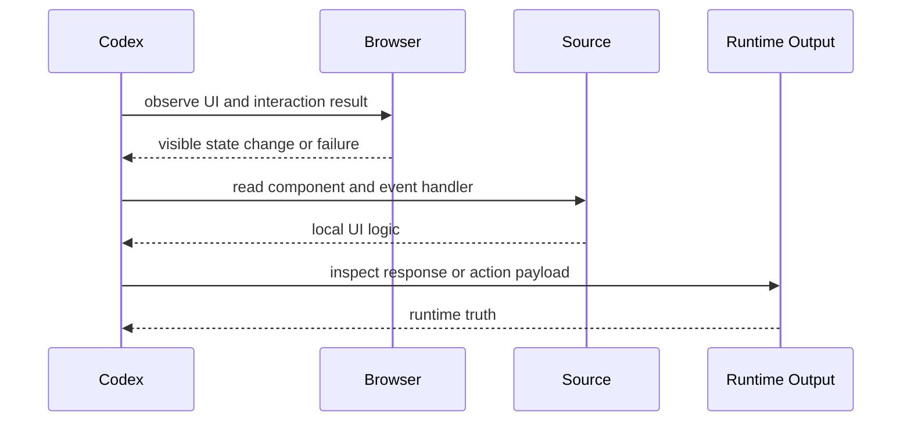

| Item | Details |
|---|---|
| Primary signals | `browser observation`, `source text`, `runtime output` |
| Data extracted | visible regression, event owner, response payload |
| Decision rule | screenshot pass만으로 UI logic success를 주장하지 않는다 |
| Follow-up | patch UI or server path |

### 7.9 Constraint / Rule Check

목적:
- 기술적으로 가능한 것과 허용된 것을 구분한다.

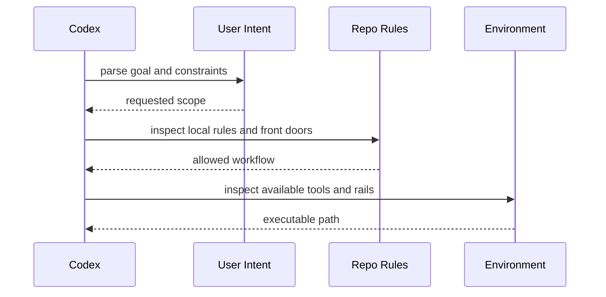

| Item | Details |
|---|---|
| Primary signals | `repo-local rules`, `user intent`, `environment` |
| Data extracted | allowed tool path, required verification rail, forbidden shortcuts |
| Decision rule | user goal가 rule violation을 정당화하지는 않는다 |
| Follow-up | choose compliant execution path |

### 7.10 Conflicting Signal Arbitration

목적:
- source, logs, diff, docs, UI, memory가 충돌할 때 winner를 정한다.

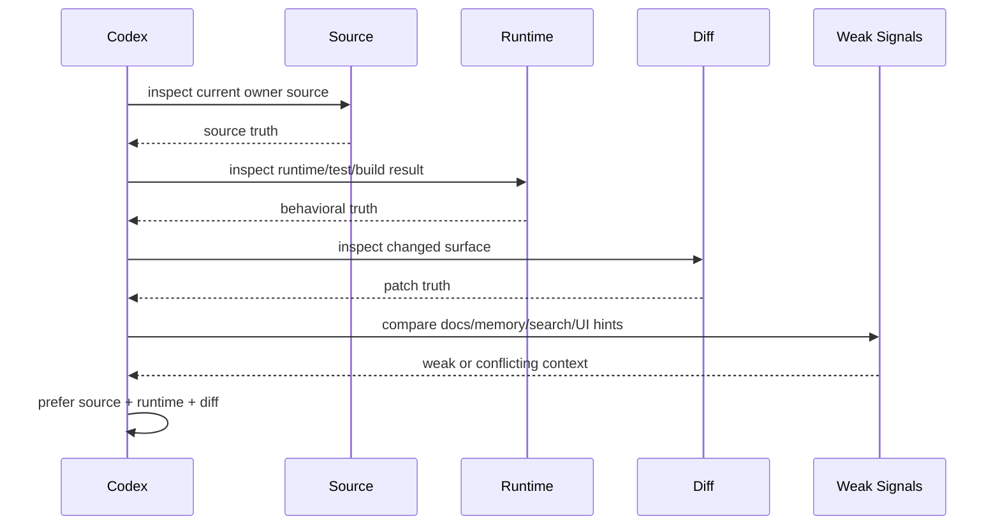

| Item | Details |
|---|---|
| Primary signals | `source text`, `runtime`, `diff`, `logs` |
| Data extracted | which strong signals agree, which weak signals conflict |
| Decision rule | weak signals never overrule current source and runtime proof |
| Follow-up | answer with explicit uncertainty or rerun |

## 9. Conflict Resolution

### 8.1 Winner ladder

1. current source
2. current runtime/test/build output
3. current diff
4. repo-local rules
5. search distribution
6. artifact/UI hint
7. docs/plans/memory

### 8.2 Typical conflict patterns

| Conflict | Winner | Why |
|---|---|---|
| doc says implemented, source says absent | source | docs are routing only |
| grep says no use, runtime breaks after delete | runtime | dynamic use beat static search |
| browser looks fine, test fails | test/runtime | visual pass is weaker |
| quick fix looks plausible, source invariant disagrees | source | proposal is not proof |
| old memory says green, current log says red | current log | freshness wins |

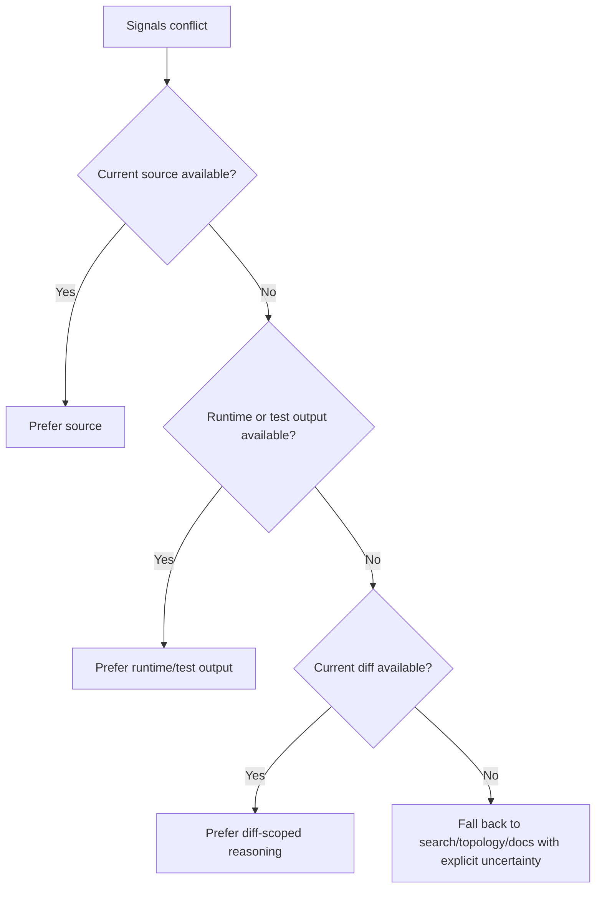

## 10. Anti-Signals

이건 신호처럼 보이지만 과신하면 안 된다.

| Anti-signal | Why it is weak |
|---|---|
| `absence from grep` | dynamic registration, reflection, generated use가 빠진다 |
| `nice file name` | naming is not ownership proof |
| `passing shape snapshot` | shape pass can hide semantic bug |
| `quick fix exists` | availability of fix is not correctness |
| `one green command` | wrong rail can pass while intended rail still fails |
| `old handoff note` | stale very often |
| `visual looks okay` | logic and data may still be broken |

## 11. Review Checklist

1. source를 읽기 전에 grep 결과로 결론내리지 않았는가
2. stale log와 current source를 섞어 말하지 않았는가
3. diff를 무시하고 unrelated failure를 task owner로 오판하지 않았는가
4. docs/plan claim을 current implementation truth처럼 취급하지 않았는가
5. UI observation만으로 behavior success를 과장하지 않았는가
6. artifact delta를 source bug라고 성급히 단정하지 않았는가
7. dynamic path 가능성이 있는데 grep absence를 dead proof처럼 쓰지 않았는가
8. repo-local rule을 무시한 verification path를 선택하지 않았는가

## 12. Rule of Thumb

- source first
- diff second
- logs and runtime close behavioral truth
- grep narrows candidates, not truth
- docs and memory route, not prove
- weak signals never overrule current source and runtime
