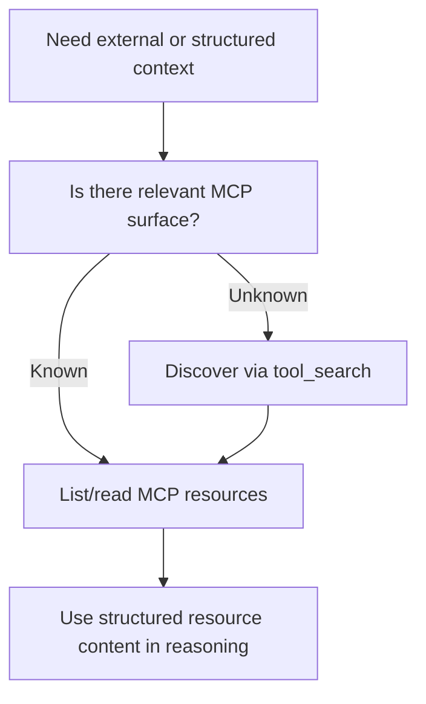
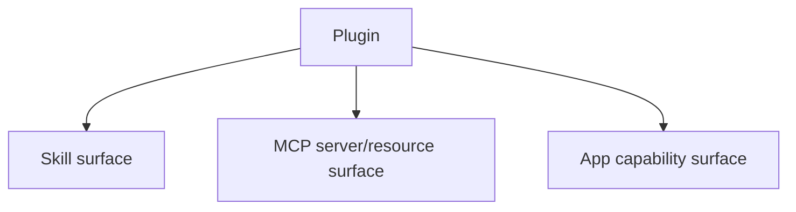
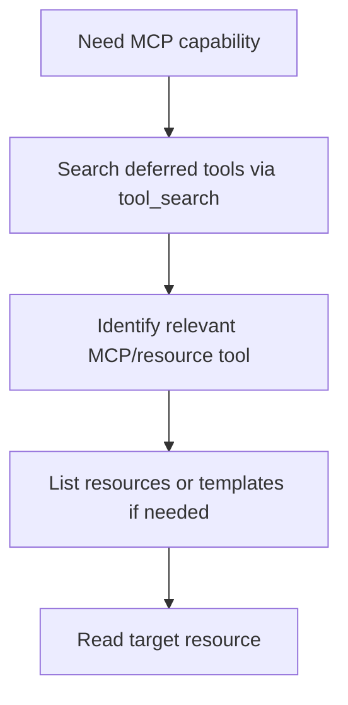

# MCP Usage Audit

Overview router: [may-20-codex-agent-loop.md](/Users/songmin/Documents/code-new/semantica-codegraph-v2/docs/analysis/codex-agent/may-20-codex-agent-loop.md)

이 문서는 Codex 계열 에이전트의 `MCP(Model Context Protocol) 사용`을 감사 관점으로 정리한다.

범위:
- 현재 세션에서 직접 보이는 MCP-related tool surface
- MCP resource access model
- MCP와 plugin/skill/tool_search의 관계
- 언제 MCP가 우선 경로가 되는지
- 무엇이 직접 관측 가능한 사실이고, 무엇이 강한/약한 추론인지

표기:
- `[FACT]`: 현재 세션 tool schema, skills/plugin instructions, app/runtime context에서 직접 관측 가능한 사실
- `[STRONG-INFERENCE]`: 관측 사실을 가장 잘 설명하는 고신뢰 구조 추론
- `[WEAK-INFERENCE]`: plausible 하지만 직접 근거가 부족한 해석

주의:
- 현재 세션에는 MCP resource 도구들이 직접 노출돼 있지만, 실제 연결된 서버나 리소스 내용 자체는 이 문서 작성 과정에서 열어보지 않았다.
- 따라서 `MCP를 어떻게 쓰는가`는 강하게 말할 수 있지만, `무슨 서버가 붙어 있는가`까지는 여기서 주장하지 않는다.

---

## 1. Executive summary

### 1.1 Final verdict

- `Alignment`: High `[STRONG-INFERENCE]`
- `Robustness`: Strong on visible MCP access contract, Medium on hidden server-side semantics `[STRONG-INFERENCE]`
- `Confidence`: High on current tool/routing facts, Medium on broader MCP deployment assumptions `[STRONG-INFERENCE]`
- `Ship readiness`: Ship as analysis doc `[STRONG-INFERENCE]`

### 1.2 Top conclusions

1. 현재 세션에는 explicit MCP resource access tool chain이 직접 노출돼 있다. `[FACT]`
2. MCP는 generic web search와 달리 **구조화된 resource retrieval rail**로 보인다. `[STRONG-INFERENCE]`
3. current instructions는 MCP tool discovery에 대해 `tool_search`를 우선하라고 말한다. `[FACT]`
4. plugin은 MCP를 직접 대체하는 것이 아니라, plugin-contributed capability bundle 안에 MCP path를 포함할 수 있다. `[STRONG-INFERENCE]`
5. 현재 세션에서 MCP는 “있을 수 있는 내부/연결기 context source”이지, 항상 기본 경로는 아니다. task relevance가 있을 때만 우선한다. `[STRONG-INFERENCE]`

---

## 2. Direct evidence inventory

## 2.1 Visible MCP-related tools

현재 세션에서 직접 callable 한 MCP-related tool:

1. `functions.list_mcp_resources` `[FACT]`
2. `functions.list_mcp_resource_templates` `[FACT]`
3. `functions.read_mcp_resource` `[FACT]`
4. `tool_search.tool_search_tool` `[FACT]`
5. `mcp__node_repl__.js` `[FACT]`
6. `mcp__node_repl__.js_reset` `[FACT]`

주의:
- `mcp__node_repl__`는 이름상 MCP-backed server tool이지만, 역할은 JS 실행 쪽이다.
- resource access MCP와는 성격이 다르다.

## 2.2 Direct tool semantics

### `list_mcp_resources`

- MCP server가 제공하는 resource 목록을 나열한다 `[FACT]`
- optional `server`와 `cursor`를 받는다 `[FACT]`

### `list_mcp_resource_templates`

- MCP resource template 목록을 나열한다 `[FACT]`
- optional `server`와 `cursor`를 받는다 `[FACT]`

### `read_mcp_resource`

- 특정 MCP resource URI를 읽는다 `[FACT]`
- `server`와 `uri`를 받는다 `[FACT]`

### `tool_search.tool_search_tool`

- deferred tool metadata를 BM25로 검색한다 `[FACT]`
- MCP tool discovery에서는 `list_mcp_resources`/`templates`보다 `tool_search`를 쓰라고 직접 적혀 있다 `[FACT]`

---

## 3. Direct policy around MCP

현재 보이는 policy facts:

1. “Prefer resources over web search when possible”라는 문구가 MCP resource tool 설명에 있다 `[FACT]`
2. “For MCP tool discovery, always use `tool_search` instead of `list_mcp_resources` or `list_mcp_resource_templates`”라고 developer instructions에 적혀 있다 `[FACT]`
3. plugins may expose skills, MCP servers, and app tools as a bundle라고 plugin instructions에 적혀 있다 `[FACT]`

이 세 규칙만으로도 MCP는 단순 부가기능이 아니라, **구조화된 우선 context path**로 취급된다고 볼 수 있다. `[STRONG-INFERENCE]`

---

## 4. Best-fit MCP model

가장 설명력이 높은 MCP usage model은 아래다. `[STRONG-INFERENCE]`

핵심:
- MCP는 검색엔진이 아니라 resource rail
- discovery와 retrieval이 분리돼 있음

---

## 5. MCP vs web

## 5.1 Direct evidence

- MCP resource tools are described as preferable to web search when possible `[FACT]`
- web search is still separately available via `web.run` `[FACT]`

## 5.2 Best-fit distinction

| Axis | MCP | Web | Classification |
| --- | --- | --- | --- |
| Data shape | structured resource | open web pages/search results | `[STRONG-INFERENCE]` |
| Discovery method | tool_search or resource listing | search query | `[FACT]` + `[STRONG-INFERENCE]` |
| Best use case | connected internal/app/server context | public/latest internet context | `[STRONG-INFERENCE]` |
| Source control | bounded server/resource URI | open internet | `[STRONG-INFERENCE]` |

### Practical rule

- public/latest fact -> web 우선
- connected structured internal/app context -> MCP 우선

이건 visible policy와 typical semantics를 가장 잘 설명한다. `[STRONG-INFERENCE]`

---

## 6. MCP vs plugin

plugin instructions는 plugin을:
- skills
- MCP servers
- app tools

bundle로 설명한다 `[FACT]`.

### Best-fit relationship

즉:
- plugin은 MCP를 포함할 수 있다
- 하지만 plugin = MCP는 아니다

이 구분은 `[STRONG-INFERENCE]`다.

### Example implication

- GitHub plugin이 있다 해도, 그 plugin이 직접 MCP resource rail을 노출하는지 여부는 separate matter다 `[STRONG-INFERENCE]`
- Browser Use plugin은 browser/app capability가 핵심이지, MCP resource list가 본질은 아니다 `[STRONG-INFERENCE]`

---

## 7. MCP vs tools vs skills

## 7.1 Tool level

MCP resource access는 callable tool로 드러난다. `[FACT]`

예:
- `list_mcp_resources`
- `read_mcp_resource`

## 7.2 Skill level

skill은 task-specific workflow이며, 필요시 MCP를 쓰라고 유도할 수 있다. `[STRONG-INFERENCE]`

예:
- `openai-docs` skill은 공식 docs/MCP preference를 강조한다 `[FACT]`

## 7.3 Plugin level

plugin은 MCP surface를 포함할 수 있는 bundle이다. `[FACT]` + `[STRONG-INFERENCE]`

---

## 8. MCP discovery process

현재 지침 기준으로 가장 맞는 discovery process:

### Why not list-first?

developer instructions가 MCP tool discovery에서는 `tool_search`를 우선하라고 직접 말한다. `[FACT]`

따라서:
- `tool_search`는 discovery rail
- `list/read_mcp_resource`는 retrieval rail

로 분리하는 게 가장 타당하다. `[STRONG-INFERENCE]`

---

## 9. Current-session MCP usage implications

현재 세션에서 practical하게 말할 수 있는 것:

1. MCP resource access 도구가 존재한다 `[FACT]`
2. 하지만 실제로 어떤 server/resource가 붙어 있는지는 이 문서 작성 과정에서 확인하지 않았다 `[FACT]`
3. 따라서 현재 문서군은 “MCP capability contract”를 다루지, “live MCP inventory”를 다루지 않는다 `[STRONG-INFERENCE]`

이 distinction이 중요하다.

---

## 10. Attack surface analysis

## 10.1 False assumption: MCP = web

- wrong
- MCP는 bounded structured resource rail로 보이는 반면, web는 open internet rail이다
- severity: P1

Classification:
- `[STRONG-INFERENCE]`

## 10.2 False assumption: plugin = MCP

- wrong
- plugin은 skill/MCP/app capability bundle
- severity: P1

Classification:
- `[FACT]` + `[STRONG-INFERENCE]`

## 10.3 False assumption: list_mcp_resources is the canonical discovery path

- contradicted by explicit “use tool_search for MCP tool discovery” rule
- severity: P2

Classification:
- `[FACT]`

## 10.4 False assumption: visible MCP tools imply useful connected resources right now

- not proven
- current session shows tool surface, not resource content inventory
- severity: P2

Classification:
- `[FACT]`

---

## 11. Concrete failure scenarios if MCP model is misunderstood

### Scenario 1: use web instead of available structured MCP resource

- setup: task depends on connected internal/app/server context
- trigger: assistant defaults to web
- expected: prefer MCP/resource path when relevant
- likely failure: lower-quality context, missing bounded internal truth
- severity: P1

Classification:
- rule basis `[FACT]` + `[STRONG-INFERENCE]`

### Scenario 2: use `list_mcp_resources` for discovery when tool_search was required

- setup: unknown MCP surface
- trigger: assistant starts list-first
- expected: `tool_search` first
- likely failure: suboptimal discovery path
- severity: P2

Classification:
- direct rule basis `[FACT]`

### Scenario 3: treat plugin capability as guaranteed MCP capability

- setup: plugin enabled
- trigger: assistant assumes resource server exists without evidence
- expected: distinguish plugin skill/app path from MCP resource path
- likely failure: wrong routing assumption
- severity: P1

Classification:
- direct plugin policy + MCP tools separation `[FACT]`

---

## 12. Unknowns

직접 알 수 없는 것:

1. 현재 세션에 연결된 MCP server 목록 전체 `[FACT: not enough evidence]`
2. 각 server가 제공하는 resource semantics `[FACT: not enough evidence]`
3. MCP authentication/session lifecycle internals `[WEAK-INFERENCE]`
4. MCP server-side caching/pagination/persistence semantics `[WEAK-INFERENCE]`

---

## 13. Most precise safe summary

- 현재 세션에는 explicit MCP resource access tool chain이 존재한다: `list_mcp_resources`, `list_mcp_resource_templates`, `read_mcp_resource`, 그리고 discovery용 `tool_search`. `[FACT]`
- direct policy는 MCP resource를 가능한 경우 web보다 우선하라고 말하며, discovery는 `tool_search`를 우선하라고 말한다. `[FACT]`
- plugin은 MCP와 동일하지 않고, skill/MCP/app capability bundle로 보는 것이 가장 정확하다. `[STRONG-INFERENCE]`
- 현재 문서 작성 기준으로는 MCP capability surface는 직접 보이지만, live connected resource inventory 자체는 확인하지 않았으므로 그 부분은 non-claim으로 남겨야 한다. `[FACT]`
