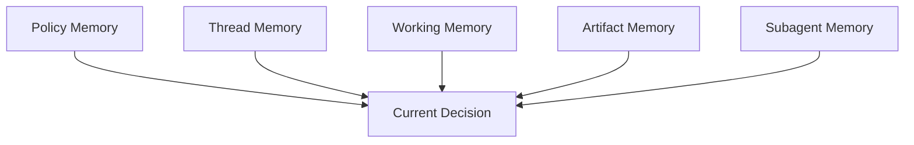
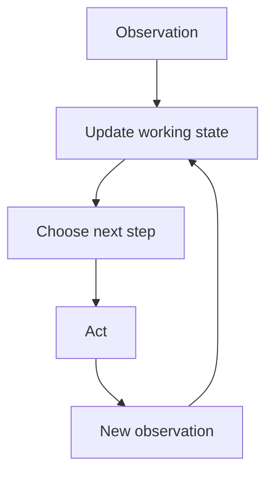
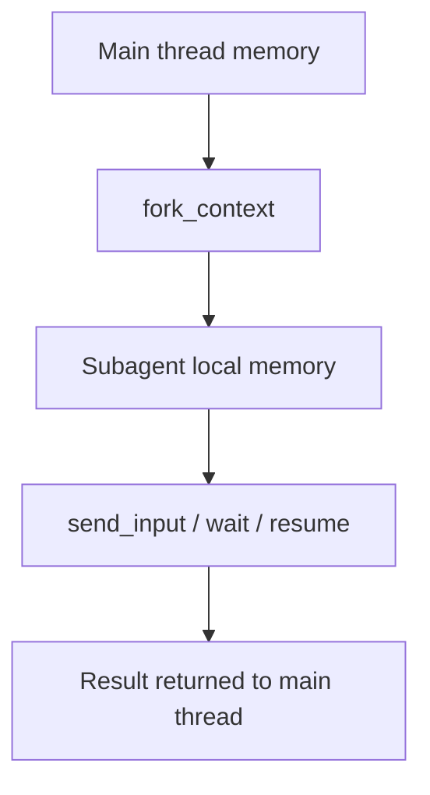
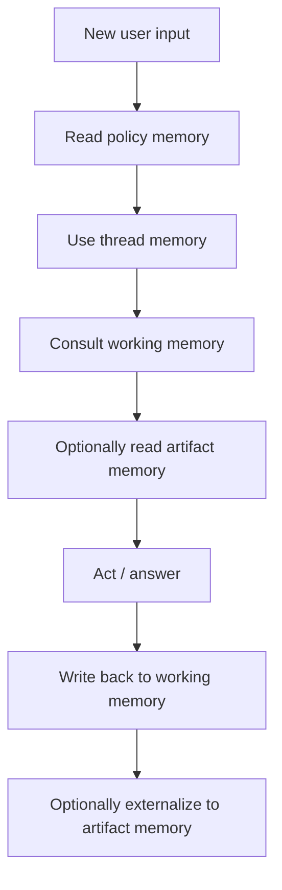

# Memory Model Audit

Overview router: [may-20-codex-agent-loop.md](/Users/songmin/Documents/code-new/semantica-codegraph-v2/docs/analysis/codex-agent/may-20-codex-agent-loop.md)

Subagent-specific deep dive: [subagent/README.md](/Users/songmin/Documents/code-new/semantica-codegraph-v2/docs/analysis/codex-agent/thread-management/subagent/README.md)

이 문서는 Codex 계열 에이전트의 `memory`가 어떻게 구성되어 있는지 감사 관점으로 재구성한다.

범위:
- 현재 세션에서 직접 관측 가능한 memory surface
- thread history, instruction stack, working state, tool observations, local artifacts가 어떤 식으로 memory처럼 작동하는지
- 별도 long-term memory tool이 없는 현재 세션에서 memory가 어떻게 유지되는지
- 무엇이 직접 관측 가능한 사실이고, 무엇이 강한/약한 추론인지

표기:
- `[FACT]`: 현재 세션 지침, tool schema, app context, 실제 대화/도구 이력에서 직접 관측 가능한 사실
- `[STRONG-INFERENCE]`: 관측 사실을 가장 잘 설명하는 고신뢰 구조 추론
- `[WEAK-INFERENCE]`: plausible 하지만 직접 근거가 부족한 해석

주의:
- 이 문서는 hidden internal vector store나 platform-wide persistent memory 존재를 가정하지 않는다.
- 현재 세션에서 실제로 보이는 memory rail을 우선한다.

---

## 1. Executive summary

### 1.1 Final verdict

- `Alignment`: High `[STRONG-INFERENCE]`
- `Robustness`: Medium `[STRONG-INFERENCE]`
- `Confidence`: High on thread/instruction/working-state memory, Low on hidden long-term memory internals `[STRONG-INFERENCE]`
- `Ship readiness`: Ship as analysis doc `[STRONG-INFERENCE]`

### 1.2 Top conclusions

1. 현재 세션에서 직접 보이는 memory는 `별도 memory tool`보다 `thread history + instruction stack + working state + local artifacts` 조합에 가깝다. `[STRONG-INFERENCE]`
2. system/developer/app/repo/skill 지침은 단순 prompt가 아니라 지속적으로 참조되는 policy memory처럼 작동한다. `[FACT]` + `[STRONG-INFERENCE]`
3. 이미 읽은 파일/직전 patch 실패/남은 갭 같은 것은 `working memory`로 유지되는 것이 observed behavior와 가장 잘 맞는다. `[STRONG-INFERENCE]`
4. local files, generated docs, repo artifacts는 agent 외부의 durable memory substrate 역할을 한다. `[STRONG-INFERENCE]`
5. 현재 세션에는 dedicated memory CRUD tool이 보이지 않으므로, explicit long-term memory API evidence는 없다. `[FACT]`

---

## 2. Direct evidence inventory

## 2.1 What memory-related primitives are directly visible?

직접 관측 가능한 사실:

| Evidence | Meaning | Classification |
| --- | --- | --- |
| 현재 대화 전체 history가 계속 누적된다 | thread history surface exists | `[FACT]` |
| system / developer / app / mode / repo AGENTS / skills가 상위 지침으로 계속 적용된다 | instruction stack persists across turns | `[FACT]` |
| tool outputs가 다음 판단에 영향을 준다 | observation carry-over exists | `[FACT]` |
| 현재 세션에 explicit `memory` CRUD tool은 없다 | no visible dedicated memory API | `[FACT]` |
| subagent tool family가 존재한다 | agents can fork or reuse context | `[FACT]` |
| `spawn_agent`에는 `fork_context` 옵션이 있다 | context copying/forking concept exists | `[FACT]` |
| `send_input`, `resume_agent`, `wait_agent`가 존재한다 | subagent conversation state continuity exists | `[FACT]` |

## 2.2 Behavioral evidence from this thread

| Observed behavior | Meaning | Classification |
| --- | --- | --- |
| 같은 메타 주제를 여러 턴에 걸쳐 이어서 설명했다 | thread-level conversational memory exists | `[FACT]` |
| 이전에 설명한 tool/prompt/loop 모델을 다음 턴에서 계속 참조했다 | prior analysis remains available in working context | `[FACT]` |
| “이미 읽은 파일은 다시 읽지 말라” 지침을 반복해서 언급했다 | working state is expected to persist across turns | `[FACT]` |
| patch failure 뒤 scripted replace로 전략을 바꿨다 | recent failure observations persist as actionable memory | `[FACT]` |
| `/docs/analysis/codex-agent/`에 누적적으로 문서를 추가해 왔다 | externalized durable artifact memory is actively used | `[FACT]` |

---

## 3. Best-fit memory model

가장 설명력이 높은 모델은 아래 다층 구조다. `[STRONG-INFERENCE]`



각 층:
1. `Policy Memory`
2. `Thread Memory`
3. `Working Memory`
4. `Artifact Memory`
5. `Subagent Memory`

---

## 4. Policy memory

## 4.1 What it is

policy memory는 아래 상위 지침 스택을 뜻한다. `[FACT]`

- system instructions
- developer instructions
- app context
- collaboration mode
- personality spec
- skills instructions
- plugins instructions
- repo `AGENTS.md`

## 4.2 Why this is memory-like

이 지침들은 한 턴에만 읽고 버리는 게 아니라, 이후 모든 판단에 계속 영향을 준다. `[STRONG-INFERENCE]`

예:
- 최신 정보면 browse mandatory `[FACT]`
- 검증은 요청 전까지 금지 `[FACT]`
- broad scan 금지 `[FACT]`
- repo-local no heuristics / fail-closed `[FACT]`

이런 규칙은 실행 중 계속 참조되므로 `policy memory`라고 보는 것이 적절하다. `[STRONG-INFERENCE]`

## 4.3 Characteristics

- persistent across turns `[FACT]`
- higher priority than user request `[FACT]`
- mutable only when new higher-order instruction arrives `[STRONG-INFERENCE]`

---

## 5. Thread memory

## 5.1 What it is

thread memory는 현재 대화의 누적 message history다. `[FACT]`

포함:
- user requests
- assistant replies
- tool outputs
- summary state

## 5.2 Observable evidence

- 사용자가 이전 설명을 이어서 파고들 수 있었다 `[FACT]`
- assistant가 이전 답변의 구조를 계속 이어갔다 `[FACT]`
- 최종적으로 summary가 생성되어 다음 turn bootstrap에 사용될 수 있다 `[FACT]`

## 5.3 Function

thread memory는 다음에 쓰인다. `[STRONG-INFERENCE]`

1. 대화 주제 연속성 유지
2. 이전 설명/결론 재사용
3. 직전 tool result 회상
4. user preference continuity

---

## 6. Working memory

이 층이 실제 agent loop에서 가장 중요하다.

## 6.1 What it appears to contain

working memory 후보:
- 현재 task kind
- owner/evidence file shortlist
- 이미 읽은 파일 목록
- 최근 tool results
- 최근 실패 원인
- current patch strategy
- 남은 갭 / unresolved blockers

이 구조는 `[STRONG-INFERENCE]`다.

## 6.2 Direct evidence supporting it

| Evidence | Why it supports working memory | Classification |
| --- | --- | --- |
| developer rule: 이미 읽은 파일을 다시 읽지 말라 | agent is expected to remember what it has read | `[FACT]` |
| follow-up에서도 이미 읽은 파일을 다시 읽지 말라 | memory spans turns, not only single step | `[FACT]` |
| patch 실패 후 전략 전환 | immediate prior failure is retained and acted upon | `[FACT]` |
| partial landing / remaining gap을 계속 추적 | unresolved state persists in active context | `[FACT]` |

## 6.3 Best-fit working-memory loop



핵심:
- working memory는 static storage가 아니라 iterative state update loop다 `[STRONG-INFERENCE]`

## 6.4 Fragility

working memory는 durable artifact보다 휘발성이 높다. `[STRONG-INFERENCE]`

위험:
- context length 압박
- 많은 turns 뒤 세부 state drift
- hidden summarization loss

current mitigation:
- external docs/files로 상태를 밀어내는 방식 `[STRONG-INFERENCE]`

---

## 7. Artifact memory

## 7.1 What it is

artifact memory는 로컬 파일/문서/로그/코드 변경 자체를 memory substrate로 쓰는 것이다. `[STRONG-INFERENCE]`

예:
- repo source files
- docs under `/docs/analysis/codex-agent/`
- generated artifacts
- local logs / reports

## 7.2 Why this matters

현재 세션에는 dedicated memory store tool이 없다. `[FACT]`
그래서 durable state를 남기려면 파일/문서/코드 같은 외부 artifact에 쓰는 것이 가장 자연스럽다. `[STRONG-INFERENCE]`

## 7.3 Observable evidence

- 사용자가 “문서로 남겨놔”를 반복 요청했고, 실제로 문서를 파일로 누적 생성했다 `[FACT]`
- 이것이 thread 바깥 durable memory 역할을 한다는 해석은 `[STRONG-INFERENCE]`

## 7.4 Practical role

artifact memory는:
1. long-lived notes
2. analysis snapshots
3. design decisions
4. replayable evidence
5. handoff substrate

로 작동한다. `[STRONG-INFERENCE]`

---

## 8. Subagent memory

## 8.1 Direct evidence

현재 세션에는 다음이 직접 보인다. `[FACT]`

- `spawn_agent`
- `send_input`
- `resume_agent`
- `wait_agent`
- `close_agent`
- `fork_context`

## 8.2 Best-fit interpretation

subagent memory는 메인 thread memory의 사본 혹은 분기된 context로 보는 것이 가장 자연스럽다. `[STRONG-INFERENCE]`



## 8.3 Limits

직접 알 수 없는 것:
- forked context가 내부적으로 얼마나 압축되는지 `[WEAK-INFERENCE]`
- subagent memory가 별도 persistent store를 가지는지 `[WEAK-INFERENCE]`

---

## 9. Memory persistence horizons

memory는 persistence horizon으로도 나눌 수 있다. `[STRONG-INFERENCE]`

### 9.1 Short horizon

- immediate tool result
- current step rationale
- last patch failure

### 9.2 Medium horizon

- current task decomposition
- already-read files
- remaining blockers
- user style preferences in current thread

### 9.3 Long horizon

- saved docs/files
- repo artifacts
- committed code changes

직접 tool/API로 보이는 long-term personal memory store는 현재 세션에 없다. `[FACT]`

---

## 10. Memory update process

가장 설명력이 높은 update process는 아래다. `[STRONG-INFERENCE]`



핵심:
- policy memory는 거의 read-only
- working memory는 iterative
- artifact memory는 explicit externalization path

---

## 11. What is *not* directly evidenced

다음은 current session에서 직접 증거가 없다.

1. hidden vector memory / embedding store `[FACT: not enough evidence]`
2. user-global persistent preference store `[FACT: not enough evidence]`
3. cross-thread autobiographical memory API `[FACT: not enough evidence]`
4. explicit memory ranking / retrieval engine details `[FACT: not enough evidence]`

따라서 아래 같은 단정은 피해야 한다.

- “Codex has a global persistent memory database”
- “all user preferences are permanently stored and retrieved automatically”

이건 current evidence로는 overclaim이다. `[FACT]`

---

## 12. Attack surface analysis

## 12.1 False assumption: no memory beyond prompt tokens

- contradicted by persistent thread history, tool outputs, policy stack, artifact use
- severity: P1

Classification:
- `[FACT]` + `[STRONG-INFERENCE]`

## 12.2 False assumption: there is a rich dedicated memory subsystem visible here

- contradicted by absence of explicit memory tools
- severity: P2

Classification:
- `[FACT]`

## 12.3 False assumption: local files are only outputs, not memory substrate

- contradicted by repeated use of docs/artifacts as persistent state carriers
- severity: P1

Classification:
- `[FACT]` + `[STRONG-INFERENCE]`

---

## 13. Concrete failure scenarios if memory model is misunderstood

### Scenario 1: assistant re-reads everything every turn

- setup: follow-up code task
- trigger: agent ignores already-read state
- expected under current rules: avoid rereads, continue from working memory
- likely failure: wasted tool budget, context bloat
- severity: P2

Classification:
- direct rule basis `[FACT]`

### Scenario 2: assistant assumes durable global memory exists

- setup: user references prior unrelated conversation state not present in thread
- trigger: agent hallucinates remembered facts
- expected: only rely on visible thread / artifacts / provided context
- likely failure: false recollection
- severity: P1

Classification:
- absence of explicit global memory evidence `[FACT]`

### Scenario 3: assistant fails to externalize long-lived analysis

- setup: large multi-turn audit
- trigger: all state kept only in transient working context
- expected: externalize into docs/artifacts when persistence matters
- likely failure: drift, loss, inconsistent continuation
- severity: P1

Classification:
- artifact-memory pattern `[STRONG-INFERENCE]`

### Scenario 4: subagent context split without explicit ownership

- setup: delegated task
- trigger: memory fork happens but result integration is weak
- expected: disjoint ownership + result merge
- likely failure: duplicated or conflicting state
- severity: P1

Classification:
- subagent tooling + policy `[FACT]` + `[STRONG-INFERENCE]`

---

## 14. False confidence traps

1. “memory” = long-term database
- current session evidence로는 너무 강한 주장이다

2. “memory” = 그냥 prompt text
- 현재는 policy stack, thread state, artifacts, subagent context까지 포함하는 게 더 정확하다

3. artifact는 memory와 무관하다
- 현재 세션에선 durable memory substitute로 매우 중요하다

4. 이미 읽은 파일을 다시 안 읽는 건 그냥 스타일이다
- 실제로는 memory contract이기도 하다

---

## 15. Most precise safe summary

- 현재 세션에서 직접 보이는 memory model은 `dedicated memory tool`보다 `policy memory + thread memory + working memory + artifact memory + subagent memory` 조합에 가깝다. `[STRONG-INFERENCE]`
- system/developer/app/repo/skill 지침은 지속적으로 참조되는 policy memory다. `[FACT]` + `[STRONG-INFERENCE]`
- 대화 history와 tool outputs는 thread memory다. `[FACT]`
- 이미 읽은 파일, 최근 실패, 현재 task decomposition, 남은 갭은 working memory로 보는 것이 observed behavior와 가장 잘 맞는다. `[STRONG-INFERENCE]`
- 로컬 문서/파일/코드 변경은 durable artifact memory 역할을 한다. `[STRONG-INFERENCE]`
- 현재 세션에는 explicit long-term global memory API evidence가 없으므로, 그 부분은 overclaim하면 안 된다. `[FACT]`

---

## Round 2 update (2026-05-21 deep dive)

원본 작성 당시에는 `dedicated memory tool 없음 / artifact-as-memory` 모델로 닫았다. 2026-05-21 deep dive에서 Codex Desktop (build 2867, codex-rs 0.130.0) 바이너리를 직접 검사한 결과, 그 결론은 **이 세션 안에서는 옳지만 전체 product 차원에서는 보수적이었다**는 게 드러났다. Codex는 별도 memory daemon과 git-versioned memories 트리를 운영한다.

### R2.1 Chronicle = 별도 memory daemon (separate binary, separate process)

- `[FACT]` Binary: `/Applications/Codex.app/Contents/Resources/codex_chronicle` (4.3MB Mach-O arm64), Rust + tokio.
- `[FACT]` Single-instance lock: `$STORAGE_ROOT/codex_chronicle.lock` + `chronicle-started.pid` (별도 PID, 별도 lifecycle).
- `[FACT]` Persistent storage path: `~/.codex/memories/extensions/chronicle/resources/{ISO}-{4alpha}-{10min|6h}-{slug}.md`.
- `[FACT]` Ephemeral storage: `$TMPDIR/chronicle/screen_recording/{ts}-display-{display_id}/{ -latest.jpg, .capture.json, .ocr.jsonl, frame-N-MINUTEBUCKETZ.jpg}`.
- `[FACT]` Capture trigger enum: `FirstFrame`, `VisualChange`, `Heartbeat`, `MinuteBucket`. Adaptive sampling — 프레임 처리가 느려지면 backoff.
- `[FACT]` OCR via Apple Vision; 화면 캡처 via Apple ScreenCaptureKit.
- `[FACT]` Two-tier recursive summarizer: `10min` (per-minute updates) → `6h` (per-hour, rolls up children). Time format `%Y-%m-%dT%H-%M-%SZ`.
- `[FACT]` Privacy filter excludes Chrome incognito (`com.google.Chrome[.beta|.canary|.dev]`), Safari Technology Preview / Safari Private Browsing, Google Meet (`meet.google.com`).
- `[FACT]` Consolidation model invocation: `codex chronicle` spawns `codex exec --skip-git-repo-check --ephemeral --ignore-user-config --ignore-rules --sandbox read-only` (자체 subprocess) — 메인 agent와 분리된 locked-down 인스턴스.
- `[FACT]` Locked-down TOML reconstructed (consolidation subprocess가 쓰는 config):
  ```toml
  [model_provider] model_provider = "openai-memgen"
  [model_providers.openai-memgen]
    name = "OpenAI"
    requires_openai_auth = true
    supports_websockets = true
    http_headers = { "X-OpenAI-Memgen-Request" = "true" }
  [features] memories=false, apps=false, plugins=false, multi_agent=false,
             tool_search=false, tool_suggest=false, web_search="disabled"
  [mcp_servers]   # empty
  [plugins]       # empty
  [apps] _default.enabled=false
  [analytics] enabled=false
  [otel] exporter="none", trace_exporter="none", metrics_exporter="none"
  [project] doc_max_bytes=0
  [skills.bundled] enabled=false
  [[skills.config]] name="chronicle", enabled=false
  ```
- `[FACT]` 이 머신 실측: 1,390개 chronicle summary markdown / 39.8MB / 8일치.
- `[FACT]` 설치 sentinel: `~/.codex/.codex-chronicle-assets-to-install.marker` (16-char hex, 예: `be2e105c8ac9cfcb`) — bundled chronicle asset 버전 마커.
- `[FACT]` Bundled skill installed to `~/.codex/skills/chronicle/instructions.md` (5.8KB) + `resources/` (~2MB).

### R2.2 Codex memory layer는 git-versioned tree다

- `[FACT]` `~/.codex/memories/` 는 **git-versioned** 디렉터리이며 다음을 포함한다:
  - `MEMORY.md` (411KB on this machine)
  - `memory_summary.md` (73KB)
  - `raw_memories.md` (714KB)
  - `rollout_summaries/`
  - `.git/`
- `[FACT]` Chronicle resources는 같은 트리의 별도 namespace `extensions/chronicle/resources/` 아래에 들어간다. memories 트리와 chronicle 트리는 분리된 namespace지만 같은 git-versioned root 안에 있다.

### R2.3 원본 결론에 대한 보정

원본 §11 ("hidden vector memory / user-global persistent preference store / cross-thread autobiographical memory API: not enough evidence") 는 **현재 세션 안에서 보이는 tool surface에만 한정**해서는 여전히 옳다. 그러나 Codex Desktop product 차원에서는 다음과 같이 보정된다:

- ~~user-global persistent preference store는 직접 증거가 없다~~ **CORRECTED 2026-05-21**: `~/.codex/memories/` 가 user-global, git-versioned, persistent memory store다. session tool로 직접 노출되지 않을 뿐 product 차원에서는 존재한다. `[FACT]`
- ~~cross-thread autobiographical memory API 증거 없음~~ **CORRECTED 2026-05-21**: chronicle daemon은 화면 OCR 기반의 cross-thread autobiographical memory를 OS-level에서 수집한다. agent thread tool로 노출되지는 않지만 product subsystem으로 존재한다. `[FACT]`

### R2.4 새 attack surface

- **P0**: chronicle 화면 캡처가 privacy filter를 우회당하면 (Incognito 우회, Meet 도메인 미감지 등) 의도치 않은 화면 컨텐츠가 git-versioned memories 트리에 영구 기록된다.
- **P1**: `~/.codex/memories/.git/` 가 git-versioned라는 점은 손상/탬퍼링 evidence trail이 남는다는 뜻이며 동시에 memory rollback이 가능하다는 뜻이다.
- **P1**: chronicle consolidation subprocess가 `--ignore-user-config --ignore-rules --sandbox read-only` 로 격리되지만, 그 격리가 풀리면 사용자 chronicle을 임의 LLM 호출에 노출시킬 수 있다.

### R2.5 Sibling doc ownership

- chronicle의 **prompt-injection defense system prompt 문구**는 [prompt-and-policy-stack.md](./prompt-and-policy-stack.md) Round 2 update 가 소유한다.
- chronicle의 **HITL/consent surface**(예: 화면 캡처 동의)는 [hitl-audit.md](./hitl-audit.md) Round 2 update 가 소유한다 — 이 문서는 메모리 substrate 그 자체만 다룬다.
