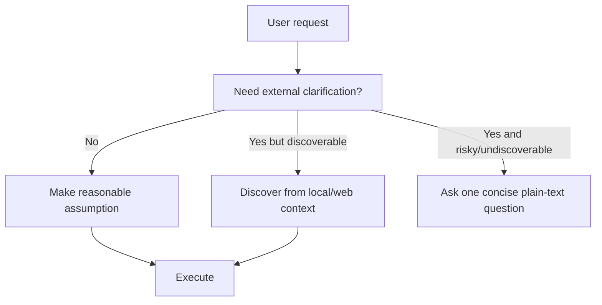
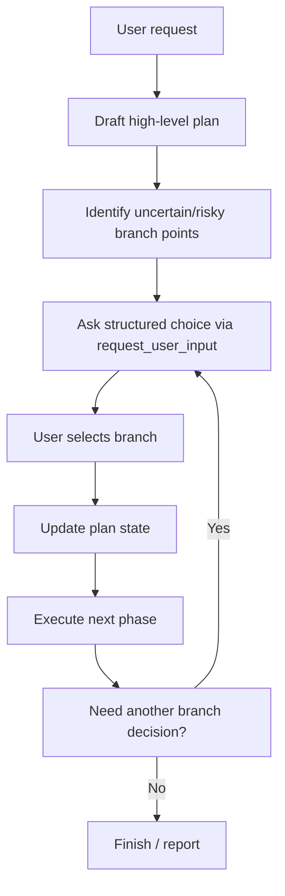
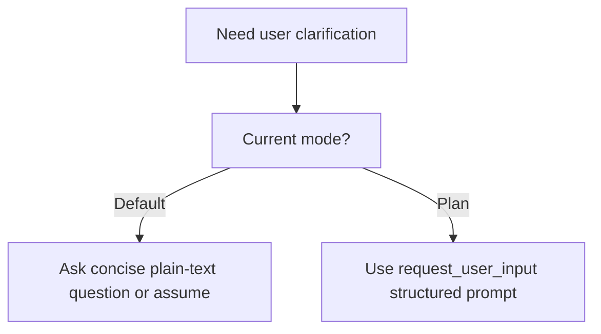

# Mode and Plan Process Audit

Overview router: [may-20-codex-agent-loop.md](/Users/songmin/Documents/code-new/semantica-codegraph-v2/docs/analysis/codex-agent/may-20-codex-agent-loop.md)

이 문서는 Codex 계열 에이전트의 `Default mode`와 `Plan mode` 차이, 그리고 `Plan mode` 내부 프로세스를 감사 관점으로 재구성한다.

범위:
- 현재 세션에서 직접 관측 가능한 mode contract
- Default vs Plan의 기능 차이
- mode가 tool availability와 interaction shape를 어떻게 바꾸는지
- Plan mode가 실제로 어떤 process를 가질 가능성이 높은지
- 무엇이 직접 관측 가능한 사실이고, 무엇이 강한/약한 추론인지

표기:
- `[FACT]`: 현재 세션 지침, tool schema, collaboration_mode block에서 직접 관측 가능한 사실
- `[STRONG-INFERENCE]`: 관측 사실을 가장 잘 설명하는 고신뢰 구조 추론
- `[WEAK-INFERENCE]`: plausible 하지만 직접 근거가 부족한 해석

주의:
- 현재 세션은 `Default mode`다. `[FACT]`
- 따라서 `Plan mode`에 대한 설명은 일부 직접 규칙 + 일부 구조적 추론으로 구성된다.

---

## 1. Executive summary

### 1.1 Final verdict

- `Alignment`: High `[STRONG-INFERENCE]`
- `Robustness`: Strong on visible mode contract, Medium on hidden Plan-mode internal orchestration `[STRONG-INFERENCE]`
- `Confidence`: High on Default/Plan user-input difference, Medium on full internal Plan loop `[STRONG-INFERENCE]`
- `Ship readiness`: Ship as analysis doc `[STRONG-INFERENCE]`

### 1.2 Top conclusions

1. mode는 단순 UI decoration이 아니라 **interaction contract**를 바꾸는 runtime-level control surface다. `[STRONG-INFERENCE]`
2. 현재 세션은 `Default mode`이며, `request_user_input`는 여기서 unavailable이다. `[FACT]`
3. mode는 user prompt가 아니라 developer instruction으로만 바뀐다. `[FACT]`
4. Default mode는 `reasonable assumptions + immediate execution` 쪽으로, Plan mode는 `structured choice/plan checkpoint` 쪽으로 기울도록 설계된 것으로 보인다. `[STRONG-INFERENCE]`
5. Plan mode의 핵심 차이는 `request_user_input` availability와, 그에 따라 `human-validated branch point`를 더 정교하게 만들 수 있다는 점이다. `[FACT]` + `[STRONG-INFERENCE]`

---

## 2. Direct evidence inventory

## 2.1 Current collaboration mode facts

현재 세션에서 직접 보이는 사실:

| Evidence | Meaning | Classification |
| --- | --- | --- |
| 현재 mode는 `Default`다 | current active mode | `[FACT]` |
| known mode names are `Default` and `Plan` | at least two modes exist | `[FACT]` |
| active mode changes only when new developer instructions change it | user request alone cannot switch modes | `[FACT]` |
| `request_user_input` tool is unavailable in Default mode | mode-specific tool availability difference | `[FACT]` |
| Default mode에서는 reasonable assumptions를 선호하고, 불필요하게 멈추지 말라고 한다 | execution posture differs by mode | `[FACT]` |

## 2.2 Tool evidence

tool schema에서 직접 보이는 사실:

| Tool | Evidence | Classification |
| --- | --- | --- |
| `functions.request_user_input` exists | structured short questions tool exists | `[FACT]` |
| tool 설명에 “This tool is only available in Plan mode”라고 적혀 있다 | Plan-specific capability exists | `[FACT]` |
| `functions.update_plan` exists | explicit plan state tool exists | `[FACT]` |

---

## 3. What a “mode” appears to be

가장 설명력이 높은 정의:

- mode는 에이전트의 `interaction strategy`, `tool availability`, `user-interrupt style`, `decision checkpoint density`를 바꾸는 runtime contract다. `[STRONG-INFERENCE]`

이건 아래 사실들을 묶어 설명한다.

1. mode별 tool availability가 다르다 `[FACT]`
2. mode 전환은 user가 아니라 developer/runtime layer가 한다 `[FACT]`
3. Default mode와 Plan mode는 user interaction 철학이 다를 것으로 강하게 시사된다 `[STRONG-INFERENCE]`

---

## 4. Default mode audit

## 4.1 Directly visible contract

Default mode에서 직접 보이는 규칙:

1. `request_user_input`는 unavailable `[FACT]`
2. reasonable assumptions를 선호 `[FACT]`
3. 가능한 한 실행을 멈추지 말고 진행 `[FACT]`
4. 꼭 필요한 경우만 plain-text question으로 질문 `[FACT]`
5. multiple choice question을 일반 assistant text로 쓰지 말라 `[FACT]`

## 4.2 Best-fit Default mode process

이건 current mode guidance를 가장 자연스럽게 설명하는 process다. `[STRONG-INFERENCE]`

## 4.3 Behavioral implications

Default mode는:
- friction 최소화
- 질문 횟수 최소화
- discoverable한 건 스스로 찾기
- ambiguous해도 low-risk면 가정하고 진행

쪽으로 bias가 걸린다. `[STRONG-INFERENCE]`

---

## 5. Plan mode audit

현재 세션은 Plan mode가 아니므로, 아래는 직접 사실과 강한 추론을 섞어 읽어야 한다.

## 5.1 Directly visible facts

1. Plan mode라는 이름의 mode가 존재한다 `[FACT]`
2. `request_user_input` tool은 Plan mode에서만 쓸 수 있다 `[FACT]`
3. `update_plan` tool이 존재한다 `[FACT]`

## 5.2 Strongly supported inference

Plan mode는 아래 성격을 가질 가능성이 높다. `[STRONG-INFERENCE]`

1. multi-step planning이 더 explicit 하다
2. branch point에서 structured human input을 받을 수 있다
3. execution 전에/도중에 더 formal한 checkpoint를 둔다
4. user choice를 binary/ternary option으로 정교하게 수집한다

이 추론은 `request_user_input`가 Plan-only라는 사실과 `update_plan` 존재를 합치면 가장 자연스럽다.

---

## 6. Default vs Plan difference matrix

| Axis | Default mode | Plan mode | Classification |
| --- | --- | --- | --- |
| Active in current session | Yes | No | `[FACT]` |
| `request_user_input` availability | Unavailable | Available | `[FACT]` |
| Interaction bias | assume-and-execute | checkpoint-and-choose | `[STRONG-INFERENCE]` |
| User questioning style | concise plain-text only when necessary | structured short questions possible | `[FACT]` + `[STRONG-INFERENCE]` |
| Branch management | agent resolves more locally | user can resolve more explicitly | `[STRONG-INFERENCE]` |
| Friction | lower | higher but more controlled | `[STRONG-INFERENCE]` |
| Best fit tasks | fast execution, coding, local fixes | multi-branch planning, scoped decision points | `[STRONG-INFERENCE]` |

---

## 7. Plan mode internal process

Plan mode 내부는 아래처럼 도는 것이 가장 설명력이 높다. `[STRONG-INFERENCE]`

## 7.1 Why this fits

이 구조가 그럴듯한 이유:

1. `request_user_input`는 short structured questions용이다 `[FACT]`
2. `update_plan`는 explicit plan state 저장용이다 `[FACT]`
3. Plan mode라는 이름 자체가 branch-explicit orchestration을 시사한다 `[STRONG-INFERENCE]`

## 7.2 Likely Plan-mode data shape

실제 tool schemas로부터 직접 보이는 구조:

- plan steps with statuses in `update_plan` `[FACT]`
- 1~3개 structured user questions in `request_user_input` `[FACT]`
- recommended option first `[FACT]`

강한 추론:
- Plan mode는 결국 `plan state machine + structured human choice` 결합체에 가깝다 `[STRONG-INFERENCE]`

---

## 8. Mode-sensitive tool routing

mode는 tool routing에도 영향을 준다.

## 8.1 Direct evidence

- same tool inventory라도 `request_user_input` availability가 mode-sensitive다 `[FACT]`

## 8.2 Best-fit routing model

이것이 mode가 interaction path를 바꾼다는 가장 직접적인 예다. `[STRONG-INFERENCE]`

---

## 9. Why Plan mode matters

Plan mode의 존재 가치는 아래처럼 보인다. `[STRONG-INFERENCE]`

1. ambiguous but high-impact branch를 agent가 독단으로 넘기지 않게 함
2. multi-step work를 explicit state machine으로 관리
3. human validation이 필요한 branch를 narrow structured choice로 압축
4. freeform chat보다 적은 ambiguity로 다음 step 결정을 얻음

즉 Default mode가 `forward progress bias`라면,
Plan mode는 `controlled branching bias`다. `[STRONG-INFERENCE]`

---

## 10. Attack surface analysis

## 10.1 False assumption: mode is just a label

- contradicted by mode-specific tool availability and explicit behavior guidance
- severity: P1

Classification:
- `[FACT]`

## 10.2 False assumption: user can switch mode by asking

- contradicted by “mode changes only when developer instructions change it”
- severity: P2

Classification:
- `[FACT]`

## 10.3 False assumption: Plan mode is just Default mode with longer answers

- weak model
- existence of `request_user_input` and `update_plan` strongly suggests structural process difference
- severity: P1

Classification:
- `[FACT]` + `[STRONG-INFERENCE]`

## 10.4 False assumption: Default mode should ask less because it knows more

- wrong framing
- Default mode asks less because collaboration contract biases toward assumptions and execution
- severity: P2

Classification:
- `[STRONG-INFERENCE]`

---

## 11. Concrete failure scenarios if mode differences are misunderstood

### Scenario 1: using `request_user_input` in Default mode

- setup: current session
- trigger: agent tries structured choice tool
- expected: unavailable
- likely failure: tool error
- severity: P2

Classification:
- `[FACT]`

### Scenario 2: over-asking in Default mode

- setup: coding task with discoverable context
- trigger: agent asks multiple clarification questions instead of proceeding
- expected: reasonable assumptions + execution
- likely failure: collaboration slowdown
- severity: P2

Classification:
- `[FACT]` + `[STRONG-INFERENCE]`

### Scenario 3: under-structuring in Plan mode

- setup: multi-branch task under Plan mode
- trigger: agent still uses freeform assumptions only
- expected: structured branch choice
- likely failure: human validation opportunity lost
- severity: P1

Classification:
- `[STRONG-INFERENCE]`

### Scenario 4: treating plan as prose only

- setup: long multi-step task
- trigger: agent writes narrative plan but does not maintain explicit plan state
- expected: update_plan + branch management
- likely failure: state drift and unclear progress
- severity: P1

Classification:
- `[STRONG-INFERENCE]`

---

## 12. False confidence traps

1. “mode는 그냥 답변 길이 조절”
- 아니다
- tool availability와 interaction contract를 바꾼다

2. “Plan mode면 무조건 느리다”
- user choice cost가 늘 수는 있지만, high-ambiguity branch에서는 오히려 더 정확하다

3. “Default mode는 질문을 절대 안 한다”
- 아니다
- risky and undiscoverable case에서는 plain-text question이 남는다

4. “Plan mode details are fully known”
- 아니다
- current session에서는 Plan mode tool availability와 naming만 직접 보인다

---

## 13. Unknowns

직접 알 수 없는 것:

1. Plan mode의 full hidden prompt wording `[FACT: not enough evidence]`
2. Plan mode의 exact internal state transitions `[WEAK-INFERENCE]`
3. mode별 hidden scoring thresholds `[WEAK-INFERENCE]`
4. additional undisclosed modes 존재 여부 `[FACT: not enough evidence]`

---

## 14. Most precise safe summary

- 현재 세션에는 `Default`와 `Plan`이라는 최소 두 개의 collaboration mode가 직접 관측된다. `[FACT]`
- mode는 tool availability와 interaction style을 바꾸는 runtime-level contract다. `[STRONG-INFERENCE]`
- Default mode는 `reasonable assumptions + immediate execution` 편향이 강하고, `request_user_input`는 unavailable이다. `[FACT]`
- Plan mode는 직접 활성화되어 있지는 않지만, `request_user_input`와 `update_plan`를 결합하는 `structured branching / checkpoint` 프로세스를 가질 가능성이 매우 높다. `[STRONG-INFERENCE]`
- 따라서 Default vs Plan의 핵심 차이는 “설명 길이”가 아니라, `human choice를 언제 어떻게 구조화해서 loop에 집어넣는가`다. `[STRONG-INFERENCE]`
