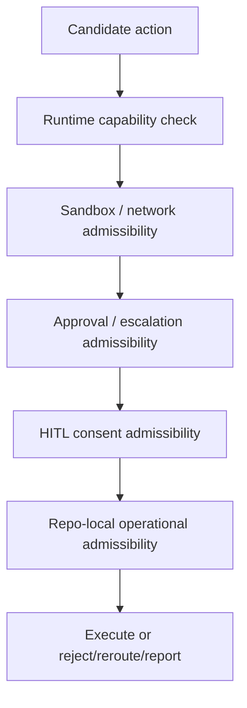
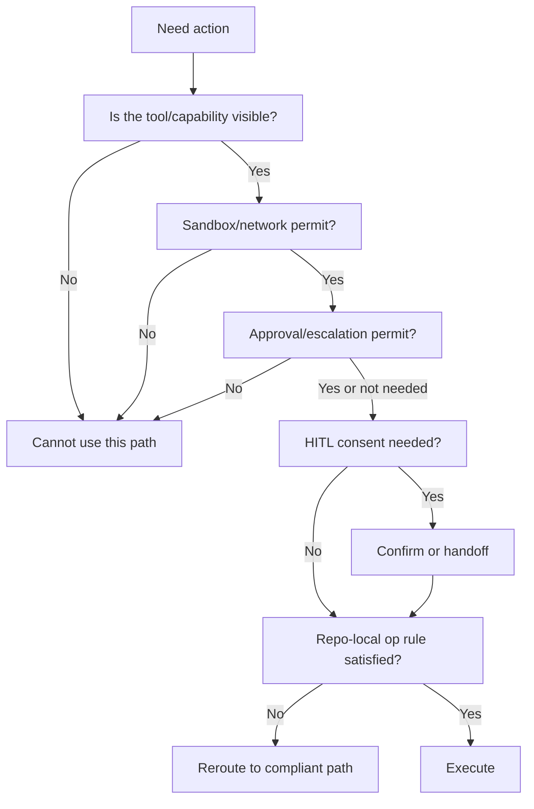

# Permission Management Audit

Overview router: [may-20-codex-agent-loop.md](/Users/songmin/Documents/code-new/semantica-codegraph-v2/docs/analysis/codex-agent/may-20-codex-agent-loop.md)

이 문서는 Codex 계열 에이전트의 `권한관리(permission management)`를 감사 관점으로 정리한다.

여기서 권한은 단일 축이 아니다. 최소한 아래 다섯 축으로 나뉜다.

1. runtime execution permission
2. sandbox / filesystem / network boundary
3. approval / escalation boundary
4. HITL consent / confirmation boundary
5. repo-local operational permission boundary

표기:
- `[FACT]`: 현재 세션 지침, tool schema, app/runtime context, repo AGENTS에서 직접 관측 가능한 사실
- `[STRONG-INFERENCE]`: 관측 사실을 가장 잘 설명하는 고신뢰 구조 추론
- `[WEAK-INFERENCE]`: plausible 하지만 직접 근거가 부족한 해석

주의:
- 이 문서는 현재 세션의 visible contract를 우선한다.
- hidden backend IAM, OS-level ACL, marketplace/service-side RBAC 등은 evidence 없으면 overclaim하지 않는다.

---

## 1. Executive summary

### 1.1 Final verdict

- `Alignment`: High `[STRONG-INFERENCE]`
- `Robustness`: Strong on visible session permissions, Medium on hidden deployment-specific internals `[STRONG-INFERENCE]`
- `Confidence`: High on current permission rails, Medium on generalized platform-wide implementation `[STRONG-INFERENCE]`
- `Ship readiness`: Ship as analysis doc `[STRONG-INFERENCE]`

### 1.2 Top conclusions

1. 권한관리는 단일 “can/cannot run command” 문제가 아니라 **다층 permission stack**으로 보인다. `[STRONG-INFERENCE]`
2. 현재 세션은 filesystem 측면에선 `danger-full-access`, approval 측면에선 `never`, HITL 측면에선 별도 confirmation policy를 가진다. `[FACT]`
3. 즉 “실행 권한”, “승인 권한”, “사용자 동의 권한”, “repo 운영 규칙 권한”은 서로 다른 레일이다. `[STRONG-INFERENCE]`
4. visible tool availability는 permission과 동일하지 않다. `tool visible`과 `action admissible`은 구분된다. `[STRONG-INFERENCE]`
5. repo-local policy는 generic runtime permission 위에 추가적인 operational permission boundary를 얹는다. `[FACT]` + `[STRONG-INFERENCE]`

---

## 2. Direct evidence inventory

## 2.1 Current session runtime permissions

현재 세션에서 직접 관측 가능한 권한 관련 사실:

| Evidence | Meaning | Classification |
| --- | --- | --- |
| `sandbox_mode = danger-full-access` | filesystem sandboxing 없음 | `[FACT]` |
| 설명 문구가 “No filesystem sandboxing - all commands are permitted” | filesystem permission이 넓게 열려 있음 | `[FACT]` |
| network access = enabled | network path 허용 | `[FACT]` |
| approval policy = never | escalation/approval path 사용 불가 | `[FACT]` |
| `sandbox_permissions`를 지정하지 말라 | current session에서 approval/escalation field 사용 금지 | `[FACT]` |

## 2.2 Tool-schema permission evidence

| Evidence | Meaning | Classification |
| --- | --- | --- |
| `exec_command` schema에 `sandbox_permissions`, `justification`, `require_escalated`가 있다 | tool execution path가 permission-aware다 | `[FACT]` |
| `request_user_input` is unavailable in Default mode | mode also controls usable interaction permissions | `[FACT]` |
| `spawn_agent` has explicit usage restrictions in instructions | delegation is permission-bounded by policy | `[FACT]` |

## 2.3 HITL / consent permission evidence

직접 관측 가능한 confirmation policy:

- `Hand-Off Required` `[FACT]`
- `Always Confirm at Action-Time` `[FACT]`
- `Pre-Approval Works` `[FACT]`
- `No Confirmation Needed` `[FACT]`

이 구조는 `consent permission`이라는 별도 축이 있음을 직접 보여준다. `[STRONG-INFERENCE]`

## 2.4 Repo-local operational permission evidence

repo AGENTS에서 직접 보이는 것:

- direct cargo 금지 `[FACT]`
- Rust verification은 `scripts/cg-dispatch` front door만 `[FACT]`
- no heuristics `[FACT]`
- fail-closed `[FACT]`
- destructive command 금지에 가까운 규칙 `[FACT]`

이건 runtime generic permission이 아니라 repo-local execution permission boundary다. `[STRONG-INFERENCE]`

---

## 3. Best-fit permission model

가장 설명력이 높은 permission 모델은 아래다. `[STRONG-INFERENCE]`

이 모델이 필요한 이유:
- filesystem/network permission만으로는 실제 행동 경계를 설명할 수 없고
- approval, HITL, repo-local ops constraints가 별도로 관측되기 때문이다

---

## 4. Permission layers

## 4.1 Runtime capability permission

이 층은 “도구가 현재 세션에 실제로 존재하는가”를 뜻한다. `[STRONG-INFERENCE]`

직접 근거:
- tool inventory가 명시적으로 제공됨 `[FACT]`

예:
- `web.run` visible `[FACT]`
- `exec_command` visible `[FACT]`
- `request_user_input` visible but mode-gated `[FACT]`

핵심:
- capability visibility는 permission의 1차 전제다 `[STRONG-INFERENCE]`

## 4.2 Sandbox / network permission

이 층은 environment-level execution boundary다.

현재 세션:
- filesystem sandboxing 없음 `[FACT]`
- network enabled `[FACT]`

의미:
- local file read/write와 network-assisted paths가 허용된다 `[STRONG-INFERENCE]`

## 4.3 Approval / escalation permission

현재 세션:
- approval policy `never` `[FACT]`
- escalation fields 사용 금지 `[FACT]`

의미:
- escalation-needed path가 있다 해도, current session에서는 그 rail을 못 탄다 `[STRONG-INFERENCE]`

## 4.4 HITL consent permission

이 층은 “기술적으로 가능”과 별도로 “사용자 동의가 있는가”를 본다. `[STRONG-INFERENCE]`

예:
- deletion
- sensitive data transmission
- representational communication
- installs/runs
- permission/access changes

근거는 `[FACT]`.

## 4.5 Repo-local operational permission

이 층은 특정 repo/workspace에서 허용되는 operational path를 제한한다. `[STRONG-INFERENCE]`

예:
- Rust verification via `scripts/cg-dispatch`
- no direct cargo
- no heuristics

근거는 `[FACT]`.

---

## 5. Permission matrix

| Permission rail | Governs | Example | Classification |
| --- | --- | --- | --- |
| Capability visibility | tool exists at all | `exec_command` available | `[FACT]` |
| Sandbox / network | local FS / network execution boundary | `danger-full-access`, network enabled | `[FACT]` |
| Approval / escalation | whether privileged path can be requested | `approval=never` | `[FACT]` |
| HITL consent | whether human confirmation/handoff is needed | delete / transmit / send / install | `[FACT]` |
| Repo-local ops | allowed operational workflow inside repo | `cg-dispatch` only, no direct cargo | `[FACT]` |

이 표는 권한을 단일 축으로 보면 안 된다는 점을 보여준다. `[STRONG-INFERENCE]`

---

## 6. Current session effective permissions

현재 세션의 effective permission을 보수적으로 요약하면:

### 6.1 Allowed without extra approval

- local shell/file operations `[FACT]`
- network-enabled browsing and web lookup `[FACT]`
- document/image/plugin paths if otherwise policy-allowed `[FACT]`

### 6.2 Disallowed / blocked

- escalation/approval path via `sandbox_permissions` `[FACT]`
- `request_user_input` in Default mode `[FACT]`
- direct cargo path for Rust repo verification `[FACT]`
- destructive operations without user consent `[FACT]`

### 6.3 Conditionally allowed

- sensitive actions only with HITL confirmation `[FACT]`
- subagent usage only with explicit user permission / bounded task policy `[FACT]`

---

## 7. Permission-aware execution process

가장 설명력 높은 process:

이건 current evidence를 가장 잘 종합한다. `[STRONG-INFERENCE]`

---

## 8. Permission interactions

## 8.1 Visibility != admissibility

예:
- `request_user_input` tool is visible `[FACT]`
- but unavailable in current mode `[FACT]`

해석:
- visible capability와 current admissibility는 별개 `[STRONG-INFERENCE]`

## 8.2 Admissibility != consent

예:
- browser/shell path로 technically action 가능
- 하지만 deletion/send/transmit는 confirmation policy에 걸림

근거:
- HITL rules `[FACT]`

## 8.3 Consent != repo-local operational compliance

예:
- user가 “컴파일해”라고 허용해도
- repo-local rule은 still `scripts/cg-dispatch`를 요구

근거:
- repo AGENTS `[FACT]`

---

## 9. Role of mode in permission management

mode도 permission surface의 일부다. `[STRONG-INFERENCE]`

직접 근거:
- `request_user_input` availability is mode-dependent `[FACT]`
- mode changes only through developer instructions `[FACT]`

해석:
- mode는 interaction permission을 제어하는 runtime rail이다 `[STRONG-INFERENCE]`

즉 permission management는:
- tool
- sandbox
- approval
- HITL
- repo ops
- mode

까지 포함한다.

---

## 10. Plugin-related permission implications

plugin은 capability를 늘리지만, permission을 자동으로 부여하진 않는다. `[STRONG-INFERENCE]`

예:
- Browser Use plugin이 있어도
  - HITL-sensitive action은 confirmation이 여전히 필요
  - current mode/tool policy를 여전히 따라야 함

근거:
- plugin policy와 HITL policy는 별도 레이어로 존재 `[FACT]`

---

## 11. Attack surface analysis

## 11.1 False assumption: permission = sandbox only

- contradicted by approval/HITL/repo-local/mode layers
- severity: P1

Classification:
- `[FACT]` + `[STRONG-INFERENCE]`

## 11.2 False assumption: visible tool == allowed action

- contradicted by mode-gated `request_user_input`, approval ban, HITL gating
- severity: P1

Classification:
- `[FACT]`

## 11.3 False assumption: user request overrides all permissions

- contradicted by higher-level runtime and policy rules
- severity: P0

Classification:
- `[FACT]`

## 11.4 False assumption: approval never means no permission system

- wrong
- current session still has HITL, mode, repo-local operational permissions
- severity: P1

Classification:
- `[FACT]` + `[STRONG-INFERENCE]`

---

## 12. Concrete failure scenarios if permission management is misunderstood

### Scenario 1: direct cargo run despite repo-local boundary

- setup: Rust verification task
- trigger: assistant uses `cargo` directly
- expected: `scripts/cg-dispatch`
- likely failure: repo policy violation
- severity: P1

Classification:
- rule basis `[FACT]`

### Scenario 2: visible tool assumed executable in current mode

- setup: current Default mode
- trigger: assistant calls `request_user_input`
- expected: unavailable
- likely failure: tool error
- severity: P2

Classification:
- rule basis `[FACT]`

### Scenario 3: shell/browser capability assumed equal to consent

- setup: destructive/send/transmit action
- trigger: assistant proceeds because runtime technically allows it
- expected: HITL confirmation/handoff
- likely failure: unauthorized user-impacting action
- severity: P0

Classification:
- rule basis `[FACT]`

### Scenario 4: escalation path assumed available

- setup: current session
- trigger: assistant sets `sandbox_permissions=require_escalated`
- expected: do not use it
- likely failure: command rejected
- severity: P2

Classification:
- rule basis `[FACT]`

---

## 13. False confidence traps

1. “현재 filesystem이 열려 있으니 권한관리도 느슨하다”
- 아니다
- approval/HITL/repo-local/mode가 남아 있다

2. “permission은 runtime concern뿐이다”
- 아니다
- user consent와 repo-local op path도 permission rail이다

3. “approval never면 다 자동 실행”
- 아니다
- escalation만 닫힌 것이지, consent/ops constraints는 그대로다

4. “repo-local rules는 스타일 가이드다”
- 아니다
- direct cargo 금지 같은 건 실질적 operational permission이다

---

## 14. Unknowns

직접 알 수 없는 것:

1. hidden backend IAM / ACL 구현 `[WEAK-INFERENCE]`
2. alternate deployment의 full permission matrix `[WEAK-INFERENCE]`
3. internal priority resolver implementation details `[WEAK-INFERENCE]`

---

## 15. Most precise safe summary

- 현재 세션의 권한관리는 단일 sandbox rail이 아니라, `capability visibility`, `sandbox/network`, `approval/escalation`, `HITL consent`, `repo-local operational boundary`, `mode gating`의 다층 구조로 보는 것이 가장 정확하다. `[STRONG-INFERENCE]`
- 직접 관측 가능한 현재 세션 상태는 `danger-full-access`, `network enabled`, `approval never`, `request_user_input unavailable in Default`, `repo-local cg-dispatch only`다. `[FACT]`
- 따라서 “실행 가능”과 “허용됨”과 “동의됨”은 서로 다른 질문이다. `[STRONG-INFERENCE]`

---

## Round 2 update (2026-05-21 deep dive)

이 섹션은 Codex Desktop build 2867 (codex-rs 0.130.0)의 Electron IPC surface와 per-host trust-mode state를 직접 inspect한 round-2 결과를 정리한다.

### R2.1 IPC channel inventory (FACT)

- 378개의 IPC channels enumerated across Electron main↔renderer surface. `[FACT]`
- Top 10 most privileged channels: `[FACT]`

  | # | Channel | Privilege concern |
  |---|---------|-------------------|
  | 1 | `upload-local-file-over-sftp` | arbitrary egress |
  | 2 | `openai-api-key` | credential exposed to renderer |
  | 3 | `computer-use-background-auth-read` / `-write` | Keychain bridge |
  | 4 | `primary-runtime-update-*` | arbitrary code install |
  | 5 | `electron-clone-workspace-repo` | repo-level write |
  | 6 | `thread-follower-command-approval-decision` | approval-decision injection |
  | 7 | `gh-pr-update` | GitHub-side write |
  | 8 | `remote-workspace-directory-entries` | remote FS read |
  | 9 | `mcp-app-sandbox-host-message` | iframe sandbox bridge |
  | 10 | `browser-use-file-transfer-origin-add` | browser-trust expansion |

### R2.2 Per-host trust-mode state (FACT)

- atom-state contains `agent-mode-by-host-id.local = "full-access" | "read-only"` — a **per-host trust mode** that gates how broadly the agent may act on a given workspace/host. `[FACT]`

### R2.3 Implications for the permission model

- §4의 5-layer model (capability → sandbox/network → approval → HITL → repo-local)에 round-2가 한 layer를 더 명시적으로 드러낸다: **per-host trust mode**. `agent-mode-by-host-id`는 workspace/host 단위로 권한 envelope를 narrow/wide로 switch한다. 이는 §4.5 "repo-local operational permission"의 implementation rail이다. `[FACT]`
- §5 permission matrix는 round-2 evidence로 확장되어야 한다:

  | Permission rail | Round-2 mechanism | Classification |
  | --- | --- | --- |
  | IPC privilege | 378 channels, top-10 critical | `[FACT]` |
  | Per-host trust | `agent-mode-by-host-id.local` atom | `[FACT]` |
- §8.1 "visibility != admissibility"는 IPC 채널 수준에서도 그대로 적용된다: 378개 채널이 *exposed*되어 있지만, 각 채널의 실제 호출 가능 여부는 별도 trust/approval rail이 결정한다. v3가 이 surface를 흡수할 때는 채널 count가 아니라 **privilege-classified subset**만 의미가 있다. `[FACT]` + `[MODEL]`
- `[MODEL]` `openai-api-key`가 renderer에 노출되는 IPC channel로 존재한다는 사실은 round-1 §11.2 ("visible tool == allowed action") false-assumption의 mirror 사례다: credential channel이 *exposed*되어 있다고 해서 모든 renderer context가 자유롭게 호출할 수 있다는 의미는 아니다. 그러나 v3는 이 패턴을 그대로 흡수하면 안 된다 — credential은 main process 안에 머물러야 한다.
- top-10 channels 중 `thread-follower-command-approval-decision`은 approval rail이 IPC-driven임을 directly 보여준다. round-1 §4.3 approval permission layer의 implementation evidence. `[FACT]`
