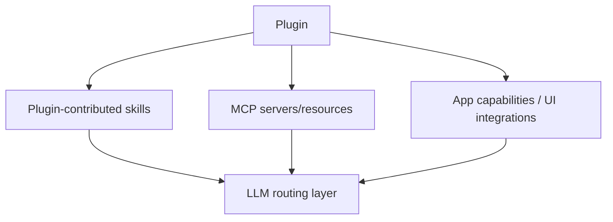
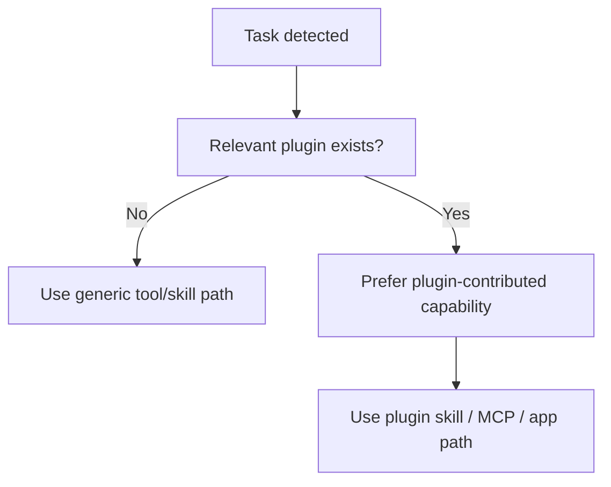
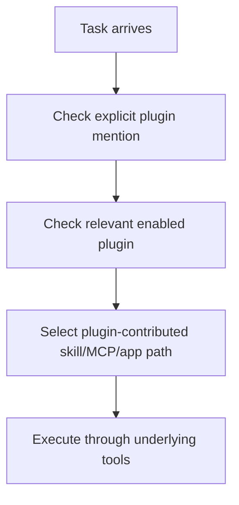

# Plugin Audit

Overview router: [may-20-codex-agent-loop.md](/Users/songmin/Documents/code-new/semantica-codegraph-v2/docs/analysis/codex-agent/may-20-codex-agent-loop.md)

이 문서는 Codex 계열 에이전트의 `plugin` 개념을 감사 관점으로 정리한다.

범위:
- 현재 세션에서 직접 보이는 plugin registry
- plugin이 skill / MCP / app capability와 어떤 관계를 가지는지
- plugin trigger rule이 실제 판단에 어떻게 개입하는지
- plugin과 tool, plugin과 app feature, plugin과 skill의 경계
- 무엇이 직접 관측 가능한 사실이고, 무엇이 강한/약한 추론인지

표기:
- `[FACT]`: 현재 세션의 plugin instructions, skills list, app context에서 직접 관측 가능한 사실
- `[STRONG-INFERENCE]`: 관측 사실을 가장 잘 설명하는 고신뢰 구조 추론
- `[WEAK-INFERENCE]`: plausible 하지만 직접 근거가 부족한 해석

주의:
- 이 문서는 현재 세션에서 실제 enabled된 plugin만 다룬다.
- hidden marketplace backend나 install/update lifecycle 내부 구현은 overclaim하지 않는다.

---

## 1. Executive summary

### 1.1 Final verdict

- `Alignment`: High `[STRONG-INFERENCE]`
- `Robustness`: Strong for visible plugin contract, Medium for hidden packaging/runtime internals `[STRONG-INFERENCE]`
- `Confidence`: High on current plugin surface, Medium on generalized plugin architecture details `[STRONG-INFERENCE]`
- `Ship readiness`: Ship as analysis doc `[STRONG-INFERENCE]`

### 1.2 Top conclusions

1. plugin은 직접 호출되는 단일 tool이 아니라, **skill + MCP + app capability bundle**로 보는 것이 가장 정확하다. `[STRONG-INFERENCE]`
2. 현재 세션에는 5개의 enabled plugin이 직접 보인다. `[FACT]`
3. plugin은 `직접 invoke` 대상이 아니라, 그 plugin이 노출한 skill/tool/app path를 통해 우회적으로 사용된다. `[FACT]`
4. plugin trigger rule은 “관련 plugin이 있으면 standalone capability보다 우선하라”는 preference layer로 작동한다. `[FACT]` + `[STRONG-INFERENCE]`
5. plugin은 tool inventory를 늘리는 것뿐 아니라, task routing 우선순위도 바꾼다. `[STRONG-INFERENCE]`

---

## 2. Direct evidence inventory

## 2.1 Enabled plugins in the current session

현재 세션에 직접 보이는 enabled plugins:

1. `Browser Use` `[FACT]`
2. `Documents` `[FACT]`
3. `GitHub` `[FACT]`
4. `Presentations` `[FACT]`
5. `Spreadsheets` `[FACT]`

## 2.2 Directly visible plugin policy

plugin instructions에서 직접 보이는 사실:

| Evidence | Meaning | Classification |
| --- | --- | --- |
| plugins are listed separately from tools | plugin은 tool과 다른 계층 | `[FACT]` |
| “Plugins are not invoked directly” | plugin 자체는 direct callable unit이 아님 | `[FACT]` |
| “Use their underlying skills, MCP servers, and app tools” | plugin은 lower-level capability bundle | `[FACT]` |
| “When a relevant plugin is available, prefer it over standalone capabilities” | plugin-aware routing preference exists | `[FACT]` |
| 사용자가 plugin 이름을 명시하면 그 plugin 관련 capability를 우선하라 | explicit plugin mention alters routing | `[FACT]` |

## 2.3 Plugin-contributed skill evidence

현재 세션 skills list에서 plugin-prefixed skills가 직접 보인다. `[FACT]`

예:
- `browser-use:browser`
- `github:gh-address-comments`
- `github:gh-fix-ci`
- `github:github`
- `github:yeet`
- `documents:documents`
- `presentations:Presentations`
- `spreadsheets:Spreadsheets`

이는 plugin이 skill surface를 export할 수 있음을 직접 보여준다. `[FACT]`

---

## 3. Best-fit plugin model

가장 설명력이 높은 plugin 모델은 아래다. `[STRONG-INFERENCE]`



의미:
- plugin은 단일 함수가 아니라 capability package
- skill, MCP, app integration을 묶어 제공

이 모델은 plugin instructions와 skills list를 가장 자연스럽게 설명한다. `[STRONG-INFERENCE]`

---

## 4. Plugin vs tool vs skill vs app feature

이 구분이 핵심이다.

## 4.1 Tool

정의:
- callable function
- schema가 직접 제공됨

예:
- `functions.exec_command`
- `web.run`
- `functions.apply_patch`

모두 `[FACT]`.

## 4.2 Skill

정의:
- task-specific instruction package
- local `SKILL.md`로 구현된 workflow

예:
- `ss`, `rr`, `aa`
- plugin-prefixed skills

모두 `[FACT]`.

## 4.3 Plugin

정의:
- 직접 호출되는 것이 아니라
- skill + MCP + app capability를 묶은 bundle

이건 plugin instructions로부터의 직접 사실 + 구조적 요약이다. `[FACT]` + `[STRONG-INFERENCE]`

## 4.4 App feature

정의:
- Codex desktop app이 제공하는 상위 UX/runtime affordance

예:
- 이미지/비디오 absolute path rendering
- git directives
- browser plugin integration

이것도 plugin과 구분되는 층이다. `[FACT]`

---

## 5. Routing impact of plugins

plugin은 단순 inventory가 아니라 routing preference에 개입한다.

## 5.1 Direct evidence

- 관련 plugin이 있으면 standalone capability보다 plugin capability 선호 `[FACT]`
- 사용자가 plugin 이름을 명시하면 그 plugin capability를 우선 `[FACT]`

## 5.2 Best-fit routing model



이건 plugin policy를 가장 자연스럽게 설명하는 모델이다. `[STRONG-INFERENCE]`

## 5.3 Example consequences

### Browser plugin case

- localhost/UI inspection 요청 시 browser-use plugin path 우선 `[FACT]`
- shell `open`나 generic browsing으로 대체하지 말라는 규칙이 있다 `[FACT]`

### GitHub plugin case

- PR review / CI / issue/PR summary는 GitHub plugin skills가 우선 `[FACT]`

### Documents / Presentations / Spreadsheets case

- `.docx`, `.pptx`, `.xlsx` 계열 작업은 plugin-contributed skill path가 canonical `[FACT]`

---

## 6. Plugin-specific audit

## 6.1 Browser Use

### Direct evidence

- plugin name: `Browser Use` `[FACT]`
- aliases: `@browser-use`, `browser-use`, `Browser`, `in-app browser` `[FACT]`
- localhost / current in-app browser tab inspection에 쓰라고 명시 `[FACT]`
- explicit browser-use request를 shell `open`이나 generic web browsing으로 대체하지 말라고 명시 `[FACT]`

### Interpretation

- browser plugin은 local UI inspection에 대한 high-priority route다 `[STRONG-INFERENCE]`

## 6.2 Documents

### Direct evidence

- `.docx` create/edit capability를 제공 `[FACT]`
- `documents:documents` skill exists `[FACT]`
- render-and-verify workflow 지향이 skill description에 드러난다 `[FACT]`

### Interpretation

- 문서 작업은 generic shell script보다 plugin workflow가 canonical path다 `[STRONG-INFERENCE]`

## 6.3 GitHub

### Direct evidence

- PR/issue/repo inspection과 CI/debug/publish workflows를 제공 `[FACT]`
- `github:*` prefixed skills 다수 존재 `[FACT]`

### Interpretation

- GitHub plugin은 단순 metadata reader가 아니라 multi-workflow orchestration bundle이다 `[STRONG-INFERENCE]`

## 6.4 Presentations

### Direct evidence

- slide deck / PowerPoint 관련 skill 존재 `[FACT]`
- plugin 자체가 presentation build/modify 용도라고 명시 `[FACT]`

## 6.5 Spreadsheets

### Direct evidence

- spreadsheet create/edit/analyze/render/export 용도 `[FACT]`
- plugin skill 존재 `[FACT]`

---

## 7. Plugin lifecycle and usage process

현재 세션에서 직접 보이는 범위로 복원한 process는 아래가 가장 적절하다. `[STRONG-INFERENCE]`



### Key point

plugin은 “invoke plugin X”가 아니라
- plugin이 제공한 skill을 읽고
- plugin이 붙인 app/MCP/tool surface를 타는 방식이다

이건 direct policy statement와 일치한다. `[FACT]`

---

## 8. Plugin and memory / context

plugin 자체에 대한 별도 persistent state API는 현재 직접 보이지 않는다. `[FACT]`

하지만 plugin 관련 context는 아래에 저장되는 것으로 보는 게 자연스럽다. `[STRONG-INFERENCE]`

1. skill instructions
2. app context
3. tool availability
4. current task routing choice

즉 plugin은 별도 memory store라기보다 `capability surface`다. `[STRONG-INFERENCE]`

---

## 9. Attack surface analysis

## 9.1 False assumption: plugin == tool

- contradicted by explicit “Plugins are not invoked directly”
- severity: P1

Classification:
- `[FACT]`

## 9.2 False assumption: plugin is optional flavor only

- contradicted by plugin preference rules and explicit browser-use replacement ban
- severity: P1

Classification:
- `[FACT]` + `[STRONG-INFERENCE]`

## 9.3 False assumption: skills and plugins are unrelated

- contradicted by plugin-prefixed skills
- severity: P2

Classification:
- `[FACT]`

## 9.4 False assumption: enabled plugin means every hidden feature is callable

- wrong
- actual callable surface still depends on exposed skills, MCP, or app tools
- severity: P2

Classification:
- `[STRONG-INFERENCE]`

---

## 10. Concrete failure scenarios if plugin model is misunderstood

### Scenario 1: browser-use request satisfied with generic shell open

- setup: user explicitly asks for `@browser-use`
- trigger: assistant uses shell/open or generic web path
- expected: plugin browser path
- likely failure: policy violation and wrong UX
- severity: P1

Classification:
- rule basis `[FACT]`

### Scenario 2: document task handled as plain text response

- setup: user wants `.docx`
- trigger: assistant ignores documents plugin
- expected: plugin-contributed document workflow
- likely failure: wrong artifact type, poor verification path
- severity: P1

Classification:
- rule basis `[FACT]` + `[STRONG-INFERENCE]`

### Scenario 3: GitHub PR/CI workflow done without GitHub plugin path

- setup: PR review comments or CI failure analysis request
- trigger: assistant treats it as generic code task only
- expected: GitHub plugin capability preferred
- likely failure: missing repository/PR/Actions context
- severity: P1

Classification:
- rule basis `[FACT]`

---

## 11. Unknowns

직접 알 수 없는 것:

1. plugin packaging internal manifest format details `[WEAK-INFERENCE]`
2. plugin loading lifecycle internals `[WEAK-INFERENCE]`
3. plugin marketplace sync/update internals `[WEAK-INFERENCE]`
4. hidden plugin-specific state persistence details `[WEAK-INFERENCE]`

---

## 12. Most precise safe summary

- 현재 세션의 plugin은 direct callable tool이 아니라, skill/MCP/app capability bundle로 보는 것이 가장 정확하다. `[STRONG-INFERENCE]`
- 현재 enabled plugin은 `Browser Use`, `Documents`, `GitHub`, `Presentations`, `Spreadsheets`다. `[FACT]`
- plugin 정책은 “관련 plugin이 있으면 standalone path보다 우선하라”는 routing preference를 명시적으로 가진다. `[FACT]`
- plugin은 task routing과 UX path를 바꾸는 capability layer이며, 그 실제 실행은 plugin-contributed skills, MCP resources, app tools를 통해 이루어진다. `[FACT]` + `[STRONG-INFERENCE]`

---

## Round 2 update (2026-05-21 deep dive)

이 섹션은 Codex Desktop build 2867 (codex-rs 0.130.0)의 bundled plugin payload를 직접 inspect한 round-2 결과를 정리한다.

### R2.1 Plugin manifest schema (FACT)

- Plugin manifest path: `<plugin>/.codex-plugin/plugin.json` (hidden `.codex-plugin` subdir, **not** bare `plugin.json`). `[FACT]`
- MCP server config (when plugin provides MCP): `<plugin>/.mcp.json` (sibling file). `[FACT]`
- Common schema across the 4 bundled plugins: `[FACT]`
  ```
  { name, version, description, author{name,email?,url?}, homepage?, license, keywords,
    mcpServers?, skills?,
    interface: { displayName, shortDescription, longDescription, developerName, category,
                 capabilities[Interactive|Read|Write], websiteURL, privacyPolicyURL,
                 termsOfServiceURL, logo, composerIcon?, defaultPrompt[], brandColor,
                 screenshots[] } }
  ```
- **No `permissions` field in the manifest** — permission gating is OS-level (entitlements/extension permissions), not declarative. `[FACT]`

### R2.2 Four bundled plugins (FACT)

#### 1. `computer-use` v1.0.793

- MCP server entry: `./Codex Computer Use.app/Contents/SharedSupport/SkyComputerUseClient.app/Contents/MacOS/SkyComputerUseClient mcp`. `[FACT]`
- Actual main executable inside the nested .app: `SkyComputerUseService` (Mach-O arm64, bundle id `com.openai.sky.CUAService`, min macOS 14.4). `[FACT]`
- Frameworks/symbols: AXUIElement, AccessibilitySupport, EventTap, UIRecorder, SyntheticAppFocusEnforcer, SystemFocusedUIElementObserver, SystemFrontmostApplicationTracker, WindowOrderingObserver, CGEvent. `[FACT]`
- Entitlements: `com.apple.security.application-groups = 2DC432GLL2.com.openai.sky.CUAService`, `com.apple.security.automation.apple-events = true`. `[FACT]`

#### 2. `browser` v0.1.0-alpha2

- Aliases: `@browser`, `@browser-use`. `[FACT]`
- Runtime: `scripts/browser-client.mjs` (~199KB, Node REPL). `[FACT]`
- API surface: `browser.tabs.{selected,new,list}()`, `browser.nameSession(...)`, screenshots via `nodeRepl.emitImage()`. `[FACT]`
- Default scope: localhost, file://, in-app browser tabs. `[FACT]`

#### 3. `chrome` v0.1.7

- Chrome extension id: `hehggadaopoacecdllhhajmbjkdcmajg`. `[FACT]`
- Native messaging host: `com.openai.codexextension`. `[FACT]`
- `installManifest.mjs` writes host manifest to Chrome's NativeMessagingHosts dir. `[FACT]`
- Separate bundled `extension-host` native binary (macos/windows/linux × arm64/x64) bridges Chrome ↔ Codex. `[FACT]`
- Privacy notice (verbatim): "Browser data from using this plugin may be used for training". `[FACT]`
- Manifest declares Capabilities: Interactive + Read only (**no Write**). `[FACT]`

#### 4. `latex` v0.2.0

- Bundles Tectonic at `bin/tectonic`. `[FACT]`
- Fallback path: system TeX Live or managed runtime at `~/.cache/codex-runtimes/codex-texlive/full`. `[FACT]`
- Three skills: `latex-compile`, `latex-doctor`, `texlive-runtime-installer`. `[FACT]`
- No root/sudo usage observed in install flow. `[FACT]`

### R2.3 Implications for the plugin model

- §3의 best-fit model (`plugin -> {skills, MCP, app capability}`)은 round-2 evidence와 정확히 일치한다. plugin.json의 `mcpServers?`와 `skills?` 필드가 directly 그 bundle 구조를 schema 레벨에서 보여준다. `[FACT]` + `[STRONG-INFERENCE]`
- `[MODEL]` "permissions are OS-level, not declarative" 사실은 §11.4의 false-assumption(enabled plugin == every hidden feature callable)을 강화한다 — plugin manifest 자체는 capability를 *advertise*만 할 뿐, 실제 admissibility는 OS entitlements + 별도 permission rail이 결정한다.
- `chrome` plugin의 "no Write" capability와 "training에 사용될 수 있다" privacy notice는 plugin이 **trust-boundary metadata**도 expose함을 보여준다. 이는 §6의 plugin-specific audit에 새 차원을 더한다. `[FACT]`
- §6.1 Browser Use 항목은 이제 두 개의 별도 plugin (`browser` alpha + `chrome` v0.1.7)으로 분리되어야 한다. round-1에서 단일 "Browser Use"로 본 것은 user-facing alias 통합이지, packaging 단위는 두 개다. `[FACT]`
