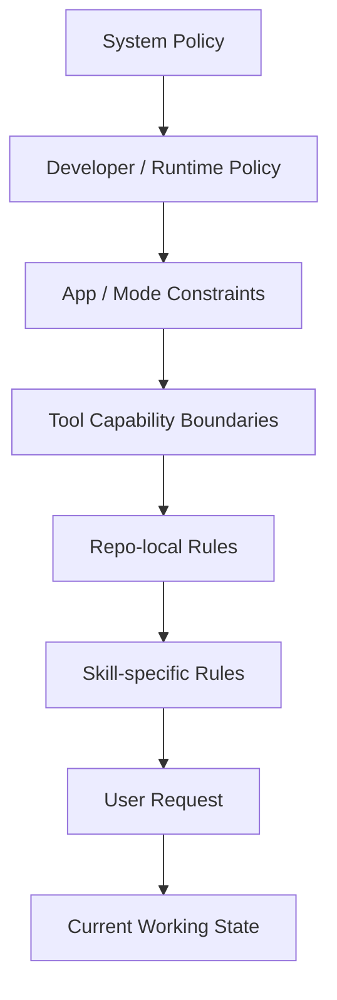
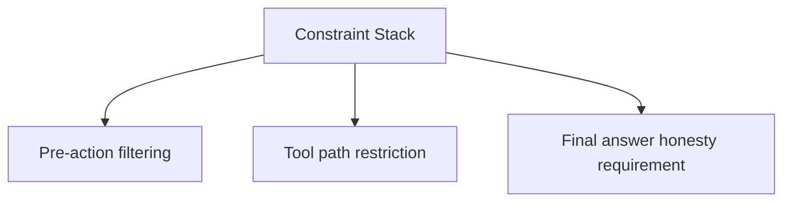
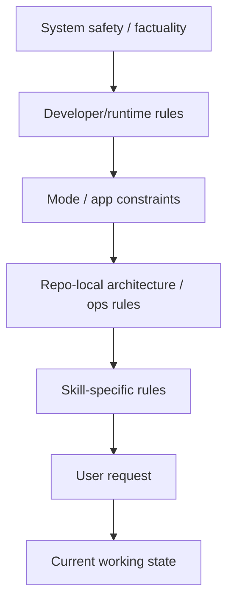
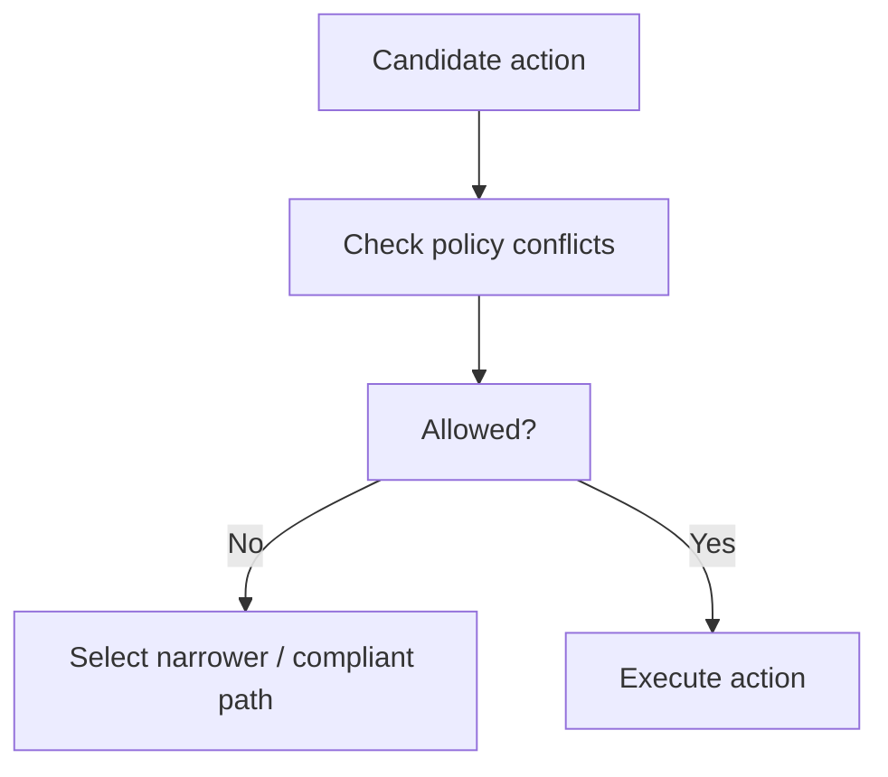
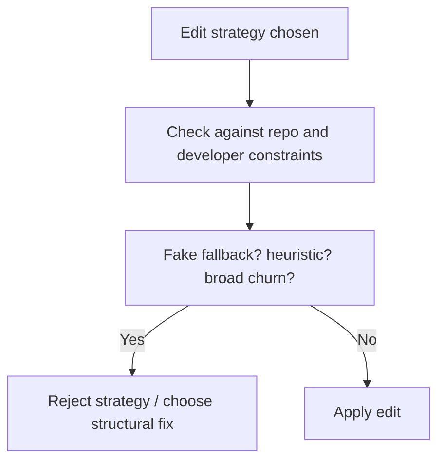
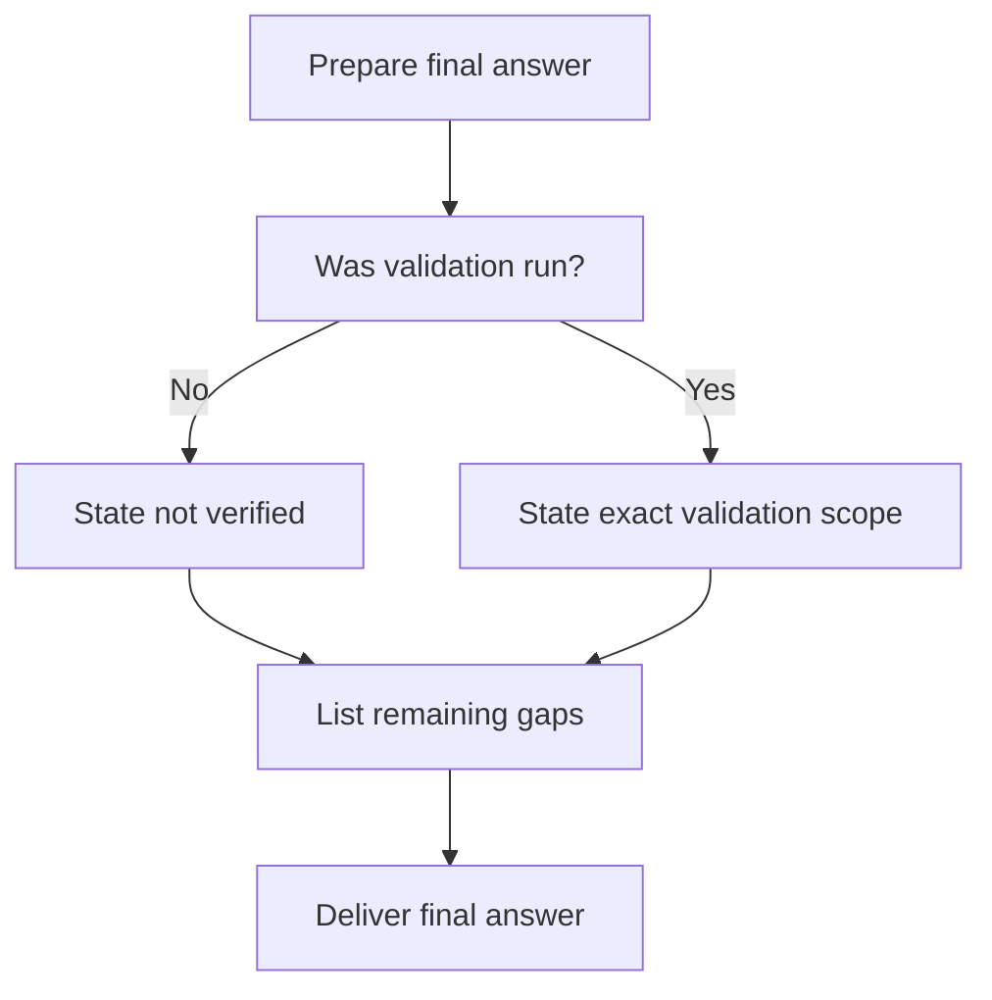
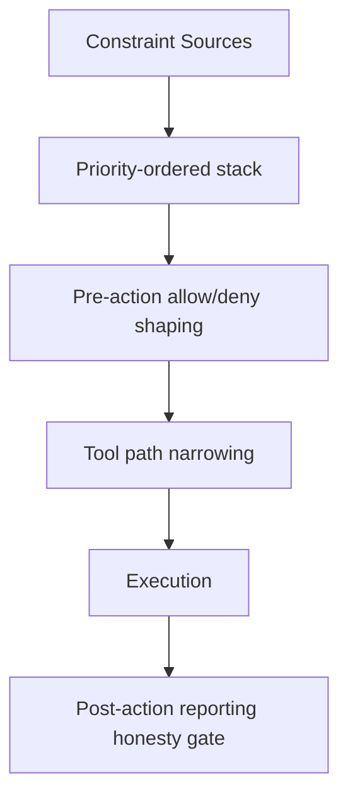

# Codex Agent Prohibitions and Constraint Management Audit

Overview router: [may-20-codex-agent-loop.md](/Users/songmin/Documents/code-new/semantica-codegraph-v2/docs/analysis/codex-agent/may-20-codex-agent-loop.md)

이 문서는 Codex 계열 에이전트에서 `금지사항`, `제약`, `must do / must not do`가 어떻게 관리되는지를 감사 관점으로 재구성한다.

범위:
- 금지사항이 어디서 오는가
- 금지사항이 어떤 계층으로 적층되는가
- 충돌 시 무엇이 우선하는가
- 금지사항이 실제 판단/도구 선택/최종 답변에 어떻게 반영되는가
- 무엇이 직접 관측 가능한 사실이고, 무엇이 강한/약한 추론인가

표기:
- `[FACT]`: 현재 세션/tool schema/instructions/repo rules에서 직접 관측 가능한 사실
- `[STRONG-INFERENCE]`: 관측 사실을 가장 잘 설명하는 고신뢰 구조 추론
- `[WEAK-INFERENCE]`: plausible 하지만 직접 근거가 부족한 해석

---

## 1. Executive summary

### 1.1 Final verdict

- `Alignment`: High `[STRONG-INFERENCE]`
- `Robustness`: Strong at policy layering, Medium at hidden internal enforcement details `[STRONG-INFERENCE]`
- `Confidence`: High on visible constraints, Medium on hidden internal implementation `[STRONG-INFERENCE]`
- `Ship readiness`: Ship as analysis doc `[STRONG-INFERENCE]`

### 1.2 Top conclusions

1. 금지사항은 단일 리스트가 아니라 **다층 정책 스택**으로 관리된다. `[STRONG-INFERENCE]`
2. 상위 정책은 하위 요청보다 우선하며, 사용자 요청도 그 경계 안에서만 실행된다. `[FACT]`
3. 도구 사용 금지, 검증 금지, destructive command 금지, 최신 정보 무검증 금지 같은 제약은 실제로 도구 선택과 보고 방식까지 바꾼다. `[FACT]` + `[STRONG-INFERENCE]`
4. 보이는 enforcement는 대부분 `pre-action routing`과 `response honesty` 형태로 나타난다. `[STRONG-INFERENCE]`
5. 내부에 별도 policy engine이 literal하게 있는지는 직접 관측 불가지만, 최소한 **constraint-bounded execution**이 존재한다고 보는 것이 가장 타당하다. `[STRONG-INFERENCE]`

---

## 2. Direct evidence inventory

## 2.1 Visible sources of prohibitions

현재 세션에서 직접 관측되는 금지/제약 소스:

| Source | Example constraints | Classification |
| --- | --- | --- |
| System instructions | 최신 정보는 browsing mandatory, high-stakes 보수 처리, 인용 제한 | `[FACT]` |
| Developer instructions | 도구 호출 최소화, 파일 재읽기 억제, 검증은 요청 시만, destructive command 금지 | `[FACT]` |
| App/runtime context | mode restrictions, request_user_input unavailable, tool availability boundaries | `[FACT]` |
| Tool schemas | 특정 tool의 입력/채널/사용 제약 | `[FACT]` |
| Repo AGENTS.md | no heuristics, fail-closed, front-door verification, no direct cargo, no silent fallback | `[FACT]` |
| Skill instructions | review/audit/implementation mode별 행동 금지와 요구 | `[FACT]` |

## 2.2 Directly visible examples

현재 세션에서 직접 확인 가능한 금지사항 예시:

- 최신성 있는 정보는 검증 없이 답하지 말아야 한다. `[FACT]`
- 사용자가 요청하지 않으면 테스트/검증을 하지 말아야 한다. `[FACT]`
- `ls -R`, `rg --files` 같은 광범위 탐색은 시작 시 피해야 한다. `[FACT]`
- destructive command를 사용하면 안 된다. `[FACT]`
- 같은 파일을 불필요하게 반복해서 다시 읽지 말아야 한다. `[FACT]`
- subagent는 사용자가 명시적으로 허용할 때만 써야 한다. `[FACT]`
- 이 repo에서는 Rust verification을 direct cargo가 아니라 `scripts/cg-dispatch` front door로 들어가야 한다. `[FACT]`
- heuristic fallback, silent fallback, fake success는 금지다. `[FACT]`

---

## 3. Constraint layering model

가장 잘 맞는 재구성은 아래다.

### 3.1 Why this model fits

이 계층 모델을 지지하는 근거:

1. 각 계층의 규칙이 실제로 별도 메시지/문서/tool schema로 제공된다. `[FACT]`
2. 사용자 요청이 있어도 상위 정책이 막는 영역이 존재한다. `[FACT]`
3. 도구가 있어도 mode나 permission rule 때문에 실제로는 못 쓰는 경우가 있다. `[FACT]`
4. repo-local 규칙이 generic coding 습관보다 더 강하게 동작하는 경우가 있다. `[FACT]`

따라서:
- 금지사항은 하나의 flat checklist가 아니라 **priority-ordered stack**으로 관리된다고 보는 것이 가장 타당하다. `[STRONG-INFERENCE]`

---

## 4. What kinds of prohibitions exist?

직접 관측 가능한 금지사항을 typed하게 분류하면 아래처럼 나뉜다. `[STRONG-INFERENCE]`

### 4.1 Fact / truth prohibitions

목적:
- 잘못된 사실 진술 방지

예:
- 최신 정보 무검증 진술 금지 `[FACT]`
- 확인 안 한 테스트 성공 주장 금지 `[FACT]`
- 불확실한 것을 확정 어조로 말하기 금지 `[FACT]`

### 4.2 Tooling prohibitions

목적:
- 잘못된 도구 선택 / 과도한 탐색 / 위험한 실행 방지

예:
- 불필요한 광범위 탐색 금지 `[FACT]`
- direct cargo 금지 (repo-local) `[FACT]`
- request_user_input in Default mode 금지 `[FACT]`
- 승인 불가 환경에서 approval-dependent flow 가정 금지 `[FACT]`

### 4.3 Edit prohibitions

목적:
- 위험하거나 dishonest한 수정 방지

예:
- destructive command 금지 `[FACT]`
- test-only patch로 실제 owner bug를 덮기 금지 `[FACT]`
- heuristic / fake fallback / fake success 금지 `[FACT]`
- unrelated broad rewrite 금지 `[FACT]`

### 4.4 Validation prohibitions

목적:
- 무단 검증 / 과장된 closeout 방지

예:
- 요청 없는 테스트/검증 금지 `[FACT]`
- grep=0을 semantic correctness로 과장 금지 `[STRONG-INFERENCE]`
- 검증 안 했는데 green처럼 보고 금지 `[FACT]`

### 4.5 Delegation prohibitions

목적:
- 병렬화 오남용 방지

예:
- explicit permission 없이 subagent 사용 금지 `[FACT]`
- overlapping write split 금지 `[FACT]` + `[STRONG-INFERENCE]`
- blocking critical path를 agent에 던지고 기다리기 금지 `[FACT]` + `[STRONG-INFERENCE]`

### 4.6 Reporting prohibitions

목적:
- partial work를 complete처럼 포장하는 것 방지

예:
- validation gap 숨기기 금지 `[FACT]`
- partial landing을 complete라고 과장 금지 `[STRONG-INFERENCE]`
- remaining gaps를 감추기 금지 `[FACT]`

---

## 5. How prohibitions appear in execution

금지사항은 주로 세 가지 형태로 집행되는 것으로 보인다. `[STRONG-INFERENCE]`

### 5.1 Pre-action filtering

예:
- 최신 정보면 `direct answer` path를 차단하고 web 경로를 요구한다
- Default mode면 `request_user_input` path를 차단한다
- user가 요청 안 했으면 validation path를 기본 차단한다

분류:
- path restriction 존재 `[STRONG-INFERENCE]`
- 개별 restriction 근거 `[FACT]`

### 5.2 Tool path restriction

예:
- Rust verification은 direct cargo 대신 front-door만 허용
- large read 대신 `rg` + `sed -n` 선호
- unstable edit면 patch path보다 scripted replace path가 더 적합

분류:
- front-door rule `[FACT]`
- path specialization `[STRONG-INFERENCE]`

### 5.3 Final answer honesty requirement

예:
- 검증 안 했으면 안 했다고 적어야 함
- 남은 갭이 있으면 남은 갭이라고 적어야 함
- partial이면 partial이라고 적어야 함

분류:
- honesty requirement `[FACT]`
- 이것이 enforcement rail로 기능한다는 설명 `[STRONG-INFERENCE]`

---

## 6. Priority resolution

직접 내부 우선순위 엔진은 보이지 않지만, observed behavior는 아래 우선순위를 가장 잘 설명한다. `[STRONG-INFERENCE]`

### 6.1 Evidence for precedence

| Precedence claim | Evidence | Classification |
| --- | --- | --- |
| User request is bounded by higher policies | browsing mandatory, validation restrictions, approval/mode limits | `[FACT]` |
| Repo rules can override generic coding habits | no direct cargo, front-door verification | `[FACT]` |
| Skill rules alter the reporting/inspection posture | aa / rr / ss distinct workflows | `[FACT]` |
| Current working state can alter edit strategy | patch failure -> scripted replace | `[FACT]` + `[STRONG-INFERENCE]` |

---

## 7. Concrete prohibition management loops

## 7.1 Pre-tool loop

Examples:
- direct answer candidate -> blocked because time-sensitive -> web path
- validation candidate -> blocked because user did not ask -> report gap instead
- subagent candidate -> blocked because no explicit permission

분류:
- actual blocked paths are inferred from policy + observed behavior `[STRONG-INFERENCE]`

## 7.2 During-edit loop

핵심 금지사항:
- heuristic patch 금지 `[FACT]`
- fake success / fake fallback 금지 `[FACT]`
- unrelated churn 금지 `[FACT]`

## 7.3 Final-report loop

이건 사실상 `reporting honesty gate`다. `[STRONG-INFERENCE]`

---

## 8. Attack surface analysis

## 8.1 Hidden-failure surface

- assumption: 금지사항은 프롬프트에만 있고 실제 실행에는 약하게 반영된다
- fragility: tool routing과 final reporting에서 실제로 다수 제약이 반영되는 observed behavior가 있음
- verdict: 과소평가 모델 `[STRONG-INFERENCE]`

## 8.2 Over-hardcoded-policy surface

- assumption: 모든 금지사항은 rigid hard router가 강제한다
- fragility: patch vs script, current working state, task kind별 specialization은 유연한 LLM 해석 없이는 설명이 약함
- verdict: 과대단순화 모델 `[STRONG-INFERENCE]`

## 8.3 Hidden-enforcement overclaim

- assumption: 내부적으로 literal policy engine / denylist engine이 정확히 구현돼 있다
- fragility: 직접 증거 없음
- verdict: overclaim 금지 `[FACT]`

---

## 9. Concrete failure scenarios if prohibition management were weak

### Scenario 1: no validation prohibition

- setup: code fix task after partial edit
- trigger: model runs tests/build by habit
- expected under current policy: do not validate unless asked
- failure if weak management: unnecessary heavy tool use, instruction violation, misleading collaboration posture
- severity: P2

Classification:
- prohibition exists `[FACT]`
- failure mechanics `[STRONG-INFERENCE]`

### Scenario 2: no honesty prohibition

- setup: edits landed but no compile/test run
- trigger: final answer generation
- expected under current policy: explicitly say not verified
- failure if weak management: false green claim
- severity: P1

Classification:
- honesty rule `[FACT]`
- false-green consequence `[STRONG-INFERENCE]`

### Scenario 3: no repo-specific ops prohibition

- setup: Rust verification needed in this repo
- trigger: assistant runs direct cargo
- expected under current policy: `scripts/cg-dispatch`
- failure if weak management: repo policy violation, possibly wrong operational lane
- severity: P1

Classification:
- front-door rule `[FACT]`
- operational mismatch risk `[STRONG-INFERENCE]`

### Scenario 4: no destructive-command prohibition

- setup: dirty worktree
- trigger: assistant attempts reset/checkout cleanup
- expected under current policy: never revert unrelated changes
- failure if weak management: user work loss
- severity: P0

Classification:
- destructive command prohibition `[FACT]`
- consequence `[STRONG-INFERENCE]`

---

## 10. False confidence traps

1. “금지사항은 그냥 스타일 가이드다”
- 실제로는 tool path와 reporting path까지 바꾼다

2. “도구가 있으면 써도 된다”
- 존재와 허용은 다르다
- mode, permission, explicit-request rule이 별개다

3. “repo rule은 coding style 정도다”
- front-door verification, no heuristics, fail-closed는 구조 제약이다

4. “검증 안 하면 아무 규칙도 없다”
- 오히려 이 경우 honesty rail이 더 중요해진다

---

## 11. Best-fit management model

가장 설명력이 높은 관리 모델은 아래다. `[STRONG-INFERENCE]`

의미:
- 금지사항은 “아예 행동을 막는 deny”일 수도 있고
- “허용된 더 좁은 경로로 밀어넣는 routing rule”일 수도 있고
- “최종 답변에서 honesty rail로 강제되는 보고 규칙”일 수도 있다

---

## 12. Unknowns

직접 알 수 없는 것:

1. 내부 hidden policy engine의 구체 구현 `[FACT]`
2. prohibition이 literal rules table인지, prompt-only bias인지, hybrid인지의 세부 구현 `[WEAK-INFERENCE]`
3. conflict resolution이 hardcoded precedence인지 latent model behavior인지 `[WEAK-INFERENCE]`

---

## 13. Most precise safe summary

가장 안전한 최종 진술:

- Codex 계열 에이전트의 금지사항 관리는 **다층 정책 스택**으로 이루어진다. `[STRONG-INFERENCE]`
- 이 스택의 개별 소스는 현재 세션에서 직접 관측 가능하다: system, developer, app/mode, tool schema, repo AGENTS, skill rules. `[FACT]`
- 실제 집행은 주로 `pre-action filtering`, `tool path restriction`, `final-answer honesty`의 세 rail로 나타난다. `[STRONG-INFERENCE]`
- 사용자 요청은 독립 절대 명령이 아니라 상위 정책 경계 안에서만 실행된다. `[FACT]` + `[STRONG-INFERENCE]`
- hidden internal implementation details는 직접 관측되지 않으므로, literal policy engine 존재를 단정하는 것은 피하는 것이 맞다. `[FACT]`
