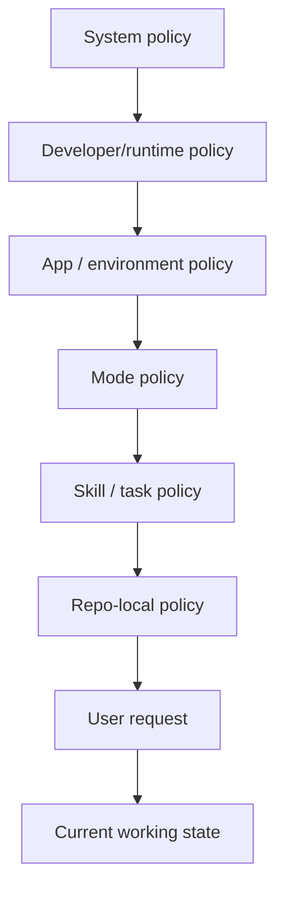

# Codex Agent Prompt and Policy Stack

Overview router: [may-20-codex-agent-loop.md](/Users/songmin/Documents/code-new/semantica-codegraph-v2/docs/analysis/codex-agent/may-20-codex-agent-loop.md)

## 1. Why stack matters

Codex 계열 에이전트는 단일 프롬프트 한 장으로 움직이지 않는다. 실제 동작은 여러 계층의 규칙이 누적된 결과다.

## 2. Policy layers

### 2.1 System policy

목적:
- 안전성
- 최신성
- 출처/근거 규율

주요 역할:
- time-sensitive 정보는 검증 우선
- high-stakes 질의는 더 보수적으로 처리
- 직접 인용/저작권/링크 정책 집행

### 2.2 Developer/runtime policy

목적:
- 제품/에이전트별 작업 습관 강제

대표 규칙 축:
- 도구는 비싸므로 최소화
- 불필요한 광범위 탐색 금지
- 검증은 요청받기 전까지 기본적으로 보류
- 코드 리뷰는 findings first

### 2.3 App/environment policy

목적:
- 현재 앱과 런타임이 제공하는 기능/권한 반영

예:
- 로컬 파일/이미지/비디오 표시 방식
- 어떤 도구가 실제로 노출돼 있는지
- git/browser/docx/pptx 같은 앱 기능

### 2.4 Mode policy

목적:
- 현재 협업 모드 제약 반영

예:
- `Default`
- `Plan`

효과:
- 어떤 interaction primitive를 쓸 수 있는지 결정
- 예: structured user input 가능 여부

### 2.5 Skill / task policy

목적:
- 특정 작업 유형에 대한 미니 플레이북 제공

예:
- implementation
- review
- audit
- browser
- documents

효과:
- 같은 질문도 skill에 따라 보는 축이 달라진다

### 2.6 Repo-local policy

목적:
- 프로젝트 고유의 아키텍처/운영 원칙 강제

이 repo에서 중요한 축:
- ROI 무관 SOTA++
- no heuristics
- fail-closed
- SSOT
- front-door build/test policy
- owner-local first

### 2.7 User request

목적:
- 현재 턴의 목표와 산출물 요구를 지정

예:
- `리뷰해줘`
- `끝까지 밀어`
- `병렬로 해`
- `최신 기준으로`

### 2.8 Current working state

목적:
- 직전 읽기/수정/실패/남은 갭을 현재 판단에 반영

효과:
- patch 실패 후 scripted replace 전환
- 이미 읽은 파일 재탐색 억제
- partial landing 상태 유지/보고

## 3. Activation timing

### 3.1 Before first action

먼저 적용되는 것:
- system
- developer/runtime
- app/environment
- mode
- repo-local
- user request

이 시점 판단:
- 작업 타입
- 답변 전략
- 도구 필요 여부

### 3.2 Before tool selection

추가로 강해지는 것:
- tool routing rule
- current working state

이 시점 판단:
- 어떤 도구가 최소 sufficient 한가
- read-first 인가, browse-first 인가, patch-first 인가

### 3.3 After observation

도구 결과를 받은 뒤:
- current working state
- repo-local constraints
- task/skill policy

이 시점 판단:
- 더 읽을지
- 바로 수정할지
- 다른 도구로 갈아탈지
- 종료해도 되는지

## 4. Practical must-do / not-to-do groups

### 4.1 Core must-do

- known fact와 assumption을 구분
- 최신 정보는 최신 출처로 검증
- local-code task는 실제 파일을 읽고 판단
- owner semantics를 먼저 수정
- validation 미실행 시 명시

### 4.2 Core not-to-do

- stale memory를 최신 사실처럼 말하지 않기
- test-only patch로 owner defect를 덮지 않기
- dual truth를 남기지 않기
- grep=0을 correctness proof로 오판하지 않기
- partial work를 complete라고 과장하지 않기

## 5. External reconstruction guidance

외부에서 유사 에이전트를 만들려면 아래 네 축을 분리해야 한다.

1. safety / factuality policy
2. tool routing policy
3. execution / repair policy
4. communication / reporting policy

이 네 축을 한 프롬프트에 섞지 않고 계층화해야 runtime 변화와 task mode 변화를 견딜 수 있다.
