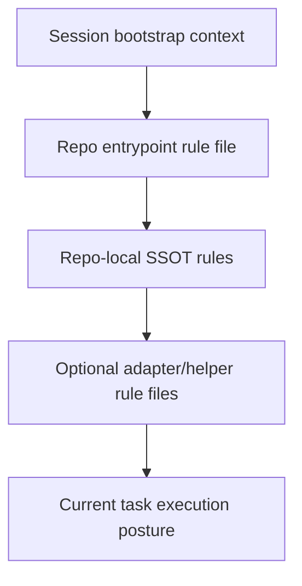
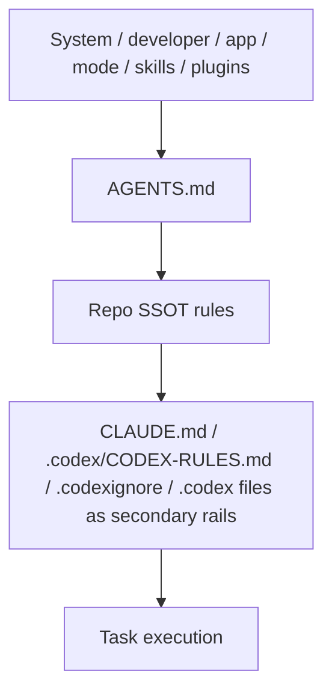
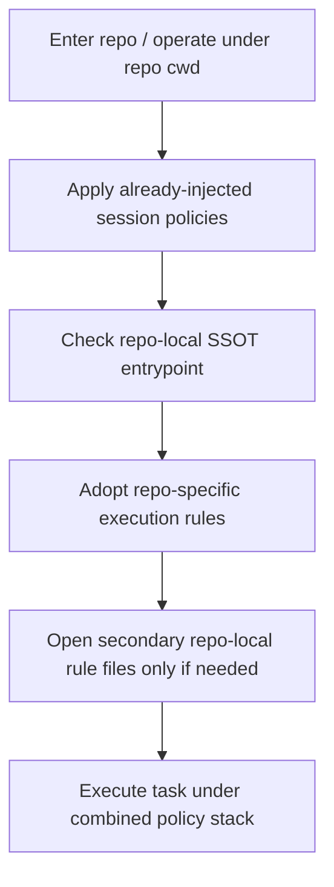
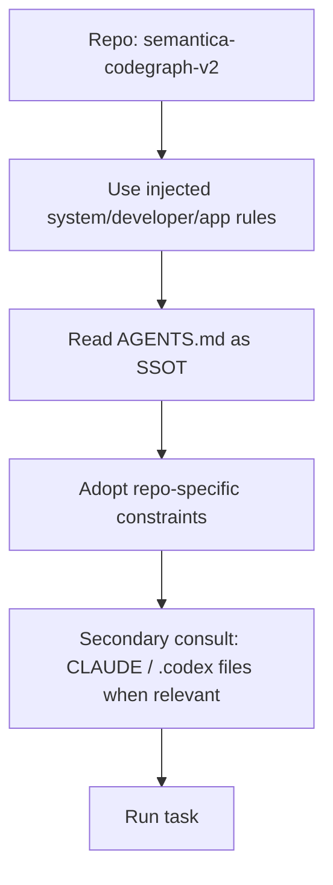

# Repo-local Rule Ingestion Audit

Overview router: [may-20-codex-agent-loop.md](/Users/songmin/Documents/code-new/semantica-codegraph-v2/docs/analysis/codex-agent/may-20-codex-agent-loop.md)

이 문서는 Codex 계열 에이전트가 repo 안의 rule 파일들, 예를 들어 `AGENTS.md`, `CLAUDE.md`, `.codex/CODEX-RULES.md`, `.codexignore` 같은 것들을 **어떻게 읽고 쓰는지**를 감사 관점으로 정리한다.

핵심 질문:
- 어떤 규칙은 세션 시작부터 고정 주입되는가
- 어떤 파일은 repo에 들어오면 확인 대상이 되는가
- 어떤 파일은 항상 읽는 게 아니라 필요할 때만 여는가
- 현재 repo의 `AGENTS.md` / `.codex/*` 구조는 어떻게 해석하는 것이 맞는가

표기:
- `[FACT]`: 현재 세션 지침, 현재 repo 파일, 현재 대화에서 직접 관측 가능한 사실
- `[STRONG-INFERENCE]`: 관측 사실을 가장 잘 설명하는 고신뢰 구조 추론
- `[WEAK-INFERENCE]`: plausible 하지만 직접 근거가 부족한 해석

주의:
- 이 문서는 hidden bootstrap loader 전체를 본 것이 아니다.
- 현재 세션에 들어와 있는 상위 지침과, repo 안에 실제로 있는 파일, 그리고 관측 가능한 실행 습관을 합쳐서 재구성한다.

---

## 1. Executive summary

### 1.1 Final verdict

- `Alignment`: High `[STRONG-INFERENCE]`
- `Robustness`: Strong on visible priority model, Medium on hidden discovery/loader internals `[STRONG-INFERENCE]`
- `Confidence`: High on `AGENTS.md` primacy in this repo, Medium on exact automatic file-open lifecycle `[STRONG-INFERENCE]`
- `Ship readiness`: Ship as analysis doc `[STRONG-INFERENCE]`

### 1.2 Top conclusions

1. 세션 시작부터 고정적으로 들어오는 것은 `system / developer / app / mode / skill/plugin registry` 같은 상위 컨텍스트다. `[FACT]`
2. repo-local 파일은 별도 층이며, 이 repo에서는 [AGENTS.md](/Users/songmin/Documents/code-new/semantica-codegraph-v2/AGENTS.md)가 SSOT라고 직접 명시돼 있다. `[FACT]`
3. 따라서 이 repo 기준으로는 `AGENTS.md`가 repo-local rule ingestion의 primary rail이다. `[STRONG-INFERENCE]`
4. `.codex/CODEX-RULES.md`, `.codex/CODEX-START-PROMPT.md`, `.codexignore`, `CLAUDE.md`는 존재하지만, `AGENTS.md`가 “포인팅만 한다”고 직접 말하므로 보조/adapter rail로 보는 것이 맞다. `[FACT]` + `[STRONG-INFERENCE]`
5. 즉 “항상 모든 repo rule 파일을 매 턴 자동으로 다시 읽는다”보다는, **상위 세션 규칙 + repo SSOT entrypoint + 필요시 보조 파일 확인** 구조가 가장 설명력이 높다. `[STRONG-INFERENCE]`

---

## 2. Direct evidence inventory

## 2.1 What is already injected into the session

현재 세션에서 파일을 열지 않아도 이미 들어와 있는 것:

1. system instructions `[FACT]`
2. developer instructions `[FACT]`
3. app context `[FACT]`
4. collaboration mode block `[FACT]`
5. personality spec `[FACT]`
6. skills instructions `[FACT]`
7. plugins instructions `[FACT]`

이건 repo file read와는 별개다. `[FACT]`

## 2.2 Repo-local files confirmed in this repo

현재 repo에서 직접 확인한 파일:

1. [AGENTS.md](/Users/songmin/Documents/code-new/semantica-codegraph-v2/AGENTS.md) `[FACT]`
2. [CLAUDE.md](/Users/songmin/Documents/code-new/semantica-codegraph-v2/CLAUDE.md) `[FACT]`
3. [CODEX-RULES.md](/Users/songmin/Documents/code-new/semantica-codegraph-v2/.codex/CODEX-RULES.md) `[FACT]`
4. [CODEX-START-PROMPT.md](/Users/songmin/Documents/code-new/semantica-codegraph-v2/.codex/CODEX-START-PROMPT.md) `[FACT]`
5. [.codexignore](/Users/songmin/Documents/code-new/semantica-codegraph-v2/.codexignore) `[FACT]`
6. [config.toml](/Users/songmin/Documents/code-new/semantica-codegraph-v2/.codex/config.toml) `[FACT]`

## 2.3 AGENTS.md facts that matter

현재 repo의 [AGENTS.md](/Users/songmin/Documents/code-new/semantica-codegraph-v2/AGENTS.md)에서 직접 확인한 사실:

1. `AGENTS.md`가 모든 규칙의 단일 진실 소스(SSOT)라고 적혀 있다 `[FACT]`
2. `CLAUDE.md`, `.codex/CODEX-RULES.md`, `.cursorrules`는 `포인팅만 한다`고 적혀 있다 `[FACT]`
3. 규칙 추가/수정/삭제는 반드시 `AGENTS.md`에서만 하라고 적혀 있다 `[FACT]`

이 세 가지가 이 repo의 rule hierarchy를 거의 결정한다.

---

## 3. Best-fit ingestion model

가장 설명력이 높은 모델은 아래다. `[STRONG-INFERENCE]`

이 repo에 대입하면:

해석:
- 상위 컨텍스트는 세션 시작부터 붙어 있음
- repo 들어오면 `AGENTS.md`가 primary ingestion point
- 나머지 repo-local agent files은 보조 레일

---

## 4. What appears fixed vs what appears on-demand

## 4.1 Fixed at session bootstrap

다음은 현재 세션에 이미 주입돼 있다:

- system/developer/app/mode/personality/skills/plugins instructions `[FACT]`

즉 이건 “매번 파일 열어서 확인”하는 것이 아니라,
세션 contract 자체로 이미 들어와 있는 층이다 `[STRONG-INFERENCE]`.

## 4.2 Repo-local primary read target

이 repo에서는:
- `AGENTS.md`가 primary read target이라고 보는 게 맞다 `[STRONG-INFERENCE]`

이유:
- SSOT라고 직접 명시돼 있음 `[FACT]`
- 다른 agent-rule 파일들은 포인터라고 직접 명시돼 있음 `[FACT]`

## 4.3 On-demand secondary files

현재 evidence 기준으로 보조적으로 읽을 수 있는 것:

- `CLAUDE.md`
- `.codex/CODEX-RULES.md`
- `.codex/CODEX-START-PROMPT.md`
- `.codexignore`
- `.codex/config.toml`

이들은:
- 존재는 확인됨 `[FACT]`
- 하지만 이 repo에서는 `AGENTS.md`가 SSOT라고 직접 명시하므로
- 항상 매턴 primary source로 읽는다고 보기는 어렵다 `[STRONG-INFERENCE]`

---

## 5. Why this is not “read everything every turn”

현재 session contract와 developer rule은:
- broad read 억제
- 필요한 것만 읽기
- 이미 읽은 파일 재읽기 금지

를 강하게 요구한다 `[FACT]`.

따라서 repo-local rule ingestion도:
- 모든 파일을 매번 다 읽는 방식보다
- entrypoint SSOT를 먼저 보고
- 필요할 때 secondary file을 여는 방식

이 더 잘 맞는다 `[STRONG-INFERENCE]`.

---

## 6. Role of `.codexignore`

현재 직접 확인한 것은 `.codexignore` 파일이 존재한다는 사실뿐이다 `[FACT]`.

안전하게 말할 수 있는 것:
- Codex-specific ignore/exclusion rail일 가능성이 높다 `[WEAK-INFERENCE]`

하지만 아직 이 파일 내용을 읽지 않았으므로:
- exact semantics
- whether it affects file discovery, context ingestion, or tool visibility

는 주장하면 안 된다 `[FACT]`.

---

## 7. Role of `CODEX-RULES.md` and `CODEX-START-PROMPT.md`

현재 직접 확인한 것은:
- 파일 존재 `[FACT]`
- `AGENTS.md`가 `.codex/CODEX-RULES.md`는 포인팅만 한다고 말함 `[FACT]`

가장 안전한 해석:

1. `AGENTS.md` = repo-local SSOT
2. `.codex/CODEX-RULES.md` = Codex-facing adapter/entry mirror rail
3. `.codex/CODEX-START-PROMPT.md` = Codex startup helper rail일 가능성

이 중 2, 3은 `[STRONG-INFERENCE]` 또는 `[WEAK-INFERENCE]`다.

정확히는:
- `CODEX-RULES.md`가 SSOT가 아니라는 점은 확실 `[FACT]`
- `CODEX-START-PROMPT.md` exact role은 아직 미확인 `[FACT: not enough evidence]`

---

## 8. Repo-local rule ingestion process

가장 설명력이 높은 process:

### For this repo

이 프로세스가:
- current file structure
- `AGENTS.md` wording
- developer anti-overread discipline

를 가장 잘 종합한다 `[STRONG-INFERENCE]`.

---

## 9. Effect on actual task execution

repo-local ingestion이 실제로 바꾸는 것:

1. 언어/응답 posture `[FACT]`
2. no heuristics / fail-closed posture `[FACT]`
3. Rust verification path (`cg-dispatch`) `[FACT]`
4. root-cause/owner-first patch discipline `[FACT]`
5. broad re-exploration 억제 `[FACT]`

즉 repo-local rule ingestion은 단순 문서 참조가 아니라
**실행 규율 채택**이다 `[STRONG-INFERENCE]`.

---

## 10. Attack surface analysis

## 10.1 False assumption: repo-local rules are only style notes

- contradicted by direct operational rules in `AGENTS.md`
- severity: P1

Classification:
- `[FACT]`

## 10.2 False assumption: Codex-specific rule file is always the SSOT

- contradicted in this repo by explicit `AGENTS.md` SSOT claim
- severity: P1

Classification:
- `[FACT]`

## 10.3 False assumption: all repo-local rule files are auto-read equally

- weak model
- broad-read minimization + SSOT wording suggest priority entrypoint model
- severity: P2

Classification:
- `[STRONG-INFERENCE]`

## 10.4 False assumption: `.codexignore` semantics are known because file exists

- wrong
- existence alone does not give semantics
- severity: P2

Classification:
- `[FACT]`

---

## 11. Concrete failure scenarios if ingestion model is misunderstood

### Scenario 1: ignore `AGENTS.md`, rely on generic coding posture only

- setup: repo-local coding task
- trigger: assistant never adopts repo-local SSOT
- expected: `AGENTS.md`-driven execution rules
- likely failure: wrong verification path, weaker fix posture
- severity: P1

Classification:
- rule basis `[FACT]`

### Scenario 2: treat `.codex/CODEX-RULES.md` as canonical over `AGENTS.md`

- setup: rule conflict or uncertainty
- trigger: assistant chooses Codex-specific file first
- expected: `AGENTS.md` SSOT
- likely failure: wrong rule source
- severity: P1

Classification:
- SSOT wording `[FACT]`

### Scenario 3: reopen all rule files every turn

- setup: long multi-turn session
- trigger: assistant rereads all repo-local files repeatedly
- expected: minimal reads, primary SSOT first
- likely failure: budget waste / overread
- severity: P2

Classification:
- anti-overread rules `[FACT]` + `[STRONG-INFERENCE]`

---

## 12. False confidence traps

1. “AGENTS.md가 있으니 나머지는 무시해도 무조건 된다”
- 과하게 단순화하면 secondary files의 contextual value를 놓칠 수 있다

2. “.codex 파일이 있으니 Codex는 그걸 자동으로 다 읽는다”
- current evidence로는 그 automaticity를 증명하지 못한다

3. “repo-local file ingestion은 매 턴 fresh parse다”
- broad-read and reread rules와 충돌한다

---

## 13. Unknowns

직접 알 수 없는 것:

1. hidden repo file discovery algorithm `[WEAK-INFERENCE]`
2. `.codexignore` exact semantics in this environment `[WEAK-INFERENCE]`
3. `CODEX-START-PROMPT.md` exact runtime role `[WEAK-INFERENCE]`
4. whether secondary rule files are eagerly preloaded or lazily read `[WEAK-INFERENCE]`

---

## 14. Most precise safe summary

- 현재 세션에 이미 주입된 상위 컨텍스트(system/developer/app/mode/skills/plugins)가 있고, repo-local rule ingestion은 그 아래 별도 층으로 작동한다고 보는 것이 가장 정확하다. `[STRONG-INFERENCE]`
- 이 repo에서는 [AGENTS.md](/Users/songmin/Documents/code-new/semantica-codegraph-v2/AGENTS.md)가 SSOT라고 직접 명시돼 있으므로 primary repo-local rule entrypoint다. `[FACT]`
- `CLAUDE.md`, `.codex/CODEX-RULES.md`, `.codexignore`, `.codex/CODEX-START-PROMPT.md`는 존재하지만, `AGENTS.md`가 포인터/보조 rail 성격을 직접 시사하므로 secondary/on-demand 경로로 보는 것이 가장 타당하다. `[FACT]` + `[STRONG-INFERENCE]`
