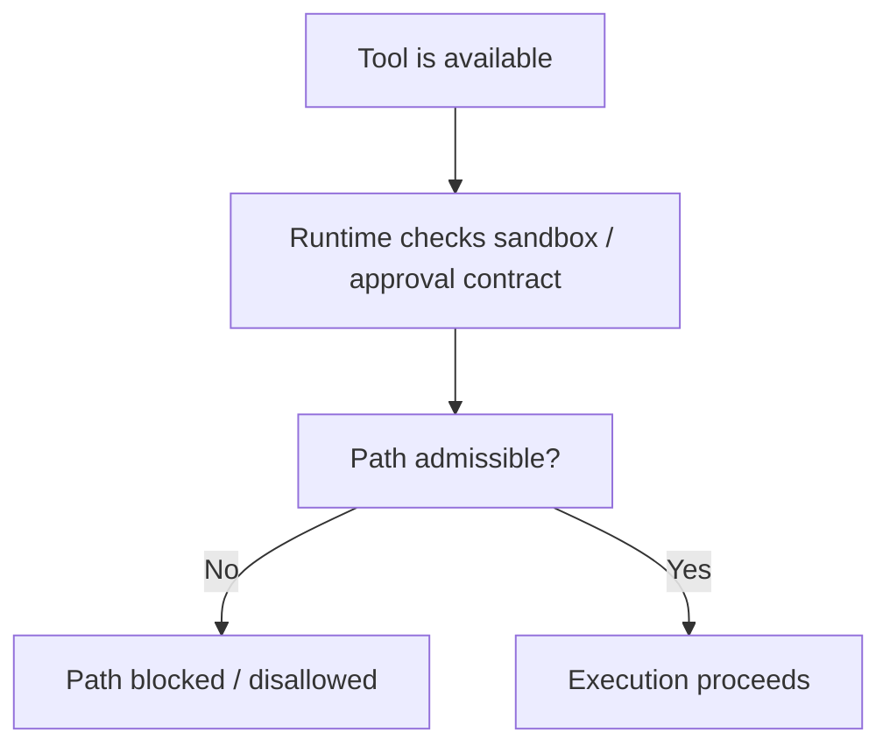
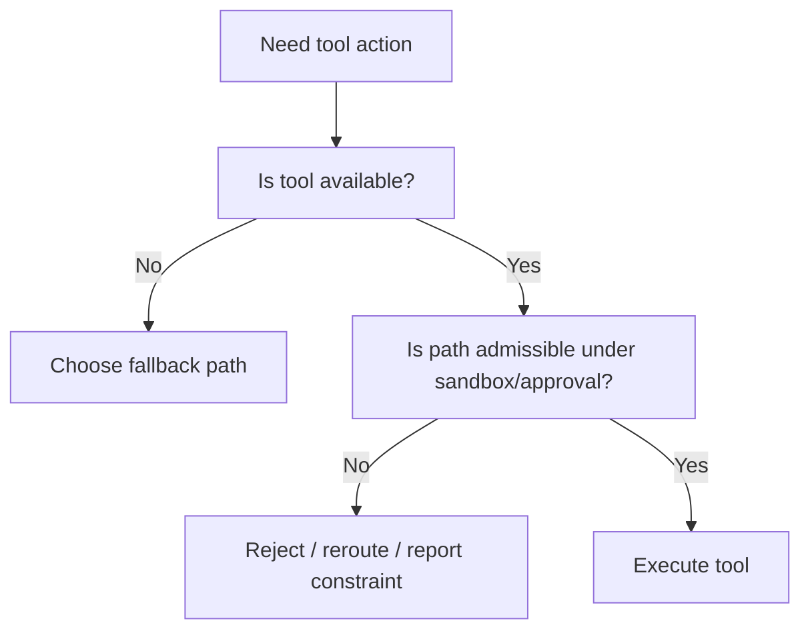
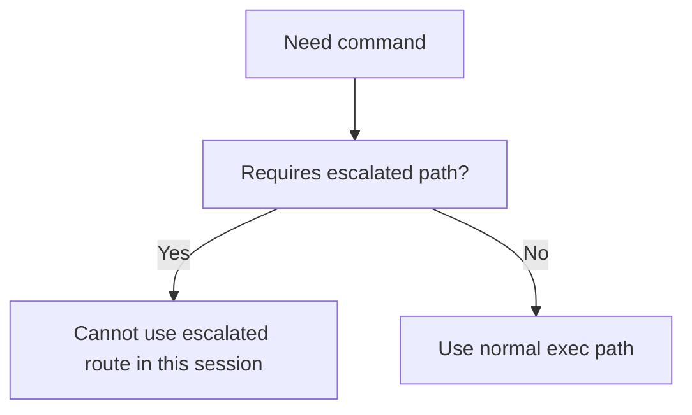

# Codex Agent Sandbox and Approval Audit

Overview router: [may-20-codex-agent-loop.md](/Users/songmin/Documents/code-new/semantica-codegraph-v2/docs/analysis/codex-agent/may-20-codex-agent-loop.md)

이 문서는 Codex 계열 에이전트에서 `sandbox mode`와 `approval policy`가 존재하는지, 존재한다면 어떻게 execution을 제한하는지를 감사 관점으로 정리한다.

범위:
- 현재 세션에서 직접 관측 가능한 sandbox / approval 사실
- sandbox와 approval이 tool execution에 어떤 경계로 작동하는지
- sandbox가 있을 때/없을 때 agent loop가 어떻게 달라지는지
- 무엇이 직접 관측 가능한 사실이고, 무엇이 강한/약한 추론인지

표기:
- `[FACT]`: 현재 세션 지침, app context, tool schema에서 직접 관측 가능한 사실
- `[STRONG-INFERENCE]`: 관측 사실을 가장 잘 설명하는 고신뢰 구조 추론
- `[WEAK-INFERENCE]`: plausible 하지만 직접 근거가 부족한 해석

주의:
- 이 문서는 `현재 세션에서 보이는 runtime contract`를 분석한다.
- Codex 제품군 전체의 모든 배포 환경을 내부 구현 수준으로 단정하지는 않는다.

---

## 1. Executive summary

### 1.1 Final verdict

- `Alignment`: High `[STRONG-INFERENCE]`
- `Robustness`: Strong for visible session contract, Medium for unseen alternate deployments `[STRONG-INFERENCE]`
- `Confidence`: High on current session facts, Medium on generalized hidden implementation `[STRONG-INFERENCE]`
- `Ship readiness`: Ship as analysis doc `[STRONG-INFERENCE]`

### 1.2 Top conclusions

1. sandbox mode와 approval policy는 **현재 세션에서 직접 관측 가능한 runtime concept**다. `[FACT]`
2. 현재 세션은 `danger-full-access` sandbox이며, filesystem sandboxing이 없다고 직접 명시돼 있다. `[FACT]`
3. 현재 세션의 approval policy는 `never`이며, 승인을 요청하는 경로는 사실상 닫혀 있다. `[FACT]`
4. sandbox/approval은 tool availability와 별도로, **execution admissibility boundary**로 작동한다. `[STRONG-INFERENCE]`
5. 즉 “도구가 있다”와 “그 도구 경로가 현재 실행 가능한가”는 다르다. `[STRONG-INFERENCE]`

---

## 2. Direct evidence inventory

## 2.1 Current session sandbox facts

현재 세션에서 직접 관측 가능한 사실:

| Fact | Evidence | Classification |
| --- | --- | --- |
| filesystem sandboxing 관련 개념이 존재한다 | permissions instructions에 직접 명시 | `[FACT]` |
| 현재 `sandbox_mode`는 `danger-full-access`다 | permissions instructions에 직접 명시 | `[FACT]` |
| `danger-full-access`는 “No filesystem sandboxing - all commands are permitted”로 설명된다 | permissions instructions에 직접 명시 | `[FACT]` |
| 네트워크 접근은 `enabled`다 | permissions/app context에 직접 명시 | `[FACT]` |
| approval policy는 `never`다 | permissions instructions에 직접 명시 | `[FACT]` |
| `sandbox_permissions`를 지정하지 말라는 제약이 있다 | permissions instructions에 직접 명시 | `[FACT]` |

## 2.2 Tool-schema evidence

tool schemas에서 직접 보이는 sandbox/approval 관련 신호:

| Evidence | Meaning | Classification |
| --- | --- | --- |
| `exec_command`에 `sandbox_permissions` 필드가 있다 | sandbox/approval-aware execution path가 tool schema에 존재 | `[FACT]` |
| `exec_command` 설명에 `require_escalated`와 `justification`이 있다 | 어떤 환경에서는 escalation/approval flow가 존재함을 시사 | `[FACT]` |
| 현재 세션 지침은 “Do not provide sandbox_permissions for any reason, commands will be rejected”라고 말한다 | 현재 세션에서는 escalation 경로 사용이 금지됨 | `[FACT]` |

## 2.3 App/runtime evidence

| Evidence | Meaning | Classification |
| --- | --- | --- |
| collaboration mode, tool availability, app context가 별도 계층으로 제공된다 | runtime이 execution contract를 제공한다 | `[FACT]` |
| request_user_input는 mode에 따라 unavailable일 수 있다 | runtime이 interaction affordance도 제어한다 | `[FACT]` |

---

## 3. Does sandbox mode exist?

### 3.1 Minimal safe statement

네. 존재한다. `[FACT]`

직접 근거:
- `sandbox_mode`라는 명시적 필드가 현재 세션 metadata에 있다
- 그 값이 현재는 `danger-full-access`다
- 설명 문구까지 붙어 있다

즉, sandbox는 추론이 아니라 **세션 contract의 일부**다. `[FACT]`

### 3.2 Does approval policy exist?

네. 이것도 직접 존재한다. `[FACT]`

직접 근거:
- `approval policy is currently never`
- escalation 관련 `sandbox_permissions` / `require_escalated` schema 존재

---

## 4. Best-fit conceptual model

현재 보이는 실행 모델을 가장 잘 설명하는 구조는 아래다. `[STRONG-INFERENCE]`

의미:
- tool availability는 1차 조건
- sandbox/approval admissibility는 2차 조건
- 즉 선택 가능성과 실행 가능성은 분리돼 있다

---

## 5. What does sandbox appear to control?

직접 관측 가능한 사실과 강한 추론을 합치면, sandbox/approval은 최소한 아래 축을 제어하는 것으로 보인다.

### 5.1 Filesystem boundary

- 현재 세션은 `danger-full-access`라 filesystem sandboxing이 없다 `[FACT]`
- 따라서 현재는 file read/write에 sandbox 제약이 사실상 없다 `[FACT]`

### 5.2 Command admissibility

- `exec_command`에는 escalation-aware fields가 있다 `[FACT]`
- 현재 세션은 그 경로를 쓰지 말라고 명시한다 `[FACT]`
- 따라서 어떤 deployment에서는 command admissibility가 sandbox/approval에 의해 바뀔 수 있다 `[STRONG-INFERENCE]`

### 5.3 Approval gating

- tool schema와 current permissions는 “일부 환경에서 승인 요청 경로가 존재한다”는 걸 보여준다 `[FACT]`
- 현재 세션은 그 경로를 닫아 놓은 상태다 `[FACT]`

### 5.4 Network / environment affordance

- current session에서 network는 enabled다 `[FACT]`
- 따라서 sandbox/approval contract는 filesystem만이 아니라 broader execution environment metadata의 일부로 보인다 `[STRONG-INFERENCE]`

---

## 6. Current-session execution consequences

현재 세션이 `danger-full-access + approval never`라는 조합이므로, 실제 execution behavior는 아래처럼 해석하는 것이 맞다. `[STRONG-INFERENCE]`

### 6.1 What is effectively allowed

- local file read/write
- shell command execution
- network-enabled browsing / web use

이건 현재 runtime contract상 허용된 범위다. `[FACT]`

### 6.2 What is effectively disallowed

- approval/escalation path 사용
- `sandbox_permissions`를 넣어 escalation 시도

이건 현재 runtime contract상 금지다. `[FACT]`

### 6.3 Practical implication

현재 세션에서 `exec_command`는 강력하지만,
- approval fallback은 없다
- 즉 command는 “승인 없이 가능한가”를 전제로만 써야 한다

이건 현재 세션에서 중요한 execution assumption이다. `[STRONG-INFERENCE]`

---

## 7. Sandbox-aware agent loop

가장 설명력 높은 loop는 아래다. `[STRONG-INFERENCE]`

핵심:
- availability
- admissibility
- execution

이 세 단계가 분리돼 있다.

---

## 8. How this changes decision-making

## 8.1 Tool selection is not enough

단순히 “이 task에는 exec_command가 맞다”로 끝나지 않는다. `[STRONG-INFERENCE]`

실제론:
1. 이 tool이 보이는가?
2. 이 경로가 sandbox/approval상 admissible 한가?
3. 현재 mode/policy에서도 허용되는가?
4. 그 다음에야 실행

## 8.2 Approval-aware branching

현재 세션은 `approval never`이므로 아래 branch는 닫혀 있다. `[FACT]`

이 branch 존재 자체는 tool schema가 시사하고, 현재 세션은 그 중 한 configuration이다. `[FACT]` + `[STRONG-INFERENCE]`

---

## 9. Alternate-mode reasoning

직접 보이는 것은 current session뿐이지만, tool schema는 alternate deployment possibility를 시사한다. `[FACT]`

### 9.1 Supported strong inference

가장 보수적인 일반화:
- 어떤 세션은 filesystem sandboxing이 있을 수 있다
- 어떤 세션은 escalated/approval flow를 허용할 수 있다

이건 `sandbox_mode`와 `require_escalated` schema가 있기 때문에 가능한 추론이다. `[STRONG-INFERENCE]`

### 9.2 Unsupported overclaim

아래는 직접 단정하면 안 된다:
- sandbox mode의 모든 가능한 enum 값
- 각 enum 값이 정확히 무엇을 허용/차단하는지
- hidden implementation details

이건 current session에서 직접 보이지 않는다. `[FACT]`

---

## 10. Attack surface analysis

## 10.1 False assumption: “no sandbox exists”

- contradicted by direct session metadata
- severity of misunderstanding: P1

Classification:
- existence itself `[FACT]`

## 10.2 False assumption: “danger-full-access means no constraints at all”

- wrong
- approval policy, mode restrictions, tool-specific constraints still 존재

Classification:
- danger-full-access semantics for filesystem `[FACT]`
- “other constraints still exist” `[FACT]` + `[STRONG-INFERENCE]`

## 10.3 False assumption: “tool visible == executable in all ways”

- wrong
- `exec_command` schema has escalation knobs, but current session forbids using them

Classification:
- schema + current ban `[FACT]`

---

## 11. Concrete failure scenarios if sandbox/approval handling were wrong

### Scenario 1: assistant assumes escalation is allowed

- setup: current session
- trigger: assistant sends `sandbox_permissions=require_escalated`
- expected under current contract: do not send it
- likely actual result: command rejected
- severity: P2

Classification:
- current ban `[FACT]`

### Scenario 2: assistant assumes filesystem is sandboxed when it is not

- setup: current session
- trigger: assistant over-optimizes around nonexistent FS restriction
- expected under current contract: normal local read/write okay
- likely failure: unnecessary fallback or refusal
- severity: P3

Classification:
- current sandbox mode `[FACT]`

### Scenario 3: assistant ignores approval boundary in a different deployment model

- setup: hypothetical session with nontrivial approval flow
- trigger: assistant assumes direct execution always fine
- expected under generalized model: approval-aware branching
- likely failure: disallowed action or wrong user experience
- severity: P1

Classification:
- alternate deployment possibility `[STRONG-INFERENCE]`

---

## 12. False confidence traps

1. “sandbox는 파일시스템만 뜻한다”
- current text는 filesystem을 직접 언급하지만, tool schema와 approval path는 broader execution contract를 시사한다

2. “danger-full-access면 아무 제약도 없다”
- approval policy, mode restrictions, tool constraints는 여전히 존재한다

3. “approval never면 sandbox와 무관하다”
- 아니다
- sandbox와 approval은 별도 축으로 보인다

4. “tool schema에 field가 있으니 지금도 그 경로를 쓸 수 있다”
- current session policy가 그걸 닫을 수 있다

---

## 13. Unknowns

직접 알 수 없는 것:

1. sandbox mode의 전체 값 집합 `[FACT]`
2. 각 모드의 정확한 hidden enforcement implementation `[FACT]`
3. approval-enabled deployment에서 실제 UX flow의 세부 구현 `[WEAK-INFERENCE]`
4. runtime이 sandbox/approval을 어떤 내부 계층에서 집행하는지의 구체 구조 `[WEAK-INFERENCE]`

---

## 14. Most precise safe summary

- sandbox mode는 현재 세션에서 **직접 존재가 관측되는 runtime concept**다. `[FACT]`
- 현재 세션은 `danger-full-access`이며, filesystem sandboxing이 없다고 직접 명시돼 있다. `[FACT]`
- approval policy 역시 직접 존재가 관측되며, 현재는 `never`다. `[FACT]`
- 따라서 현재 세션은 “파일시스템 제약은 거의 없지만, approval/escalation path는 닫힌” configuration으로 보는 것이 맞다. `[STRONG-INFERENCE]`
- 일반화하면, tool execution은 `availability -> admissibility under sandbox/approval -> actual execution`의 단계로 이해하는 것이 가장 정확하다. `[STRONG-INFERENCE]`

---

## Round 2 update (2026-05-21 deep dive)

이 섹션은 Codex Desktop build 2867 (codex-rs 0.130.0)의 sandbox/approval enforcement layer를 직접 inspect한 round-2 결과를 정리한다.

### R2.1 Approval rules engine (FACT)

- `~/.codex/rules/default.rules` (~353KB) — bash command **allowlist** via `prefix_rule(pattern=[…], decision="allow"|"deny")`. `[FACT]`
- Covers git, build, test, python `uv`, `pyright`, `pytest` commands. `[FACT]`
- This file is the **base of approval gating** — the rule-engine input that decides whether a command can run without per-action approval. `[FACT]`
- Default `approvals_reviewer = "user"` in `config.toml`. `[FACT]`
- Observed in archived sessions: `turn_context.approval_policy = "on-request"`. `[FACT]`

`[MODEL]` round-1 §2.1의 `approval policy = never`는 the *runtime session-level* state. round-2 evidence shows the *default config-file value* is `"on-request"`, with `"never"` being a per-session override (such as the current dangerous-bypass session). The two are not contradictory but live at different config layers.

### R2.2 Bypass flag (FACT)

- Codex Rust subcommand exposes a `--dangerously-bypass-approvals-and-sandbox` flag. `[FACT]`
- The flag is **disabled by default**. `[FACT]`
- `[MODEL]` Round-1 §2.1의 `approval=never + danger-full-access` 조합 세션은 사실상 이 bypass flag 또는 동등 config가 활성화된 deployment configuration에 해당한다.

### R2.3 OS-level sandbox primitives (FACT)

- **macOS Seatbelt** profile fragments visible in Rust binary strings: `(version 1)`, `(allow file-read*)`, `(subpath (param "…"))`, `(allow network-outbound (remote ip "localhost:..."))`. `[FACT]`
- **Linux**: Landlock-based sandbox via `codex-linux-sandbox` crate. `[FACT]`

`[MODEL]` Round-1 §9.1의 "filesystem sandboxing이 있을 수 있다"는 strong inference는 round-2에서 directly confirmed: Codex는 macOS에서는 Seatbelt(`sandbox-exec`), Linux에서는 Landlock을 사용하여 OS-level enforcement를 한다. `danger-full-access`는 이 layer를 disable한 mode.

### R2.4 Codex.app entitlements (FACT)

Codex.app 자체의 entitlements (Team ID 2DC432GLL2, OpenAI):

| Entitlement | Value | Classification |
| --- | --- | --- |
| `com.apple.security.app-sandbox` | **false** (Codex.app 자체는 unsandboxed) | `[FACT]` |
| `com.apple.security.automation.apple-events` | true | `[FACT]` |
| `com.apple.security.cs.allow-jit` | true | `[FACT]` |
| `com.apple.security.cs.allow-unsigned-executable-memory` | true | `[FACT]` |
| `com.apple.security.device.audio-input` | true | `[FACT]` |
| `com.apple.security.files.user-selected.read-write` | true | `[FACT]` |
| `com.apple.security.network.client` | true | `[FACT]` |
| `keychain-access-groups` | `2DC432GLL2.*` | `[FACT]` |
| `NSAllowsArbitraryLoads` (Info.plist) | true (cleartext HTTP allowed) | `[FACT]` |

- asar integrity SHA256: `8242a5ba1fb767ed47284033b053c30f3be701be046f2d9b1525986f8b03b509`. `[FACT]`

### R2.5 Implications for the sandbox/approval model

- §3.1 "sandbox mode exists"는 round-2에서 **mechanism-level**로 확정된다: macOS Seatbelt + Linux Landlock이 enforcement primitive. `[FACT]`
- §3.2 "approval policy exists"도 mechanism-level로 확정: `~/.codex/rules/default.rules`가 allow/deny prefix rule engine이다. round-1에서 "literal policy engine 존재를 단정하지 말라"고 한 보수성은 round-2 evidence로 완화 가능 — **the rule engine literally exists as a 353KB rules file consumed by the Rust core**. `[FACT]`
- §10.2 "danger-full-access means no constraints at all" false-assumption은 더욱 강해진다: Codex.app 자체는 unsandboxed지만 spawned subprocess는 여전히 Seatbelt/Landlock으로 wrap될 수 있다. host app sandboxing과 child execution sandboxing은 **별도 축**이다. `[FACT]`
- `NSAllowsArbitraryLoads=true` + `allow-unsigned-executable-memory=true` 조합은 Codex.app이 **electron + JIT-heavy runtime + cleartext HTTP**를 모두 허용한 매우 넓은 host trust boundary 위에서 동작함을 보여준다. v3가 흡수할 sandbox model을 design할 때는 이 두 entitlement를 ROI-positive로 가져오지 말 것. `[FACT]` + `[MODEL]`
