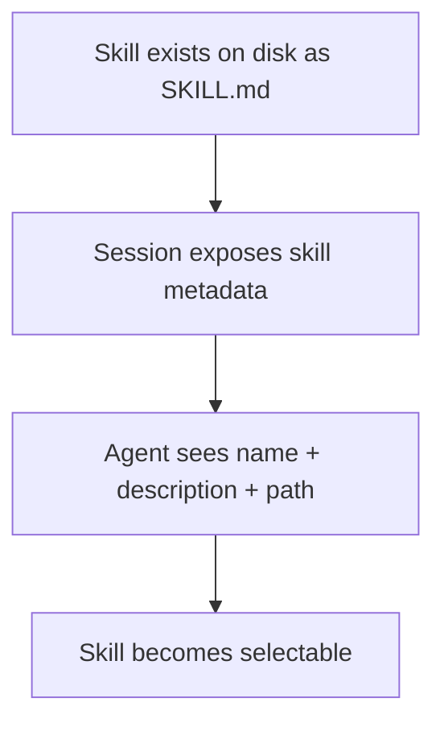
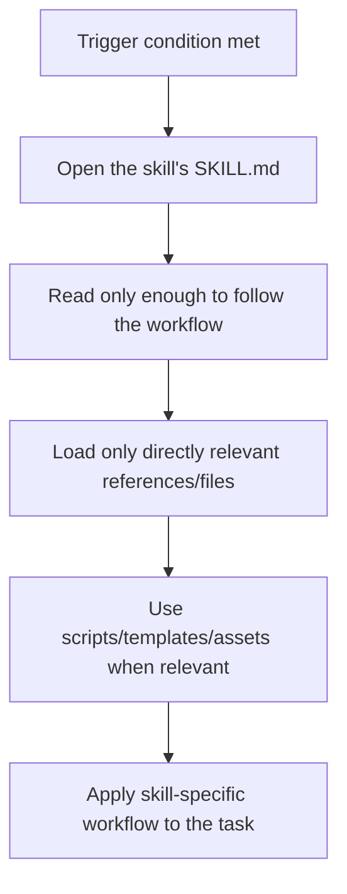
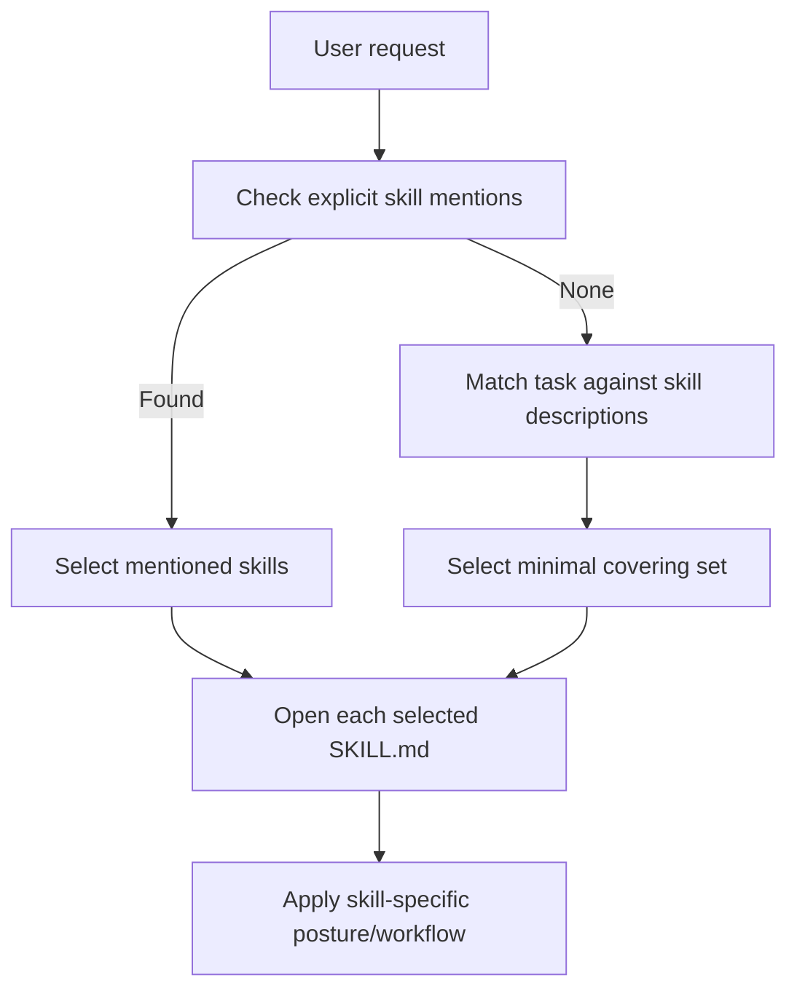
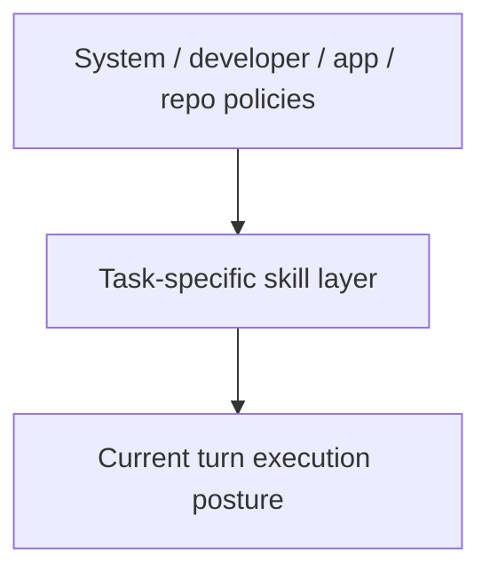

# Skills Audit

Overview router: [may-20-codex-agent-loop.md](/Users/songmin/Documents/code-new/semantica-codegraph-v2/docs/analysis/codex-agent/may-20-codex-agent-loop.md)

이 문서는 Codex 계열 에이전트의 `skills`가 어떻게 동작하는지 감사 관점으로 정리한다.

범위:
- skill이 무엇으로 보이는가
- 현재 세션에서 skill이 어떻게 등록/노출되는가
- skill 선택이 어떻게 트리거되는가
- skill 사용 시 어떤 실행 흐름을 따르는가
- plugin-contributed skill과 일반 skill의 차이
- 이 대화에서 skill 선택이 실제로 어떻게 일어났는가

표기:
- `[FACT]`: 현재 세션의 skills instructions, skills list, plugin instructions, 대화 이력에서 직접 관측 가능한 사실
- `[STRONG-INFERENCE]`: 관측 사실을 가장 잘 설명하는 고신뢰 구조 추론
- `[WEAK-INFERENCE]`: plausible 하지만 직접 근거가 부족한 해석

주의:
- hidden skill registry backend나 installer 내부 구현 전체를 본 것은 아니다.
- 따라서 “등록과정”은 **현재 세션에 skill이 노출되는 observable contract**를 중심으로 설명한다.

---

## 1. Executive summary

### 1.1 Final verdict

- `Alignment`: High `[STRONG-INFERENCE]`
- `Robustness`: Strong on visible trigger/usage contract, Medium on hidden registration backend details `[STRONG-INFERENCE]`
- `Confidence`: High on current-session skill behavior, Medium on platform-wide hidden internals `[STRONG-INFERENCE]`
- `Ship readiness`: Ship as analysis doc `[STRONG-INFERENCE]`

### 1.2 Top conclusions

1. skill은 `도구`가 아니라 **task-specific instruction package**다. `[FACT]` + `[STRONG-INFERENCE]`
2. 현재 세션에서 skill은 `name + description + file path` 형태로 직접 노출된다. `[FACT]`
3. skill 선택은 두 경로가 있다:
   - user가 명시적으로 skill을 부름
   - task가 skill description과 명확히 맞음
   둘 다 직접 규칙으로 명시돼 있다. `[FACT]`
4. skill 사용 흐름은 `skill 결정 -> SKILL.md 열기 -> 필요한 만큼만 읽기 -> workflow 적용`이다. `[FACT]`
5. plugin-contributed skill은 일반 skill과 동일한 usage model을 가지되, 이름이 `plugin_name:skill_name` 형태로 노출된다. `[FACT]`
6. 이 대화에서는 `$ss`, `$rr`, `$aa` 같은 명시 호출이 실제로 반복 사용되었고, 그때마다 task posture가 바뀌었다. `[FACT]`

---

## 2. Direct evidence inventory

## 2.1 What a skill is

skills instructions에서 직접 보이는 정의:

- “A skill is a set of local instructions to follow that is stored in a `SKILL.md` file.” `[FACT]`

즉 skill은:
- tool이 아니고
- local instruction bundle이며
- `SKILL.md`를 통해 제공된다

이 세 가지는 직접 사실이다. `[FACT]`

## 2.2 How skills are exposed in the session

현재 세션에서 각 skill entry는 다음 필드를 가진다. `[FACT]`

1. `name`
2. `description`
3. `file path`

skills list는 실제로 이 세 가지를 포함해 제공된다. `[FACT]`

## 2.3 Visible current-session skills

현재 세션에 직접 보이는 skill 예시:

- `aa`
- `audit`
- `rr`
- `ss`
- `tt`
- `imagegen`
- `openai-docs`
- `skill-installer`
- `skill-creator`
- plugin-prefixed skills:
  - `browser-use:browser`
  - `documents:documents`
  - `github:*`
  - `presentations:Presentations`
  - `spreadsheets:Spreadsheets`

모두 `[FACT]`.

---

## 3. Registration / exposure model

“등록과정”은 내부 backend 구현까지는 안 보인다. 대신 현재 세션에서 **등록된 것으로 간주되는 조건**은 직접 보인다.

## 3.1 Directly visible registration/exposure facts

1. 세션은 사용 가능한 skill 목록을 미리 제공한다 `[FACT]`
2. 각 skill은 로컬 filesystem 경로의 `SKILL.md`에 대응한다 `[FACT]`
3. plugin이 skill을 제공하면 skill 이름 앞에 `plugin_name:` prefix가 붙는다 `[FACT]`
4. skill body는 listed file path에 있다 `[FACT]`

## 3.2 Best-fit exposure model

가장 설명력이 높은 모델:

이건 visible contract를 가장 자연스럽게 설명한다. `[STRONG-INFERENCE]`

## 3.3 What we cannot safely claim

직접 알 수 없는 것:

1. hidden global skill registry backend `[WEAK-INFERENCE]`
2. skill indexing/cache implementation `[WEAK-INFERENCE]`
3. session boot 시 skill discovery exact algorithm `[WEAK-INFERENCE]`

즉 “등록과정”에 대해 안전하게 말할 수 있는 건:
- **세션에 노출되면 선택 가능하다**
- **노출된 skill은 로컬 `SKILL.md` 경로를 가진다**
정도다.

---

## 4. Trigger rules

현재 세션에서 직접 보이는 trigger rule은 매우 강하다.

## 4.1 Explicit trigger

직접 규칙:
- “If the user names a skill (with `$SkillName` or plain text) ... you must use that skill for that turn.” `[FACT]`

즉:
- `$ss`
- `$rr`
- `$aa`
- `audit`

같은 식의 explicit mention은 hard trigger다. `[FACT]`

## 4.2 Implicit trigger

직접 규칙:
- “OR the task clearly matches a skill's description shown above, you must use that skill for that turn.” `[FACT]`

즉 explicit mention이 없어도:
- task description과 skill description이 명확히 일치하면
- 그 skill은 mandatory다 `[FACT]`

## 4.3 Multi-skill trigger

직접 규칙:
- “Multiple mentions mean use them all.” `[FACT]`
- “If multiple skills apply, choose the minimal set that covers the request and state the order you'll use them.” `[FACT]`

따라서:
- skill trigger는 단일 선택만이 아니라
- multi-skill composition도 허용한다 `[FACT]`

---

## 5. Skill usage process

skills instructions에서 직접 보이는 usage flow:

이건 거의 직접 규칙을 요약한 것이다. `[FACT]`

## 5.1 Progressive disclosure

직접 규칙:
1. skill 결정 후 `SKILL.md`를 연다 `[FACT]`
2. 필요한 만큼만 읽는다 `[FACT]`
3. relative path는 skill dir 기준으로 resolve한다 `[FACT]`
4. references/assets/scripts는 필요한 것만 읽는다 `[FACT]`
5. scripts/templates가 있으면 재사용한다 `[FACT]`

## 5.2 Why this matters

skill 사용은 “prompt를 통째로 다 때려넣는 것”이 아니라,
**필요한 만큼만 skill context를 읽는 lazy-loading discipline**을 가진다고 보는 게 맞다. `[STRONG-INFERENCE]`

---

## 6. Skill and task posture

skill은 단순 label이 아니라 task posture를 바꾼다.

## 6.1 `ss`

visible description:
- implement code changes with focused structural patches `[FACT]`

직접 보이는 posture:
- root-cause fix
- production-quality behavior
- no fake fallback
- minimal unrelated churn

모두 skill description / SKILL.md에 직접 있다 `[FACT]`.

## 6.2 `rr`

visible description:
- review code and identify concrete actionable issues only `[FACT]`

직접 보이는 posture:
- concise
- severity-classified
- non-generic
- what / why / how to fix

`[FACT]`

## 6.3 `aa` / `audit`

visible description:
- audit implementation against design/intended behavior
- focus on invariant violations, authority leaks, stale state, semantic drift, fail-closed behavior

`[FACT]`

## 6.4 Why this matters

같은 코드베이스 작업이라도:
- `ss`면 수정 posture
- `rr`면 finding posture
- `aa/audit`면 spec-alignment posture

로 바뀐다.

이건 skill이 단순 naming이 아니라 **task lens switch**라는 뜻이다. `[STRONG-INFERENCE]`

---

## 7. Plugin-contributed skills

## 7.1 Direct evidence

plugin instructions는 plugin이 skill을 기여할 수 있음을 직접 시사하고,
현재 skills list에는 plugin-prefixed skill names가 실제로 있다 `[FACT]`.

예:
- `browser-use:browser`
- `github:github`
- `documents:documents`

## 7.2 Interpretation

plugin-contributed skill은 일반 skill과 실행 모델은 같고,
다만:
- plugin-owned namespace를 가지고
- plugin-specific capability를 우선 path로 제안한다

고 보는 것이 가장 자연스럽다. `[STRONG-INFERENCE]`

---

## 8. Skill selection in this thread

현재 대화에서 직접 관측된 skill selection 패턴:

### 8.1 Explicitly invoked skills

사용자가 실제로 명시한 것:
- `$ss` `[FACT]`
- `$rr` `[FACT]`
- `$aa` `[FACT]`
- `audit` 성격 요청들 `[FACT]`

### 8.2 Observable effect

각각 대체로 이렇게 동작했다. `[STRONG-INFERENCE]`

- `$ss`
  - implementation/patch posture
  - changed files / contract / remaining gap reporting
- `$rr`
  - findings-first review posture
  - severity/why/fix framing
- `$aa`
  - intended contract vs implementation mismatch
  - authority / drift / invariant framing

이건 current replies의 스타일 전환과 일치한다 `[FACT]` + `[STRONG-INFERENCE]`.

### 8.3 Auto-selection possibility

현재 세션 규칙상 explicit mention이 없어도 task가 명확히 match하면 skill은 mandatory다 `[FACT]`.

예:
- “review this code” -> `rr`
- “audit this implementation against spec” -> `audit/aa`
- “implement/fix/refactor” -> `ss`

이건 visible rule + skill descriptions를 조합한 strong inference다. `[STRONG-INFERENCE]`

---

## 9. Skill selection algorithm: best-fit model

가장 설명력이 높은 model:

근거:
- explicit mention rule `[FACT]`
- task-clearly-matches rule `[FACT]`
- minimal set rule `[FACT]`
- order declaration rule `[FACT]`

따라서 selection은 “있으면 아무거나”가 아니라:
- explicit > implicit
- one or more skills
- minimal covering set

으로 보는 것이 맞다 `[STRONG-INFERENCE]`.

---

## 10. Skill vs prompt stack

skill은 상위 prompt stack 안에서 추가되는 local instruction layer다. `[STRONG-INFERENCE]`

순서상 가장 그럴듯한 구조:

의미:
- skill은 system/developer를 override하는 게 아니라
- 그 아래에서 task posture를 specialization 한다

이건 visible hierarchy와 observed behavior를 가장 잘 설명한다. `[STRONG-INFERENCE]`

---

## 11. Attack surface analysis

## 11.1 False assumption: skill = tool

- contradicted by direct definition: skill is local instructions in `SKILL.md`
- severity: P1

Classification:
- `[FACT]`

## 11.2 False assumption: skills are just optional hints

- contradicted by “must use that skill” trigger rule
- severity: P1

Classification:
- `[FACT]`

## 11.3 False assumption: explicit mention is the only trigger

- contradicted by “task clearly matches description” rule
- severity: P2

Classification:
- `[FACT]`

## 11.4 False assumption: plugin skills are a different execution model

- weak
- visible evidence suggests same skill model with namespaced ownership
- severity: P2

Classification:
- `[FACT]` + `[STRONG-INFERENCE]`

---

## 12. Concrete failure scenarios if skill model is misunderstood

### Scenario 1: review request handled in implementation posture

- setup: user asks for review
- trigger: assistant skips `rr`
- expected: findings-first, severity-based review
- likely failure: wrong output shape
- severity: P1

Classification:
- trigger rule basis `[FACT]`

### Scenario 2: implementation request handled as plain chat

- setup: user asks to fix code
- trigger: assistant ignores `ss`
- expected: root-cause patch posture
- likely failure: weak or unfocused code changes
- severity: P1

Classification:
- skill description basis `[FACT]`

### Scenario 3: explicit `$aa` ignored

- setup: user explicitly names audit skill
- trigger: assistant does not use audit posture
- expected: adversarial alignment audit
- likely failure: misses invariant/authority issues
- severity: P1

Classification:
- trigger rule basis `[FACT]`

### Scenario 4: plugin-specific task routed to generic capability only

- setup: user asks browser-use / GitHub-specific flow
- trigger: assistant ignores plugin-contributed skill
- expected: plugin capability preference
- likely failure: weaker workflow
- severity: P2

Classification:
- plugin + skill rule basis `[FACT]`

---

## 13. False confidence traps

1. “skill은 그냥 긴 프롬프트 별칭이다”
- 과소평가다
- trigger rules, progressive disclosure, task posture shift가 명시돼 있다

2. “skill은 user가 `$name`으로 부를 때만 발동한다”
- 아니다
- task match도 강제 trigger다

3. “SKILL.md는 전부 다 읽는다”
- 아니다
- 필요한 만큼만 읽으라는 lazy-loading discipline이 명시돼 있다

4. “skill이 있으면 무조건 많이 쓴다”
- 아니다
- minimal covering set 규칙이 있다

---

## 14. Unknowns

직접 알 수 없는 것:

1. hidden skill registry backend `[WEAK-INFERENCE]`
2. exact boot-time skill discovery implementation `[WEAK-INFERENCE]`
3. hidden ranking/scoring when multiple implicit skills partially match `[WEAK-INFERENCE]`
4. skill cache/persistence internals `[WEAK-INFERENCE]`

---

## 15. Most precise safe summary

- 현재 세션에서 skill은 `SKILL.md`에 저장된 local instruction package로 직접 정의된다. `[FACT]`
- skill은 `name + description + file path` 형태로 세션에 노출되며, user explicit mention 또는 task clear-match가 있으면 mandatory로 적용된다. `[FACT]`
- skill 사용은 `선택 -> SKILL.md 열기 -> 필요한 만큼만 읽기 -> workflow 적용`의 progressive disclosure 흐름을 따른다. `[FACT]`
- plugin-contributed skill도 같은 모델을 따르되, plugin namespace와 capability preference를 가진다. `[FACT]` + `[STRONG-INFERENCE]`
- 이 대화에서 `$ss`, `$rr`, `$aa`는 실제로 explicit trigger로 작동했고, 답변 posture를 바꾸었다. `[FACT]`

---

## Round 2 update (2026-05-21 deep dive)

이 섹션은 Codex Desktop build 2867 (codex-rs 0.130.0)의 on-disk skill layout과 marketplace bootstrap을 직접 inspect한 round-2 결과를 정리한다.

### R2.1 Skill on-disk layout (FACT)

- Plugin-contributed skills layout: `<plugin>/skills/<skill_name>/SKILL.md` (markdown). `[FACT]`
- Some skill directories ship an adjacent `agents/openai.yaml` file. `[FACT]`
- Skills are loaded from `<plugin>/skills/` at plugin init time. Each subdir has its own `SKILL.md` doc. `[FACT]`

`[MODEL]` `agents/openai.yaml`의 존재는 single skill이 OpenAI-side managed agent profile까지 carry할 수 있음을 시사하지만, 정확한 wiring 경로는 round-2 evidence만으로는 미확정.

### R2.2 Marketplace / bootstrap (FACT)

- Two bundled marketplaces declared in `config.toml`: `[FACT]`
  - `openai-bundled` — local source at `~/.codex/.tmp/bundled-marketplaces/openai-bundled`
  - `openai-primary-runtime` — local source at `~/.cache/codex-runtimes/codex-primary-runtime/...`
- User skill dir: `~/.codex/skills/` (empty by default after fresh install). `[FACT]`
- One concrete user skill installed via marker file: `~/.codex/skills/chronicle/instructions.md` (~5.8KB). `[FACT]`

### R2.3 Implications for the skills model

- §3.2 best-fit exposure model은 정확하다. round-2가 추가하는 것은 *어디서* `SKILL.md`가 로드되는가에 대한 concrete path: `<plugin>/skills/<name>/SKILL.md` (bundled) 또는 `~/.codex/skills/<name>/` (user). `[FACT]`
- §3.3 "hidden global skill registry backend" 미지수는 부분적으로 해소된다: bootstrap은 hidden DB가 아니라 **local-source marketplace dir + per-plugin `skills/` walk**가 1차 surface다. 다만 marketplace sync/update lifecycle 내부는 여전히 미관측. `[FACT]` + `[WEAK-INFERENCE]`
- plugin-prefixed skill name (`github:gh-fix-ci`)은 §7.1의 인용대로 directly 관측되며, packaging 측면에서 `<plugin>/skills/<name>/SKILL.md` 파일이 그 namespace의 ground-truth source임이 확인된다. `[FACT]`
- user skill dir이 empty라는 사실은 §8의 explicit-invocation 대부분이 **plugin-contributed skill**이거나 **bundled marketplace skill**임을 의미한다 — pure user-authored skill은 round-2 시점에 chronicle 하나뿐. `[FACT]`
