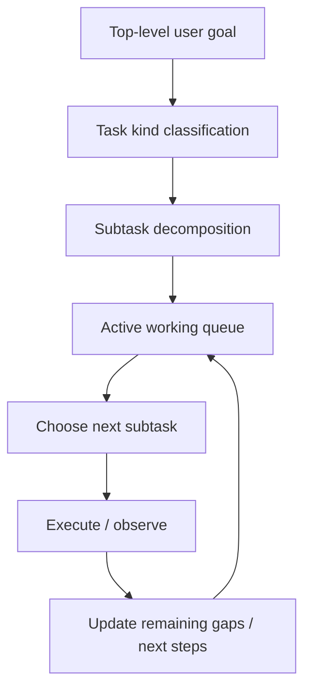
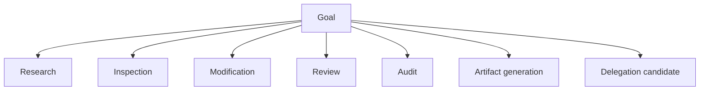
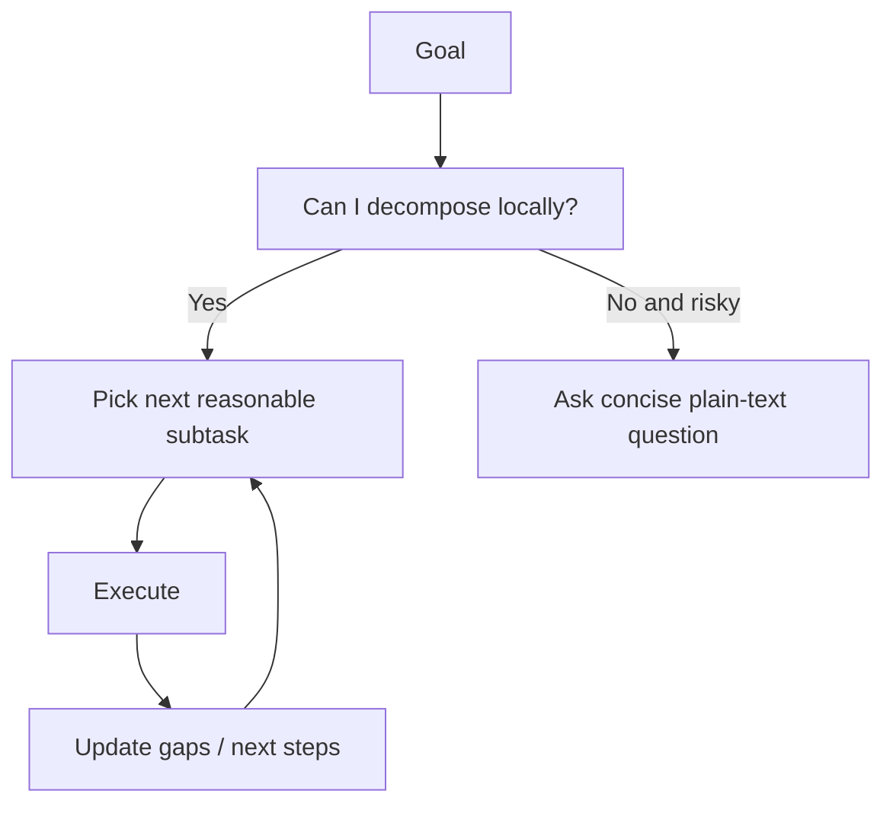
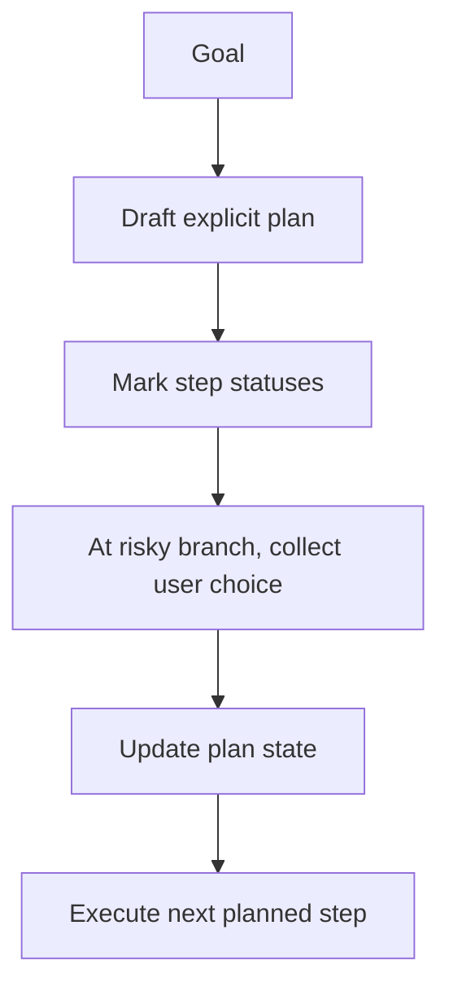
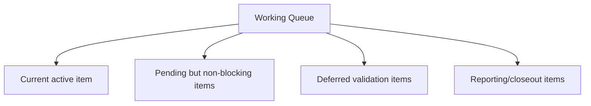
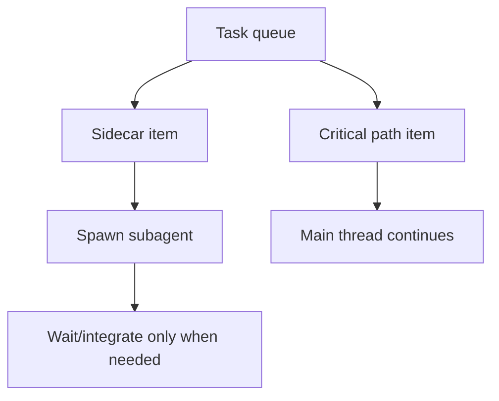
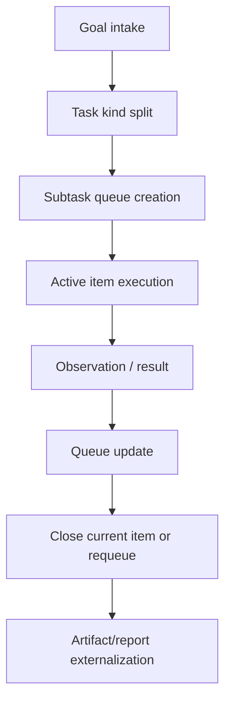

# Task Management and Todo Audit

Overview router: [may-20-codex-agent-loop.md](/Users/songmin/Documents/code-new/semantica-codegraph-v2/docs/analysis/codex-agent/may-20-codex-agent-loop.md)

Subagent-specific deep dive: [subagent/README.md](/Users/songmin/Documents/code-new/semantica-codegraph-v2/docs/analysis/codex-agent/thread-management/subagent/README.md)

이 문서는 Codex 계열 에이전트의 `내부 task 관리`와 `todo-like decomposition`이 어떻게 보이는지 감사 관점으로 정리한다.

범위:
- task를 어떻게 쪼개는지
- todo 같은 중간 상태가 무엇인지
- plan tool, working memory, subagent, artifact가 task management에서 어떤 역할을 하는지
- 무엇이 직접 관측 가능한 사실이고, 무엇이 강한/약한 추론인지

표기:
- `[FACT]`: 현재 세션 지침, tool schema, actual thread behavior에서 직접 관측 가능한 사실
- `[STRONG-INFERENCE]`: 관측 사실을 가장 잘 설명하는 고신뢰 구조 추론
- `[WEAK-INFERENCE]`: plausible 하지만 직접 근거가 부족한 해석

주의:
- hidden internal scheduler나 private todo datastructure 원문을 본 것은 아니다.
- 이 문서는 외부에서 보이는 task-management contract를 재구성한다.

---

## 1. Executive summary

### 1.1 Final verdict

- `Alignment`: High `[STRONG-INFERENCE]`
- `Robustness`: Medium-to-Strong `[STRONG-INFERENCE]`
- `Confidence`: High on visible decomposition/process rules, Medium on hidden internal queue structures `[STRONG-INFERENCE]`
- `Ship readiness`: Ship as analysis doc `[STRONG-INFERENCE]`

### 1.2 Top conclusions

1. 내부 task 관리는 `single big goal`을 바로 실행하는 방식이 아니라, **typed subtask decomposition + working-state queue**에 가깝다. `[STRONG-INFERENCE]`
2. 현재 세션에는 explicit task-state tool로 `update_plan`이 있고, subtask branching tool로 subagent family가 있다. `[FACT]`
3. 현재 mode가 Default라 `request_user_input` 기반 structured branch resolution은 닫혀 있지만, plan state 자체는 여전히 개념적으로 존재한다. `[FACT]` + `[STRONG-INFERENCE]`
4. “todo가 나온다”는 건 별도 visible todo tool이라기보다, **working memory에 유지되는 task queue / remaining-gap list / next-step set**으로 이해하는 것이 가장 정확하다. `[STRONG-INFERENCE]`
5. artifact 문서와 summary는 long-lived task ledger 역할도 한다. `[STRONG-INFERENCE]`

---

## 2. Direct evidence inventory

## 2.1 Directly visible task-management tools

현재 세션에서 직접 보이는 task-management 관련 tools:

1. `functions.update_plan` `[FACT]`
2. `functions.request_user_input` `[FACT]`
3. `functions.spawn_agent` `[FACT]`
4. `functions.send_input` `[FACT]`
5. `functions.wait_agent` `[FACT]`
6. `functions.close_agent` `[FACT]`

## 2.2 Directly visible rules around work decomposition

현재 세션 지침에서 직접 보이는 사실:

1. 큰 작업에서는 단계적 계획이 가능하다 `[FACT]`
2. Default mode에서는 reasonable assumptions를 선호하고 unnecessary stop을 피하라고 한다 `[FACT]`
3. subagent는 explicit user permission 있을 때만 쓰는 것이 원칙이다 `[FACT]`
4. subagent는 disjoint write ownership을 가져야 한다 `[FACT]`
5. urgent blocking task는 메인에서 직접 처리하라는 지침이 있다 `[FACT]`
6. sidecar task를 병렬로 분리하라는 지침이 있다 `[FACT]`
7. 이미 읽은 파일은 다시 읽지 말라는 강한 지침이 있다 `[FACT]`
8. 검증은 요청 전까지 하지 말라고 한다 `[FACT]`

## 2.3 Observed task-management behavior in this thread

이 스레드에서 직접 관측된 사실:

1. 큰 주제를 여러 문서 단위로 분리해 순차적으로 처리했다 `[FACT]`
2. 각 턴에서 “다음 자연스러운 단계”를 별도로 적는 패턴이 반복됐다 `[FACT]`
3. partial landing / remaining gaps / next steps를 계속 명시했다 `[FACT]`
4. broad re-exploration 없이 기존 분석 축을 이어서 확장했다 `[FACT]`
5. todo-like list를 plain text로 여러 번 구성했다 `[FACT]`

---

## 3. Best-fit task-management model

가장 설명력이 높은 모델은 아래다. `[STRONG-INFERENCE]`

핵심:
- goal
- typed subtasks
- active queue
- gap-based update

이 네 축이 todo-like behavior를 가장 잘 설명한다.

---

## 4. What “todo” most likely means here

### 4.1 Not directly observed

현재 세션에는 explicit `todo_add`, `todo_list`, `todo_check` 같은 tool은 없다 `[FACT]`.

따라서 “todo”는 다음 둘 중 하나로 보는 것이 맞다. `[STRONG-INFERENCE]`

1. explicit `update_plan` state
2. implicit working-memory task queue

### 4.2 Best-fit interpretation

todo-like state는 보통 이런 구성으로 보인다. `[STRONG-INFERENCE]`

- current objective
- current blocking subtask
- pending side subtasks
- remaining gaps
- suggested next steps
- validation left undone

즉 별도 app todo widget이 아니라, **working-state agenda**에 가깝다.

---

## 5. Typed task decomposition

task 관리는 먼저 `무슨 종류의 task인가`를 나누는 것에서 시작하는 것으로 보인다. `[STRONG-INFERENCE]`

이 typed split은 current session의 skill/mode/tool structure와 잘 맞는다. `[STRONG-INFERENCE]`

### Why this matters

task type에 따라:
- 필요한 evidence
- 허용되는 도구
- validation posture
- reporting shape

가 바뀌기 때문이다.

---

## 6. Default-mode task management

현재 세션은 Default mode다 `[FACT]`.

### 6.1 Best-fit process

### Characteristics

1. agent-local branch resolution이 많다 `[STRONG-INFERENCE]`
2. user interrupt를 최소화한다 `[FACT]` + `[STRONG-INFERENCE]`
3. todo state는 주로 plain-text next-step list나 working memory로 유지된다 `[STRONG-INFERENCE]`

---

## 7. Plan-tool task management

현재 세션은 Default mode지만, visible tooling은 Plan-style task management capability를 시사한다.

### 7.1 Direct evidence

- `update_plan` exists `[FACT]`
- `request_user_input` exists but is Plan-only `[FACT]`

### 7.2 Best-fit process

### Interpretation

Plan mode에서는 todo가 더 formal한 `plan state`로 드러날 가능성이 높다 `[STRONG-INFERENCE]`.

---

## 8. Working queue model

가장 설명력 높은 내부 working queue 모델:

### 8.1 Current active item

- 지금 바로 처리해야 하는 subtask `[STRONG-INFERENCE]`

### 8.2 Pending non-blocking items

- follow-up candidate
- sidecar artifact
- remaining surface cleanup

이런 것들이 “다음 자연스러운 단계”로 자주 표현된다 `[FACT]` + `[STRONG-INFERENCE]`.

### 8.3 Deferred validation items

- current session 지침상 validation은 자주 뒤로 밀린다 `[FACT]`
- 따라서 validation 자체가 task queue의 deferred lane으로 존재한다고 보는 것이 맞다 `[STRONG-INFERENCE]`

### 8.4 Reporting/closeout items

- changed files
- enforced contract
- not verified
- remaining gaps

이런 final-answer 요소도 사실상 closeout checklist다 `[STRONG-INFERENCE]`.

---

## 9. Subagent as task-management primitive

subagent는 단순 실행 수단이 아니라 task management primitive이기도 하다.

### 9.1 Direct evidence

- subagent tools 존재 `[FACT]`
- explicit permission 필요 `[FACT]`
- disjoint ownership 요구 `[FACT]`
- critical path는 메인에서 유지하라는 지침 `[FACT]`

### 9.2 Interpretation

subagent는 아래와 같이 task queue를 분기하는 도구다. `[STRONG-INFERENCE]`

즉 todo는 단순 순차 리스트가 아니라, **main queue + side queue** 구조를 가질 수 있다.

---

## 10. Artifact-backed task ledger

현재 세션에서 큰 주제를 `/docs/analysis/codex-agent/` 아래 문서들로 externalize해 왔다 `[FACT]`.

### Interpretation

이건 단순 output이 아니라 task ledger 역할도 한다. `[STRONG-INFERENCE]`

기능:
1. 완료된 subtask 기록
2. remaining scope 시각화
3. future continuation anchor
4. handoff material

즉 문서 생성 자체가 task management의 일부다.

---

## 11. Task lifecycle

가장 적합한 lifecycle:

분류:
- lifecycle structure `[STRONG-INFERENCE]`
- many steps have direct supporting evidence from behavior and tooling `[FACT]`

---

## 12. Attack surface analysis

## 12.1 False assumption: no task management exists beyond plain chat

- contradicted by explicit planning/delegation tools and observed gap tracking
- severity: P1

Classification:
- `[FACT]` + `[STRONG-INFERENCE]`

## 12.2 False assumption: todo means explicit visible todo database

- not supported
- visible evidence suggests working queue / plan state / artifact ledger instead
- severity: P2

Classification:
- `[FACT]` + `[STRONG-INFERENCE]`

## 12.3 False assumption: validation is a final automatic step

- contradicted by validation budget rules
- validation behaves more like a deferred queue item
- severity: P1

Classification:
- `[FACT]` + `[STRONG-INFERENCE]`

## 12.4 False assumption: subagent is just parallel compute, not task management

- contradicted by ownership and critical-path rules
- severity: P2

Classification:
- `[FACT]` + `[STRONG-INFERENCE]`

---

## 13. Concrete failure scenarios if task management is misunderstood

### Scenario 1: treat every follow-up as fresh task

- setup: continuing multi-turn implementation/audit
- trigger: assistant ignores prior queue/gaps
- expected: continue from working state
- likely failure: duplicate work, rereads, drift
- severity: P2

Classification:
- rule basis `[FACT]`

### Scenario 2: treat todo as immutable prose plan

- setup: new evidence changes priority
- trigger: assistant follows old prose order rigidly
- expected: queue/gap update after observation
- likely failure: bad prioritization
- severity: P1

Classification:
- dynamic working queue model `[STRONG-INFERENCE]`

### Scenario 3: push critical path into subagent

- setup: main thread blocked on result
- trigger: assistant delegates blocking owner task
- expected: keep urgent blocker local
- likely failure: latency and idle waiting
- severity: P1

Classification:
- subagent rules `[FACT]`

### Scenario 4: forget to externalize long-running analysis

- setup: large investigation
- trigger: assistant keeps all state implicit
- expected: artifact-backed ledger when persistence matters
- likely failure: continuity loss
- severity: P1

Classification:
- artifact accumulation evidence `[FACT]` + `[STRONG-INFERENCE]`

---

## 14. False confidence traps

1. “todo”가 보이면 hidden task database가 있는 거다
- current evidence로는 과하다

2. task management는 `update_plan` 있을 때만 존재한다
- 아니다
- Default mode에서도 working queue와 gap tracking이 계속 돈다

3. task decomposition은 단지 답변 스타일이다
- 아니다
- tool choice, validation posture, delegation까지 바뀐다

4. next steps list는 decoration이다
- 아니다
- active/deferred queue snapshot으로 읽는 게 더 정확하다

---

## 15. Unknowns

직접 알 수 없는 것:

1. hidden internal todo datastructure `[WEAK-INFERENCE]`
2. plan state persistence internals beyond visible tools `[WEAK-INFERENCE]`
3. task prioritization scoring internals `[WEAK-INFERENCE]`
4. whether there is a hidden global task ledger outside thread/artifacts `[WEAK-INFERENCE]`

---

## 16. Most precise safe summary

- 현재 세션에서 보이는 task management는 `explicit plan tool + implicit working queue + artifact-backed ledger + bounded delegation` 조합에 가깝다. `[STRONG-INFERENCE]`
- explicit visible todo CRUD tool은 없지만, `update_plan`, `subagent tools`, `gap/next-step reporting`, `artifact accumulation`이 todo-like state를 충분히 설명한다. `[FACT]` + `[STRONG-INFERENCE]`
- 따라서 “todo가 나온다”는 것은 hidden todo app보다, **working-state queue가 externalized되거나 plan state로 surfaced되는 현상**으로 이해하는 것이 가장 정확하다. `[STRONG-INFERENCE]`
