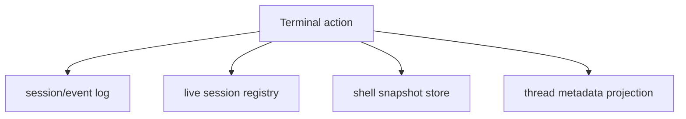

# Codex Terminal Reimplementation Blueprint

Overview router: [README.md](/Users/songmin/Documents/code-new/semantica-codegraph-v2/docs/analysis/codex-agent/terminal/README.md)

이 문서는 current Codex evidence를 바탕으로, 비슷한 terminal subsystem을 처음부터 다시 만든다면 어떤 control plane과 API가 최소로 필요할지 정리한다.

표기:
- `[FACT]`: current Codex evidence에서 직접 보이는 requirement source
- `[SOTA-INFERENCE]`: 새 제품을 만들 때 가장 타당한 설계
- `[NON-CLAIM]`: 현재 evidence로 Codex 구현이라고 단정할 수 없는 것

관련 문서:
- [terminal-surface-and-tool-contract-audit.md](/Users/songmin/Documents/code-new/semantica-codegraph-v2/docs/analysis/codex-agent/terminal/terminal-surface-and-tool-contract-audit.md)
- [terminal-runtime-and-session-architecture.md](/Users/songmin/Documents/code-new/semantica-codegraph-v2/docs/analysis/codex-agent/terminal/terminal-runtime-and-session-architecture.md)
- [terminal-state-and-recovery-audit.md](/Users/songmin/Documents/code-new/semantica-codegraph-v2/docs/analysis/codex-agent/terminal/terminal-state-and-recovery-audit.md)

---

## 1. Requirements extracted from current evidence

현재 evidence가 강제하는 최소 requirement:

1. one-shot command와 long-lived session을 같은 API family에서 다뤄야 한다 `[FACT]`
2. TTY interactive session과 non-tty long-running process를 모두 지원해야 한다 `[FACT]`
3. long-lived session은 `session_id` continuation handle을 가져야 한다 `[FACT]`
4. app terminal read surface는 exec session rail과 분리되어야 한다 `[FACT]` + `[STRONG-INFERENCE]`
5. tool call/output는 thread rollout event rail에 append되어야 한다 `[FACT]`
6. shell state snapshot rail이 별도로 있어야 한다 `[FACT]` + `[STRONG-INFERENCE]`

---

## 2. Minimal subsystem split

Codex-like 구현을 새로 만든다면 아래 7개 component가 최소다. `[SOTA-INFERENCE]`

1. `ExecDispatcher`
- block 단위 command admission
- `cwd`, `tty`, timeout/yield, token budget metadata 수용

2. `SessionBroker`
- long-running process에 `session_id` 발급
- session lookup, liveness, close semantics 관리

3. `PTYRunner`
- interactive stdin/stdout/stderr
- prompt-aware chunking은 optional

4. `PipeRunner`
- non-tty job execution
- partial output emission
- closed-stdin semantics 분리

5. `AppTerminalBridge`
- UI terminal pane attach/read
- exec session과 별도 handle space 유지

6. `RolloutAppender`
- `function_call`, `function_call_output`, `event_msg` append-only 기록

7. `ShellSnapshotter`
- shell env reconstruction script write
- alias/function/export/setopt capture

---

## 3. API shape

가장 설명력 높은 API surface:

```text
runCommand({
  cmd,
  cwd,
  tty,
  login,
  yield_time_ms,
  max_output_tokens
}) -> {
  stdout?,
  stderr?,
  exit_code?,
  session_id?
}

writeSessionStdin({
  session_id,
  chars,
  yield_time_ms,
  max_output_tokens
}) -> {
  stdout?,
  stderr?,
  exit_code?,
  still_running?
}

readAppTerminal() -> {
  attached: boolean,
  output?: string
}

snapshotShell({
  thread_id
}) -> {
  path
}
```

설계 이유:

- `runCommand`는 block/action 인터페이스다 `[SOTA-INFERENCE]`
- `writeSessionStdin`는 stream continuation 인터페이스다 `[SOTA-INFERENCE]`
- `readAppTerminal`는 다른 handle family여야 한다 `[FACT]` + `[SOTA-INFERENCE]`

---

## 4. Persistence layout

새로 구현한다면 최소 persistence split은 아래가 타당하다. `[SOTA-INFERENCE]`



권장 store split:

- `event log`
  - append-only JSONL or structured WAL
- `live session registry`
  - in-memory + optional local checkpoint
- `shell snapshot store`
  - filesystem `.sh` snapshots
- `thread metadata projection`
  - SQLite or equivalent local queryable store

이 split이 좋은 이유:

- replay/debug와 live process lookup의 workload가 다르다
- shell env restore payload와 stdout transcript payload가 다르다
- UI sidebar/thread metadata는 relational queryability가 필요하다

---

## 5. Why app terminal must be separate

Codex evidence에서 이미 보인 문제:

- tool-launched exec session이 있어도 `read_thread_terminal`는 unattached를 돌릴 수 있다 `[FACT]`

새 제품에서도 app terminal과 exec session을 억지로 합치면:

1. UI pane lifecycle과 tool-launched process lifecycle이 꼬인다
2. hidden background process를 UI pane read로 잘못 가정하게 된다
3. permission/ownership model이 흐려진다

따라서:

- `exec session = process handle`
- `app terminal = UI attachment handle`

로 분리하는 게 맞다. `[SOTA-INFERENCE]`

---

## 6. Failure modes to design against

### P0

1. `session_id` exists but stdin is already closed
2. app terminal read가 background exec output을 대신해줄 거라고 가정
3. restart 후 live process continuity를 과장

### P1

1. shell snapshot을 stdout transcript로 오해
2. short one-shot command와 long-running session path를 같은 closeout logic으로 처리
3. event log append는 했지만 shell snapshot을 안 남겨 environment RCA가 막힘

### P2

1. thread metadata DB에 full tool inventory를 넣으려다 noisy projection이 됨
2. PTY/non-PTY distinction 없이 single runner로 밀어붙임

---

## 7. Build order

새로 만든다면 이 순서가 맞다. `[SOTA-INFERENCE]`

1. `runCommand` one-shot
2. long-running `session_id` continuation
3. PTY vs non-PTY split
4. rollout event appender
5. shell snapshotter
6. app terminal bridge
7. restart/recovery refinement

이유:

- Codex evidence에서도 user-facing 핵심은 먼저 `command block + session continuation`이다
- app terminal은 별도 rail이라 초기 MVP 필수는 아니다
- shell snapshot은 recovery 품질을 크게 올리지만 live execution보다 뒤에 둬도 된다

---

## 8. Non-claims

이 문서는 다음을 Codex의 exact hidden implementation이라고 주장하지 않는다.

- 정확한 class/module names
- exact storage engine choice
- exact shell snapshot capture trigger
- exact supervisor lifecycle and cleanup policy

---

## 9. Round 2 update (2026-05-21 deep dive)

이 라운드에서 실제 설치된 `Codex.app` (build 2867)을 직접 본 결과, §1의 requirement 목록에 **추가 요구사항**이 생겼다. 새로 설계할 때 이것들을 명시적으로 떠받쳐야 Codex parity에 가까워진다.

### 9.1 Additional requirements

1. PTY backend는 `node-pty` 같은 검증된 라이브러리를 쓰는 것이 reference setpoint다. `[FACT]` (Codex evidence: bundled `node-pty` v1.1.0)
2. `terminal-shell-options` 같은 dedicated shell option IPC가 별도 channel로 있어야 한다. `[FACT]` + `[SOTA-INFERENCE]`
3. Windows host에서는 WSL detection + path translation + bash spawning이 first-class lane으로 있어야 한다. `[FACT]` (Codex evidence: `wsl.exe --status / --list --verbose`, `/usr/bin/bash -lc/-ilc`, `/mnt/c → C:` 변환, `\\wsl$\<distro>\…`)
4. spawned child shell에서 host crash-reporter env vars (`BREAKPAD_DUMP_LOCATION`, `CRASHPAD_*`, `ELECTRON_CRASH_REPORTER_PROCESS_TYPE`)를 필터링하는 hygiene step이 있어야 한다. `[FACT]`
5. external IDE/terminal "Open in" handoff target list가 별도로 관리돼야 한다. `[FACT]` (Codex evidence: 27 apps tracked — iTerm2, Warp, Ghostty, VS Code, Cursor, Zed, Windsurf, Antigravity, JetBrains family 등)
6. shell environment snapshot rail 외에, Node REPL 상태를 위한 별도 rail (`~/.codex/node_repl/` 같은)이 plugin bootstrap을 위해 필요할 수 있다. `[FACT]` + `[SOTA-INFERENCE]`

### 9.2 Subsystem split 갱신

§2의 7개 component에 다음 두 개를 추가하는 것이 타당하다. `[SOTA-INFERENCE]`

8. `WSLBridge`
- `wsl.exe` discovery
- distro enumeration
- path translation between `/mnt/<drive>` ↔ `<drive>:` and UNC `\\wsl$\<distro>\…`
- bash spawning with login/interactive flags
- crash-reporter env filtering

9. `ExternalHostHandoff`
- discovery of installed IDEs/terminals
- target-app spawn with workspace path
- "Open in <app>" UI rail

### 9.3 API shape 추가

```text
listExternalHostTargets() -> Array<{ id, displayName, available }>

openInExternalHost({
  target_id,
  cwd
}) -> {
  spawned: boolean,
  error?: string
}

detectWSL() -> {
  available: boolean,
  default_distro?: string,
  distros?: Array<{ name, state, version }>
}
```

### 9.4 Build order 갱신

§7의 build order에 추가 stage를 끼우는 것이 자연스럽다. `[SOTA-INFERENCE]`

1. `runCommand` one-shot
2. long-running `session_id` continuation
3. PTY vs non-PTY split (use `node-pty` reference)
4. rollout event appender
5. shell snapshotter
6. app terminal bridge
7. **WSL bridge** (Windows parity)
8. **External host handoff** ("Open in" list)
9. restart/recovery refinement
10. **Node REPL state rail** (plugin bootstrap parity)

### 9.5 Failure modes 추가

P0:
- Windows에서 WSL path translation을 안 해 host path와 distro path를 섞어 보냄
- child shell에 crash-reporter env가 inherit되어 child가 host crash-reporter에 잘못 enroll됨

P1:
- "Open in" handoff에서 target app 부재 시 silent fail
- Node REPL state rail이 shell snapshot rail과 같은 GC 정책을 공유한다고 가정
