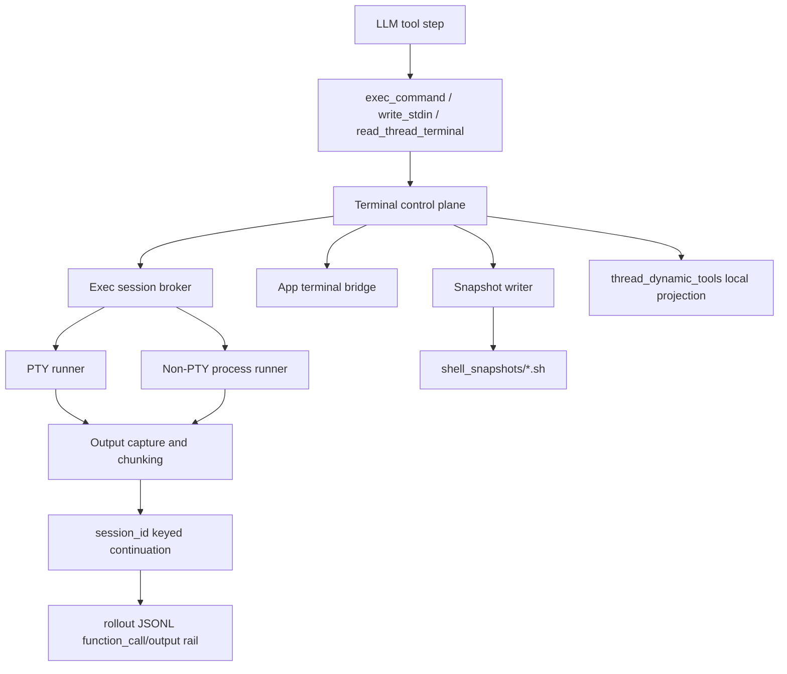

# Codex Terminal Runtime And Session Architecture

Overview router: [README.md](/Users/songmin/Documents/code-new/semantica-codegraph-v2/docs/analysis/codex-agent/terminal/README.md)

이 문서는 Codex terminal subsystem의 best-fit runtime model을 `tool contract`, `rollout event rail`, `shell snapshot rail`, `local SQLite projection`을 합쳐 복원한다.

표기:
- `[FACT]`: current tool surface, local artifacts, live probe에서 직접 보인 것
- `[STRONG-INFERENCE]`: direct seam을 가장 잘 설명하는 구조 추론
- `[SOTA-INFERENCE]`: Codex 같은 제품을 새로 만들 때 가장 타당한 설계 추론
- `[NON-CLAIM]`: 현재 evidence로 못 박을 수 없는 것

관련 문서:
- [terminal-surface-and-tool-contract-audit.md](/Users/songmin/Documents/code-new/semantica-codegraph-v2/docs/analysis/codex-agent/terminal/terminal-surface-and-tool-contract-audit.md)
- [thread-management/session-management-audit.md](/Users/songmin/Documents/code-new/semantica-codegraph-v2/docs/analysis/codex-agent/thread-management/session-management-audit.md)
- [thread-management/storage-and-db-audit.md](/Users/songmin/Documents/code-new/semantica-codegraph-v2/docs/analysis/codex-agent/thread-management/storage-and-db-audit.md)
- [thread-management/logging-and-recovery-audit.md](/Users/songmin/Documents/code-new/semantica-codegraph-v2/docs/analysis/codex-agent/thread-management/logging-and-recovery-audit.md)

---

## 1. Direct runtime seams

### 1.1 Session handle seam

- `exec_command`가 ongoing process에 대해 `session_id`를 돌려줄 수 있다. `[FACT]`
- `write_stdin(session_id=...)`가 그 handle을 이어받는다. `[FACT]`
- 즉 thread conversation state와 별도로 live exec session registry가 있다. `[FACT]` + `[STRONG-INFERENCE]`

근거:
- [thread-management/session-management-audit.md](/Users/songmin/Documents/code-new/semantica-codegraph-v2/docs/analysis/codex-agent/thread-management/session-management-audit.md)
- [terminal-surface-and-tool-contract-audit.md](/Users/songmin/Documents/code-new/semantica-codegraph-v2/docs/analysis/codex-agent/terminal/terminal-surface-and-tool-contract-audit.md)

### 1.2 App terminal seam

- `read_thread_terminal`은 tool로 visible하다. `[FACT]`
- 그런데 live probe에서는 ongoing exec session과 무관하게 `No app terminal session is attached to this thread yet.`를 반환했다. `[FACT]`
- 따라서 app terminal은 `exec_command`의 raw alias가 아니라 별도 attach state를 갖는 surface다. `[STRONG-INFERENCE]`

### 1.3 Rollout event seam

- active rollout JSONL에는 `function_call`과 `function_call_output` row가 직접 쌓인다. `[FACT]`
- 이 turn의 terminal probe도 같은 rollout file에 그대로 남았다. `[FACT]`
- 따라서 terminal execution trace는 same-thread replay/debug rail에 append된다. `[STRONG-INFERENCE]`

근거:
- [rollout-2026-05-21T02-14-01-019e4661-4823-7bb1-8dd2-e188103d4a20.jsonl](/Users/songmin/.codex/sessions/2026/05/21/rollout-2026-05-21T02-14-01-019e4661-4823-7bb1-8dd2-e188103d4a20.jsonl)

### 1.4 Shell snapshot seam

직접 확인한 local facts:

- `/Users/songmin/.codex/shell_snapshots` directory가 존재한다. `[FACT]`
- current snapshot count는 `27` files, `17` distinct prefix ids였다. `[FACT]`
- sample filename은 `thread-like id + timestamp + .sh` 패턴이다. `[FACT]`
- sample snapshot file은 `functions`, `setopt`, `alias`, `export` blocks를 가진 shell reconstruction script shape다. `[FACT]`
- sample exports에는 `CODEX_SHELL=1`, `CODEX_INTERNAL_ORIGINATOR_OVERRIDE='Codex Desktop'`, `SHELL=/bin/zsh` 등이 들어 있다. `[FACT]`

근거:
- [shell_snapshots](/Users/songmin/.codex/shell_snapshots)
- [019e4661-4823-7bb1-8dd2-e188103d4a20.1779297241124921000.sh](/Users/songmin/.codex/shell_snapshots/019e4661-4823-7bb1-8dd2-e188103d4a20.1779297241124921000.sh)

### 1.5 Local SQLite projection seam

`state_5.sqlite`에서 직접 확인한 facts:

- `thread_dynamic_tools` table exists. `[FACT]`
- current snapshot count:
  - `read_thread_terminal`: `2850` `[FACT]`
  - `load_workspace_dependencies`: `2850` `[FACT]`
  - `automation_update`: `2850` `[FACT]`
  - `exec_command`: `0` `[FACT]`
  - `write_stdin`: `0` `[FACT]`

의미:

- `thread_dynamic_tools`는 full tool inventory projection이 아니다. `[STRONG-INFERENCE]`
- 최소한 current local projection에서는 app-bound dynamic tools만 따로 저장되고, developer tool surface 전체는 여기 안 박히지 않는다. `[STRONG-INFERENCE]`

근거:
- [state_5.sqlite](/Users/songmin/.codex/state_5.sqlite)

---

## 2. Best-fit hidden architecture

visible seam을 가장 잘 설명하는 모델은 아래다. `[STRONG-INFERENCE]`

핵심 해석:

1. `tool call`
- LLM은 block 단위로 명령을 보낸다

2. `terminal control plane`
- command dispatch, session handle issuance, tty mode split, output capture를 맡는 중간 레이어가 있다

3. `exec session broker`
- long-lived process만 `session_id`를 가진다

4. `app terminal bridge`
- `read_thread_terminal`는 exec broker와 별도 attach state를 읽는다

5. `snapshot writer`
- shell environment reconstruction artifact를 `.sh` 파일로 남긴다

6. `rollout event rail`
- user-facing same-thread replay/debug는 active rollout JSONL이 owner다

---

## 3. Why the architecture likely looks like this

### 3.1 Why not “just one terminal stream”

그렇게 보기 어려운 direct evidence:

- `exec_command` ongoing session과 `read_thread_terminal` result가 분리됐다 `[FACT]`
- `write_stdin`은 `session_id`를 받고, `read_thread_terminal`은 no-arg다 `[FACT]`
- `thread_dynamic_tools`에는 `read_thread_terminal`만 있고 `exec_command`/`write_stdin`은 없다 `[FACT]`

가장 자연스러운 해석:

- Codex는 `developer exec rail`과 `app terminal rail`을 분리한다. `[STRONG-INFERENCE]`

### 3.2 Why not “TTY only”

그렇게 보기 어려운 direct evidence:

- non-tty long-running command도 `session_id`를 받았다 `[FACT]`
- 대신 stdin closure error가 따로 났다 `[FACT]`

가장 자연스러운 해석:

- session continuation과 interactive stdin availability는 분리된 축이다. `[STRONG-INFERENCE]`

### 3.3 Why shell snapshot likely exists

직접 보이는 snapshot file shape:

- plain transcript가 아니라 shell reconstruction script에 가깝다 `[FACT]`
- alias/function/setopt/export를 포함한다 `[FACT]`

가장 자연스러운 해석:

- 이 rail은 `stdout log`보다 `shell state restore substrate`에 가깝다. `[STRONG-INFERENCE]`
- 다만 exact restore orchestration에 실제로 쓰이는지는 별도 증거가 더 필요하다. `[NON-CLAIM]`

---

## 4. Architecture consequences

### 4.1 User-facing behavior

- 짧은 명령은 그냥 one-shot tool call처럼 보인다. `[FACT]`
- long-running command는 handle-based continuation으로 바뀐다. `[FACT]`
- app terminal pane이 없으면 `read_thread_terminal`는 empty-attached state를 돌릴 수 있다. `[FACT]`

### 4.2 Operator consequences

- command block orchestration과 terminal stream handling을 섞어 설계하면 안 된다. `[SOTA-INFERENCE]`
- `session_id`만 저장한다고 full process restore가 되는 것은 아니다. `[STRONG-INFERENCE]`
- app terminal과 tool-launched exec session을 같은 durable truth로 보면 overclaim이다. `[STRONG-INFERENCE]`

---

## 5. Non-claims

이 문서가 주장하지 않는 것:

- hidden exec broker의 exact implementation language
- PTY backend exact library
- shell snapshot write timing rule
- `thread_dynamic_tools`가 어떤 code path에서 채워지는지의 exact implementation
- app terminal attach가 어떤 UI interaction에서 켜지는지의 full lifecycle

---

## 6. Round 2 update (2026-05-21 deep dive)

이 라운드에서 실제 설치된 `Codex.app` (build 2867) 렌더러 번들을 직접 본 결과, runtime architecture에 cross-platform shell host와 IDE/terminal handoff rail이 추가로 관측됐다.

### 6.1 WSL detection logic

- `[FACT]` `workspace-root-drop-handler-*.js`에 WSL detection logic이 직접 들어 있다.
- `[FACT]` `wsl.exe --status`, `wsl.exe --list --verbose`를 spawn한다.
- `[FACT]` `/usr/bin/bash -lc/-ilc`를 spawn한다.
- `[FACT]` `/mnt/c → C:`, `\\wsl$\<distro>\…` 경로 변환이 들어 있다.
- `[FACT]` spawned shell에서 `BREAKPAD_DUMP_LOCATION`, `CRASHPAD_*`, `ELECTRON_CRASH_REPORTER_PROCESS_TYPE` 같은 crash-reporter env vars를 필터링한다.

해석:
- §2의 best-fit architecture에 **WSL bridge** lane이 추가돼야 한다. `[STRONG-INFERENCE]`
- 즉 PTY/non-PTY split 위에, Windows host에서는 WSL distro 안의 bash로 routing되는 별도 path가 있다.
- crash-reporter env filter는 child shell에서 Electron crash-reporter envs가 의도치 않게 inherit되는 것을 차단하는 hygiene 조치다. `[STRONG-INFERENCE]`

### 6.2 "Open in" external IDE/terminal handoff

- `[FACT]` 27개의 external IDE/terminal app이 "Open in" workflow의 target으로 tracked된다 (iTerm2, Warp, Ghostty, VS Code, Cursor, Zed, Windsurf, Antigravity, JetBrains family 등 포함).

해석:
- Codex의 terminal subsystem은 self-hosted PTY 외에 **external host handoff** rail도 갖는다. `[STRONG-INFERENCE]`
- 이는 §2의 architecture에서 `App terminal bridge` 아래에 또 하나의 outbound lane을 추가해야 함을 시사한다. `[STRONG-INFERENCE]`
- 단, 이 handoff가 어떤 UI action에서 trigger되는지, 어떤 IPC가 그 dispatch를 owner하는지는 minified bundle 안에서 직접 확인되지 않았다. `[WEAK-INFERENCE]`
