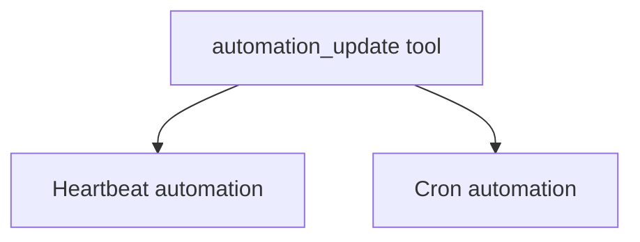
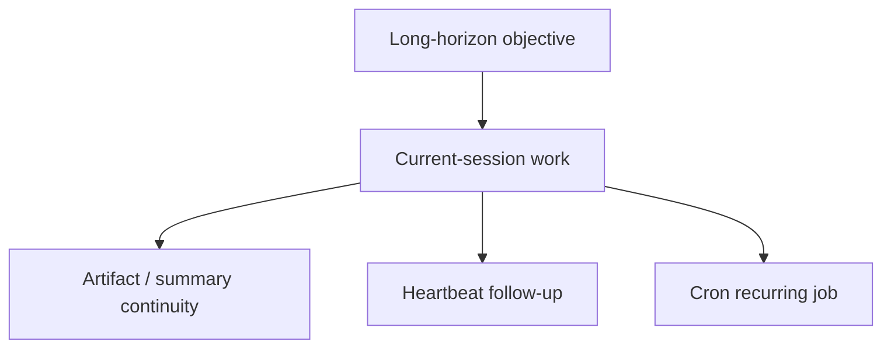

# Automation Audit

Overview router: [README.md](/Users/songmin/Documents/code-new/semantica-codegraph-v2/docs/analysis/codex-agent/thread-management/README.md)

이 문서는 Codex 계열 에이전트의 `automation` surface를 감사 관점으로 정리한다.

범위:
- 현재 세션에서 직접 callable 한 automation tool
- heartbeat vs cron 구분
- create/view/update/delete/suggested_* lifecycle
- automation과 long-horizon task management의 관계
- 무엇이 직접 관측 가능한 사실이고, 무엇이 강한/약한 추론인지

표기:
- `[FACT]`: 현재 세션 tool schema, app context, 실제 호출 결과에서 직접 관측 가능한 사실
- `[STRONG-INFERENCE]`: 관측 사실을 가장 잘 설명하는 고신뢰 구조 추론
- `[WEAK-INFERENCE]`: plausible 하지만 직접 근거가 부족한 해석
- `[SOTA-INFERENCE]`: 2025-2026 desktop agent/local control-plane 일반 패턴과 현재 evidence를 합친 합리적 추론

---

## 1. Executive summary

### 1.1 Final verdict

- `Alignment`: High `[STRONG-INFERENCE]`
- `Robustness`: Strong on visible automation contract, Medium on hidden execution backend details `[STRONG-INFERENCE]`
- `Confidence`: High `[STRONG-INFERENCE]`
- `Ship readiness`: Ship as analysis doc `[STRONG-INFERENCE]`

### 1.2 Top conclusions

1. 현재 세션에는 explicit automation tool이 실제로 존재한다: `codex_app.automation_update`. `[FACT]`
2. automation은 최소 두 종류다: `heartbeat`와 `cron`. `[FACT]`
3. heartbeat는 현재 thread를 나중에 다시 깨우는 rail이고, cron은 workspace 대상 독립 반복 작업 rail이다. `[FACT]` + `[STRONG-INFERENCE]`
4. automation lifecycle은 `create`, `view`, `update`, `delete`, `suggested_create`, `suggested_update`를 가진다. `[FACT]`
5. 따라서 이전 long-horizon-task 문서에서 “현재 세션엔 visible automation tool이 없다”고 했던 부분은 이제 **현재 시점 기준으로 갱신**되어야 한다. `[FACT]`

---

## 2. Direct evidence inventory

## 2.1 App-context evidence

app context에 직접 적힌 사실:

1. app supports recurring automations, reminders, monitors, follow-ups, and thread wakeups `[FACT]`
2. automation 관련 요청이면 `automation_update` tool을 먼저 찾으라고 적혀 있다 `[FACT]`

## 2.2 Current-session callable tool evidence

현재 세션에서 tool search 후 실제로 노출된 tool:

- `codex_app.automation_update` `[FACT]`

이건 현재 대화 중 직접 확인된 callable surface다. `[FACT]`

## 2.3 Actual invocation evidence

이 대화에서 실제로 수행한 것:

- `mode=create`
- `kind=heartbeat`
- `destination=thread`
- `name="Codex Agent Follow-up"`
- prompt와 RRULE을 포함한 heartbeat automation 생성
- returned `automationId="codex-agent-follow-up"`

모두 `[FACT]`.

---

## 3. Visible automation model

가장 직접적으로 보이는 automation model:

### 3.1 Heartbeat

tool schema에서 직접 보이는 설명:
- proactive follow-up attached to the current local thread `[FACT]`
- thread를 나중에 다시 깨우는 용도 `[STRONG-INFERENCE]`
- one hour below에서는 heartbeat 선호 `[FACT]`

### 3.2 Cron

tool schema에서 직접 보이는 설명:
- standalone jobs against workspaces `[FACT]`
- workspace directories, execution environment, model, reasoning effort 같은 필드를 가짐 `[FACT]`

---

## 4. Lifecycle operations

tool schema상 visible lifecycle modes:

1. `create` `[FACT]`
2. `view` `[FACT]`
3. `update` `[FACT]`
4. `delete` `[FACT]`
5. `suggested_create` `[FACT]`
6. `suggested_update` `[FACT]`

### 4.1 Interpretation

이 하나의 tool이 CRUD + suggestion workflow를 모두 담당한다. `[STRONG-INFERENCE]`

즉 automation은:
- 바로 mutate할 수도 있고
- suggestion/proposal 단계로 user review를 거칠 수도 있다

---

## 5. Visible fields and their meaning

tool schema에서 직접 보이는 주요 필드:

### Common

- `id` `[FACT]`
- `kind` (`cron` / `heartbeat`) `[FACT]`
- `name` `[FACT]`
- `prompt` `[FACT]`
- `rrule` `[FACT]`
- `status` (`ACTIVE` / `PAUSED`) `[FACT]`
- `mode` `[FACT]`

### Heartbeat-related

- `destination` `[FACT]`
- `targetThreadId` `[FACT]`

### Cron-related

- `cwds` `[FACT]`
- `executionEnvironment` `[FACT]`
- `model` `[FACT]`
- `reasoningEffort` `[FACT]`
- `localEnvironmentConfigPath` `[FACT]`

### Interpretation

이 필드 집합은:
- heartbeat = thread-bound continuation
- cron = workspace-bound autonomous run

이라는 구분을 매우 강하게 뒷받침한다 `[STRONG-INFERENCE]`.

---

## 6. Heartbeat vs cron

| Axis | Heartbeat | Cron | Classification |
| --- | --- | --- | --- |
| Target | current thread | workspace job | `[FACT]` |
| Typical use | follow-up / wakeup / continue conversation | recurring check / monitor / standalone task | `[FACT]` + `[STRONG-INFERENCE]` |
| Destination | thread | workspace/local execution | `[FACT]` |
| Time granularity | can be minute-based | hourly/weekly schedules | `[FACT]` |
| Human continuity | high | lower, detached run | `[STRONG-INFERENCE]` |

---

## 7. Suggested vs immediate mutation

### Direct evidence

tool schema는 `suggested_create` / `suggested_update`를 직접 제공한다 `[FACT]`.

### Interpretation

automation UX는 두 rail을 가진다. `[STRONG-INFERENCE]`

1. immediate mutation
2. proposal/review first

즉:
- user confirmation sensitivity가 있거나
- 중복/업데이트를 조심해야 할 때
- suggestion rail이 더 적합할 수 있다

---

## 8. Existing-automation handling

tool description에서 직접 보이는 사실:

1. existing automation requests should inspect `$CODEX_HOME/automations/*/automation.toml` `[FACT]`
2. matching automation id를 찾으라고 적혀 있다 `[FACT]`
3. duplicate보다 update를 선호하라고 적혀 있다 `[FACT]`

### Interpretation

automation management는 naive create-only가 아니라:
- lookup
- dedupe
- update-preferred

workflow를 가진다 `[STRONG-INFERENCE]`.

## 8.1 Persistence snapshot caveat

현재 local DB snapshot에서 직접 확인한 것:

1. `sqlite/codex-dev.db`의 `automations` table row count는 `0`이었다 `[FACT]`
2. `inbox_items` row count도 `0`이었다 `[FACT]`

이 사실이 뜻하는 안전한 결론:

- tool contract 존재와 현재 local table row 존재는 같은 뜻이 아니다 `[STRONG-INFERENCE]`
- deleted automation, empty current snapshot, 다른 retention path, 또는 다른 storage write timing 가능성을 열어둬야 한다 `[SOTA-INFERENCE]`

즉:
- “automation tool이 있으니 지금 local table에 반드시 row가 있어야 한다”
- “local row count가 0이니 automation feature는 가짜다”

둘 다 과한 결론이다.

---

## 9. Scheduling contract

### Direct evidence

- scheduling은 `rrule`로 표현된다 `[FACT]`
- raw RRULE을 user에게 보여주지 말라고 적혀 있다 `[FACT]`
- heartbeat는 minute-based interval도 지원한다 `[FACT]`
- cron은 hourly interval or weekly schedules를 사용한다고 적혀 있다 `[FACT]`

### Interpretation

automation scheduling은:
- machine-level scheduling field는 `rrule`
- user-facing explanation은 natural-language summary

로 분리된 UX를 가진다 `[STRONG-INFERENCE]`.

---

## 10. Relationship to long-horizon task management

이건 중요하다.

### Previous state

이전에는 visible automation tool이 없어서,
- artifact
- summary
- thread continuity

로 장기 task continuity를 메운다고 썼다.

### Current corrected view

지금은 최소한 아래를 말할 수 있다:

1. explicit automation tool exists now `[FACT]`
2. therefore native long-horizon continuation support is visible `[FACT]`
3. artifact/summary continuity rail은 여전히 중요하지만, 이제 heartbeat/cron이라는 first-class automation surface도 있다 `[STRONG-INFERENCE]`

즉 long-horizon 모델은 다음처럼 업데이트된다:

---

## 11. Attack surface analysis

## 11.1 False assumption: no automation exists

- contradicted by direct callable `automation_update`
- severity: P1

Classification:
- `[FACT]`

## 11.2 False assumption: heartbeat and cron are basically the same

- contradicted by schema and target model
- severity: P1

Classification:
- `[FACT]`

## 11.3 False assumption: automation is always immediate mutation

- contradicted by suggested_create / suggested_update
- severity: P2

Classification:
- `[FACT]`

## 11.4 False assumption: schedule UX == raw RRULE exposure

- contradicted by direct “do not show raw RRULE strings” guidance
- severity: P2

Classification:
- `[FACT]`

---

## 12. Concrete failure scenarios if automation model is misunderstood

### Scenario 1: use cron for short thread follow-up

- setup: user wants “wake this thread later”
- trigger: assistant creates detached cron instead of heartbeat
- expected: heartbeat preferred
- likely failure: wrong continuity surface
- severity: P1

Classification:
- rule basis `[FACT]`

### Scenario 2: create duplicate automation instead of updating existing one

- setup: existing automation already matches the intent
- trigger: assistant creates new one blindly
- expected: update-preferred workflow
- likely failure: duplicate reminders/jobs
- severity: P1

Classification:
- rule basis `[FACT]`

### Scenario 3: expose raw RRULE to the user

- setup: user asks what was created
- trigger: assistant dumps RRULE instead of natural-language description
- expected: no raw RRULE exposure
- likely failure: bad UX / instruction violation
- severity: P2

Classification:
- rule basis `[FACT]`

### Scenario 4: assume heartbeat is workspace-autonomous

- setup: user wants repo monitor
- trigger: assistant uses heartbeat instead of cron
- expected: cron for detached workspace job
- likely failure: underpowered automation
- severity: P1

Classification:
- schema distinction `[FACT]`

---

## 13. False confidence traps

1. “automation tool 있으니 모든 scheduling/use-case가 다 풀렸다”
- 아니다
- current schema가 보이더라도 hidden backend semantics, limits, exact execution engine details는 안 보인다

2. “heartbeat = delayed message”
- 과소평가다
- thread-bound continuation rail이라는 점이 핵심이다

3. “cron = 그냥 반복 heartbeat”
- 아니다
- target, environment, model, cwd, execution semantics가 다르다

4. “automation은 long-horizon continuity를 artifact에서 완전히 대체한다”
- 아니다
- artifacts/summary는 여전히 durable context rail이다

---

## 14. Unknowns

직접 알 수 없는 것:

1. backend automation persistence implementation `[WEAK-INFERENCE]`
2. execution engine retry/failure semantics `[WEAK-INFERENCE]`
3. exact automation UI rendering in app `[WEAK-INFERENCE]`
4. automation concurrency / de-dup internals beyond visible guidance `[WEAK-INFERENCE]`

---

## 15. Most precise safe summary

- 현재 세션에는 실제 callable automation surface가 존재한다: `codex_app.automation_update`. `[FACT]`
- visible automation model은 `heartbeat`와 `cron` 두 종류를 중심으로 하며, 각각 `thread-bound follow-up`과 `workspace-bound recurring job`으로 구분된다. `[FACT]` + `[STRONG-INFERENCE]`
- lifecycle은 `create/view/update/delete/suggested_create/suggested_update`를 포함한다. `[FACT]`
- 따라서 Codex agent의 장기 continuity 모델은 이제 `artifact/summary/thread continuity`뿐 아니라 `native automation surface`까지 포함하는 것으로 보는 것이 가장 정확하다. `[STRONG-INFERENCE]`
