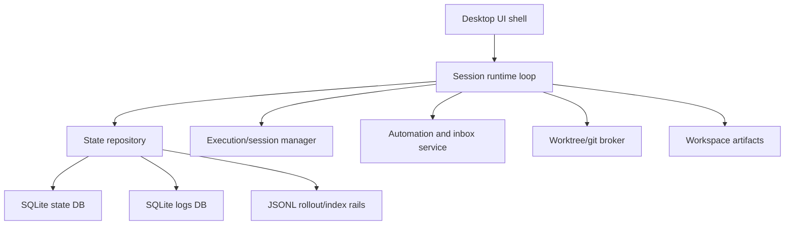
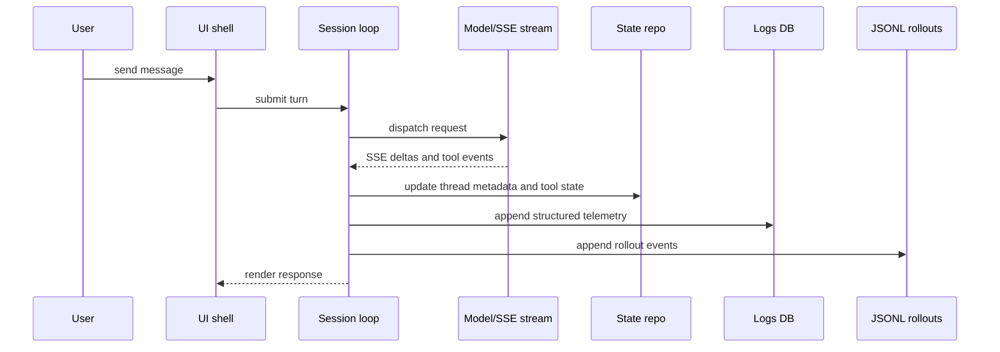
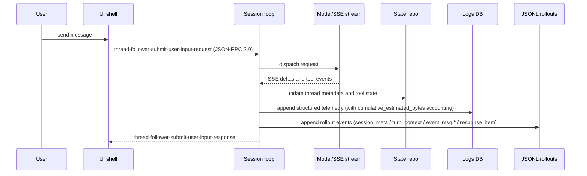

# Codex Thread Internal Architecture Inference

Overview router: [README.md](/Users/songmin/Documents/code-new/semantica-codegraph-v2/docs/analysis/codex-agent/thread-management/README.md)

관련 owner:
- [storage-and-db-audit.md](/Users/songmin/Documents/code-new/semantica-codegraph-v2/docs/analysis/codex-agent/thread-management/storage-and-db-audit.md)
- [thread-ui-and-fork-surface-audit.md](/Users/songmin/Documents/code-new/semantica-codegraph-v2/docs/analysis/codex-agent/thread-management/thread-ui-and-fork-surface-audit.md)
- [logging-and-recovery-audit.md](/Users/songmin/Documents/code-new/semantica-codegraph-v2/docs/analysis/codex-agent/thread-management/logging-and-recovery-audit.md)

이 문서는 Codex desktop의 hidden implementation을 직접 본 것이 아니라, 현재 로컬 snapshot과 visible contract를 2026년 desktop agent 일반 패턴과 합쳐 가장 설명력 높은 내부 구조를 정리한다.

표기:
- `[FACT]`: 현재 로컬 JSONL/SQLite snapshot, logs sample, tool/app contract에서 직접 확인된 사실
- `[STRONG-INFERENCE]`: 직접 사실을 가장 잘 설명하는 고신뢰 구조 추론
- `[SOTA-INFERENCE]`: 2025-2026 desktop agent/common local-control-plane pattern과 현재 evidence를 합친 합리적 추론

주의:
- 이 문서는 reverse-engineered implementation SSOT가 아니다.
- hidden service-side sync, cloud retention, native UI framework exact choice는 단정하지 않는다.

---

## 1. Executive summary

### 1.1 Top conclusions

1. best-fit local architecture는 `UI shell + session runtime loop + mixed persistence layer + execution manager + automation/worktree services` 5층이다. `[STRONG-INFERENCE]` + `[SOTA-INFERENCE]`
2. local state/logging core는 Rust 계열 runtime이 SQLx-managed SQLite와 append-only JSONL을 함께 쓰는 구조일 가능성이 높다. `[FACT]` + `[STRONG-INFERENCE]`
3. active turn path는 `session_loop -> submission_dispatch -> SSE response consumption -> local persistence/logging` 쪽이 가장 설명력이 높다. `[FACT]` + `[STRONG-INFERENCE]`
4. thread fork, subagent lineage, dynamic tool exposure는 단순 prompt UI가 아니라 structured local control plane이 있음을 보여준다. `[FACT]` + `[STRONG-INFERENCE]`
5. mixed-store split은 2026 desktop agent SOTA 관점에서 자연스럽다: SQLite는 queryable state, JSONL은 replay/debug artifact, logs DB는 high-volume telemetry, workspace files는 user-facing durable output. `[SOTA-INFERENCE]`

---

## 2. Direct anchors

### 2.1 State and index artifacts

- `state_5.sqlite`, `logs_2.sqlite`, `sqlite/codex-dev.db`가 실제 존재한다 `[FACT]`
- `session_index.jsonl`, `history.jsonl`, `archived_sessions/rollout-*.jsonl`가 실제 존재한다 `[FACT]`
- `~/.codex/sessions/**/rollout-*.jsonl`도 실제 존재한다 `[FACT]`
- 2026-05-21 local snapshot 기준:
  - `threads_count = 6950` `[FACT]`
  - `spawn_edges_count = 5986` `[FACT]`
  - `dynamic_tools_count = 8472` `[FACT]`
  - `logs_count = 4326814` `[FACT]`
  - `session_index.jsonl = 5570 lines` `[FACT]`
  - `history.jsonl = 1358 lines` `[FACT]`
  - `archived rollout JSONL files = 6211` `[FACT]`
  - `active session rollout JSONL files = 739` `[FACT]`
  - `threads.thread_source='subagent' = 4304` `[FACT]`
  - `threads.thread_source='user' = 318` `[FACT]`

### 2.2 Migration and runtime evidence

- `state_5.sqlite`와 `logs_2.sqlite`에는 `_sqlx_migrations` table이 있다 `[FACT]`
- `state_5.sqlite` migration descriptions에는 `threads preview`, `thread goals`, `thread dynamic tools namespace`, `threads thread source`가 보인다 `[FACT]`
- `logs_2.sqlite` migration descriptions에는 `logs`, `logs feedback log body`가 보인다 `[FACT]`
- recent `logs_2.sqlite` sample target에는 `codex_api::sse::responses`, `codex_otel.log_only`, `hyper_util::client::legacy::*`가 보인다 `[FACT]`
- recent `feedback_log_body` sample에는 `session_loop{thread_id=...}:submission_dispatch`가 보인다 `[FACT]`

가장 보수적인 결론:
- local state/log runtime의 적어도 일부는 Rust crate/module naming을 가진 process에서 나왔다 `[STRONG-INFERENCE]`
- local SQLite migration management는 SQLx 계열일 가능성이 높다 `[STRONG-INFERENCE]`

### 2.3 Thread control-plane evidence

- `threads(id, cwd, title, preview, archived, rollout_path, git_sha, git_branch, ...)` table이 있다 `[FACT]`
- `thread_spawn_edges(parent_thread_id, child_thread_id, status)` table이 있고 `open/closed` row sample이 보인다 `[FACT]`
- `thread_dynamic_tools(thread_id, position, name, namespace, ...)` table이 있다 `[FACT]`
- 최신 thread sample들에서 `automation_update`, `read_thread_terminal`, `load_workspace_dependencies`가 thread-bound dynamic tool set으로 반복 노출된다 `[FACT]`
- `threads` population은 `subagent` rows가 다수를 차지한다 `[FACT]`
- joined edge sample에서 child rows 다수는 `subagent`였다 `[FACT]`

이 조합은 thread가 단순 message blob이 아니라 structured runtime object임을 강하게 시사한다. `[STRONG-INFERENCE]`
다만 이 dataset는 top-level user chat보다 broader thread universe를 반영한다. `[STRONG-INFERENCE]`

---

## 3. Best-fit hidden architecture

### 3.1 Desktop UI shell

역할:
- sidebar thread list
- context-menu actions
- open in new window
- copy handles

best-fit model:
- UI는 직접 truth owner라기보다 thread/session control plane의 thin client다 `[SOTA-INFERENCE]`
- user-visible row title/preview/cwd/session-id는 local state repo에서 읽히는 metadata일 가능성이 높다 `[STRONG-INFERENCE]`

### 3.2 Session runtime loop

역할:
- user turn intake
- tool routing
- response streaming
- local state/log persistence

best-fit model:
- `session_loop`라는 runtime concept가 실제 존재한다 `[FACT]`
- `submission_dispatch`와 `codex_api::sse::responses` 흔적을 볼 때, session runtime이 networked model response stream을 소비하면서 local state를 갱신하는 구조가 가장 자연스럽다 `[STRONG-INFERENCE]`

### 3.3 State repository

역할:
- queryable thread/session metadata
- lineage graph
- dynamic tool exposure
- archive/read UI metadata 일부

best-fit model:
- `state_5.sqlite`가 canonical local state store 역할을 맡고, `session_index.jsonl`은 lightweight index/cache or export rail을 맡는 구조가 가장 설명력이 높다 `[STRONG-INFERENCE]` + `[SOTA-INFERENCE]`
- 특히 `threads`는 top-level chats only가 아니라 subagent/derived thread까지 포함하는 broader object table일 가능성이 높다 `[STRONG-INFERENCE]`

### 3.4 Execution/session manager

역할:
- shell session lifecycle
- `session_id` continuation
- background running process state
- possibly subagent-side tool continuation

best-fit model:
- thread conversation state와 live command session state를 분리한 별도 manager가 있을 가능성이 높다 `[SOTA-INFERENCE]`

### 3.5 Automation and inbox service

역할:
- heartbeat wakeup
- cron recurrence
- thread-linked inbox summary

best-fit model:
- `codex-dev.db`는 app-side automation/inbox state를 위한 별도 lightweight service DB일 가능성이 높다 `[STRONG-INFERENCE]`

### 3.6 Worktree/git broker

역할:
- `Fork into new worktree`
- git branch / sha / cwd rebinding
- open-in-finder / working-directory surfacing

best-fit model:
- UI menu action은 pure chat fork가 아니라 thread lineage와 filesystem lineage를 함께 다루는 git/worktree broker를 뒤에 두는 구조가 가장 자연스럽다 `[SOTA-INFERENCE]`

---

## 4. Best-fit runtime dataflows

## 4.1 Active user turn

근거:
- `session_loop` / `submission_dispatch` / `codex_api::sse::responses` log sample `[FACT]`
- `threads` and `logs` SQLite tables, archived rollout JSONL rails `[FACT]`

## 4.2 Local thread fork

best-fit sequence:
1. parent thread row exists in `threads` `[FACT]`
2. child thread row is created `[STRONG-INFERENCE]`
3. a shared lineage relation may be persisted, possibly through `thread_spawn_edges` or a sibling mechanism `[SOTA-INFERENCE]`
4. child keeps same or near-identical `cwd` `[SOTA-INFERENCE]`
5. title/preview/first-user-message bootstrap follows normal thread creation path `[SOTA-INFERENCE]`
6. current `thread_spawn_edges` evidence is subagent-heavy, so UI local fork를 이 table에 직결하는 것은 아직 과하다 `[STRONG-INFERENCE]`

## 4.3 New worktree fork

best-fit sequence:
1. local thread fork steps 1-3 repeat `[STRONG-INFERENCE]`
2. separate worktree/git context is provisioned `[SOTA-INFERENCE]`
3. child `threads.cwd` and likely `git_branch` / `git_sha` diverge from parent `[SOTA-INFERENCE]`
4. filesystem side effects become isolated while thread lineage remains linkable `[SOTA-INFERENCE]`

## 4.4 Startup and recovery

best-fit sequence:
1. load queryable thread rows from `state_5.sqlite` `[STRONG-INFERENCE]`
2. materialize user-visible filtered list/index from `session_index.jsonl` or equivalent derived rail `[SOTA-INFERENCE]`
3. reopen active or archived detail through `rollout_path` into `~/.codex/sessions/...` or `~/.codex/archived_sessions/...` JSONL when needed `[STRONG-INFERENCE]`
4. use `logs_2.sqlite` mainly for observability rather than user-facing semantic recovery `[STRONG-INFERENCE]`

---

## 5. Why this split is SOTA-consistent

### 5.1 SQLite for canonical local state

왜 자연스러운가:
- relational query needs: thread list, fork edges, dynamic tools, archive bits
- atomic update needs: status, timestamps, parent-child edges
- local desktop durability with low operational overhead

현재 evidence와 맞는 점:
- `threads`, `thread_spawn_edges`, `thread_dynamic_tools`는 전형적인 relational local-control-plane schema다 `[FACT]` + `[SOTA-INFERENCE]`

### 5.2 JSONL for replay and low-friction export

왜 자연스러운가:
- append-only event records가 단순하다
- diff/debug/handoff에 좋다
- user-facing artifacts and archival traces를 남기기 쉽다

현재 evidence와 맞는 점:
- archived rollout JSONL이 실제로 append-only event shape를 보인다 `[FACT]`

### 5.3 Separate logs DB for high-volume telemetry

왜 자연스러운가:
- session metadata DB와 telemetry flood를 분리하면 query/retention 운영이 쉽다
- observability schema는 thread state schema와 lifecycle가 다르다

현재 evidence와 맞는 점:
- `logs_2.sqlite`는 4.3M+ row 규모이며 `target`, `level`, `feedback_log_body`, `thread_id` 중심이다 `[FACT]`

### 5.4 Workspace filesystem as ultimate user-facing truth

왜 자연스러운가:
- coding agent의 최종 산출물은 repo/skill artifacts다
- thread state보다 파일이 훨씬 durable하고 inspectable하다

현재 evidence와 맞는 점:
- analysis docs와 skill files가 실제 continuity anchor로 쓰였다 `[FACT]`

---

## 6. Best-fit ownership split by store

| Store | Most plausible owner role | Evidence anchor | Confidence |
| --- | --- | --- | --- |
| `state_5.sqlite` | canonical local control-plane state | `threads`, `thread_spawn_edges`, `thread_dynamic_tools`, `_sqlx_migrations` | `[STRONG-INFERENCE]` |
| `logs_2.sqlite` | high-volume observability and runtime telemetry | `logs`, `thread_id`, `codex_api::sse::responses`, `session_loop...submission_dispatch` | `[STRONG-INFERENCE]` |
| `sqlite/codex-dev.db` | app-service side state for automation/inbox/features | `automations`, `automation_runs`, `inbox_items`, `local_app_server_feature_enablement` | `[STRONG-INFERENCE]` |
| `session_index.jsonl` | filtered/materialized index/cache/export rail | line count mismatch vs `threads` and lightweight row shape | `[STRONG-INFERENCE]` |
| `~/.codex/sessions/*.jsonl` | active session rollout rail | `threads.rollout_path`, sessions-dir file population | `[STRONG-INFERENCE]` |
| `history.jsonl` | lightweight prompt/text history rail | `session_id`, `ts`, `text` rows | `[STRONG-INFERENCE]` |
| `archived_sessions/*.jsonl` | detailed replay/archive rail | `session_meta`, `response_item` rows | `[STRONG-INFERENCE]` |

---

## 7. Non-claims

이 문서가 주장하지 않는 것:

- exact native UI framework choice
- exact cloud sync backend
- ~~exact WAL/retention/compaction policy~~ **CORRECTED 2026-05-21**: `logs_2.sqlite`의 retention algorithm은 binary string으로 직접 확인되었다 (sliding-window over cumulative `estimated_bytes` + PASSIVE WAL checkpoint). exact byte threshold value는 여전히 안 보인다. Owner: [storage-and-db-audit.md](./storage-and-db-audit.md#r24-logs_2sqlite-deep-dive).
- exact rule for when JSONL and SQLite writes happen in what order
- exact code path that populates every `thread_spawn_edges` row
- whether `codex-dev.db` uses SQLx or a different migration path

---

## Round 2 update (2026-05-21 deep dive)

이 섹션은 이 문서의 “runtime loop + control plane” 모델을 round-2 facts로 보강한다. storage layout deep dive는 sibling document인 [storage-and-db-audit.md](./storage-and-db-audit.md#round-2-update-2026-05-21-deep-dive)가 owner다 — 여기서는 thread-follower channel과 runtime architecture 변경에만 집중한다.

### R2.1 Thread-follower channel envelope

minified bundle 분석에서 확인된 **13개 distinct thread-follower events**: `[FACT]`

1. `thread-follower-start-turn`
2. `thread-follower-submit-user-input`
3. `thread-follower-interrupt-turn`
4. `thread-follower-steer-turn`
5. `thread-follower-compact-thread`
6. `thread-follower-edit-last-user-turn`
7. `thread-follower-command-approval-decision`
8. `thread-follower-file-approval-decision`
9. `thread-follower-permissions-request-approval-response`
10. `thread-follower-submit-mcp-server-elicitation-response`
11. `thread-follower-set-model-and-reasoning`
12. `thread-follower-set-collaboration-mode`
13. `thread-follower-set-queued-follow-ups-state`

Channel envelope: `[FACT]`

- JSON-RPC 2.0 framing
- request/response naming: `{event}-request`, `{event}-response`, `{event}-timeout`
- timeout error code: `-32000`

해석: `[STRONG-INFERENCE]`

- session loop와 UI shell 사이는 thin, typed JSON-RPC 채널이다 (round-1의 `UI ↔ runtime` 분리 가설과 일치)
- 13개 event는 turn-level mutation (start/submit/interrupt/steer/compact/edit), approval response (command/file/permissions/mcp elicitation), 그리고 session-level config (model+reasoning, collaboration_mode, queued follow-ups state)를 모두 cover한다
- 즉 UI 상에서 보이는 거의 모든 user-driven thread mutation은 이 13개 채널 중 하나로 흐른다

### R2.2 Updated 4.1 active-turn dataflow

round-1 sequence는 그대로 유효하지만, `UI → L` edge가 thread-follower JSON-RPC envelope임이 추가로 확정됐다.

추가 모델:
- `thread-follower-interrupt-turn` / `thread-follower-steer-turn`은 in-flight turn 중간 redirect rail이다 `[STRONG-INFERENCE]`
- `thread-follower-edit-last-user-turn`은 UI rewind/edit rail이다 `[STRONG-INFERENCE]`
- `thread-follower-compact-thread`는 user-driven summary 압축 trigger다 `[STRONG-INFERENCE]`

### R2.3 Turn-snapshot rail

archived rollout의 `turn_context` line은 **매 turn마다** `turn_id, cwd, current_date, timezone, approval_policy, sandbox_policy, permission_profile, model, personality, collaboration_mode, realtime_active, effort, summary, user_instructions, truncation_policy` 전체를 박는다. `[FACT]`

→ round-1의 “rollout JSONL은 append-only event log”라는 결론을 강화한다. 추가로:

- fork/resume이 turn-self-contained하다 — 어느 turn에서든 그 turn의 policy/model/cwd/personality를 정확히 재구성 가능 `[STRONG-INFERENCE]`
- `thread-follower-set-collaboration-mode`로 mutate되는 collaboration_mode가 `turn_context`에 박힌다는 점은 RPC와 rollout이 같은 source of truth를 공유한다는 강한 단서다 `[STRONG-INFERENCE]`

### R2.4 Storage ownership map (round-2 refresh)

이전 §6 table에 추가/정정:

| Store | Round-2 refinement |
| --- | --- |
| `logs_2.sqlite` | sliding-window retention over cumulative `estimated_bytes` + PASSIVE WAL checkpoint; ~10 days cap on this machine. Full schema/index/algorithm은 [storage-and-db-audit.md](./storage-and-db-audit.md#r24-logs_2sqlite-deep-dive)가 owner |
| `archived_sessions/*.jsonl` | per-turn full `turn_context` snapshot 추가 확인 |
| `session_index.jsonl` | UUID v7-like `id` 확인 (시간순 prefix) |
| `~/.codex/config.toml` | 전체 schema 노출됨 — model/reasoning/personality/projects/features/plugins/marketplaces. Owner는 [storage-and-db-audit.md](./storage-and-db-audit.md#r22-codexconfigtoml-schema) |
| `~/.codex/.codex-global-state.json` | electron-persisted atom state; `agent-mode-by-host-id.local` (full-access/read-only) 포함 |
| `~/.codex/memories/` | git-versioned memory store (MEMORY.md + summaries + rollout_summaries/ + chronicle extension resources) |

### R2.5 Updated non-claims

이전 §7에서 retention/compaction 항목은 round-2에서 부분 해소됐고, 새로 보이는 unclaims:

- exact byte threshold value parameter for `logs_2.sqlite` retention `[NON-CLAIM]`
- whether all 13 thread-follower events fan-in to a single `submission_dispatch` or separate handlers `[NON-CLAIM]`
- whether `turn_context.collaboration_mode` is the *source* of truth, or `agent-mode-by-host-id.local` is, or they are independently maintained `[NON-CLAIM]`
