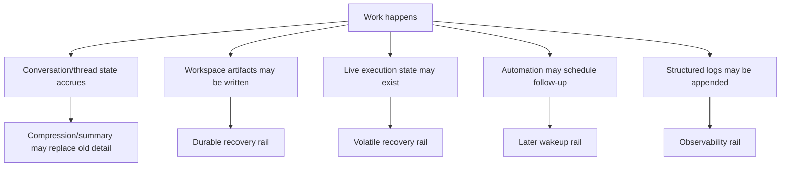

# Logging and Recovery Audit

Overview router: [README.md](/Users/songmin/Documents/code-new/semantica-codegraph-v2/docs/analysis/codex-agent/thread-management/README.md)

이 문서는 Codex 계열 에이전트의 `logging`과 `interruption recovery`를 현재 세션에서 보이는 evidence 기준으로 정리한다.

표기:
- `[FACT]`: 현재 세션 지침, visible tool surface, app/runtime context, thread behavior에서 직접 관측 가능한 사실
- `[STRONG-INFERENCE]`: 관측 사실을 가장 잘 설명하는 고신뢰 구조 추론
- `[WEAK-INFERENCE]`: plausible 하지만 직접 근거가 부족한 해석
- `[SOTA-INFERENCE]`: 2025-2026 desktop agent/local control-plane 일반 패턴과 현재 evidence를 합친 합리적 추론

주의:
- hidden backend telemetry, storage backend internals, exact persistence lifetime은 overclaim하지 않는다.
- 이 문서는 “무엇이 durable한가”와 “어떤 상태가 휘발적인가”를 분리하는 데 초점을 둔다.

---

## 1. Executive summary

### 1.1 Final verdict

- `Alignment`: High `[STRONG-INFERENCE]`
- `Robustness`: Strong for artifact/thread-backed continuity, Medium for volatile execution-state continuity `[STRONG-INFERENCE]`
- `Confidence`: High on current-session visible rails, Medium on hidden backend persistence internals `[STRONG-INFERENCE]`
- `Ship readiness`: Ship as analysis doc `[STRONG-INFERENCE]`

### 1.2 Top conclusions

1. 이 에이전트는 모든 작업을 별도 logfile로 기록하는 모델로 직접 보이지 않는다. `[STRONG-INFERENCE]`
2. direct structured log rail은 실제로 존재한다: `logs_2.sqlite.logs`. `[FACT]`
3. sample log target에는 `codex_api::sse::responses`, `codex_otel.log_only`, `hyper_util::*`, `session_loop...submission_dispatch`가 보인다. `[FACT]`
4. 다만 user-facing continuity는 여전히 `thread history + compressed summary + durable workspace artifacts` 조합이 더 강하다. `[STRONG-INFERENCE]`
5. live shell session, stdin stream, in-flight process 같은 것은 상대적으로 휘발성이 강한 상태다. `[STRONG-INFERENCE]`
6. automation/heartbeat는 recovery log 그 자체가 아니라 later wakeup/follow-up rail이다. `[FACT]` + `[STRONG-INFERENCE]`

---

## 2. Direct evidence inventory

## 2.1 Directly visible continuity rails

현재 세션에서 직접 관측 가능한 continuity 관련 사실:

1. thread conversation state가 누적된다. `[FACT]`
2. 긴 작업 뒤에 structured summary/compression state가 주입되는 것이 직접 관측됐다. `[FACT]`
3. visible tool surface에는 dedicated global memory CRUD tool이 없다. `[FACT]`
4. visible tool surface에는 shell execution tool과 session continuation tool이 있다:
   - `functions.exec_command` `[FACT]`
   - `functions.write_stdin` `[FACT]`
   - `functions.read_thread_terminal` `[FACT]`
5. visible tool surface에는 subagent continuation tool이 있다:
   - `spawn_agent` `[FACT]`
   - `send_input` `[FACT]`
   - `resume_agent` `[FACT]`
   - `wait_agent` `[FACT]`
   - `close_agent` `[FACT]`
6. explicit automation tool `codex_app.automation_update`가 직접 관측되었다. `[FACT]`
7. heartbeat automation을 실제로 생성하고 삭제한 thread behavior가 있었다. `[FACT]`

## 2.1A Directly visible structured logging rail

직접 확인한 facts:

1. `/Users/songmin/.codex/logs_2.sqlite`가 존재한다 `[FACT]`
2. `logs` table이 존재한다 `[FACT]`
3. columns에는 `level`, `target`, `feedback_log_body`, `thread_id`, `process_uuid`가 있다 `[FACT]`
4. current snapshot row count는 `4326814`다 `[FACT]`
5. recent sample target에는 `codex_api::sse::responses`, `codex_otel.log_only`, `hyper_util::client::legacy::*`가 보였다 `[FACT]`
6. recent sample body에는 `session_loop{thread_id=...}:submission_dispatch`가 보였다 `[FACT]`

## 2.2 Directly visible durable artifact evidence

이 대화에서 실제로 workspace에 남긴 artifacts:

- `/Users/songmin/Documents/code-new/semantica-codegraph-v2/docs/analysis/codex-agent/README.md` `[FACT]`
- `/Users/songmin/Documents/code-new/semantica-codegraph-v2/docs/analysis/codex-agent/*.md` 아래 다수의 analysis docs `[FACT]`
- `/Users/songmin/.codex/skills/dd/SKILL.md` `[FACT]`
- `/Users/songmin/.codex/skills/dd/agents/openai.yaml` `[FACT]`
- `/Users/songmin/.codex/skills/ss/SKILL.md` 수정 `[FACT]`
- `/Users/songmin/.codex/skills/aa/SKILL.md` 수정 `[FACT]`
- `/Users/songmin/.codex/skills/rr/SKILL.md` 수정 `[FACT]`

이 파일들은 app restart와 무관하게 workspace/skill directory에 남는 durable state다. `[STRONG-INFERENCE]`

## 2.3 Directly visible volatile-state evidence

직접 관측 가능한 휘발성 상태 관련 사실:

1. `write_stdin`은 `session_id`에 의존한다. `[FACT]`
2. `resume_agent`는 `id`에 의존한다. `[FACT]`
3. live shell session은 thread history와는 별도 identifier를 가진다. `[FACT]`
4. 현재 visible contract만으로는 shell session이 app restart 후 항상 복구된다고 말할 근거가 없다. `[FACT]`

---

## 3. Best-fit model

가장 설명력 높은 모델은 아래다. `[STRONG-INFERENCE]`

핵심:
- persistence는 단일 log file이 아니라 여러 rail의 조합으로 보인다 `[STRONG-INFERENCE]`
- recovery strength는 rail마다 다르다 `[STRONG-INFERENCE]`

---

## 4. Logging model

## 4.1 What is directly logged or retained in visible form

직접 보이는 retained state:

1. conversation turns `[FACT]`
2. tool calls and their outputs in thread context `[FACT]`
3. compressed summary state after long work spans `[FACT]`
4. files modified/created in workspace or skill directories `[FACT]`
5. structured operational log rows in `logs_2.sqlite` `[FACT]`

이 네 가지는 “visible retained state”로 보는 것이 가장 타당하다. `[STRONG-INFERENCE]`

## 4.2 What is not directly shown as explicit logging

직접 보이지 않는 것:

1. user-facing semantic recovery가 dedicated per-task logfile replay에 의존한다는 증거 `[FACT]`
2. visible global memory database for arbitrary user facts `[FACT]`
3. visible persistent operation journal API `[FACT]`

따라서 “로그가 전혀 없다”도 틀리고, “user-facing recovery가 로그 DB replay만으로 닫힌다”도 틀릴 가능성이 높다. `[STRONG-INFERENCE]`

## 4.3 Best-fit logging interpretation

가장 보수적으로 정확한 해석:

- thread is a retained interaction log `[STRONG-INFERENCE]`
- compression summary is a retained working-state distillation `[STRONG-INFERENCE]`
- written artifacts are the strongest durable log-like substrate `[STRONG-INFERENCE]`
- `logs_2.sqlite` is a structured observability substrate `[STRONG-INFERENCE]`
- live process/session state is not a strong durable log rail `[STRONG-INFERENCE]`

---

## 5. Recovery model

## 5.1 Same-thread recovery

가장 강한 복구 경로:

1. thread history `[FACT]`
2. compressed summary `[FACT]`
3. durable artifacts in repo/skill directories `[FACT]`

이 조합으로 같은 thread 재진입 시 복구가 가능한 것으로 보인다. `[STRONG-INFERENCE]`

## 5.2 App restart / laptop interruption recovery

직접 말할 수 있는 것:

1. workspace files remain as durable state `[FACT]`
2. thread history appears to remain available within the conversation surface `[FACT]`
3. automation can wake the thread later when configured `[FACT]`

강한 추론:

- app restart 후에도 같은 thread와 workspace artifacts가 남아 있으면 continuity 복구가 가능하다 `[STRONG-INFERENCE]`
- 하지만 exact backend retention lifetime, shell session persistence, and hidden state restoration rules are not directly known `[WEAK-INFERENCE]`

## 5.3 Live shell / process recovery

현재 evidence에서 가장 보수적인 결론:

- live shell/process state는 durable continuity rail보다 약하다 `[STRONG-INFERENCE]`
- session-id based continuation exists, but restart-survival is not proven `[FACT]` + `[STRONG-INFERENCE]`

---

## 6. Role of automation in recovery

automation은 logging substrate라기보다 wakeup substrate로 보인다. `[STRONG-INFERENCE]`

직접 근거:

1. automation tool exists `[FACT]`
2. heartbeat and cron families exist `[FACT]`
3. heartbeat attaches to current thread and can wake it later `[FACT]`

따라서:
- automation = future re-entry trigger `[STRONG-INFERENCE]`
- artifact/thread state = actual recovery material `[STRONG-INFERENCE]`

---

## 7. Recovery strength by rail

| Rail | Visible evidence | Recovery strength | Why |
| --- | --- | --- | --- |
| Thread history | direct conversation continuity | Strong | same-thread context survives as visible surface |
| Compression summary | directly observed | Strong | preserves working state when context is compressed |
| Workspace artifacts | many files written | Very Strong | external durable state outside transient context |
| Skill directory edits | directly written files | Very Strong | durable local filesystem state |
| Structured logs DB | `logs_2.sqlite`, `logs` table | Medium | observability is durable, but semantic recovery SSOT는 아님 |
| Automation heartbeat | directly created/deleted | Medium | helps wake thread later but is not the work log itself |
| Live shell session | session_id based tools | Weak-Medium | continuation exists, restart durability unproven |
| In-flight process state | indirect | Weak | no direct evidence of durable restart restoration |

Classification:
- evidence cells `[FACT]`
- strength judgments `[STRONG-INFERENCE]`

---

## 8. Failure scenarios

### Scenario 1: rely only on live shell state

- setup: agent performs long-running work only in a shell session
- trigger: app or machine interruption
- expected robust behavior: important state already externalized to files or thread summary
- likely failure if not externalized: shell-local context lost
- severity: P1

Classification:
- volatile session evidence `[FACT]` + `[STRONG-INFERENCE]`

### Scenario 2: assume hidden global memory exists

- setup: user says “remember this” without artifact externalization
- trigger: new thread or interrupted context
- expected under visible contract: no explicit global memory guarantee
- likely failure: preference/fact not restored
- severity: P1

Classification:
- no visible global memory CRUD `[FACT]`

### Scenario 3: assume automation itself preserves work state

- setup: heartbeat created, but no artifact or summary exists
- trigger: later wakeup
- expected: wakeup occurs, but detailed state still needs thread/artifact substrate
- likely failure: weak continuation fidelity
- severity: P2

Classification:
- automation surface `[FACT]` + `[STRONG-INFERENCE]`

---

## 9. False confidence traps

1. “별도 로그파일이 안 보이니 아무것도 안 남는다”
- 아니다
- thread, summary, artifacts, structured logs가 남는다

2. “thread history만 있으면 충분하다”
- 아니다
- durable artifacts가 제일 강한 continuity rail이다

3. “heartbeat가 있으니 복구 state도 자동 저장된다”
- 아니다
- heartbeat는 wakeup rail이지 state journal이라는 evidence는 없다

4. “live shell session이 있으니 restart 후에도 그대로 이어진다”
- 현재 evidence로는 그렇게 말할 수 없다

---

## 10. Unknowns

직접 알 수 없는 것:

1. hidden backend logging retention/rotation semantics `[WEAK-INFERENCE]`
2. exact summary/compression trigger thresholds `[WEAK-INFERENCE]`
3. shell session survival across app restart `[WEAK-INFERENCE]`
4. automation persistence backend internals `[WEAK-INFERENCE]`
5. cross-thread memory restoration rules beyond visible thread/history/artifact rails `[WEAK-INFERENCE]`

---

## 11. Most precise safe summary

- 현재 visible contract상, structured log DB는 실제로 존재한다. `[FACT]`
- 다만 user-facing continuity는 `thread history + compressed summary + durable filesystem artifacts`를 중심으로 유지되는 것으로 보인다. `[STRONG-INFERENCE]`
- interruption recovery에서 가장 강한 rail은 workspace/skill directory에 남은 파일이다. `[FACT]` + `[STRONG-INFERENCE]`
- `logs_2.sqlite`는 observability rail로 보는 것이 가장 정확하다. `[STRONG-INFERENCE]`
- automation은 recovery log 자체가 아니라 later wakeup/follow-up rail로 보는 것이 가장 정확하다. `[STRONG-INFERENCE]`
- live shell/process state는 continuation identifier가 있더라도 durable restart-recovery rail로는 약하게 봐야 한다. `[STRONG-INFERENCE]`
