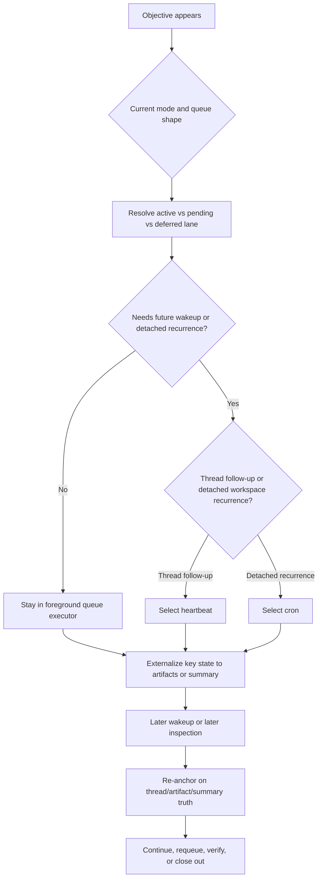
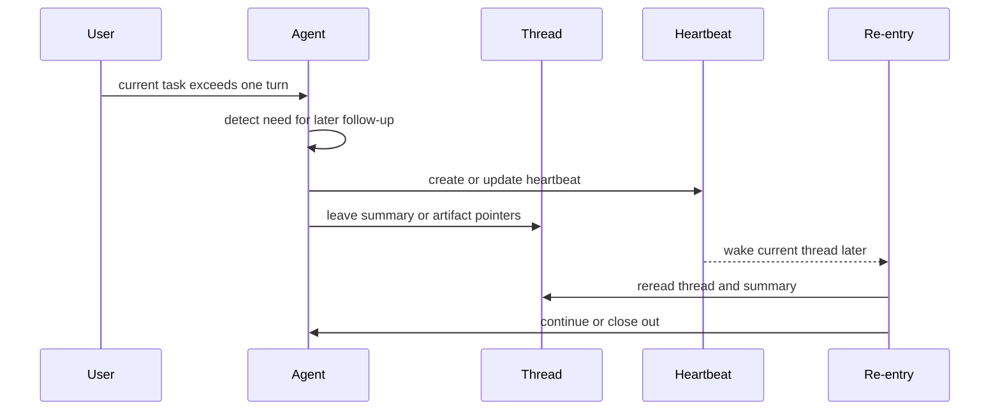
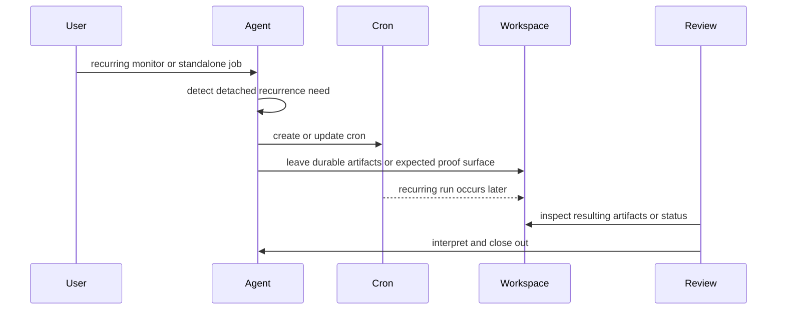

# Long-Horizon Task Management Audit

Overview router: [README.md](/Users/songmin/Documents/code-new/semantica-codegraph-v2/docs/analysis/codex-agent/thread-management/README.md)

이 문서는 Codex 계열 에이전트의 `장기 task(long-horizon task)` 동작을 현재 세션 기준으로 정리한다.

핵심 원칙:
- 먼저 `FACT-only ledger`
- 그 다음 `DERIVED operational model`
- 마지막에 `NON-CLAIM`

표기:
- `[FACT]`: 현재 세션 tool schema, app context, visible capability surface에서 직접 관측 가능한 사실
- `[STRONG-INFERENCE]`: 위 사실을 가장 잘 설명하는 구조 추론
- `[WEAK-INFERENCE]`: plausible 하지만 직접 근거가 약한 해석

주의:
- backend persistence internals, wakeup scheduler internals, hidden recall substrate는 단정하지 않는다.
- 이 문서는 “automation surface가 보인다”와 “그래서 long-horizon loop가 어떻게 도는가”를 분리한다.

---

## 1. Executive summary

### 1.1 Final verdict

- `Alignment`: High `[STRONG-INFERENCE]`
- `Robustness`: Medium `[STRONG-INFERENCE]`
- `Confidence`: High on visible long-horizon surface, Medium on end-to-end hidden backend semantics `[STRONG-INFERENCE]`
- `Ship readiness`: Ship as analysis doc `[STRONG-INFERENCE]`

### 1.2 Top conclusions

1. 현재 세션에는 explicit automation surface가 직접 보인다: `codex_app.automation_update`. `[FACT]`
2. visible explicit automation kind는 최소 둘이다: `heartbeat`와 `cron`. `[FACT]`
3. `update_plan`, subagent, thread history, compression summary, workspace artifacts도 visible하다. 이들의 역할 분해는 모델 층위다. `[FACT]` + `[STRONG-INFERENCE]`
4. 가장 설명력 높은 모델은 `trigger detection -> rail selection -> continuity externalization -> wakeup or detached execution -> re-entry and closeout` 5단계다. `[STRONG-INFERENCE]`
5. automation은 first-class rail이지만, durable proof and recovery substrate는 여전히 artifact와 summary 쪽이 더 강하다. `[STRONG-INFERENCE]`
6. 전체 shape는 `background planner`보다 `foreground queue executor + explicit continuation rails` 쪽으로 보는 것이 더 정확하다. `[STRONG-INFERENCE]`

---

## 2. FACT-only ledger

이 섹션은 구조 해석 없이, 현재 세션에서 직접 말할 수 있는 것만 적는다.

### 2.1 Visible long-horizon surfaces

1. `codex_app.automation_update` callable tool이 존재한다. `[FACT]`
2. app context는 recurring automations, reminders, monitors, follow-ups, thread wakeups를 지원한다고 말한다. `[FACT]`
3. automation 관련 요청이면 `automation_update` tool을 먼저 찾으라고 적혀 있다. `[FACT]`

### 2.2 Automation contract

1. `automation_update`는 `kind=heartbeat | cron`을 가진다. `[FACT]`
2. lifecycle mode로 `create`, `view`, `update`, `delete`, `suggested_create`, `suggested_update`를 가진다. `[FACT]`
3. common field로 `id`, `name`, `prompt`, `rrule`, `status`, `mode`가 보인다. `[FACT]`
4. heartbeat 관련 field로 `destination`, `targetThreadId`가 보인다. `[FACT]`
5. cron 관련 field로 `cwds`, `executionEnvironment`, `model`, `reasoningEffort`, `localEnvironmentConfigPath`가 보인다. `[FACT]`
6. scheduling machine field는 `rrule`이다. `[FACT]`
7. heartbeat는 minute-based interval을 지원한다. `[FACT]`
8. cron은 hourly interval or weekly schedule 쪽 설명을 가진다. `[FACT]`
9. existing automation request에서는 duplicate보다 update를 선호하라고 적혀 있다. `[FACT]`

직접 설명 텍스트에서 말할 수 있는 것:

- heartbeat description에는 `proactive follow-up attached to the current local thread`가 직접 보인다. `[FACT]`
- cron description에는 `standalone jobs against workspaces`가 직접 보인다. `[FACT]`

### 2.3 Other visible continuity rails

1. thread history가 대화 surface에 남는다. `[FACT]`
2. compressed summary or handoff state가 visible continuity rail로 관측된다. `[FACT]`
3. workspace artifact file을 생성/수정할 수 있다. `[FACT]`
4. `update_plan`이 존재한다. `[FACT]`
5. subagent lifecycle tool (`spawn_agent`, `send_input`, `resume_agent`, `wait_agent`, `close_agent`)이 존재한다. `[FACT]`
6. live exec/session continuation tool (`exec_command`, `write_stdin`, `read_thread_terminal`)이 존재한다. `[FACT]`

### 2.4 Direct boundaries

1. visible contract만으로는 automation persistence backend exact shape를 알 수 없다. `[FACT]`
2. visible contract만으로는 heartbeat wakeup internals를 알 수 없다. `[FACT]`
3. visible contract만으로는 cron execution backend internals를 알 수 없다. `[FACT]`
4. visible contract만으로는 arbitrary cross-thread rich recall을 보장할 수 없다. `[FACT]`

---

## 3. Derived distinctions

여기부터는 위 `FACT-only ledger`를 가장 잘 설명하는 추론이다.

### 3.1 Multi-step task vs long-horizon task

| Axis | Multi-step task | Long-horizon task | Basis |
| --- | --- | --- | --- |
| Main concern | current-session decomposition | future wakeup or detached recurrence | `[STRONG-INFERENCE]` |
| Primary rail | `update_plan`, working queue, next-step set | `heartbeat` or `cron`, plus durable continuity rails | `[STRONG-INFERENCE]` |
| Typical state | current active item, pending items, deferred validation | schedule, wakeup target, detached job context, durable handoff | `[STRONG-INFERENCE]` |
| Main failure mode | plan을 durable scheduler처럼 과신 | automation만 믿고 state externalization 생략 | `[STRONG-INFERENCE]` |

핵심:

- `update_plan`은 task decomposition rail로 읽는 것이 가장 자연스럽다. `[STRONG-INFERENCE]`
- `heartbeat`/`cron`은 long-horizon continuation rail로 읽는 것이 가장 자연스럽다. `[STRONG-INFERENCE]`
- 둘은 대체 관계가 아니다. `[STRONG-INFERENCE]`

### 3.2 Role split across rails

이 섹션은 rail `존재`가 아니라 rail `역할`을 정리하므로 전부 모델이다.

| Rail | Most plausible role | Why this is not stronger than that |
| --- | --- | --- |
| heartbeat | current thread follow-up or wakeup | thread-attached description은 보이지만 backend wakeup internals는 안 보임 |
| cron | detached recurring workspace execution | workspace-job description은 보이지만 execution backend는 안 보임 |
| `update_plan` | current-session explicit plan state | future wakeup scheduling field가 없음 |
| subagent | bounded sidecar work | recurring schedule semantics가 없음 |
| artifact | durable state ledger | schedule trigger는 아님 |
| summary | compressed re-entry packet | full execution log는 아님 |
| live exec session | in-flight continuation | durable restart rail이라는 근거는 약함 |

---

## 4. Derived operational model

가장 설명력 높은 end-to-end long-horizon loop는 5단계다.

### 4.1 Stage model

이 표의 `Strongest visible basis` 열은 FACT anchor이고, `Derived outcome` 열은 모델이다.

| Stage | Main question | Strongest visible basis | Derived outcome |
| --- | --- | --- | --- |
| 1. Trigger detection | 이 작업이 later wakeup or recurrence를 요구하나 | mode surface, automation surface, plan surface, task queue surface | long-horizon 여부 분기 `[STRONG-INFERENCE]` |
| 2. Branch shaping | 누가 분기를 닫고, 어떤 queue lane이 active인가 | Default vs Plan difference, current/pending/deferred queue model | mode branch + queue branch 형성 `[STRONG-INFERENCE]` |
| 3. Rail selection | thread follow-up인가 detached workspace run인가 | heartbeat vs cron field split, subagent and plan surfaces | heartbeat or cron or current-session queue 유지 `[STRONG-INFERENCE]` |
| 4. Continuity externalization | later re-entry 때 무엇을 다시 읽을 것인가 | artifacts, summary, thread history visible | state를 artifact/summary에 남김 `[STRONG-INFERENCE]` |
| 5. Wakeup, re-entry, and closeout | 나중에 무엇을 다시 읽고 어떻게 닫나 | automation lifecycle, thread/artifact rails, closeout queue model | wakeup or detached recurrence 후 proof를 artifact/thread에 다시 고정 `[STRONG-INFERENCE]` |

### 4.2 Diagram

### 4.3 Why this model fits

1. long-horizon에는 explicit automation surface가 직접 보인다. `[FACT]`
2. 그 surface는 `heartbeat`와 `cron` kind 구분을 직접 가진다. `[FACT]`
3. task decomposition surface로 `update_plan`과 task queue owner 문서가 따로 존재한다. `[FACT]`
4. mode owner 문서는 Default와 Plan의 interaction contract 차이를 정리한다. `[FACT]`
5. logging/recovery owner 문서는 thread, summary, artifact, automation, live session 같은 continuity rail existence를 정리한다. `[FACT]`

따라서 long-horizon을:
- 단순 `plan 연장선`
- 또는 단순 `automation만 있으면 됨`
- 또는 단순 `background scheduler가 알아서 저장함`

으로 보는 것보다,

- `foreground queue execution`과
- `rail selection`과
- `durable state externalization`

의 결합체로 보는 것이 더 설명력이 높다. `[STRONG-INFERENCE]`

---

## 5. Representative flows

### 5.1 Thread follow-up flow

FACT anchor:
- heartbeat surface exists
- thread-bound fields exist
- thread history and summary rails exist

derived part:
- later re-entry는 summary/artifact reread를 동반한다 `[STRONG-INFERENCE]`
- closeout은 current item 종료, requeue, deferred validation carry 중 하나 이상을 포함한다 `[STRONG-INFERENCE]`

### 5.2 Detached recurring workspace flow

FACT anchor:
- cron surface exists
- workspace/job fields exist

derived part:
- detached run 결과를 다시 artifact/status 쪽에서 해석해야 한다 `[STRONG-INFERENCE]`
- cron 자체가 final proof store는 아니고, closeout은 다시 foreground 해석 단계가 필요하다 `[STRONG-INFERENCE]`

---

## 6. Failure modes

### 6.1 Treat `update_plan` as durable scheduler

- break: current-session plan state만 있으면 later wakeup continuity가 된다고 과신
- stronger model: plan은 decomposition rail, automation은 long-horizon rail, artifact/summary는 durable substrate

### 6.2 Treat automation as state ledger

- break: wakeup or cron recurrence는 있었지만 later re-entry에서 읽을 durable context가 약함
- stronger model: automation은 trigger/execution rail, state ledger는 artifact or summary

### 6.3 Collapse heartbeat and cron

- break: thread follow-up과 detached workspace recurrence semantics가 섞임
- stronger model: thread-bound vs workspace-bound split을 유지

### 6.4 Treat live exec session as the primary long-horizon substrate

- break: interruption/app restart 뒤 continuity 약화
- stronger model: live exec는 약한 continuation rail, artifact/summary가 더 강함

---

## 7. NON-CLAIM boundary

이 문서가 주장하지 않는 것:

1. heartbeat wakeup backend exact implementation
2. cron execution backend exact implementation
3. exact persistence lifetime
4. arbitrary cross-thread automatic recall
5. automation 자체가 complete proof log를 저장한다는 주장

---

## 8. Most precise safe summary

- 현재 세션에는 explicit automation surface가 직접 보인다: `codex_app.automation_update`. `[FACT]`
- visible explicit automation kind는 `heartbeat`와 `cron`으로 나뉜다. `[FACT]`
- `update_plan`, subagent, summary, artifact, thread continuity도 visible하다. 그것들의 역할 분해는 모델 층위다. `[FACT]` + `[STRONG-INFERENCE]`
- 가장 설명력 높은 모델은 `trigger detection -> rail selection -> continuity externalization -> wakeup or detached execution -> re-entry and closeout`이다. `[STRONG-INFERENCE]`
- 이 모델은 합리적 추론 기반이지만, backend persistence internals까지 본 것은 아니다. `[NON-CLAIM]`
