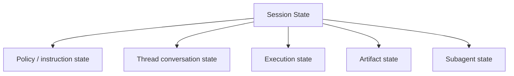
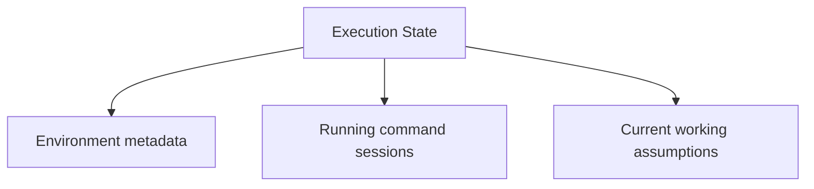
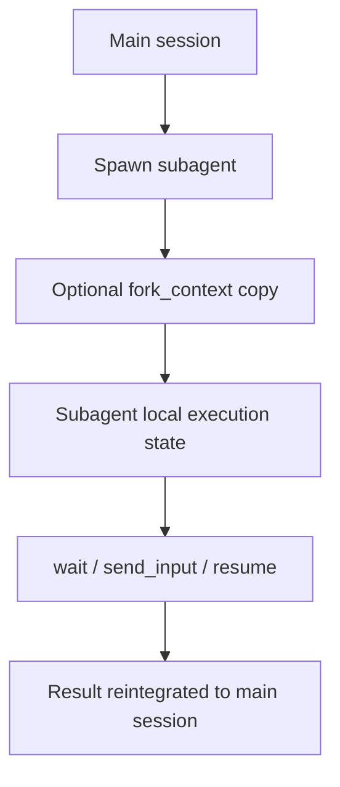
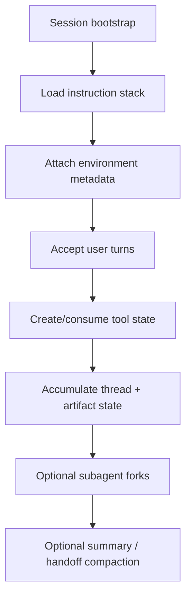
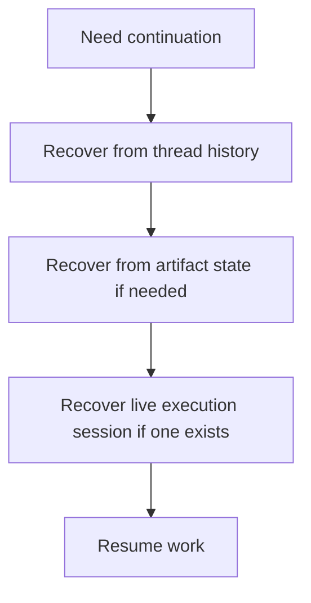

# Session Management Audit

Overview router: [README.md](/Users/songmin/Documents/code-new/semantica-codegraph-v2/docs/analysis/codex-agent/thread-management/README.md)

Subagent-specific deep dive: [subagent/README.md](/Users/songmin/Documents/code-new/semantica-codegraph-v2/docs/analysis/codex-agent/thread-management/subagent/README.md)

이 문서는 Codex 계열 에이전트의 `세션관리(session management)`를 감사 관점으로 정리한다.

범위:
- 세션이 어떤 상태로 구성되는지
- 세션 상태가 어떻게 유지/갱신/복구/분기되는지
- thread history, mode, tool session, subagent, summary, artifact가 세션관리에서 어떤 역할을 하는지
- 무엇이 직접 관측 가능한 사실이고, 무엇이 강한/약한 추론인지

표기:
- `[FACT]`: 현재 세션 지침, tool schema, environment/app context, 대화/도구 이력에서 직접 관측 가능한 사실
- `[STRONG-INFERENCE]`: 관측 사실을 가장 잘 설명하는 고신뢰 구조 추론
- `[WEAK-INFERENCE]`: plausible 하지만 직접 근거가 부족한 해석
- `[SOTA-INFERENCE]`: 2025-2026 desktop agent/local control-plane 일반 패턴과 현재 evidence를 합친 합리적 추론

주의:
- 이 문서는 hidden backend session store 구현을 직접 본 것이 아니다.
- 현재 세션에서 실제로 보이는 contract와 behavior만 우선한다.

---

## 1. Executive summary

### 1.1 Final verdict

- `Alignment`: High `[STRONG-INFERENCE]`
- `Robustness`: Strong on visible thread/tool/subagent/session contract, Medium on hidden persistence internals `[STRONG-INFERENCE]`
- `Confidence`: High on current-session state surfaces, Medium on generalized lifecycle internals `[STRONG-INFERENCE]`
- `Ship readiness`: Ship as analysis doc `[STRONG-INFERENCE]`

### 1.2 Top conclusions

1. 세션은 단일 채팅 로그가 아니라 **instruction stack + thread history + tool execution state + artifact state + subagent state**의 결합체로 보인다. `[STRONG-INFERENCE]`
2. 현재 세션에는 explicit terminal session, subagent ids, mode, sandbox, approval, cwd, date/timezone 같은 session metadata가 직접 보인다. `[FACT]`
3. tool session은 thread session과 별도로 존재할 수 있다. 예: `write_stdin(session_id=...)`가 가능한 long-lived exec session. `[FACT]`
4. subagent는 main session의 분기(fork) 또는 별도 child session처럼 관리되는 것으로 보인다. `[FACT]` + `[STRONG-INFERENCE]`
5. summary와 artifact 문서는 세션 continuity를 보존하는 외부화 수단으로 기능한다. `[STRONG-INFERENCE]`
6. local SQLite에는 session/thread state의 persisted projection이 별도로 존재한다. `[FACT]` + `[STRONG-INFERENCE]`

---

## 2. Direct evidence inventory

## 2.1 Visible session metadata

현재 세션에서 직접 보이는 metadata:

| Evidence | Meaning | Classification |
| --- | --- | --- |
| `cwd`가 제공된다 | session has a bound workspace root | `[FACT]` |
| `shell=zsh`가 제공된다 | session has shell/runtime context | `[FACT]` |
| `current_date`와 `timezone`이 제공된다 | session has temporal context | `[FACT]` |
| `subagents` ID 목록이 제공된다 | session is aware of subordinate agent handles | `[FACT]` |
| `collaboration_mode=Default`가 제공된다 | session has an active mode | `[FACT]` |
| sandbox / approval / network metadata가 제공된다 | session has execution-boundary state | `[FACT]` |

## 2.2 Tool-level session evidence

| Tool evidence | Meaning | Classification |
| --- | --- | --- |
| `exec_command` can return an ongoing session ID | tool execution can create long-lived command session | `[FACT]` |
| `write_stdin` takes `session_id` | command session state is resumable/interactive | `[FACT]` |
| `read_thread_terminal` exists | thread-level terminal surface exists | `[FACT]` |
| `spawn_agent`, `resume_agent`, `wait_agent`, `close_agent` exist | sub-session / child-session lifecycle exists | `[FACT]` |
| `spawn_agent` has `fork_context` | context forking is first-class | `[FACT]` |

## 2.3 Conversation-level evidence

| Evidence | Meaning | Classification |
| --- | --- | --- |
| prior turns remain available across the conversation | thread history persists inside session | `[FACT]` |
| system/developer/app/repo instructions stay active across turns | instruction state persists for session lifetime | `[FACT]` |
| a summary message can be produced for handoff/continuity | session can be externally compacted into a state summary | `[FACT]` |

## 2.4 Persisted local session-state evidence

| Evidence | Meaning | Classification |
| --- | --- | --- |
| `threads(id, cwd, title, preview, archived, rollout_path, ...)` table exists | session/thread metadata has a local persisted projection | `[FACT]` |
| recent sample rows show `title`, `first_user_message`, `preview` often align | thread presentation metadata is derived and persisted | `[FACT]` + `[STRONG-INFERENCE]` |
| `thread_dynamic_tools(thread_id, position, name, ...)` exists | tool surface can be projected per thread | `[FACT]` |
| recent sample rows repeatedly expose `automation_update`, `read_thread_terminal`, `load_workspace_dependencies` per thread | session-local tool surface is not just abstract prompt state | `[FACT]` + `[STRONG-INFERENCE]` |
| `thread_spawn_edges(parent_thread_id, child_thread_id, status)` exists | lineage/fork state has a local persisted representation | `[FACT]` |
| `threads.thread_source='subagent'` rows are a large share of the population | persisted `threads` table spans more than top-level user chats | `[FACT]` + `[STRONG-INFERENCE]` |

---

## 3. Session state model

가장 설명력이 높은 session model은 아래다. `[STRONG-INFERENCE]`



각 층:
1. `Policy / instruction state`
2. `Thread conversation state`
3. `Execution state`
4. `Artifact state`
5. `Subagent state`

---

## 4. Policy / instruction session state

## 4.1 Direct evidence

현재 세션에는 아래가 동시에 active state로 존재한다. `[FACT]`

- system instructions
- developer instructions
- app context
- collaboration mode
- personality spec
- skills instructions
- plugins instructions
- repo-local `AGENTS.md`

## 4.2 Why this is session state

이 규칙들은 한 번 읽고 버리는 것이 아니라, 세션 전체 동안 지속적으로 적용된다. `[STRONG-INFERENCE]`

즉 이 층은:
- session bootstrap state
- high-priority read-only control state

로 기능한다. `[STRONG-INFERENCE]`

## 4.3 Mutation rule

직접 보이는 규칙:
- mode는 user request가 아니라 new developer instruction으로만 바뀐다 `[FACT]`

강한 추론:
- policy state는 일반 user prompt보다 높은 권한으로만 mutate된다 `[STRONG-INFERENCE]`

---

## 5. Thread conversation state

## 5.1 What is visible

- user/assistant/tool interactions가 누적된다 `[FACT]`
- 이전 논의를 기반으로 후속 질문이 가능하다 `[FACT]`
- 앞에서 만든 분석 모델을 계속 이어서 확장했다 `[FACT]`

## 5.2 Session role

thread state는:
1. user intent continuity
2. previous conclusions
3. previous open questions
4. previous tool results

를 담는 session rail로 보인다. `[STRONG-INFERENCE]`

## 5.3 Fragility

thread state는:
- 길어질수록 summarization/compression pressure를 받을 가능성이 있다 `[WEAK-INFERENCE]`
- 그래서 external artifact와 summary가 보조 continuity rail이 된다 `[STRONG-INFERENCE]`

---

## 6. Execution state

execution state는 단순 대화 내용과 다르다.

## 6.1 Visible components

1. current mode `[FACT]`
2. sandbox / approval / network `[FACT]`
3. shell context `[FACT]`
4. current cwd `[FACT]`
5. long-lived command session IDs via `write_stdin` path `[FACT]`

## 6.2 Best-fit model



### Environment metadata

- cwd
- shell
- date/timezone
- sandbox
- network
- approval

모두 `[FACT]`.

### Running command sessions

- `exec_command` can create a continuing session `[FACT]`
- `write_stdin(session_id)` resumes it `[FACT]`

이건 tool execution state가 thread state와 별도로 존재함을 직접 보여준다. `[STRONG-INFERENCE]`

local DB projection까지 합치면:
- thread conversation state
- runtime execution state
- persisted session metadata state

가 분리되어 있을 가능성이 높다 `[STRONG-INFERENCE]`.

### Current working assumptions

예:
- 이미 읽은 파일
- 최근 실패 원인
- 현재 수정 strategy

이는 working-memory/session-state 성격이 강하다. `[STRONG-INFERENCE]`

---

## 7. Artifact state

## 7.1 Direct evidence

- 이 세션 동안 `/docs/analysis/codex-agent/` 아래 문서들이 누적 생성되었다 `[FACT]`
- file edits themselves persist in the workspace `[FACT]`

## 7.2 Session role

artifact state는 session 외부 durable rail이다. `[STRONG-INFERENCE]`

역할:
1. long-lived continuity
2. handoff material
3. memory externalization
4. re-entry point for future sessions

## 7.3 Why it matters

세션이 길어질수록:
- thread/working state만으로 계속 가는 것보다
- artifacts로 상태를 밀어내는 것이 더 안정적이다

이 해석은 현재 문서 축적 패턴과 잘 맞는다. `[STRONG-INFERENCE]`

---

## 8. Subagent state

## 8.1 Direct evidence

visible tools:
- `spawn_agent`
- `send_input`
- `resume_agent`
- `wait_agent`
- `close_agent`
- `fork_context`

모두 `[FACT]`.

## 8.2 Best-fit lifecycle



이 구조는 tool schema를 가장 자연스럽게 설명한다. `[STRONG-INFERENCE]`

## 8.3 Session interpretation

subagent는:
- 완전히 무상태 함수 호출이 아니라
- 별도 identity를 가진 child session/child context

로 보는 것이 적절하다. `[STRONG-INFERENCE]`

근거:
- stable target IDs
- resume capability
- input forwarding
- wait semantics

모두 `[FACT]`에 기반한다.

---

## 9. Session lifecycle

현재 세션 evidence를 바탕으로 재구성한 lifecycle:



분류:
- bootstrap inputs 존재 `[FACT]`
- lifecycle reconstruction `[STRONG-INFERENCE]`

## 9.1 Bootstrap

보이는 bootstrap inputs:
- instructions
- tools
- plugins
- mode
- environment context

모두 `[FACT]`.

## 9.2 Steady-state

steady-state에서 일어나는 일:
- user turns
- tool actions
- working-state updates
- artifact writes

이는 observed behavior와 일치한다. `[FACT]` + `[STRONG-INFERENCE]`

## 9.3 Handoff / compaction

summary generation은 session continuity를 압축하는 rail로 보인다. `[STRONG-INFERENCE]`

직접 근거:
- summary message가 실제로 생성될 수 있다 `[FACT]`

---

## 10. Session recovery / resume

## 10.1 Visible mechanisms

1. `write_stdin`로 command session continuation `[FACT]`
2. `resume_agent`로 subagent continuation `[FACT]`
3. thread history persistence `[FACT]`
4. artifact re-entry through files/docs `[FACT]`

## 10.2 Recovery model



이건 visible mechanisms를 가장 잘 조합하는 model이다. `[STRONG-INFERENCE]`

---

## 11. Session boundaries

session management에서 중요한 경계:

### 11.1 Within-session

- thread history
- working state
- active tool sessions

### 11.2 Cross-turn but same session

- prior answers
- prior tool outputs
- prior mode and policy stack

### 11.3 Beyond-session / durable

- artifacts
- repo changes
- generated docs

직접 observable global cross-session memory API는 없다. `[FACT]`

---

## 12. Attack surface analysis

## 12.1 False assumption: session = chat log only

- contradicted by tool sessions, subagents, mode, sandbox, artifact continuity
- severity: P1

Classification:
- `[FACT]` + `[STRONG-INFERENCE]`

## 12.2 False assumption: session state is entirely transient

- contradicted by artifact continuity and resumable handles
- severity: P1

Classification:
- `[FACT]` + `[STRONG-INFERENCE]`

## 12.3 False assumption: subagent is stateless RPC

- contradicted by IDs, resume, fork_context, wait lifecycle
- severity: P1

Classification:
- `[FACT]`

## 12.4 False assumption: hidden global session store is proven

- not enough evidence
- severity: P2

Classification:
- `[FACT]`

---

## 13. Concrete failure scenarios if session management is misunderstood

### Scenario 1: ignore prior working state and reread everything

- setup: follow-up task in same session
- trigger: assistant treats it as fresh stateless interaction
- expected: reuse thread + working state
- likely failure: wasted tool budget, repeated exploration
- severity: P2

Classification:
- direct rule basis `[FACT]`

### Scenario 2: assume artifact writes are not part of session continuity

- setup: long-running analysis task
- trigger: assistant does not externalize state
- expected: docs/artifacts preserve continuity
- likely failure: drift, lost context, weaker handoff
- severity: P1

Classification:
- artifact accumulation evidence `[FACT]` + `[STRONG-INFERENCE]`

### Scenario 3: assume subagent has no persistent state

- setup: delegated task with follow-up
- trigger: assistant respawns instead of resume/send_input
- expected: reuse existing agent context when appropriate
- likely failure: duplicated work and context loss
- severity: P2

Classification:
- tool semantics `[FACT]`

### Scenario 4: assume mode can be changed by user text alone

- setup: user asks to “switch to plan mode”
- trigger: assistant internally assumes mode changed
- expected: mode changes only by developer instruction
- likely failure: wrong tool path and wrong interaction shape
- severity: P1

Classification:
- direct mode rule `[FACT]`

---

## 14. False confidence traps

1. “세션”은 그냥 conversation text다
- 아니다
- execution state, subagent state, mode, artifacts가 있다

2. long-lived shell session은 없고 매 command는 독립이다
- 아니다
- `write_stdin(session_id)`가 직접 보인다

3. summary는 단순 요약문일 뿐이다
- 현재 context에선 handoff/compaction rail로 읽는 게 더 정확하다

4. artifact는 output이지 session state가 아니다
- durable continuity rail이라는 점을 놓치기 쉽다

---

## 15. Unknowns

직접 알 수 없는 것:

1. hidden backend session store implementation `[WEAK-INFERENCE]`
2. thread compaction/summarization internals `[WEAK-INFERENCE]`
3. live terminal session retention policy beyond current thread `[WEAK-INFERENCE]`
4. exact persistence semantics of subagent state across closures `[WEAK-INFERENCE]`

---

## 16. Most precise safe summary

- 현재 세션의 session management는 `instruction stack + thread history + execution state + artifact state + subagent state`의 결합체로 보는 것이 가장 정확하다. `[STRONG-INFERENCE]`
- 직접 관측 가능한 session state는 mode, sandbox, approval, network, cwd, shell, subagent IDs, tool handles, and conversation history다. `[FACT]`
- `write_stdin(session_id)`와 `resume_agent(id)`는 resumable session/child-session semantics를 직접 보여준다. `[FACT]`
- artifacts와 summary는 long-running work의 continuity/handoff rail로 기능한다고 보는 것이 observed behavior와 가장 잘 맞는다. `[STRONG-INFERENCE]`

---

## Round 2 update (2026-05-21 deep dive)

이 섹션은 session/turn 단위 state 가시성을 더 확정한다. storage layout/`logs_2.sqlite` deep dive는 [storage-and-db-audit.md](./storage-and-db-audit.md#round-2-update-2026-05-21-deep-dive)가 owner다.

### R2.1 Turn-level full snapshot rail

`archived_sessions/rollout-*.jsonl`의 한 line type `turn_context`가 직접 확인됐다. `[FACT]`

payload keys:

```
turn_id, cwd, current_date, timezone, approval_policy, sandbox_policy,
permission_profile, model, personality, collaboration_mode,
realtime_active, effort, summary, user_instructions, truncation_policy
```

의미:
- 매 turn마다 **execution state + policy state + instruction state의 full snapshot**이 한 line으로 박힌다 `[FACT]`
- 즉 session state model의 §4 (policy/instruction), §5 (thread), §6 (execution)가 turn 단위로 self-contained하게 기록된다 `[STRONG-INFERENCE]`
- 이건 round-1의 §10.2 recovery model을 훨씬 더 강하게 한다 — 같은 thread 재진입이든 fork든, 그 turn의 policy/sandbox/model/personality/collaboration_mode를 정확히 재구성 가능 `[STRONG-INFERENCE]`

### R2.2 `session_meta` payload keys

같은 archived rollout의 `session_meta` line payload keys (직접 확인): `[FACT]`

```
id, timestamp, cwd, originator, cli_version, source, model_provider,
base_instructions, git
```

- `source`와 `originator`가 sub-field로 박혀서 session origin (user vs subagent vs automation 등)이 self-describing하다 `[STRONG-INFERENCE]`
- `git` payload는 thread row의 `git_sha`/`git_branch`/`git_origin_url`과 같은 기원을 가질 가능성이 높다 `[STRONG-INFERENCE]`

### R2.3 Session/thread ID format

`session_index.jsonl` line schema (확정): `[FACT]`

```json
{"id":"019df0da-7f60-7f20-9d1a-d128bf054cea","thread_name":"...","updated_at":"<ISO8601>"}
```

- `id`는 UUID v7-like 형태 (`019df0da-7f60-7...` time-prefix) `[FACT]`
- 즉 thread/session ID는 시간순 정렬이 가능한 sortable identifier다 `[STRONG-INFERENCE]`
- index lag: 이 머신에는 `archived_sessions/` 6,326 files vs `session_index.jsonl` 5,607 lines — 즉 archived rollout이 index보다 약간 앞선다 `[FACT]` + `[STRONG-INFERENCE]`

### R2.4 Collaboration mode is an explicit RPC mutation

이전 §4에서 “mode는 user request가 아니라 new developer instruction으로만 바뀐다”라고 적었던 것을 확장한다.

round-2 evidence: `[FACT]`

- `thread-follower-set-collaboration-mode` event가 thread-follower channel에 explicit하게 존재한다
- `turn_context.collaboration_mode`가 매 turn snapshot으로 박힌다
- `.codex-global-state.json`에는 `agent-mode-by-host-id.local = "full-access"|"read-only"`라는 별도 global trust knob이 있다

해석:
- per-thread collaboration_mode와 per-host agent-mode는 다른 layer다 `[STRONG-INFERENCE]`
- per-host knob (`full-access`/`read-only`)이 더 외곽 trust gate로 작동하고, per-thread collaboration_mode는 그 안에서 conversation 단위 모드를 표현하는 것으로 보인다 `[STRONG-INFERENCE]`
- mode mutation이 UI RPC로 노출된 것은 §4.3 “high-priority mutation only” rule을 binary RPC level로 구체화한 것이다 `[STRONG-INFERENCE]`

### R2.5 Approval/elicitation as session events

round-1 §6에는 `approval` metadata는 있지만 approval flow가 어떻게 mutate되는지는 모델 층이었다. round-2는 4개 explicit approval events를 확정한다. `[FACT]`

- `thread-follower-command-approval-decision`
- `thread-follower-file-approval-decision`
- `thread-follower-permissions-request-approval-response`
- `thread-follower-submit-mcp-server-elicitation-response`

해석:
- approval flow는 conversation prompt가 아니라 typed RPC channel을 통한 별도 mutation이다 `[STRONG-INFERENCE]`
- mcp server elicitation도 같은 channel family를 공유한다 → tool RPC vs approval RPC가 unified envelope를 쓴다 `[STRONG-INFERENCE]`
- 이건 §12.3 “subagent is stateless RPC” false assumption과 같은 결로, approval/elicitation도 일회성 conversational input이 아닌 first-class lifecycle event다 `[STRONG-INFERENCE]`

### R2.6 Updated unknowns

round-1 §15에서 일부 unknowns가 보강됐다:

- ~~thread compaction/summarization internals~~ → `thread-follower-compact-thread` event 존재가 확인됐다 (mechanism은 여전히 black-box) `[FACT]`
- ~~live terminal session retention policy~~ → 여전히 unknown (변화 없음)
- approval/elicitation flow → typed RPC envelope임이 확인됨 `[FACT]`
