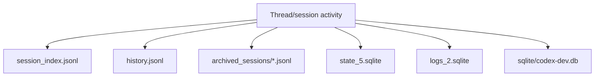

# Codex Thread Storage and DB Audit

Overview router: [README.md](/Users/songmin/Documents/code-new/semantica-codegraph-v2/docs/analysis/codex-agent/thread-management/README.md)

이 문서는 Codex의 `thread/session storage`를 현재 로컬에서 직접 보인 artifact 기준으로 정리한다.

범위:
- `~/.codex` 아래에서 직접 확인된 JSONL and SQLite artifacts
- thread/session/automation/logging 관련 table names and columns
- 각 저장 rail이 어떤 역할로 보이는지
- 무엇이 `FACT`이고, 무엇이 overclaim인지

표기:
- `[FACT]`: 현재 로컬 filesystem, JSONL head/sample, SQLite schema에서 직접 확인된 사실
- `[STRONG-INFERENCE]`: 위 사실을 가장 잘 설명하는 고신뢰 구조 추론
- `[WEAK-INFERENCE]`: plausible 하지만 직접 근거가 부족한 해석
- `[SOTA-INFERENCE]`: 2025-2026 desktop agent/local control-plane 일반 패턴과 현재 evidence를 합친 합리적 추론

주의:
- 이 문서는 local visible persistence layer를 다룬다.
- hidden service-side DB, sync backend, retention GC policy는 직접 보지 못했다.

---

## 1. Executive summary

### 1.1 Top conclusions

1. visible local persistence는 단일 DB가 아니라 `JSONL + SQLite + workspace artifact` 혼합 구조다. `[FACT]` + `[STRONG-INFERENCE]`
2. thread index 성격의 JSONL, archived rollout JSONL, lightweight input history JSONL이 별도로 보인다. `[FACT]`
3. SQLite도 최소 세 갈래가 보인다:
   - `state_5.sqlite` for thread/session/job state `[FACT]`
   - `logs_2.sqlite` for structured logs `[FACT]`
   - `sqlite/codex-dev.db` for automation/inbox/local-app feature state `[FACT]`
4. 따라서 “Codex는 DB를 안 쓰고 파일만 쓴다”도 틀리고, “모든 thread state가 하나의 SQLite에만 있다”도 틀릴 가능성이 높다. `[STRONG-INFERENCE]`

---

## 2. Direct artifact inventory

직접 확인한 local artifacts:

- `/Users/songmin/.codex/session_index.jsonl` `[FACT]`
- `/Users/songmin/.codex/history.jsonl` `[FACT]`
- `/Users/songmin/.codex/archived_sessions/rollout-*.jsonl` 다수 `[FACT]`
- `/Users/songmin/.codex/logs_2.sqlite` `[FACT]`
- `/Users/songmin/.codex/state_5.sqlite` `[FACT]`
- `/Users/songmin/.codex/sqlite/codex-dev.db` `[FACT]`

이 자체로:
- JSONL rail 존재 `[FACT]`
- SQLite rail 존재 `[FACT]`
- thread/session persistence가 단일 포맷이 아님 `[STRONG-INFERENCE]`

### 2.1 Snapshot size on 2026-05-21

현재 local snapshot에서 직접 확인한 대략적 규모:

- `session_index.jsonl`: 5570 lines `[FACT]`
- `history.jsonl`: 1358 lines `[FACT]`
- `archived_sessions/rollout-*.jsonl`: 6211 files `[FACT]`
- `threads` rows: 6950 `[FACT]`
- `thread_spawn_edges` rows: 5986 `[FACT]`
- `thread_dynamic_tools` rows: 8472 `[FACT]`
- `logs` rows: 4326814 `[FACT]`

이 규모 자체는:
- thread/session surface가 장난감 1-file cache가 아니라 꽤 오래 누적되는 local control plane임을 시사한다 `[STRONG-INFERENCE]`

---

## 3. JSONL rails

## 3.1 `session_index.jsonl`

head sample에서 직접 보인 row shape:

```json
{"id":"...","thread_name":"...","updated_at":"..."}
```

안전한 결론:
- session/thread index row가 JSONL로 남는다 `[FACT]`
- 최소 필드는 `id`, `thread_name`, `updated_at`다 `[FACT]`

가장 설명력 높은 해석:
- sidebar thread list의 lightweight index substrate 중 하나다 `[STRONG-INFERENCE]`

## 3.2 `history.jsonl`

head sample에서 직접 보인 row shape:

```json
{"session_id":"...","ts":1777859141,"text":"..."}
```

안전한 결론:
- lightweight user text history rail이 JSONL로 별도 존재한다 `[FACT]`
- 최소 필드는 `session_id`, `ts`, `text`다 `[FACT]`

## 3.3 `archived_sessions/rollout-*.jsonl`

sample head에서 직접 보인 record types:

```json
{"timestamp":"...","type":"session_meta","payload":{...}}
{"timestamp":"...","type":"response_item","payload":{...}}
```

안전한 결론:
- archived rollout은 append-only event log에 가까운 JSONL artifact로 남는다 `[FACT]`
- `session_meta`, `response_item`, `event_msg` 류 record family가 존재한다 `[FACT]`
- one session/thread에 여러 event line이 누적된다 `[FACT]`

가장 설명력 높은 해석:
- detailed replay/debug/handoff rail은 archived rollout JSONL이 맡는다 `[STRONG-INFERENCE]`

---

## 4. SQLite rails

## 4.0 Engine and migration evidence

직접 보인 facts:

- `state_5.sqlite`에는 `_sqlx_migrations` table이 있다 `[FACT]`
- `logs_2.sqlite`에도 `_sqlx_migrations` table이 있다 `[FACT]`
- `state_5.sqlite` migration descriptions sample:
  - `threads preview`
  - `thread goals`
  - `thread dynamic tools namespace`
  - `threads thread source`
  모두 `[FACT]`
- `logs_2.sqlite` migration descriptions sample:
  - `logs`
  - `logs feedback log body`
  모두 `[FACT]`

가장 보수적인 해석:
- 적어도 `state_5.sqlite`와 `logs_2.sqlite`는 SQLx-managed SQLite migration path를 쓸 가능성이 높다 `[STRONG-INFERENCE]`
- 즉 local state/log persistence layer의 일부는 Rust ecosystem migration stack과 매우 잘 맞는다 `[SOTA-INFERENCE]`

## 4.1 `state_5.sqlite`

visible tables:

- `threads` `[FACT]`
- `thread_goals` `[FACT]`
- `thread_spawn_edges` `[FACT]`
- `thread_dynamic_tools` `[FACT]`
- `agent_jobs` `[FACT]`
- `agent_job_items` `[FACT]`
- `backfill_state`, `jobs`, `remote_control_enrollments`, `stage1_outputs` `[FACT]`

### `threads` table

직접 보인 주요 columns:

- `id` `[FACT]`
- `rollout_path` `[FACT]`
- `created_at`, `updated_at`, `created_at_ms`, `updated_at_ms` `[FACT]`
- `source`, `model_provider`, `cli_version`, `thread_source` `[FACT]`
- `cwd`, `title`, `preview` `[FACT]`
- `sandbox_policy`, `approval_mode` `[FACT]`
- `tokens_used`, `has_user_event`, `memory_mode` `[FACT]`
- `git_sha`, `git_branch`, `git_origin_url` `[FACT]`
- `first_user_message`, `agent_nickname`, `agent_role`, `model`, `reasoning_effort`, `agent_path` `[FACT]`
- `archived`, `archived_at` `[FACT]`
- current snapshot row count: `6950` `[FACT]`

안전한 결론:
- thread/session metadata는 SQLite table에도 명시적으로 존재한다 `[FACT]`
- JSONL index와 별도로 richer structured thread row가 있다 `[FACT]`
- thread row가 archived rollout JSONL path를 직접 가리키는 field를 가진다 `[FACT]`

가장 설명력 높은 해석:
- SQLite metadata rail과 archived rollout JSONL rail이 `rollout_path`로 연결될 가능성이 높다 `[STRONG-INFERENCE]`

### `thread_goals` table

직접 보인 주요 columns:

- `thread_id`, `goal_id`, `objective`, `status` `[FACT]`
- `token_budget`, `tokens_used`, `time_used_seconds` `[FACT]`
- `created_at_ms`, `updated_at_ms` `[FACT]`

의미:
- thread-level goal/accounting state가 구조화되어 있다 `[STRONG-INFERENCE]`

### `thread_spawn_edges` table

직접 보인 columns:

- `parent_thread_id` `[FACT]`
- `child_thread_id` `[FACT]`
- `status` `[FACT]`
- current snapshot row count: `5986` `[FACT]`
- distinct parent threads: `471` `[FACT]`
- distinct child threads: `5986` `[FACT]`
- row sample에는 `open`과 `closed` status가 모두 보였다 `[FACT]`

의미:
- parent-child thread edge를 구조적으로 저장하는 local state가 있다 `[FACT]`
- UI fork나 delegated branch와 관련된 lineage rail일 가능성이 높다 `[STRONG-INFERENCE]`

### `thread_dynamic_tools` table

직접 보인 columns:

- `thread_id`, `position`, `name`, `description`, `input_schema`, `defer_loading`, `namespace` `[FACT]`
- current snapshot row count: `8472` `[FACT]`
- sample rows에는 `automation_update`, `read_thread_terminal`, `load_workspace_dependencies`가 반복적으로 보였다 `[FACT]`

의미:
- thread별 tool surface 또는 tool exposure ordering이 동적으로 붙을 수 있다 `[STRONG-INFERENCE]`
- tool availability가 static global list만이 아니라 thread-local projection일 가능성이 높다 `[STRONG-INFERENCE]`

### `agent_jobs` / `agent_job_items`

직접 보인 columns:

- `agent_jobs`: `id`, `name`, `status`, `instruction`, `output_schema_json`, `input_headers_json`, `input_csv_path`, `output_csv_path`, `auto_export`, `started_at`, `completed_at`, `last_error`, `max_runtime_seconds` `[FACT]`
- `agent_job_items`: `job_id`, `item_id`, `row_index`, `source_id`, `row_json`, `status`, `assigned_thread_id`, `attempt_count`, `result_json`, `last_error`, `completed_at`, `reported_at` `[FACT]`

의미:
- batch/job-like orchestration state도 local SQLite에 존재한다 `[STRONG-INFERENCE]`

## 4.2 `logs_2.sqlite`

visible table:
- `logs` `[FACT]`
- current snapshot row count: `4326814` `[FACT]`

직접 보인 주요 columns:

- `ts`, `ts_nanos`, `level`, `target` `[FACT]`
- `feedback_log_body`, `module_path`, `file`, `line` `[FACT]`
- `thread_id`, `process_uuid` `[FACT]`
- `estimated_bytes` `[FACT]`
- sample target에는 `codex_api::sse::responses`, `codex_otel.log_only`, `hyper_util::client::legacy::*`가 보였다 `[FACT]`
- sample `feedback_log_body`에는 `session_loop{thread_id=...}:submission_dispatch`가 보였다 `[FACT]`

안전한 결론:
- structured log rail은 SQLite logs table로 남는다 `[FACT]`
- log row가 thread와 process identity를 함께 가질 수 있다 `[FACT]`
- local runtime/network/SSE observability가 별도 log rail에 남는다 `[FACT]`

## 4.3 `sqlite/codex-dev.db`

visible tables:

- `automations` `[FACT]`
- `automation_runs` `[FACT]`
- `inbox_items` `[FACT]`
- `local_app_server_feature_enablement` `[FACT]`

### `automations`

직접 보인 주요 columns:

- `id`, `name`, `prompt`, `status` `[FACT]`
- `next_run_at`, `last_run_at` `[FACT]`
- `cwds`, `rrule`, `model`, `reasoning_effort` `[FACT]`
- `created_at`, `updated_at` `[FACT]`

의미:
- automation state는 local SQLite에 구조적으로 남는다 `[FACT]`

### `automation_runs`

직접 table 존재만 확인됐다. `[FACT]`

가장 설명력 높은 해석:
- run history or execution bookkeeping rail일 가능성이 높다 `[STRONG-INFERENCE]`

### `inbox_items`

직접 보인 주요 columns:

- `thread_id`, `automation_id`, `status`, `read_at` `[FACT]`
- `thread_title`, `source_cwd`, `inbox_title`, `inbox_summary` `[FACT]`
- `archived_user_message`, `archived_assistant_message`, `archived_reason` `[FACT]`

의미:
- automation-triggered follow-up나 thread-linked inbox concept가 local DB에 존재한다 `[STRONG-INFERENCE]`

### `automation.toml` evidence gap

현재 로컬 quick check에서는 `~/.codex/automations/**/automation.toml` 파일을 확인하지 못했다. `[FACT]`

안전한 결론:
- 이 세션에서 직접 확인된 automation persistence evidence는 SQLite 쪽이 더 강하다 `[FACT]`

안전하지 않은 단정:
- automation이 절대 TOML을 쓰지 않는다
- 다른 설치나 버전에서도 동일하다

둘 다 `NON-CLAIM`.

---

## 5. Best-fit storage model



가장 설명력 높은 역할 분해:

- `session_index.jsonl`: lightweight list/index rail `[STRONG-INFERENCE]`
- `history.jsonl`: lightweight prompt/text recall rail `[STRONG-INFERENCE]`
- `archived_sessions/*.jsonl`: detailed archived event/replay rail `[STRONG-INFERENCE]`
- `state_5.sqlite`: live thread/session/goal/fork/job state rail `[STRONG-INFERENCE]`
- `logs_2.sqlite`: structured operational log rail `[STRONG-INFERENCE]`
- `codex-dev.db`: automation/inbox/local app feature rail `[STRONG-INFERENCE]`

---

## 6. What can be said about “which DB Codex uses”

안전한 답:

1. local visible persistence에는 SQLite가 실제로 사용된다 `[FACT]`
2. local visible persistence에는 JSONL도 실제로 사용된다 `[FACT]`
3. 따라서 Codex local desktop state는 `SQLite only`도 아니고 `JSONL only`도 아니다 `[STRONG-INFERENCE]`

안전하지 않은 답:

1. “모든 thread state는 `state_5.sqlite` 하나에만 있다”
2. “service-side backend도 SQLite다”
3. “UI 메뉴 action이 항상 특정 table 하나에 1:1 매핑된다”

모두 `NON-CLAIM`.

---

## 7. Why this split is the most plausible SOTA shape

### 7.1 Why not SQLite-only

SQLite-only로 보기 어려운 이유:
- archived rollout JSONL이 별도로 존재한다 `[FACT]`
- session index와 lightweight history도 JSONL이 별도다 `[FACT]`

가장 자연스러운 해석:
- queryable control-plane state와 append-only replay/export rail을 분리한 구조다 `[SOTA-INFERENCE]`

### 7.2 Why not JSONL-only

JSONL-only로 보기 어려운 이유:
- `threads`, `thread_spawn_edges`, `thread_dynamic_tools`, `logs`, `automations` 같은 relational schema가 직접 보인다 `[FACT]`

가장 자연스러운 해석:
- sidebar/thread lifecycle, lineage edges, tool exposure, logs filtering 같은 기능은 SQLite가 더 잘 맞는다 `[SOTA-INFERENCE]`

### 7.3 Why a split store is operationally rational

best-fit rationale:
- `state_5.sqlite`: canonical local control-plane state `[SOTA-INFERENCE]`
- `logs_2.sqlite`: high-volume observability 분리 `[SOTA-INFERENCE]`
- `archived_sessions/*.jsonl`: replay/debug/handoff export rail `[SOTA-INFERENCE]`
- workspace files: user-facing durable truth `[STRONG-INFERENCE]`

이 조합은 2025-2026 desktop coding-agent에서 가장 흔한 local-operability tradeoff와 잘 맞는다. `[SOTA-INFERENCE]`

---

## 8. Non-claims

이 문서가 주장하지 않는 것:

- hidden remote sync backend exact shape
- retention/compaction/GC rules
- JSONL and SQLite write ordering guarantees
- UI action to table write 1:1 mapping
- whether `thread_spawn_edges` is UI fork only, subagent only, or mixed lineage
