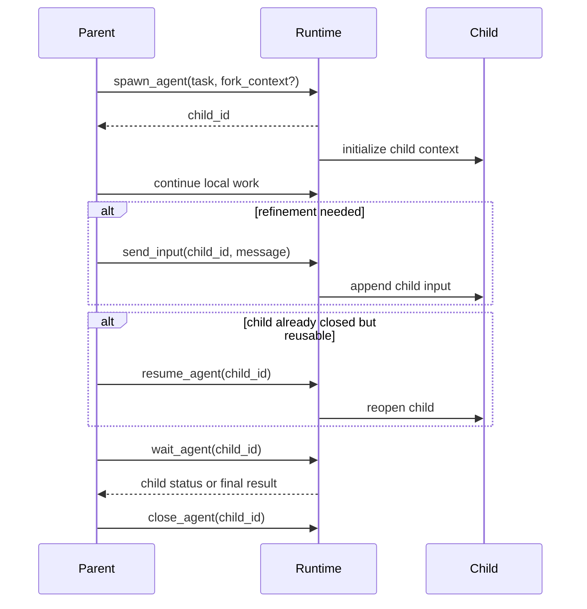
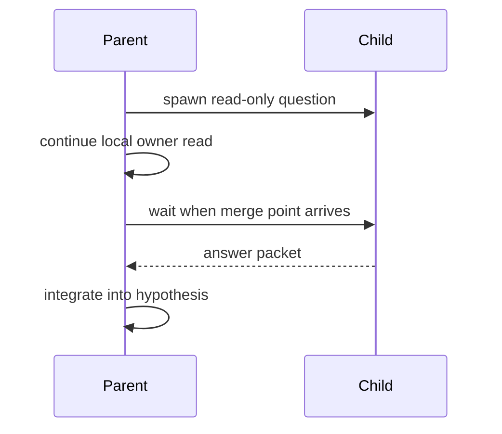
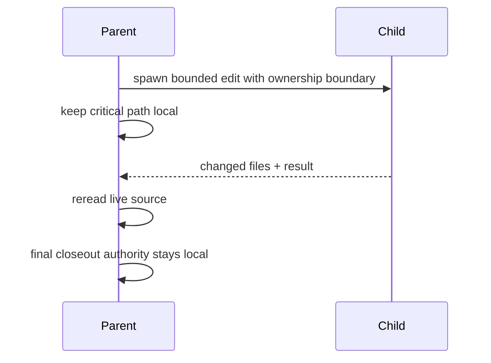
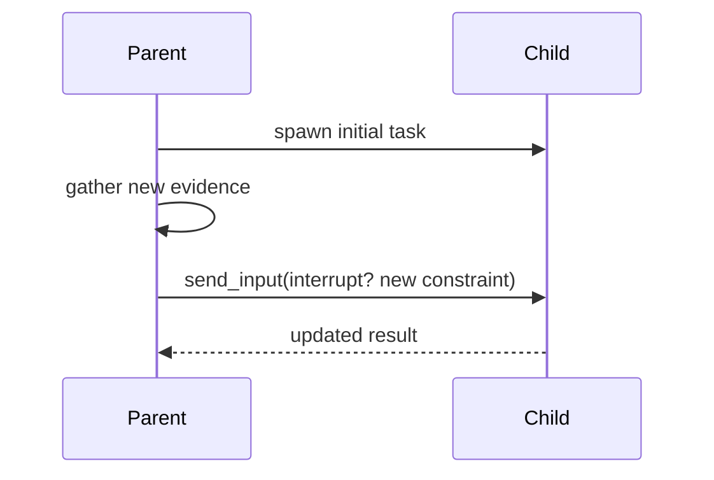

# Subagent Lifecycle And Runtime Interface

Overview router: [subagent-management-audit.md](/Users/songmin/Documents/code-new/semantica-codegraph-v2/docs/analysis/codex-agent/thread-management/subagent/subagent-management-audit.md)

## 1. Visible interface

직접 보이는 subagent lifecycle surface:

| Tool | Direct meaning |
| --- | --- |
| `spawn_agent` | child 생성 |
| `send_input` | existing child에 추가 입력 |
| `resume_agent` | closed child를 다시 열기 |
| `wait_agent` | child final status 대기 |
| `close_agent` | child 종료 |
| `fork_context` | spawn 시 parent context 복제 옵션 |

이 표면만으로도 `one-shot helper call`보다 lifecycle-bearing child primitive 모델이 더 자연스럽다.

## 2. Best-fit request/response flow



## 2.1 Three common lifecycle shapes

### A. Read-only sidecar



### B. Disjoint edit worker



### C. Refinement / redirect



## 3. Payloads the parent actually cares about

| Call | Fields that matter most | Parent usually extracts |
| --- | --- | --- |
| `spawn_agent` | `agent_type`, `fork_context`, `message/items`, `reasoning_effort` | child role, context scope, initial objective |
| `send_input` | `target`, `message/items`, `interrupt` | whether to refine or redirect child work |
| `resume_agent` | `id` | whether old child can be reused instead of respawn |
| `wait_agent` | `targets`, `timeout_ms` | child completion, final packet, whether parent is blocked |
| `close_agent` | `target` | shutdown and lifecycle cleanup |

## 3.1 Payload-to-action mapping

| Observation from child lifecycle | Parent-side interpretation | Immediate next move |
| --- | --- | --- |
| child id returned | child branch admitted | continue local critical path |
| child final packet arrived | merge point reached | integrate or reread live source |
| wait timeout | child is not ready yet | keep local work going or defer join |
| resumed child accepted | old child context still useful | prefer reuse over redundant respawn |
| interrupting send_input used | parent wants immediate redirect | child objective changes now |

## 4. Best-fit child task packet

hidden exact packet shape는 비가시다. 다만 observable behavior를 설명하는 scaffold는 이 정도다.

```text
ChildTaskPacket {
  objective,
  task_kind,
  ownership_boundary,
  touched_files_or_surfaces,
  avoid_files_or_surfaces,
  expected_output_shape,
  keep_constraints_from_parent,
  reminder_not_to_revert_others
}
```

best-fit practical fields:

| Field | Why parent needs it |
| --- | --- |
| `objective` | child가 정확히 무엇을 닫아야 하는지 |
| `task_kind` | read-only analysis인지 edit worker인지 구분 |
| `ownership_boundary` | merge conflict와 duplicate work 방지 |
| `touched_files_or_surfaces` | write scope 고정 |
| `avoid_files_or_surfaces` | no-go zone 고정 |
| `expected_output_shape` | parent integration 비용 축소 |
| `keep_constraints_from_parent` | repo-local / reporting / honesty rule 계승 |

## 5. Why `fork_context` matters

`fork_context`는 단순 boolean 이상으로 해석된다. `[STRONG-INFERENCE]`

- child가 parent history/context를 그대로 시작할 수 있음을 시사
- 따라서 child는 fresh blank worker보다 `forked conversational worker`에 가깝다
- 반대로 exact copy depth, hidden memory transfer, artifact handle semantics는 `NON-CLAIM`이다

## 6. Parent-side pseudocode

```python
def use_subagent(sidecar_task, local_step):
    child = spawn_agent(sidecar_task)
    local_result = do_local_critical_path(local_step)

    if child_result_needed_now(local_result):
        child_result = wait_agent(child)
        local_result = integrate(local_result, child_result)

    close_agent(child)
    return local_result
```

핵심:
- child는 parent loop를 대체하지 않는다
- parent가 merge authority를 유지한다

## 6.1 Retry, resume, respawn

best-fit decision rule은 이렇다.

```python
def next_child_action(child_state, parent_state):
    if child_state.is_useful_and_inflight:
        return "wait_or_continue_local"
    if child_state.exists_and_new_constraints_arrived:
        return "send_input"
    if child_state.closed_but_context_still_valuable:
        return "resume_agent"
    return "spawn_new_child"
```

의미:
- 같은 bounded thread를 이어갈 가치가 있으면 `resume/send_input`
- 아니면 새 child를 만든다

## 6.2 Error and limit path

| Symptom | Parent reaction |
| --- | --- |
| spawn rejected or unavailable | reroute to local work or no-spawn path |
| wait timed out | avoid blocking; continue local path if possible |
| child output conflicts with fresh source | trust fresh source, not child packet alone |
| child ownership drifts | stop integration and tighten boundary |
| child no longer relevant | close child and drop branch |

## 7. Interface boundary

안전하게 말할 수 있는 것:
- explicit child lifecycle exists
- child can receive more input
- child can be waited on
- child can be resumed

안전하게 말하면 안 되는 것:
- exact internal thread/process topology
- exact child memory graph cloning
- scheduler policy
- exact timeout/retry scheduler semantics
