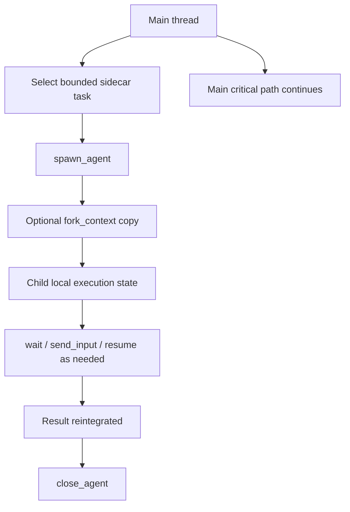
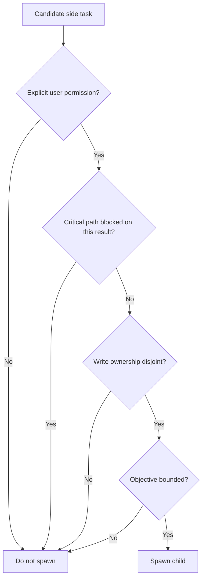

# Codex Subagent Management Audit

Overview router: [README.md](/Users/songmin/Documents/code-new/semantica-codegraph-v2/docs/analysis/codex-agent/thread-management/subagent/README.md)

상위 router:
- [thread-management/README.md](/Users/songmin/Documents/code-new/semantica-codegraph-v2/docs/analysis/codex-agent/thread-management/README.md)
- [may-20-codex-agent-loop.md](/Users/songmin/Documents/code-new/semantica-codegraph-v2/docs/analysis/codex-agent/may-20-codex-agent-loop.md)

## 1. Final model

가장 보수적인 결론은 이거다.

- `FACT`
  - `spawn_agent`, `send_input`, `resume_agent`, `wait_agent`, `close_agent`가 visible tool surface에 있다.
  - `spawn_agent`에는 `fork_context`가 있다.
  - subagent는 user가 명시적으로 병렬/위임을 허용했을 때만 쓰라는 rule이 있다.
  - urgent blocking task는 메인에서 직접 처리하고, subagent는 disjoint sidecar task에 쓰라는 rule이 있다.
- `STRONG-INFERENCE`
  - subagent는 `stateless RPC`보다 `child session primitive`로 보는 것이 더 설명력이 높다.
  - main thread는 critical path를 유지하고, child는 bounded sidecar를 처리한다.
  - child continuity는 `close` 전까지는 의미가 있지만 durable proof substrate는 아니다.
- `NON-CLAIM`
  - hidden scheduler internals
  - child persistence backend exact shape
  - arbitrary cross-thread child recall

## 2. Direct facts

| Fact | Why it matters |
| --- | --- |
| `spawn_agent`, `send_input`, `resume_agent`, `wait_agent`, `close_agent` visible | explicit child lifecycle exists |
| `fork_context` visible | context copy/fork is first-class |
| explicit permission rule visible | subagent is policy-gated, not default |
| disjoint ownership rule visible | merge-conflict avoidance is built into the policy surface |
| keep critical path local rule visible | delegation is bounded, not full handoff |

업스트림 fact owner:
- [direct-observable-facts.md](/Users/songmin/Documents/code-new/semantica-codegraph-v2/docs/analysis/codex-agent/direct-observable-facts.md)
- [session-management-audit.md](/Users/songmin/Documents/code-new/semantica-codegraph-v2/docs/analysis/codex-agent/thread-management/session-management-audit.md)
- [task-management-and-todo-audit.md](/Users/songmin/Documents/code-new/semantica-codegraph-v2/docs/analysis/codex-agent/task-management-and-todo-audit.md)

## 2.1 Fact-to-meaning ladder

| Visible evidence | Minimal safe meaning | Strongest reasonable model |
| --- | --- | --- |
| child lifecycle tools exist | child handle exists beyond one immediate message | child is a lifecycle-bearing session primitive |
| `fork_context` exists | parent-derived bootstrap is supported | child can start as a forked context worker |
| explicit permission rule exists | delegation is policy-gated | subagent is not default orchestration, only bounded optional branch |
| disjoint ownership rule exists | write overlap is forbidden | parent-child split is designed around merge-safe sidecars |
| keep critical path local rule exists | parent remains main execution authority | child is sidecar, not primary loop owner |

## 3. Best-fit model

subagent를 가장 잘 설명하는 shape는 아래다. `[STRONG-INFERENCE]`

이 모델이 설명하는 것:
- stable child ID
- resumable child execution
- queued input forwarding
- explicit wait/rejoin
- bounded ownership

설명하지 못하는 것:
- hidden worker pool size
- scheduler priority
- persistence after close

## 3.1 Operational reading

이 모델을 operational하게 읽으면 이렇다.

1. parent는 먼저 `지금 당장 막히는가`를 본다
2. 안 막히고 독립 분리가 되면 sidecar를 child로 뺀다
3. parent는 기다리지 않고 local critical path를 계속 간다
4. child result가 next step에 필요해지는 시점에만 join한다
5. 최종 source-of-truth reread와 closeout은 parent가 가진다

## 4. Why it is not a stateless RPC

`stateless RPC` 모델과 충돌하는 관측 사실:
- stable target ID가 있다
- `resume_agent`가 있다
- `send_input`이 있다
- `wait_agent`가 있다
- `fork_context`가 있다

즉 보수적으로도:
- one-shot function call
- fire-and-forget background swarm

둘 다 아니다.

## 5. Practical lifecycle

| Phase | Main thread action | Child-side meaning |
| --- | --- | --- |
| spawn | bounded task packet 전달 | child identity 생성 |
| optional fork | parent context 일부 복제 | child bootstrap context 확보 |
| run | main continues or pauses selectively | child local execution 진행 |
| interact | `send_input` or `resume_agent` | child task refinement or continuation |
| join | `wait_agent` | child result 수집 |
| close | `close_agent` | child lifecycle 종료 |

세부 payload와 call shape는 [subagent-lifecycle-and-runtime-interface.md](/Users/songmin/Documents/code-new/semantica-codegraph-v2/docs/analysis/codex-agent/thread-management/subagent/subagent-lifecycle-and-runtime-interface.md)가 owner다.

## 5.1 Usecase matrix

| Usecase | Spawn fit | Why |
| --- | --- | --- |
| wide review에서 독립 파일군 병렬 읽기 | high | child result가 즉시 blocker가 아니고 write ownership도 없음 |
| bounded code edit on disjoint file set | medium to high | ownership이 명확하면 유효 |
| owner tracing where next local step depends on answer | low | parent next step이 child answer에 막히므로 local 처리 쪽이 낫다 |
| immediate compile-failure RCA on current owner | low | blocking task라 parent가 직접 하는 편이 맞다 |
| long-running side verification while parent keeps implementing | medium | true sidecar면 가능하지만 verification rail/closeout authority는 parent가 유지 |

## 5.2 Spawn admission gate

## 6. Control rules

subagent는 보통 아래 조건에서만 합법적이다.

1. user가 병렬/위임/subagent를 명시적으로 허용
2. task가 bounded sidecar로 분리 가능
3. main critical path가 child result 없이도 진행 가능
4. write ownership이 겹치지 않음

반대로 아래는 bad split이다.

1. immediate blocker를 child에 넘김
2. parent와 child가 같은 write set을 가짐
3. child 결과가 없으면 parent next step이 막힘
4. parent가 child 작업을 다시 중복 수행
5. child objective가 너무 넓어서 integration contract가 사라짐

세부 split 규칙은 [subagent-task-delegation-and-ownership.md](/Users/songmin/Documents/code-new/semantica-codegraph-v2/docs/analysis/codex-agent/thread-management/subagent/subagent-task-delegation-and-ownership.md)가 owner다.

## 7. Continuity boundary

subagent continuity는 강하지 않다. `[STRONG-INFERENCE]`

| Surface | Safe claim | Unsafe overclaim |
| --- | --- | --- |
| child id | child handle continuity exists until close | durable global child identity |
| child result | changed files, status, final packet may be reintegrated | full persistent work log |
| forked context | some parent context can be copied | exact cloned hidden memory graph |
| wait/resume | in-flight child continuation exists | arbitrary future resurrection across sessions |

세부 continuity owner는 [subagent-memory-and-continuity.md](/Users/songmin/Documents/code-new/semantica-codegraph-v2/docs/analysis/codex-agent/thread-management/subagent/subagent-memory-and-continuity.md)다.

## 8. Failure modes

| Failure mode | What breaks |
| --- | --- |
| parent delegates critical path | main loop stalls or waits too early |
| overlapping write ownership | merge conflict or revert risk |
| over-trust child result | stale child read beats fresh local source |
| treat child as durable memory | false continuity claim |
| treat child as free parallelism | agent/thread limits or integration overhead ignored |

## 8.1 Parent integration checklist

child를 썼으면 parent는 closeout 전에 최소 이 다섯 개를 다시 확인해야 한다.

1. child output shape가 요청한 contract와 맞는가
2. touched surface가 실제 ownership boundary 안에 있는가
3. live source reread가 필요한가
4. child finding과 parent-side fresh evidence가 충돌하지 않는가
5. final answer에서 child work를 과장 없이 통합했는가

## 9. Non-claims

이 문서가 주장하지 않는 것:
- subagent scheduler exact implementation
- child storage backend
- child state durability after close
- platform-wide automatic child recall

---

## Round 2 update (2026-05-21 deep dive)

이 섹션은 subagent 모델에 round-2에서 새로 확인된 background subagent rail과 external-agent migration rail evidence를 추가한다. detailed lifecycle/runtime IPC는 [subagent-lifecycle-and-runtime-interface.md](./subagent-lifecycle-and-runtime-interface.md#round-2-update-2026-05-21-deep-dive)가 owner다.

### R2.1 Foreground subagent vs background subagent

round-1의 subagent 모델은 `spawn_agent`/`send_input`/`wait_agent`/`close_agent` 기반 **foreground synchronous child**였다. round-2에서는 background queued subagent rail도 확인됐다. `[FACT]`

증거:
- `is-subagent-conversation-*.js` renderer hook
- `/tasks` page (background subagent queue UI)
- `use-is-background-subagents-enabled` feature gate
- `list-pending-automation-run-threads` IPC channel

해석:
- subagent에는 최소 두 가지 모델이 있다: `[STRONG-INFERENCE]`
  - foreground: parent loop가 `wait_agent`로 직접 합류
  - background: queue에 들어가고 `/tasks` UI에서 inspect, parent loop와 별도로 진행
- §3 best-fit model은 foreground subagent에 더 정확히 맞고, background subagent는 별도 lifecycle 모델이 필요하다 `[STRONG-INFERENCE]`

### R2.2 Subagent vs external-agent migration

round-2 발견: codex는 “타 agent 자료 import lifecycle”을 subagent invocation과 **별도로** 가진다. `[FACT]`

External-agent migration events:
- `external_agent_import_detect_finished`
- `external_agent_import_provider_stage_finished`
- `external_agent_import_session_completion_finished`
- `external_agent_import_finished`

Persistent state: `external_agent_session_imports.json` `[FACT]`

Runtime bridge: `external_agent_tool_call`, `external_agent_tool_result` `[FACT]`

Import targets: `~/.claude/`, `.claude-plugin/`, `.claudeCode/`, `.claudeCowork/`, plus `AGENTS.md` / `agents.md` files `[FACT]`

해석:
- 이건 codex가 다른 agent ecosystem (예: Claude Code, Cowork)의 session/skill/agents.md를 import하는 별도 lifecycle이다 `[FACT]`
- subagent invocation과는 다른 차원이지만, “외부 agent 자료를 codex 내부 thread로 끌어옴” → external-agent를 일종의 source-of-context subagent처럼 처리하는 모델 `[STRONG-INFERENCE]`
- 즉 §1 final model에 새 row를 추가해야 한다: external-agent migration은 `[FACT]` lifecycle이고, child session primitive와는 다른 lifecycle event family `[STRONG-INFERENCE]`

### R2.3 Updated final model

§1 final model에 보강:

**`FACT` (round-2 추가)**
- `is-subagent-conversation-*.js` renderer hook 존재
- `/tasks` page + `use-is-background-subagents-enabled` feature gate 존재
- `list-pending-automation-run-threads` IPC 존재
- `external_agent_import_*` events 4종 존재
- `external_agent_session_imports.json` 존재
- `external_agent_tool_call` / `external_agent_tool_result` bridge channels 존재
- 위 import targets 5종

**`STRONG-INFERENCE` (round-2 추가)**
- subagent has at least two modes: foreground (in-process child) and background (queued, UI-visible)
- external-agent migration is a separate lifecycle, not subagent invocation
- background subagent의 durable evidence는 `/tasks` rail에 있을 가능성

### R2.4 Updated non-claims

이전 §9 non-claims에 추가:

- exact backend queue and dispatch semantics of background subagents
- whether foreground subagent (`spawn_agent`) and background subagent (`/tasks`) share the same `state_5.sqlite.threads` row population or not
- exact migration trigger that runs `external_agent_import_*` lifecycle (manual vs auto-detect)
- whether imported external agents become standalone threads or become subagent children
