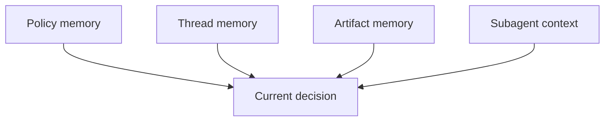

# Subagent Memory And Continuity

Overview router: [subagent-management-audit.md](/Users/songmin/Documents/code-new/semantica-codegraph-v2/docs/analysis/codex-agent/thread-management/subagent/subagent-management-audit.md)

## 1. Direct facts

직접 보이는 continuity 관련 사실:

| Fact | Meaning |
| --- | --- |
| child lifecycle tools exist | child state is not purely ephemeral per call |
| `fork_context` exists | parent context copy/fork concept exists |
| `wait_agent` exists | child completion can be synchronized |
| `resume_agent` exists | child continuity can outlive one immediate response |

## 2. Best-fit continuity ladder

| Continuity rail | Strength | Safe claim | Unsafe overclaim |
| --- | --- | --- | --- |
| child id / handle | medium | child can be referenced again until close | durable global agent registry |
| forked context | medium | some parent context can seed child | exact full memory graph copy |
| child final result | medium | child output can be reintegrated | full persistent work log |
| child after close | weak | maybe resumable only if explicitly supported by visible tool path | guaranteed durable child resurrection |

핵심:
- child continuity는 있다
- 하지만 artifact/thread summary보다 강하지는 않다

## 2.1 Relative strength versus other rails

| Rail | Relative strength versus subagent context | Why |
| --- | --- | --- |
| thread history | stronger | parent same-thread continuity가 더 기본 rail이다 |
| workspace artifact | much stronger | file/doc/log는 durable substrate다 |
| live shell session | similar or slightly stronger in its niche | both are in-flight continuation rails |
| automation wakeup | orthogonal | future re-entry trigger이지 child context 자체는 아님 |

## 3. Relation to broader memory model

best-fit memory stack 안에서 subagent는 이 위치다. `[STRONG-INFERENCE]`

의미:
- parent thread history가 제일 강한 continuity rail 중 하나
- artifact는 durable proof substrate
- child context는 bounded auxiliary continuity rail

## 3.1 Continuity after interruption

best-fit rule:

1. same thread, child still open: child continuity usable
2. same thread, child closed but resumable: maybe reuse
3. app interruption or new thread: artifact/thread summary reread가 더 안전

즉 interruption이 커질수록 child continuity보다 artifact continuity가 우선한다.
앱 재시작이나 더 큰 recovery 질문은 [session-management-audit.md](/Users/songmin/Documents/code-new/semantica-codegraph-v2/docs/analysis/codex-agent/thread-management/session-management-audit.md)와 [logging-and-recovery-audit.md](/Users/songmin/Documents/code-new/semantica-codegraph-v2/docs/analysis/codex-agent/thread-management/logging-and-recovery-audit.md)가 더 직접적인 owner다.

## 4. What `fork_context` most likely means

안전한 해석:
- child bootstrap에 parent context 일부를 전달할 수 있다
- child는 blank worker보다 parent-derived worker에 가깝다

안전하지 않은 해석:
- exact hidden prompt stack 전체가 lossless copy된다
- global memory store까지 자동 복제된다
- child close 후에도 same richness로 자동 복구된다

## 5. Practical rule

subagent 결과를 받았다고 해서 그 자체를 durable truth로 취급하면 안 된다.

실전 closeout rule:
1. child output 확인
2. parent-side live source or artifact reread
3. defended claim만 final에 반영

## 5.1 Resume versus rebuild

| Situation | Better move |
| --- | --- |
| child가 아직 relevant하고 handle이 살아 있음 | `wait` or `send_input` |
| child context가 still useful but closed | `resume_agent` 고려 |
| parent evidence가 크게 바뀜 | fresh spawn or local reread |
| thread/app continuity가 약해짐 | artifact/thread-based reconstruction 우선 |

## 5.2 Continuity failure modes

| Failure mode | Consequence |
| --- | --- |
| child packet만 믿고 local reread 생략 | stale closure claim |
| child continuity를 durable memory처럼 가정 | wrong cross-session expectation |
| huge context drift after parent evidence changed | outdated child hypothesis persists |
| interruption 후 child handle 집착 | weaker rail에 과적합 |

## 6. Non-claims

이 문서가 주장하지 않는 것:
- subagent persistent store exact shape
- child context retention after platform restart
- arbitrary cross-thread automatic child recall
