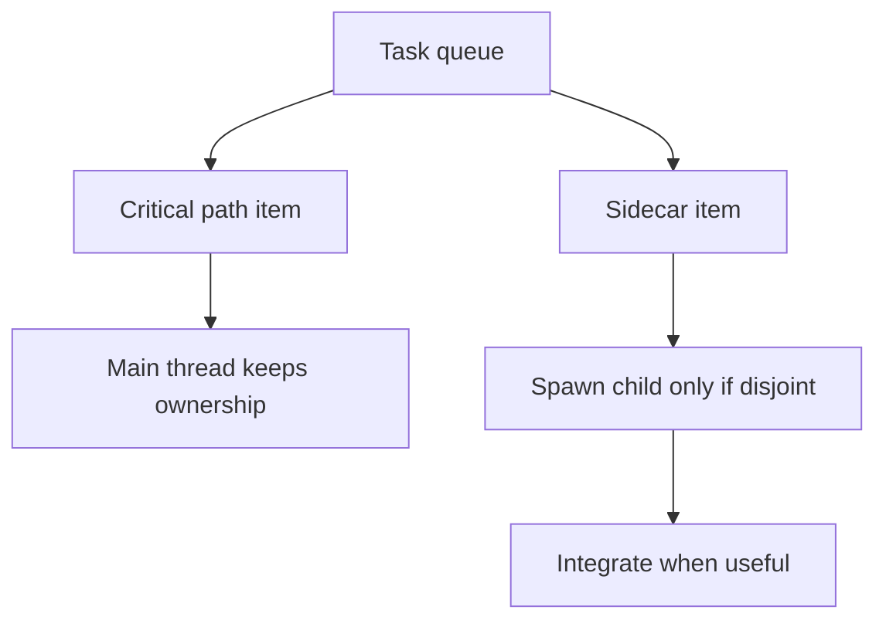

# Subagent Task Delegation And Ownership

Overview router: [subagent-management-audit.md](/Users/songmin/Documents/code-new/semantica-codegraph-v2/docs/analysis/codex-agent/thread-management/subagent/subagent-management-audit.md)

## 1. Direct rules

직접 보이는 rule은 이거다.

1. explicit user permission 필요
2. urgent blocking task는 main에서 처리
3. sidecar task만 병렬 분리
4. write ownership은 disjoint해야 함
5. child가 다른 사람/다른 worker의 변경을 revert하면 안 됨

이건 heuristic이 아니라 visible policy surface다.

## 2. Best-fit split model



## 2.1 Spawn versus no-spawn matrix

| Condition | Spawn bias |
| --- | --- |
| child result is not an immediate blocker | pro-spawn |
| child write set is disjoint | pro-spawn |
| task is read-only and bounded | pro-spawn |
| parent next step depends on the answer now | anti-spawn |
| ownership is fuzzy | anti-spawn |
| merge contract is unclear | anti-spawn |

## 3. Good split versus bad split

| Split type | Good or bad | Why |
| --- | --- | --- |
| read-only repo question in parallel | good | main can continue independently |
| bounded code edit on disjoint files | good | ownership is clear |
| immediate blocker needed for next line of work | bad | parent stalls waiting |
| same module edited by parent and child | bad | merge and ownership conflict |
| duplicated grep/read done by both parent and child | bad | waste and context drift |

## 4. What the child should own

best-fit ownership packet:

```text
OwnershipBoundary {
  owned_files,
  owned_modules,
  read_only_surfaces,
  forbidden_surfaces,
  expected_output,
  merge_contract
}
```

parent는 최소한 이 다섯 개를 명확히 해야 한다.

1. child objective
2. owned write set
3. no-touch surfaces
4. expected output shape
5. merge point

## 4.1 Ownership examples

| Example | Good boundary? | Why |
| --- | --- | --- |
| `docs/analysis/codex-agent/thread-management/subagent/*.md` only | good | file scope is explicit |
| `parser owner file` while parent edits same owner | bad | same write surface |
| `test-only sidecar` while parent changes implementation | maybe | only if tests and impl are truly disjoint and merge contract is clear |
| repo-wide grep summary with no owner narrowing | bad | bounded ownership보다 broad search noise가 큼 |

## 5. Main-thread discipline

parent가 유지해야 하는 것:
- critical path ownership
- final source-of-truth reread
- integration authority
- closeout wording

child에 넘기면 안 되는 것:
- final defended claim selection
- overlapping write ownership
- unbounded broad refactor
- speculative architecture rewrite

## 5.1 Integration contract

parent는 child spawn 전에 integration contract를 정해두는 게 맞다. `[STRONG-INFERENCE]`

```text
IntegrationContract {
  expected_return_shape,
  whether_live_reread_is_mandatory,
  merge_owner,
  closeout_owner,
  escalation_rule_if_child_finds_conflict
}
```

이 contract가 없으면 child result를 받아도 parent가 다시 넓게 읽느라 병렬 이득이 줄어든다.

## 6. Failure modes

| Failure mode | Symptom | Correction |
| --- | --- | --- |
| child gets blocking work | parent waits immediately | keep blocker local |
| ownership unclear | merge conflict or revert risk | tighten owned file/module list |
| child output over-trusted | stale result beats fresh source | reread live source before closeout |
| too many children | thread/attention overhead | keep lane count bounded |
| parent duplicates child work | no real parallel win | narrow child objective |

## 7. Stop rule

subagent를 써도 merge authority는 parent에 남아야 한다. `[STRONG-INFERENCE]`

즉 closeout 전 최종 판정은:
- child result 수령
- live source reread if needed
- parent-side defended claim filtering

순서로 닫는 것이 맞다.

## 7.1 Parent-side final arbitration

child가 무언가를 결론냈더라도 마지막 승자는 parent-side fresh evidence다.

우선순위:
1. fresh local source
2. runtime/build/test output if relevant
3. child packet
4. older docs or memory

즉 child result는 strong hint일 수는 있어도 final authority는 아니다.

---

## Round 2 update (2026-05-21 deep dive)

이 섹션은 task delegation / ownership 모델에 round-2에서 확인된 background subagent와 external-agent migration evidence를 반영한다. 두 별도 lifecycle 자체의 owner는 [subagent-management-audit.md](./subagent-management-audit.md#round-2-update-2026-05-21-deep-dive)와 [subagent-lifecycle-and-runtime-interface.md](./subagent-lifecycle-and-runtime-interface.md#round-2-update-2026-05-21-deep-dive)다.

### R2.1 Delegation mode matters now

round-1에서는 delegation = foreground sidecar 하나의 모델로 가정했다. round-2 facts 후로는 delegation surface에 최소 3가지 mode가 있다:

| Mode | Surface | Round-2 evidence |
| --- | --- | --- |
| foreground subagent | `spawn_agent` family | round-1 그대로 |
| background subagent | `/tasks` page + `list-pending-automation-run-threads` IPC | `[FACT]` |
| external-agent migration | `external_agent_import_*` events + `external_agent_tool_call`/`_result` bridge | `[FACT]` |

해석:
- ownership/integration contract는 mode마다 다르게 적용돼야 한다 `[STRONG-INFERENCE]`
- 즉 §1 “직접 보이는 rule”은 foreground subagent 기준이고, background subagent와 external-agent에는 별도 ownership 정책이 필요하다 `[STRONG-INFERENCE]`

### R2.2 Foreground vs background ownership

| Axis | Foreground subagent | Background subagent |
| --- | --- | --- |
| Parent loop integration | `wait_agent` synchronous join | UI-visible queue + later integration |
| Critical-path block | parent can stall on `wait_agent` | parent doesn't stall — UI surfaces it |
| Ownership boundary check | parent must check before `close_agent` | UI/automation flow must check at result time |
| Closeout authority | parent thread | possibly automation or UI-driven review |

`[STRONG-INFERENCE]`

해석:
- background subagent는 “delegate and forget, review later in `/tasks`” 패턴에 가깝다 `[STRONG-INFERENCE]`
- 따라서 §5 “Main-thread discipline”의 closeout owner 규칙은 background subagent의 경우 parent thread가 아닌 review surface일 수 있다 `[STRONG-INFERENCE]`

### R2.3 External-agent migration is not delegation

external-agent migration은 task delegation이 아니라 **외부 도구 자료 import** lifecycle이다. `[FACT]`

따라서:
- §3 “Good split vs bad split” table은 external-agent에는 적용되지 않는다 `[STRONG-INFERENCE]`
- ownership boundary 대신 “import scope/contract”가 중요해진다 `[STRONG-INFERENCE]`
- 즉 external-agent는 별도 owner doc이 필요하지만, 현재 이 pack에서는 NON-CLAIM 경계만 유지한다

### R2.4 Updated bad-split list

§1 + §3에 추가:

7. background subagent에 immediate-blocker work를 넣고 parent thread를 join하지 않음
   - 결과: critical-path가 멈춘 채로 `/tasks` queue에 잠김 `[STRONG-INFERENCE]`

8. external-agent migration을 task delegation으로 오해
   - 결과: import lifecycle을 spawn-like RPC로 잘못 다룸 `[STRONG-INFERENCE]`

### R2.5 Updated non-claims

- exact merge-contract semantics for background subagent results (no foreground `wait_agent` join)
- exact ownership boundary policy applied during external-agent migration
- whether background subagent의 thread row가 `state_5.sqlite.threads.thread_source`에서 어떤 값을 가지는지
