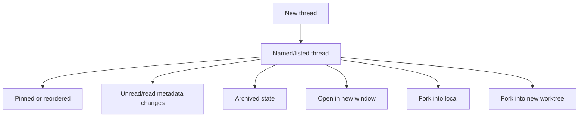

# Codex Thread UI and Fork Surface Audit

Overview router: [README.md](/Users/songmin/Documents/code-new/semantica-codegraph-v2/docs/analysis/codex-agent/thread-management/README.md)

write-path hypothesis companion:
- [ui-action-to-persistence-mapping.md](/Users/songmin/Documents/code-new/semantica-codegraph-v2/docs/analysis/codex-agent/thread-management/ui-action-to-persistence-mapping.md)

이 문서는 Codex desktop에서 직접 보인 `thread UI actions`와 `fork surface`를 thread-management 관점으로 정리한다.

범위:
- sidebar/context-menu에서 직접 보인 thread actions
- `session ID`, `deeplink`, `working directory` handle이 뜻하는 것
- `Fork into local` vs `Fork into new worktree`의 가장 안전한 해석
- subagent fork와 UI thread fork의 차이

표기:
- `[FACT]`: 현재 UI observation, local artifact, tool surface에서 직접 보이는 사실
- `[STRONG-INFERENCE]`: 위 사실을 가장 잘 설명하는 구조 추론
- `[WEAK-INFERENCE]`: plausible 하지만 직접 근거가 약한 해석
- `[SOTA-INFERENCE]`: 일반적인 desktop agent/local control-plane 패턴과 현재 evidence를 합친 합리적 추론

주의:
- 이 문서는 visible UI contract를 다룬다.
- exact Electron/native view implementation이나 hidden fork orchestration backend는 단정하지 않는다.

---

## 1. Direct UI surface

직접 보인 thread context menu actions:

- `Pin chat` `[FACT]`
- `Rename chat` `[FACT]`
- `Archive chat` `[FACT]`
- `Mark as unread` `[FACT]`
- `Open in Finder` `[FACT]`
- `Copy working directory` `[FACT]`
- `Copy session ID` `[FACT]`
- `Copy deeplink` `[FACT]`
- `Fork into local` `[FACT]`
- `Fork into new worktree` `[FACT]`
- `Open in new window` `[FACT]`

이 메뉴만으로도 thread가 단순 ephemeral prompt blob보다 richer addressable object로 보인다. `[STRONG-INFERENCE]`

---

## 2. Session/thread handle model

## 2.1 Visible handles

직접 보이는 handle family:

1. session/thread ID `[FACT]`
2. working directory `[FACT]`
3. deeplink `[FACT]`
4. thread title/name `[FACT]`

보강 evidence:

- `session_index.jsonl` row는 `id`, `thread_name`, `updated_at`를 가진다 `[FACT]`
- archived rollout `session_meta.payload.id`가 존재한다 `[FACT]`
- `threads` SQLite row는 `id`, `cwd`, `title`, `preview`, `archived` 등 richer metadata를 가진다 `[FACT]`

## 2.2 Default title/preview bootstrap

최근 thread sample에서는 `title`, `first_user_message`, `preview`가 같거나 첫 user message에서 직접 파생된 형태가 보였다. `[FACT]`

가장 설명력 높은 해석:

- explicit rename 전에는 sidebar title/preview가 first user message bootstrap을 따를 가능성이 높다 `[STRONG-INFERENCE]`

가장 설명력 높은 해석:

- sidebar row는 `thread object + metadata + addressable handle`로 관리된다 `[STRONG-INFERENCE]`

---

## 3. What each action most likely means

| UI action | Minimal safe meaning | Strongest reasonable model |
| --- | --- | --- |
| `Pin chat` | thread ordering/preference state exists | pinned metadata is stored in some local state rail |
| `Rename chat` | thread title is mutable | thread list uses mutable title metadata |
| `Archive chat` | thread archive state exists | archived bit plus archive timestamp/reason may be tracked |
| `Mark as unread` | read-state exists | unread/read UX state is separate metadata |
| `Open in Finder` | thread is bound to a local cwd | thread remembers workspace root |
| `Copy working directory` | cwd is first-class thread metadata | thread is workspace-addressable |
| `Copy session ID` | session/thread ID is first-class | thread can be explicitly addressed across UI/tool surfaces |
| `Copy deeplink` | thread can be reopened via link handle | app-level re-entry handle exists |
| `Fork into local` | thread/session branch can be created without separate worktree | local thread fork shares main checkout lineage |
| `Fork into new worktree` | thread branch can be created with git worktree isolation | fork creates or binds to separate worktree lineage |
| `Open in new window` | same thread can be opened in another UI surface | UI/view and thread identity are separable |

첫 번째 열은 `[FACT]` 기반, 세 번째 열은 `[STRONG-INFERENCE]`.

---

## 4. Fork surfaces are not all the same

이 축은 구분이 중요하다.

### 4.1 UI thread fork

visible UI action:

- `Fork into local` `[FACT]`
- `Fork into new worktree` `[FACT]`

이건 top-level conversation/session branch surface다. `[STRONG-INFERENCE]`

### 4.2 Subagent fork

visible tool action:

- `spawn_agent(..., fork_context?)` `[FACT]`
- `send_input`, `resume_agent`, `wait_agent`, `close_agent` `[FACT]`

이건 child-session / delegated worker surface다. `[FACT]` + `[STRONG-INFERENCE]`

### 4.3 Why the distinction matters

UI fork와 subagent fork를 같은 것으로 취급하면 안 된다.

- UI fork는 user-visible top-level thread branch에 가깝다 `[STRONG-INFERENCE]`
- subagent fork는 parent-controlled bounded child branch에 가깝다 `[STRONG-INFERENCE]`

---

## 5. Best-fit model for `Fork into local`

안전한 사실:

- separate menu item exists `[FACT]`
- it is distinct from `Fork into new worktree` `[FACT]`

가장 설명력 높은 모델:

- same repository checkout 안에서 thread lineage만 분기한다 `[STRONG-INFERENCE]`
- 즉 cwd/workspace identity는 유지하고, conversation/session lineage를 분기하는 rail일 가능성이 높다 `[STRONG-INFERENCE]`

안전하지 않은 단정:

- exact copy depth of hidden runtime state
- whether shell sessions or child handles are copied
- whether every local fork creates a `thread_spawn_edges` row immediately

모두 `NON-CLAIM`.

---

## 6. Best-fit model for `Fork into new worktree`

안전한 사실:

- separate menu item exists `[FACT]`
- repo and app both already have explicit worktree concept surfaces `[FACT]`

보강 evidence:

- repo-local rules explicitly discuss persistent external worktree slots `[FACT]`
- git/worktree distinction already appears in local operational docs `[FACT]`

가장 설명력 높은 모델:

- thread lineage 분기와 함께 filesystem/git worktree isolation을 준다 `[STRONG-INFERENCE]`
- 즉 same logical task branch라도 source tree side effects를 분리하려는 UX surface다 `[STRONG-INFERENCE]`

이 해석은 name 자체와 repo-local worktree practices를 함께 볼 때 가장 자연스럽다.

---

## 7. Possible local lineage backing

`state_5.sqlite`의 `thread_spawn_edges(parent_thread_id, child_thread_id, status)`는 중요한 visible evidence다. `[FACT]`

안전한 결론:

- parent-child thread lineage를 저장하는 local structured rail이 있다 `[FACT]`

강한 추론:

- UI fork, delegated branch, or both 중 일부가 이 edge table에 기록될 가능성이 높다 `[STRONG-INFERENCE]`

하지만 아래는 아직 단정 불가다.

- exact writer action that populates it
- whether UI local fork and worktree fork use the same edge table
- whether subagent edges and UI thread edges are unified or split

---

## 8. Lifecycle view

가장 설명력 높은 해석:

- thread lifecycle에는 conversation 자체 외에 metadata operations와 lineage operations가 붙는다 `[STRONG-INFERENCE]`

---

## 9. Non-claims

이 문서가 주장하지 않는 것:

- exact implementation of deeplink resolver
- exact storage slot for pin/unread flags
- whether UI fork duplicates hidden prompt stack losslessly
- whether worktree fork always creates a git branch automatically
- whether every fork is durable across every restart boundary
