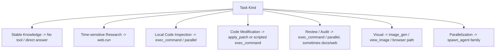
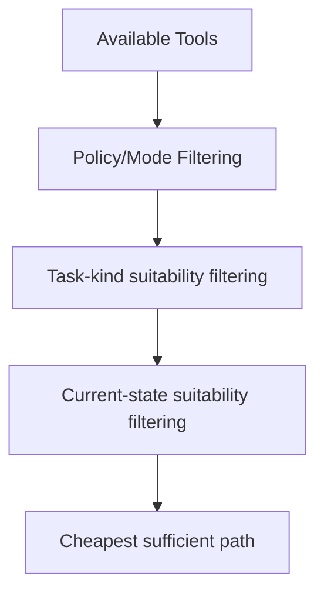

# Codex Agent Tool Inventory and Usage Audit

Overview router: [may-20-codex-agent-loop.md](/Users/songmin/Documents/code-new/semantica-codegraph-v2/docs/analysis/codex-agent/may-20-codex-agent-loop.md)

이 문서는 **현재 세션에서 직접 관측 가능한 tool set**을 기준으로, 내가 실제로 사용하는 도구들을 꼼꼼하게 정리한다.

범위:
- 현재 세션에 실제로 노출된 도구 목록
- 각 도구의 목적, 입력 형태, 트리거 조건, 제약, 실전 사용 패턴
- 도구와 앱 메타 기능의 구분
- 무엇이 직접 관측 가능한 사실이고, 무엇이 강한/약한 추론인지

주의:
- 이 문서는 `현재 세션 tool inventory` 기준이다.
- Codex 전체 제품군의 잠재 도구가 아니라, **이 세션에서 실제 callable 한 것**만 다룬다.

표기:
- `[FACT]`: tool schema / app context / session history에서 직접 관측 가능한 사실
- `[STRONG-INFERENCE]`: observed usage와 constraints를 가장 잘 설명하는 고신뢰 추론
- `[WEAK-INFERENCE]`: plausible 하지만 직접 근거가 부족한 해석

---

## 1. Executive summary

### 1.1 Final verdict

- `Alignment`: High `[STRONG-INFERENCE]`
- `Robustness`: Strong for visible inventory, limited for hidden latent selection logic `[STRONG-INFERENCE]`
- `Confidence`: High `[STRONG-INFERENCE]`
- `Ship readiness`: Ship as analysis doc `[STRONG-INFERENCE]`

### 1.2 Top conclusions

1. 현재 세션에는 총 23개의 callable tool entry가 직접 노출돼 있다. `[FACT]`
2. 실무 핵심축은 `exec_command`, `apply_patch`, `multi_tool_use.parallel`, `web.run`이다. `[FACT]` + `[STRONG-INFERENCE]`
3. 도구 선택은 availability만으로 결정되지 않고, task kind / policy constraints / current state를 함께 본다. `[STRONG-INFERENCE]`
4. 일부 기능은 tool이 아니라 app-level directive다. `[FACT]`

---

## 2. Directly observable tool inventory

### 2.1 Visible callable tools

현재 세션에서 직접 관측 가능한 callable tools:

1. `web.run` `[FACT]`
2. `image_gen.imagegen` `[FACT]`
3. `functions.exec_command` `[FACT]`
4. `functions.write_stdin` `[FACT]`
5. `functions.list_mcp_resources` `[FACT]`
6. `functions.list_mcp_resource_templates` `[FACT]`
7. `functions.read_mcp_resource` `[FACT]`
8. `functions.update_plan` `[FACT]`
9. `functions.request_user_input` `[FACT]`
10. `functions.view_image` `[FACT]`
11. `functions.spawn_agent` `[FACT]`
12. `functions.send_input` `[FACT]`
13. `functions.resume_agent` `[FACT]`
14. `functions.wait_agent` `[FACT]`
15. `functions.close_agent` `[FACT]`
16. `functions.read_thread_terminal` `[FACT]`
17. `functions.load_workspace_dependencies` `[FACT]`
18. `functions.install_workspace_dependencies` `[FACT]`
19. `functions.apply_patch` `[FACT]`
20. `mcp__node_repl__.js` `[FACT]`
21. `mcp__node_repl__.js_reset` `[FACT]`
22. `tool_search.tool_search_tool` `[FACT]`
23. `multi_tool_use.parallel` `[FACT]`

### 2.2 Non-tool app directives

아래는 tool이 아니라 app-level response directive다. `[FACT]`

- `::code-comment{...}`
- `::archive{...}`
- `::git-stage{...}`
- `::git-commit{...}`
- `::git-create-branch{...}`
- `::git-push{...}`
- `::git-create-pr{...}`

---

## 3. Top-level tool families

도구는 아래 family로 묶는 것이 가장 실용적이다. `[STRONG-INFERENCE]`

| Family | Tools | Main purpose | Classification |
| --- | --- | --- | --- |
| Web / research | `web.run` | 최신 정보, 공식 문서, 링크/출처 | `[FACT]` + `[STRONG-INFERENCE]` |
| Image | `image_gen.imagegen`, `view_image` | 이미지 생성/편집/확인 | `[FACT]` |
| Local shell / file | `exec_command`, `write_stdin`, `read_thread_terminal`, `apply_patch` | 읽기/수정/명령 실행 | `[FACT]` |
| MCP resources | `list_mcp_resources`, `list_mcp_resource_templates`, `read_mcp_resource` | 구조화된 외부 리소스 읽기 | `[FACT]` |
| Planning / workflow | `update_plan`, `request_user_input` | 계획/구조화 입력 | `[FACT]` |
| Delegation | `spawn_agent`, `send_input`, `resume_agent`, `wait_agent`, `close_agent` | 병렬 작업 | `[FACT]` |
| Runtime dependencies | `load_workspace_dependencies`, `install_workspace_dependencies` | 문서/시트/슬라이드 의존성 준비 | `[FACT]` |
| Node REPL | `mcp__node_repl__.js`, `js_reset` | 지속형 JS 실행 | `[FACT]` |
| Tool discovery / batching | `tool_search.tool_search_tool`, `multi_tool_use.parallel` | 추가 tool 검색 / 병렬 developer-tool 실행 | `[FACT]` |

---

## 4. Detailed tool audit

## 4.1 `web.run`

### What it does

- 웹 검색 `[FACT]`
- 결과 열기 `[FACT]`
- 링크 클릭 `[FACT]`
- 페이지 내 문자열 찾기 `[FACT]`
- PDF screenshot `[FACT]`
- finance / weather / sports / time 조회 `[FACT]`

### Trigger conditions

- 최신성 있는 질문 `[FACT]`
- 사용자가 `찾아봐`, `검색해`, `최신`, `오늘`, `공식 문서`라고 요구 `[FACT]`
- 링크/출처가 필요한 응답 `[FACT]`

### Practical usage pattern

1. `search_query`
2. `open`
3. 필요 시 `find`
4. 출처 포함 답변

이 패턴은 tool schema와 일반 사용 흐름을 가장 잘 설명한다. `[STRONG-INFERENCE]`

### Constraints

- 최신성 있는 정보는 browse가 사실상 mandatory다 `[FACT]`
- 기술 질문은 1차 출처 우선이다 `[FACT]`
- OpenAI 제품 질문은 공식 도메인 제한이 우선이다 `[FACT]`

### Common pitfalls

- 너무 넓은 검색어 -> domain/filter 필요 `[STRONG-INFERENCE]`
- static knowledge인데 browse 과다 사용 -> cost waste `[STRONG-INFERENCE]`

---

## 4.2 `image_gen.imagegen`

### What it does

- 텍스트 기반 이미지 생성 `[FACT]`
- 기존 이미지 편집 `[FACT]`

### Trigger conditions

- 사용자가 이미지 생성/편집을 요청 `[FACT]`
- 시각 산출물이 결과물 자체인 경우 `[STRONG-INFERENCE]`

### Constraints

- 생성 후 장황한 설명을 붙이지 말아야 한다 `[FACT]`
- 이미지 편집은 이 tool 우선 `[FACT]`

---

## 4.3 `functions.exec_command`

### What it does

- 셸 명령 실행 `[FACT]`
- 파일 읽기/검색/스크립트/빌드/검증 등 범용 작업 `[STRONG-INFERENCE]`

### Trigger conditions

- repo 기반 질문 `[STRONG-INFERENCE]`
- 코드 수정/리뷰/감사 `[STRONG-INFERENCE]`
- 단순 명령 결과를 사용자에게 보여줘야 할 때 `[FACT]`

### Common patterns

- `rg -n ...` `[FACT]`
- `sed -n 'a,bp' ...` `[FACT]`
- `python3 - <<'PY' ...` scripted replacement `[FACT]`
- `scripts/cg-dispatch ...` verification front-door `[FACT]`

### Constraints

- 도구 호출은 비싸므로 최소화 `[FACT]`
- broad scan (`ls -R`, `rg --files`) 금지에 가깝다 `[FACT]`
- 검증은 요청받기 전까지 기본 보류 `[FACT]`
- repo-local Rust verification은 direct cargo가 아니라 front-door `[FACT]`

### Why this is the primary tool

실제 로컬 코드 작업의 대부분은 읽기/검색/스크립트/명령 실행으로 환원되기 때문이다. `[STRONG-INFERENCE]`

---

## 4.4 `functions.write_stdin`

### What it does

- 이미 열린 exec session에 추가 입력 `[FACT]`

### Trigger conditions

- interactive process가 입력을 기다리는 경우 `[FACT]`
- TTY session continuation `[FACT]`

### Practical note

- 현재 작업 스타일은 non-interactive 선호라 사용 빈도는 낮은 편으로 보인다. `[STRONG-INFERENCE]`

---

## 4.5 `functions.read_thread_terminal`

### What it does

- 현재 터미널 출력 읽기 `[FACT]`

### Trigger conditions

- 이미 열린 terminal state를 확인해야 할 때 `[STRONG-INFERENCE]`

### Practical note

- `exec_command` 결과로 충분하면 굳이 안 쓰는 보조 도구다. `[STRONG-INFERENCE]`

---

## 4.6 `functions.apply_patch`

### What it does

- patch format으로 파일 추가/수정/삭제/이동 `[FACT]`

### Trigger conditions

- 국소 수정
- 문맥이 안정적
- 줄 단위 diff가 적합

위 trigger는 실제 사용 패턴을 가장 잘 설명한다. `[STRONG-INFERENCE]`

### Constraints

- grammar가 엄격하다 `[FACT]`
- 병렬 호출 금지 `[FACT]`

### Observed usage

- 실제 코드 수정에 여러 번 사용됨 `[FACT]`
- context mismatch가 발생한 사례가 있음 `[FACT]`

### Fallback

- 불안정/중복 블록에서는 `exec_command + scripted replace`로 전환하는 것이 canonical fallback로 보인다. `[STRONG-INFERENCE]`

---

## 4.7 MCP resource tools

### Tools

- `list_mcp_resources` `[FACT]`
- `list_mcp_resource_templates` `[FACT]`
- `read_mcp_resource` `[FACT]`

### What they do

- MCP 서버가 제공하는 구조화 리소스 탐색/읽기 `[FACT]`

### Trigger conditions

- 웹보다 구조화된 외부/내부 리소스가 필요한 경우 `[STRONG-INFERENCE]`

### Practical note

- 현재 스레드에서는 실사용 빈도는 낮았다. `[FACT]`

---

## 4.8 `functions.update_plan`

### What it does

- 작업 계획과 단계 상태를 업데이트 `[FACT]`

### Trigger conditions

- multi-step task
- 단계 상태를 명시적으로 관리해야 할 때

이건 일반적인 usage reconstruction이다. `[STRONG-INFERENCE]`

### Practical note

- 현재 Default mode에서는 많이 쓰지 않았지만, 구조상 planning tool이다. `[FACT]`

---

## 4.9 `functions.request_user_input`

### What it does

- 구조화된 짧은 선택형 질문 `[FACT]`

### Constraint

- 현재 `Default` mode에서는 unavailable `[FACT]`

### Practical implication

- 현재 세션에서는 plain-text question이나 reasonable assumption이 기본 경로다. `[STRONG-INFERENCE]`

---

## 4.10 `functions.view_image`

### What it does

- 로컬 이미지 파일 보기 `[FACT]`

### Trigger conditions

- 사용자가 로컬 이미지 파일 자체를 묻는 경우 `[STRONG-INFERENCE]`
- 시각적 검토가 필요한 경우 `[STRONG-INFERENCE]`

---

## 4.11 Delegation tools

### Tools

- `spawn_agent` `[FACT]`
- `send_input` `[FACT]`
- `resume_agent` `[FACT]`
- `wait_agent` `[FACT]`
- `close_agent` `[FACT]`

### What they do

- 서브에이전트 생성, 입력 전달, 대기, 재개, 종료 `[FACT]`

### Constraints

- 사용자가 명시적으로 병렬/서브에이전트를 요청했을 때만 쓰는 것이 원칙 `[FACT]`
- worker는 disjoint ownership을 명시해야 한다 `[FACT]`
- wait는 sparingly `[FACT]`

### Trigger conditions

- explicit parallelization request
- bounded, disjoint side tasks

이건 rules + orchestration logic reconstruction이다. `[STRONG-INFERENCE]`

### Practical note

- 현재 대화에서는 실제 호출되지 않았다 `[FACT]`

---

## 4.12 Dependency/runtime helpers

### Tools

- `load_workspace_dependencies` `[FACT]`
- `install_workspace_dependencies` `[FACT]`

### What they do

- bundled runtime/library paths 확인 및 설치 `[FACT]`

### Trigger conditions

- documents / presentations / spreadsheets / PDFs 작업 전에 필요한 런타임 확인 `[FACT]`

---

## 4.13 `mcp__node_repl__.js` / `js_reset`

### What they do

- persistent Node REPL에서 JS 실행 `[FACT]`
- REPL reset `[FACT]`

### Trigger conditions

- JS로 빠르게 데이터 변환/실험이 적합할 때 `[STRONG-INFERENCE]`
- Node package 사용이 필요할 때 `[FACT]`

### Practical note

- 로컬 shell보다 JS 런타임이 더 자연스러운 task에서만 우세하다. `[STRONG-INFERENCE]`

---

## 4.14 `tool_search.tool_search_tool`

### What it does

- deferred / dynamic tool 검색 `[FACT]`

### Trigger conditions

- 현재 노출된 목록 바깥의 추가 tool이 필요한지 찾을 때 `[FACT]`

### Constraint

- MCP tool discovery는 list_mcp_*보다 tool_search를 우선하라고 명시돼 있다 `[FACT]`

---

## 4.15 `multi_tool_use.parallel`

### What it does

- 여러 developer tools 병렬 실행 `[FACT]`

### Trigger conditions

- 여러 독립 read를 동시에 해야 할 때 `[FACT]`
- latency를 줄이고 싶을 때 `[STRONG-INFERENCE]`

### Constraints

- system tool은 여기로 못 부른다 `[FACT]`
- 충돌 write는 병렬 금지 `[FACT]`
- `apply_patch` 같은 수정성 tool은 병렬 금지로 보는 게 맞다 `[STRONG-INFERENCE]`

### Observed usage

- 실제로 여러 `exec_command` read를 병렬로 묶는 데 사용됨 `[FACT]`

---

## 5. Trigger logic by task kind

이 매핑은 current tool set과 observed behavior를 가장 잘 설명한다. `[STRONG-INFERENCE]`

---

## 6. Tool selection audit

## 6.1 What is clearly not happening

### Not a flat “one tool per request type” mapping

같은 code modification 안에서도:
- `apply_patch`
- `exec_command scripted replace`
가 상황에 따라 갈린다. `[FACT]`

따라서 고정 매핑만으로는 부족하다. `[STRONG-INFERENCE]`

### Not “all available tools are equally eligible”

예:
- `request_user_input`는 현재 mode에서 unavailable `[FACT]`
- `spawn_agent`는 policy상 explicit permission이 있을 때만 적합 `[FACT]`
- `web.run`은 time-sensitive query일 때 강하게 우선 `[FACT]`

따라서 availability와 admissibility는 다르다. `[STRONG-INFERENCE]`

## 6.2 Best-fit selection model

해석:
- availability
- policy admissibility
- task suitability
- current-state suitability
- cost/precision tradeoff

이 다섯 축이 실제 선택을 설명한다. `[STRONG-INFERENCE]`

---

## 7. Common tool bundles

## 7.1 Research bundle

- `web.run.search_query`
- `web.run.open`
- `web.run.find`

Classification:
- tool combination `[FACT]`
- canonical sequence `[STRONG-INFERENCE]`

## 7.2 Repo inspection bundle

- `exec_command` with `rg`
- `exec_command` with `sed -n`
- `multi_tool_use.parallel`

Classification:
- actual usage `[FACT]`

## 7.3 Edit bundle

- small stable edit -> `apply_patch`
- repeated unstable edit -> `exec_command` scripted replacement

Classification:
- actual usage + fallback pattern `[FACT]` + `[STRONG-INFERENCE]`

## 7.4 Delegation bundle

- `spawn_agent`
- `send_input`
- `wait_agent`
- `close_agent`

Classification:
- orchestration family `[FACT]`

---

## 8. Attack surface and false confidence traps

### 8.1 “exec_command 하나면 나머지는 의미 없다”

- 틀린 모델이다
- `web`, `image`, `subagent`, `node_repl`, `parallel`은 distinct affordance를 가진다

Classification:
- strong warning `[STRONG-INFERENCE]`

### 8.2 “tool exists == always used”

- availability와 policy admissibility는 다르다
- `request_user_input`, `spawn_agent`가 대표적이다

Classification:
- direct evidence `[FACT]`

### 8.3 “apply_patch is the only edit tool”

- 실제로 patch failure 후 scripted replace가 쓰였다

Classification:
- direct evidence `[FACT]`

### 8.4 “web is optional even for latest facts”

- 현재 상위 policy는 최신성 있는 정보에서 browsing mandatory다

Classification:
- direct evidence `[FACT]`

---

## 9. Unknowns

직접 알 수 없는 것:

1. hidden internal confidence scoring이 실제 존재하는지 `[WEAK-INFERENCE]`
2. exact latent ranking function이 어떻게 계산되는지 `[WEAK-INFERENCE]`
3. tool selection이 literal enum router인지 fully prompt-mediated인지 `[WEAK-INFERENCE]`

---

## 10. Most precise safe summary

- 현재 세션에는 23개의 callable tool entry가 직접 노출돼 있다. `[FACT]`
- 이 중 실전 핵심은 `exec_command`, `apply_patch`, `multi_tool_use.parallel`, `web.run`이다. `[FACT]` + `[STRONG-INFERENCE]`
- 도구 선택은 단순 존재 여부가 아니라 `policy filtering -> task suitability -> current-state suitability -> cheapest sufficient path` 순으로 이해하는 것이 observed behavior와 가장 잘 맞는다. `[STRONG-INFERENCE]`
- image/browser/subagent/MCP/node_repl/plan tools는 주 작업이 아니더라도 분명한 별도 역할을 가진다. `[FACT]`
- app directives는 tool과 구분해야 한다. `[FACT]`
