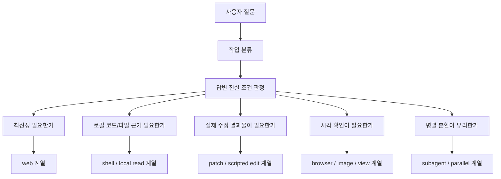
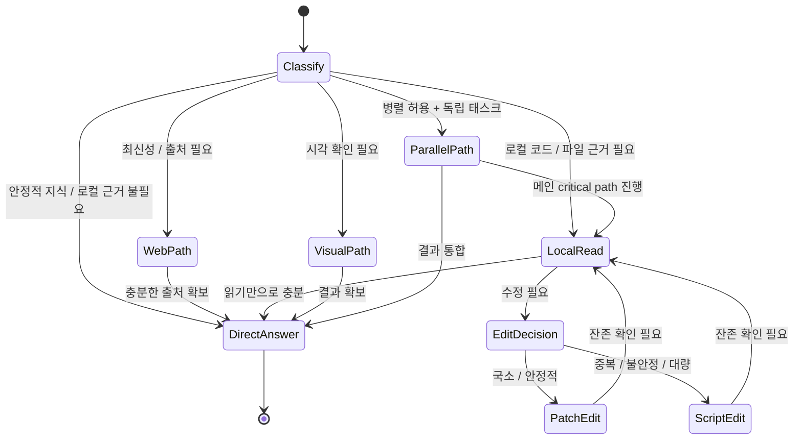

# Codex Agent Tool Routing and Triggering

Overview router: [may-20-codex-agent-loop.md](/Users/songmin/Documents/code-new/semantica-codegraph-v2/docs/analysis/codex-agent/may-20-codex-agent-loop.md)

## 1. Core principle

도구는 질문 문자열에 기계적으로 반응하는 것이 아니다. 실제 트리거는 `답변이 무엇을 근거로 해야 하는가`에 의해 결정된다.

즉:
- 최신 사실이 핵심이면 `web`
- 로컬 코드 근거가 핵심이면 `shell/file`
- 실제 수정이 핵심이면 `edit`
- 병렬 전략이 핵심이면 `subagent`
- 시각 결과물이 핵심이면 `image/browser`

## 2. Tool families

### 2.1 Web tools

언제:
- 최신 정보
- 공식 문서
- 가격/일정/날씨/뉴스
- 링크/출처 요구

트리거 표현 예:
- `최신`
- `오늘`
- `지금`
- `찾아봐`
- `공식 문서`

전형 흐름:
1. search
2. open
3. find
4. cite

### 2.2 Local shell / file tools

언제:
- repo code review
- 심볼 검색
- 함수/테스트/owner 확인
- 빌드/테스트/스크립트 실행

전형 흐름:
1. `rg`
2. `sed -n`
3. 필요 시 script

핵심:
- 로컬 코드가 truth source인 질문은 browse보다 local read가 우선

### 2.3 Edit tools

언제:
- 실제 파일 수정

분기:
- patch edit:
  - 국소 변경
  - 문맥 안정
- scripted replace:
  - 중복 블록
  - 대량 치환
  - patch context mismatch

### 2.4 Browser / visual tools

언제:
- localhost 확인
- 클릭/입력/화면 inspection
- 이미지 생성/편집
- 로컬 이미지 보기

핵심:
- 시각 검증이 필요한 요청을 텍스트 추론으로 대체하지 않는다

### 2.5 Subagent / parallel tools

언제:
- 사용자가 병렬 허용
- 독립 side task 존재
- write scope 분리 가능

핵심:
- critical path는 메인에 남기고
- sidecar task만 위임

## 3. Trigger examples

| 질문 유형 | 답변의 진실 조건 | 우선 도구 |
|-----------|------------------|-----------|
| "최신 OpenAI 문서 확인" | 최신성 + 출처 | web |
| "이 repo에서 foo 어디 남았냐" | 로컬 증거 | shell/file |
| "이 함수 고쳐" | 실제 수정 결과물 | edit |
| "localhost 열어봐" | 시각 관찰 | browser |
| "병렬로 처리해" | 작업 전략 | subagent |
| "monad가 뭐냐" | 안정적 개념 설명 | no tool |

## 4. Tool routing state machine

## 5. Fallback behavior

### 5.1 Patch failure

증상:
- context mismatch
- 중복 블록
- partial old/new mix

전환:
- 재patch에 집착하지 말고 scripted replace로 이동

### 5.2 Over-broad shell output

증상:
- 읽기 범위 과다
- grep noise 과다

전환:
- `rg`로 위치를 먼저 좁히고
- `sed -n`으로 필요한 구간만 읽기

### 5.3 Weak web search results

증상:
- 검색 결과가 너무 넓음
- 비공식 문서 혼입

전환:
- domain 제한
- 검색어 구체화
- 공식 URL 직접 open

### 5.4 Bad subagent split

증상:
- 같은 파일 충돌
- critical path 지연

전환:
- 메인에서 직접 처리
- side task만 agent로 분리

## 6. Practical rule of thumb

가장 실전적인 요약:

- 최신 사실이 핵심이면 web
- local truth가 핵심이면 shell/file
- patch가 흔들리면 script
- 병렬은 disjoint side task만
- 도구는 질문에 반응하는 게 아니라 `답변 증거 조건`에 반응한다

## Round 2 update (2026-05-21 deep dive)

이 round에서 tool routing/triggering 자체의 transport-layer 사실이 처음으로 fact level로 확인됐다.

### A. IPC envelope (router transport)

- `[FACT]` Electron surface에 걸쳐 **378개 IPC channel**이 enumerate된다. envelope는 JSON-RPC 2.0이다 (`jsonrpc` string literal이 bundle에서 13곳 발견).
- `[FACT]` Channel naming convention은 정형이다: `{channel}-request` / `{channel}-response` / `{channel}-timeout`. timeout이 explicit한 별도 path를 가진다 (JSON-RPC error code `-32000`).
- `[FACT]` Protocol-version marker는 bundle 어디에도 없다. build는 lockstep으로 묶여 있다.
- `[FACT]` Type packages (private workspace, public `openai/codex` repo에는 없음): `protocol` (envelope), `app-server-types` (payload types), `commands` (command catalog), `shared-node` (node helpers), `external-agent-migration` (Claude Code import bridge), `browser-api` + `browser-backend-common` + `browser-common` (vendored browser-use).

### B. Thread-follower events as router-side input

- `[FACT]` 13 distinct thread-follower events (router-side surface):
  1. `start-turn`, 2. `submit-user-input`, 3. `interrupt-turn`, 4. `steer-turn`,
  5. `compact-thread`, 6. `edit-last-user-turn`,
  7. `command-approval-decision`, 8. `file-approval-decision`,
  9. `permissions-request-approval-response`, 10. `submit-mcp-server-elicitation-response`,
  11. `set-model-and-reasoning`, 12. `set-collaboration-mode`,
  13. `set-queued-follow-ups-state`.

closeout-side에서 어떻게 소비되는지는 `response-assembly-and-closeout.md`가 owner. 본 doc은 router envelope로서만 소유한다.

### C. §2 tool family table에 대한 envelope-level 보강

§2의 family들은 모두 위 IPC envelope를 같이 탄다. 즉:

- web / shell / edit / browser / subagent / MCP는 application-level family이고, 그 아래 transport layer가 단일 JSON-RPC 2.0 channel pattern이다.
- explicit timeout path는 §5의 fallback behavior와 직결된다 — `tool_unavailable` / `execution_error` 외에 transport-level `timeout`이 별도 status다.

### D. Router state machine (§4) 갱신

§4 mermaid에는 변경 없음. 다만 다음 fact가 보강된다:

- `[FACT]` Tool dispatch는 Rust crate `codex-core`의 `core/src/tools/router.rs`로 routed된다 (path string 존재). 이건 application-level routing이고, IPC transport는 그 위 layer다.
- 즉 (UI side) follower event → IPC envelope → (Rust side) `core/src/tools/router.rs` → built-in tool 또는 MCP 또는 plugin 의 두 layer 구조다.

### E. What stays unchanged

- §3 trigger examples 표는 그대로.
- §5 fallback behavior 4종은 그대로 유지하되, transport-level `timeout`을 별도 fallback로 인식해야 한다는 점이 추가된다.
- tool-inventory level의 enumerable list는 `tool-inventory-and-usage-audit.md` owner. 본 doc은 dispatch shape만 소유한다.
