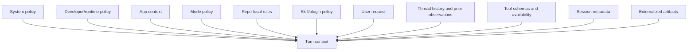
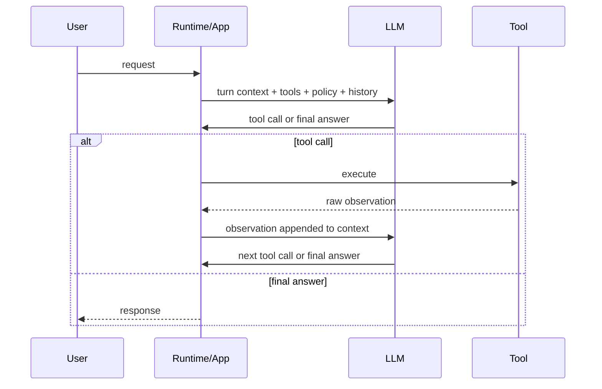
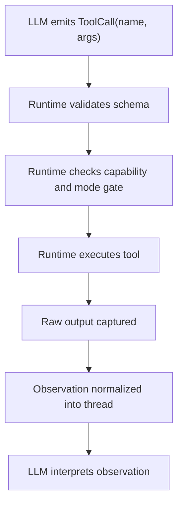

# Codex Turn Context And Runtime Interface

Overview router: [may-20-codex-agent-loop.md](/Users/songmin/Documents/code-new/semantica-codegraph-v2/docs/analysis/codex-agent/may-20-codex-agent-loop.md)

이 문서는 Codex agent loop에서 `turn context 조립`과 `runtime-LLM handshake`만 따로 뽑아 정리한다.

목표:
- 무엇이 언제 주입되는지 고정한다
- prompt text, capability metadata, history, on-demand evidence를 분리한다
- `TurnContext -> AgentAction -> ToolObservation` 인터페이스를 best-fit model로 정리한다
- tool-call lifecycle과 observation normalization을 독립 축으로 닫는다

관련 문서:
- [may-20-codex-agent-loop.md](/Users/songmin/Documents/code-new/semantica-codegraph-v2/docs/analysis/codex-agent/may-20-codex-agent-loop.md)
- [prompt-and-policy-stack.md](/Users/songmin/Documents/code-new/semantica-codegraph-v2/docs/analysis/codex-agent/prompt-and-policy-stack.md)
- [tool-routing-and-triggering.md](/Users/songmin/Documents/code-new/semantica-codegraph-v2/docs/analysis/codex-agent/tool-routing-and-triggering.md)
- [mode-and-plan-process-audit.md](/Users/songmin/Documents/code-new/semantica-codegraph-v2/docs/analysis/codex-agent/mode-and-plan-process-audit.md)
- [session-management-audit.md](/Users/songmin/Documents/code-new/semantica-codegraph-v2/docs/analysis/codex-agent/thread-management/session-management-audit.md)

주의:
- 이 문서는 hidden implementation dump가 아니다.
- `TurnContext`, `AgentAction`, `ToolObservation`은 best-fit operational scaffold다.

## 1. Boundary summary

| Surface | Mostly runtime/app-owned | Mostly LLM-owned | Shared interface |
| --- | --- | --- | --- |
| turn bootstrap | instruction stack attach, tool schema exposure, mode/sandbox metadata attach | none | turn context bundle |
| capability gating | which tools exist, which mode/tool is unavailable, approval/sandbox limits | choose among allowed tools only | tool availability set |
| tool execution | actual process/browser/web/tool run, result capture, session ids | decide whether and when to call | tool call schema and observation schema |
| observation storage | thread append, session handle retention, artifact retention | interpret success/failure/noise and route next step | appended observation message |

핵심:

- runtime은 `무엇을 실을지`와 `어떻게 실행할지`를 담당한다.
- LLM은 `무엇이 필요한지`와 `이 관찰이 무엇을 의미하는지`를 담당한다.

## 2. Injection stack



## 3. What gets injected

| Signal family | Injected by | When | Primary role | Class |
| --- | --- | --- | --- | --- |
| `system policy` | runtime | every turn | safety, browsing, high-stakes rules | `[FACT]` |
| `developer/runtime policy` | runtime | every turn | tool budget, workflow posture, validation posture | `[FACT]` |
| `app context` | runtime/app | every turn | browser/doc/image/git/automation surfaces | `[FACT]` |
| `mode policy` | runtime | every turn | `Default` vs `Plan`, interaction shape | `[FACT]` |
| `repo-local AGENTS` | runtime/repo loader | every turn | canonical tooling, language, prohibitions | `[FACT]` |
| `skill/plugin policy` | runtime | when active | task-specific playbook | `[FACT]` |
| `tool schemas` | runtime | every turn | callable affordance set | `[FACT]` |
| `session metadata` | runtime | every turn | `cwd`, shell, date, timezone, sandbox, approval | `[FACT]` |
| `thread history` | runtime | every turn | conversational continuity | `[FACT]` |
| `prior tool observations` | runtime | after each tool call | observation memory | `[FACT]` |
| `workspace artifacts` | filesystem | when read | durable external evidence | `[FACT]` once read |
| `user request` | user | current turn | objective, scope, stop condition | `[FACT]` |
| `LSP semantic signals` | tool/runtime if exposed | conditional | owner/type/blast-radius acceleration | `[FACT]` if surface exists |
| `non-LSP local signals` | shell/files/logs | conditional | source truth, runtime truth, diff truth | `[FACT]` once read |
| `memory hints` | memory loader | conditional | routing hints, stale-context hints | `[FACT]` as input, weak as proof |

## 4. Practical read order

Codex가 먼저 강하게 보는 축은 대체로 이 순서다. `[MODEL]`

1. policy and constraint stack
2. user intent
3. current tool and capability surface
4. current working state from thread and prior observations
5. source, log, artifact truth needed for this task

즉:

- `신호 주입`은 기계적이다 `[FACT]`
- `신호 해석과 weighting`은 LLM 의존적이다 `[MODEL]`

## 5. Prompt layers versus raw state

모든 injected signal이 같은 형태로 prompt text가 되는 것은 아니다. `[MODEL]`

| Input kind | Best-fit insertion style |
| --- | --- |
| policy layers | instruction or policy layer |
| tool schemas and availability | capability metadata layer |
| thread history | prior messages layer |
| tool observations | observation messages layer |
| filesystem artifacts | on-demand evidence layer |
| working state | compressed state layer |
| memory hints | optional routing hint layer |

개념적으로는 아래 packet이 가장 설명력이 높다.

```text
EffectivePromptPacket {
  policy_layers,
  capability_metadata,
  current_task_lens,
  working_state,
  recent_observations,
  user_request
}
```

## 6. Runtime-LLM interface

### 6.1 Request-side interface

runtime이 LLM에 넘기는 최소 인터페이스는 개념적으로 아래와 같다. `[MODEL]`

```text
TurnContext {
  instruction_stack,
  user_messages,
  prior_assistant_messages,
  prior_tool_observations,
  tool_schemas,
  app_capabilities,
  mode,
  session_metadata,
  repo_rules,
  optional_memory_snippets
}
```

### 6.2 Action-side interface

LLM은 매 step에서 대략 둘 중 하나를 만든다. `[MODEL]`

```text
AgentAction =
  FinalAnswer(text)
  ToolCall(name, arguments)
```

### 6.3 Observation-side interface

runtime은 tool 결과를 다시 문맥에 붙인다. `[MODEL]`

```text
ToolObservation {
  tool_name,
  arguments,
  raw_result,
  status,
  optional_session_id,
  optional_artifacts,
  optional_error
}
```

핵심:

- runtime이 observation을 `실행 가능한 데이터`로 만든다
- LLM은 그 observation을 `다음 판단에 쓸 증거`로 바꾼다

## 7. Tick-tock model



## 8. Tool-call lifecycle



| Phase | Mostly runtime-owned | Mostly LLM-owned |
| --- | --- | --- |
| emit | none | choose tool and arguments |
| validate | schema check, required fields check | none |
| gate | unavailable tool rejection, mode restriction, approval and sandbox restriction | reroute after rejection |
| execute | process, browser, web, or plugin run | none |
| capture | stdout, stderr, result, session id, artifacts | none |
| normalize | observation appended to thread context | none |
| interpret | none | success, failure, noise, next-step meaning extraction |

## 9. Error path and normalization

tool error는 단순 실패가 아니라 다음 routing 입력이다. `[MODEL]`

```python
def handle_tool_observation(action, observation, ctx):
    if observation.status == "schema_error":
        return reroute_with_fixed_arguments(action, ctx)

    if observation.status == "tool_unavailable":
        return switch_to_alternate_surface(action, ctx)

    if observation.status == "execution_error":
        return decide_retry_vs_fallback(action, observation, ctx)

    if observation.status == "success":
        return interpret_observation(observation, ctx)
```

정규화는 대체로 이런 wrapper를 가진다고 보는 게 맞다. `[MODEL]`

```python
def normalize_observation(raw_tool_result, tool_name):
    return {
        "tool_name": tool_name,
        "status": extract_status(raw_tool_result),
        "summary": summarize_raw_shape(raw_tool_result),
        "payload": raw_tool_result,
        "artifacts": extract_artifacts(raw_tool_result),
        "handles": extract_handles(raw_tool_result),
    }
```

## 10. Observation payload families

| Tool family | Typical raw payload | What LLM extracts |
| --- | --- | --- |
| shell or exec | `stdout`, `stderr`, `exit_code`, optional `session_id` | file facts, error text, failing command |
| patch or edit | success or failure, touched file list, patch mismatch error | whether edit landed, whether strategy must switch |
| web search | result list, titles, URLs, snippets | candidate sources, next page to open |
| web open | page text, links, passages | cited facts, exact dates and names |
| browser | page state, screenshot, interaction result | visible behavior and next interaction |
| semantic surface | locations, ranges, type or signature text, diagnostics | owner, type, blast radius |
| subagent | child status, child final message, changed files | side-task result and integration path |

## 11. Current-session capability map

현재 세션에서 practical routing을 설명하는 surface는 아래 정도다. `[FACT]`

| Need | Preferred surface | Typical output used |
| --- | --- | --- |
| targeted local read | `functions.exec_command` | file text, grep hits, line ranges |
| parallel independent reads | `multi_tool_use.parallel` | parallel file excerpts |
| bounded local edit | `functions.apply_patch` | patch success or failure |
| repetitive scripted edit | `functions.exec_command` | command result, exit status |
| long-running process | `functions.exec_command` + `functions.write_stdin` | session id, incremental stdout and stderr |
| latest public fact | `web.run` | search hits, opened page text, links |
| JS runtime execution | `mcp__node_repl__.js` | exact text output, runtime result |
| localhost visual state | Browser plugin path | visible page state, action result, screenshots |
| explicit parallel sidecar | `spawn_agent` + `wait_agent` family | child status, final result, changed files |

## 12. Rule of thumb

- policy, capability, history, metadata는 runtime이 붙인다
- tool call과 final answer 선택은 LLM이 한다
- observation transport는 runtime이 하고, 의미 해석은 LLM이 한다
- 이 handshake를 owner 문서로 따로 분리해야 loop 설명이 monolith로 다시 붕괴하지 않는다
