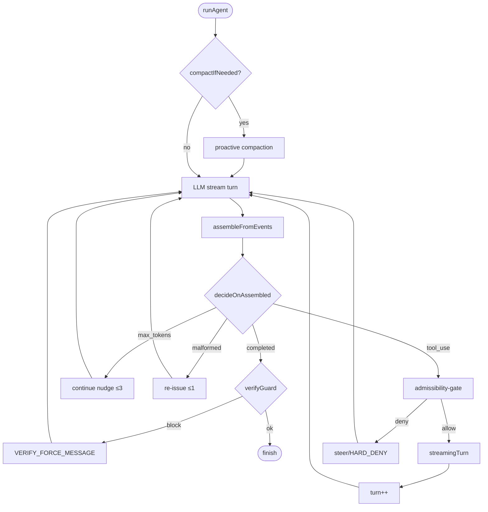

# Agent Loop — 운영 reference

운영 reference. ADR/RFC 아님 — 실측 동작과 코드 경로를 한 문서에 묶어 디버깅·온보딩·세션간 컨텍스트 보존용으로 쓴다. 어휘는 Codex App agent-loop 문서에서 빌렸지만, 명세는 전부 v3 실제 구현(`src/agent/loop.ts`, `src/agent/dispatch.ts`, `src/tool/*`, `src/permission/policy.ts`)을 따른다. 충돌 시 코드가 truth.

## 0. Loop at a glance

가장 빠른 멘탈 모델. 세부는 §1 이후. 화살표는 turn 단위 제어 흐름이며, 모든 화살표의 코드 anchor는 §3 lifecycle 표에서 확인할 수 있다.

Anchors: `runAgent` ⇒ `src/agent/loop.ts`. `decideOnAssembled` ⇒ `loop.ts:530`. admissibility-gate SSOT ⇒ ADR-0026 (`docs/decisions/0026-admissibility-gate-ssot.md`). verify-before-finish ⇒ ADR-0013.

## 1. v3 loop boundary map

runtime은 **기계적 invariant**(스키마/permission/capture/스트림 dispatch)만 책임지고, 판단(어떤 tool을 어떤 순서로, 결과를 어떻게 해석)은 전부 LLM이 진다. 분리는 RFC §1.2 anti-bloat의 직접 귀결.

| 영역 | 소유 | 코드 anchor |
|---|---|---|
| loop 제어 (turn 카운트·recovery·guard 발화·streaming) | runtime | `loop.ts:103-110`, `loop.ts:530`, `loop.ts:618-746` |
| tool 검증·gate·실행·capture | runtime | `registry.ts:41`, `policy.ts:104` `policy.ts:130`, `dispatch.ts:166-177` |
| working memory `wm` 관리 / trajectory | runtime | `state.ts`, `stream/adapters/jsonl-recorder.ts` (RFC-0002) |
| 어떤 read/grep/edit/test를 어떤 순서로, 결과 해석, 종료 시점 | **LLM** | (판단 영역 — 코드 없음) |

## 2. Signal trust ladder

most-trusted → least:

1. **source text** — `read` / `edit` 응답, `grep`·`glob` 매치 본문
2. **runtime/build/test output** — `bash` / `test_runner`의 exitCode + stderr tail (capture: `dispatch.ts:42-44` evidenceOf, durationMs는 `:166-177`에서 부착)
3. **LSP semantic** — `diagnostics` tool (`QUANTA_LSP=1` gate, default OFF)
4. **git diff** — bench `withGitSnapshot` 누적 diff (`runner.ts:174 sourceOnlyDiff`)
5. **memory recall** — `@/memory` 슬라이스 회상 (loop 내부에서 `recallContext`로 주입, 별도 사용자-호출형 tool은 미노출); **재검증 전엔 한 단계 강등**
6. **docs / hints** — least trusted

**원칙**: source > inference. test output은 *necessary-but-not-sufficient* — 이번 세션 초반 `testCmd:"true"` no-op로 "100%"가 찍힌 사고가 그 이유다(grading-wiring 수정으로 해소). 통과 신호가 곧 진실은 아니다, 통과시킨 rail이 무엇인지까지 확인해야 한다.

## 3. Tool-call lifecycle phases

| phase | 책임 | 위치 |
|---|---|---|
| emit | LLM이 ToolCall block 방출, loop은 streaming-dispatch로 picking, safe-read는 concurrency batching | `loop.ts`, `streaming-dispatch.ts` |
| validate | zod `safeParse` (registry) — 실패 시 malformed tool_result | `registry.ts:41`, `registry.ts:60` |
| gate | permission policy — `HARD_DENY` 먼저, 그다음 read-only allow, 그다음 classifier (auto) | `policy.ts:10`, `policy.ts:86`, `policy.ts:104`, `policy.ts:130` |
| execute | 각 tool impl | `src/tool/{bash,edit,write,grep,glob,read,test-runner,diagnostics}/index.ts` |
| capture | durationMs · stderrTail(cap) · exitCode · fullLogPath | `dispatch.ts:38-44`, `dispatch.ts:166-177` |
| normalize | `tool_result` AgentEvent 방출, evidence fields 옵션 | `src/stream/types.ts` |
| interpret | wm에 append → `decideOnAssembled` 다음 step | `loop.ts:530` |

## 4. Observation payload families

| tool 군 | raw payload (대략) | LLM이 보통 추출 |
|---|---|---|
| bash / test_runner | `{stdout, stderr, exitCode, durationMs, fullLogPath}` | exit code, 실패 한두 줄, 경로 |
| edit / write | `{path, applied, hunks?}` 또는 mismatch 에러 | 적용 여부, 충돌 위치 |
| grep / glob / read | 매치 라인 / 파일목록 / 파일본문 | 후보 위치, 다음 read 타겟 |
| localize | symbol·file·line 후보 목록 | LSP 없이도 빠른 owner 좁히기 |
| diagnostics (LSP) | `[{file, range, severity, message}]` | 타입/심볼 오류 (QUANTA_LSP=1일 때만) |
| `agent` (subagent), `Skill`, `ToolSearch` | `QUANTA_SUBAGENT` / `QUANTA_SKILLS_DIR` env-gated. 자식 최종 텍스트 + 사용 tool log / 활성 skill 본문 / deferred tool 카탈로그 | 요약된 위임 결론 / 적용할 skill / 호출 가능한 tool 한정 |

## 5. Recovery & guards

`RecoveryReason` 전부:

| reason | trigger | 결정 위치 |
|---|---|---|
| `backoff` | stream/LLM 오류, bounded backoff 재시도 | `decideOnStreamError` (`loop.ts`, `retry.ts:backoffDelayMs`) |
| `compact` | turn-top proactive 또는 PTL reactive | `compaction.ts compactIfNeeded`, `reactiveCompact` + `CompactionBreaker` |
| `nudge` | same-turn 1회 재시도 (max_output_tokens 등) | `decideOnAssembled` (`loop.ts:530`) |
| `empty` | assembled가 비었을 때 1회 recovery | `decideOnAssembled` |
| `malformed` | tool_use 형식 오류 1회 교정 | `decideOnAssembled` |
| `unverified` | verify-guard 발화 (bench-gated, default OFF) | `verify-guard.ts decideVerifyGuard` |
| `closeout` | closeout-guard 발화 (`cfg.closeoutGuard.enabled` opt-in, run당 single-shot) | `closeout-guard.ts decideCloseoutGuard`, `loop.ts:675-746` |

**verify-guard vs closeout-guard는 독립.** 둘 다 활성이면 verify가 먼저 trip하고, 같은 turn에 closeout은 도달하지 않는다 (`loop.ts:743-746`). verify-guard는 Easy-5 gpt-4o single-pass에서 **0트립** — SWEBENCH_DIRECTIVE 하에 모델이 이미 self-verify 패턴을 보여 경험적으로 inert.

## 6. Budget gates

| axis | 의미 | default |
|---|---|---|
| `maxTurns` | per-run turn ceiling | config |
| `verifyGuard.maxTrips` | finish-time verify 강제 cap (ADR-0013 변경 이력 2→1) — bench는 `{}` 명시로 default 상속 (`runner.ts:310`) | 1 |
| `closeoutGuard` | per-run single-shot, maxTrips knob 의도적 없음 | OFF (opt-in) |
| `repair.maxRounds` | bench-only external repair budget (`QUANTA_REPAIR_ROUNDS`) | 0 (opt-in) |
| `compaction.*` | context-window 안전 | config |

v3는 Codex 문서식 per-axis budget (validation/read/edit 별도 예산)을 **두지 않는다** — anti-bloat. 이런 자원은 LLM이 `maxTurns` 안에서 자체 판단으로 배분한다.

## 7. Known failure modes (실측)

| failure mode | 무엇이 깨지나 | v3 실측 / 경험 | mitigation |
|---|---|---|---|
| stale docs/memory as truth | 과거 사실로 현재 판단 | 사례 없음 (이번 세션) | trust-ladder 강등은 doc-level 권고, 코드 강제 X |
| fake 100% via no-op testCmd | 통과 신호가 가짜 | 세션 초 `testCmd:"true"`로 100% 찍힘 — grading-wiring fix로 해소 | 통과 rail 검증, source-only diff 필수 |
| grep-only closure | grep 매치만으로 종결 | RFC §1.2 anti-bloat 영역 | source/runtime corroboration 요구 (trust-ladder) |
| 잘못된 rail green / patch fixation | patch 자체엔 PASS, 의도와 무관 | 초기 trial에서 test-file까지 patch에 포함하는 비대 diff가 PASS_TO_PASS를 깨는 사례 (구체 size/repo는 본 세션 artifact 미보존 — 일반 패턴은 `runner.ts:140-170` 주석에 명시) | `sourceOnlyDiff` filter (`runner.ts:174`) |
| LSP over-trust | semantic 오신호 | 현재 미관측 | default OFF (`QUANTA_LSP`) |
| context drift on long thread | 후반 turn에서 사실 흐림 | proactive+reactive compaction이 흡수 | `compaction.ts` + `CompactionBreaker` |
| forced-verify over-correction | guard가 멀쩡한 답을 망친다 | repair-rounds n=1 r=2 Easy-5: **2/5 (40%)** vs 베이스라인 3/5, `django__django-10914` **PASS→FAIL** 회귀 | default OFF / opt-in (ADR-0014 한계 (d)) |
| bad subagent split | 위임 단위 잘못 | 별도 측정 없음 | critical path는 local 유지 |

참고 capability 라인: Easy-5 single-pass gpt-4o **3/5 (60%)**, Easy-10 **5/10 (50%)**, Best-of-N n=3 Easy-5 **3/5 (60%)** — n=3에서 움직이지 않음 → variance가 아니라 capability gap. n=1 측정은 ±20% noise.

## 8. Explicit non-goals (v3 미채택)

| Codex 패턴 | 미채택 이유 |
|---|---|
| §5.7 weighted scoring formula for tool path | runtime이 tool 선택 결정자가 됨 = workflow-engine 회귀 — RFC §1.2 |
| §5.8 dynamic task-kind reclassification | task-kind state machine = runtime이 행동 분기 결정자가 됨, RFC Non-Goals(`FSM/워크플로우 엔진 금지`) |
| task-lens-per-classification (RepairLens/ReviewLens/AuditLens/ResearchLens 등을 classifier가 wire) | 위와 같은 이유 (분류기 + per-kind 분기 = workflow) — RFC §1.2 |
| per-axis budget (read/edit/validation 별도) | anti-bloat — RFC §1.2 (`<20k LoC` 폐기 이후에도 surface 확장 자체는 ADR 트리거); v3는 `maxTurns` 안에서 LLM이 자체 배분 |
| `request_user_input` interactive primitive | table-extending feature creep — RFC Non-Goals(전체 액션 사전 정의 강박 금지) |

## 9. Footer

**이 문서는 ADR 아님, RFC 아님 — 운영 reference다.** enforcement는 코드(`src/`)와 RFC, ADR(0011·0013·0014 등)에 산다. 실측 숫자(3/5, 5/10, 2/5, 0트립)는 capture 시점 — gpt-4o + v3 minimal agent의 single-pass Easy-django는 50~60% noisy이며 일반 대표성 없다. **동작이 이 문서와 갈리면 코드를 믿고 문서를 고친다.**
